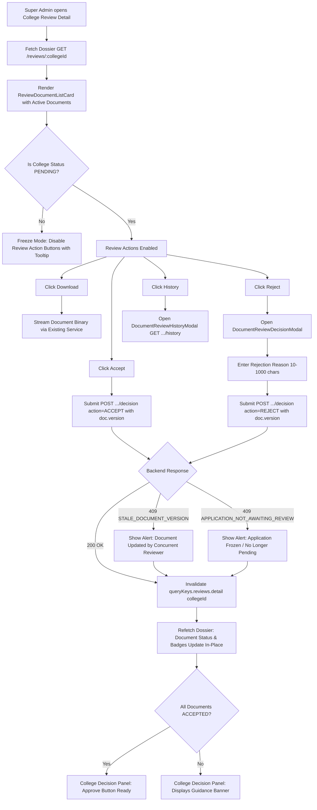
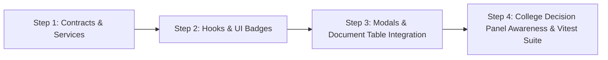

# Acadlytic — Phase 03: Super Admin Frontend Document Review Workflow
## Scope Discovery & Implementation Planning Report v1.0

**Document Reference:** `docs/03-phase/Module-03-Frontend-Document-Review-Planning-Report-v1.0.md`  
**Author:** DeepMind Antigravity Coding Agent  
**Date:** 2026-11-26  
**Status:** `PLANNING_COMPLETE` — Awaiting Project Owner Review & Implementation Authorization  
**Target Milestone:** Phase 03 — Super Admin Frontend Document Review Workflow (Unassigned)  

---

## Executive Summary

This report establishes the technical architecture, component boundaries, data contracts, and implementation plan for the **Super Admin Frontend Document Review Workflow** within **Phase 03**.

Between 2026-11-25 and 2026-11-26, the backend infrastructure for document-level reviews was designed, implemented, and approved across three modules:
1. **Module 3.6A (APPROVED):** Database Schema & Flyway V6 Migration (`college_registration_documents` schema extension, `college_document_reviews` append-only audit trail, Flyway Java preflight callback).
2. **Module 3.6B (APPROVED):** Backend Document Review Service & APIs (`POST .../decision`, `GET .../history`, hierarchical pessimistic row locking, idempotency with version validation, cross-revision isolation).
3. **Module 3.6C (APPROVED):** Backend College Approval Integration & Lifecycle (document verification gates requiring active submitted documents to be `ACCEPTED` before college `APPROVE` can succeed, blocking on `PENDING` or `REJECTED` documents).

Currently, the Super Admin frontend (`frontend/src/pages/admin/CollegeReviewDetailPage.tsx` and `frontend/src/components/review/ReviewDocumentListCard.tsx`) provides basic document inspection (category, filename, size, checksum) and binary download streaming. However, it lacks:
- Display of document **verification status** (`PENDING`, `ACCEPTED`, `REJECTED`).
- Display of document **provenance** (`NOT_REVIEWED`, `DIRECT_REVIEW`, `CARRIED_FORWARD`, `LEGACY_COLLEGE_APPROVAL`).
- Super Admin action controls to **ACCEPT** or **REJECT** individual documents.
- Modal workflow for recording required **rejection reasons** (10–1000 characters).
- Audit trail viewer for inspecting **document review history** (`GET .../history`).
- Document-level **optimistic concurrency locking** using `expectedDocumentVersion`.
- Automatic detection of **lifecycle freeze** (disabling document mutations once the college application transitions out of `PENDING`).
- Proactive UI feedback aligning with backend college approval gates (`DOCUMENTS_NOT_VERIFIED`, `DOCUMENTS_REJECTED`).

This document details an evidence-based, non-breaking implementation plan to deliver the complete Super Admin document review UI while preserving all existing college-level review capabilities and adhering to strict architecture boundaries.

---

## 1. Current Frontend Architecture & Codebase Inspection

### 1.1 Frontend Technology Stack
- **Framework & Runtime:** React 18.3+, TypeScript 5.5+, Vite 5.4.
- **Styling & UI:** Tailwind CSS 3.4, Lucide React icons.
- **State Management & Data Fetching:** TanStack Query 5 (React Query), Axios HTTP client with credentials and CSRF interceptors, Zustand 5 stores.
- **Forms & Validation:** React Hook Form 7.52+, Zod 3.23+ schemas.
- **Testing:** Vitest 2.0+, React Testing Library, jsdom.

### 1.2 Existing Files & Component Inventory

| File Path | Role in Current Architecture | Modification Needed |
| :--- | :--- | :--- |
| `frontend/src/types/index.ts` | Global TypeScript DTOs, enums, presentation models. | **Update:** Enrich `DocumentResponse` with verification fields; add `DocumentVerificationStatus`, `DocumentVerificationProvenance`, `DocumentReviewAction`, and review request/response DTOs. |
| `frontend/src/services/reviewService.ts` | Super Admin review API client communicating with backend `CollegeReviewController`. | **Update:** Add `recordDocumentDecision()` and `getDocumentReviewHistory()`. Enrich `normalizeReviewDetail()`. |
| `frontend/src/services/queryKeys.ts` | Centralized TanStack Query key factory. | **Update:** Add document review history query key `reviews.documentHistory(collegeId, documentId)`. |
| `frontend/src/schemas/reviewSchema.ts` | Zod validation schemas for review actions and filters. | **Update:** Add `documentReviewDecisionSchema` (10–1000 chars rejection reason for REJECT, null for ACCEPT). |
| `frontend/src/hooks/useCollegeReview.ts` | React Query custom hooks for review queue and detail. | **Update:** Add `useRecordDocumentDecision()` mutation and `useDocumentReviewHistory()` query hooks. |
| `frontend/src/components/review/ReviewDocumentListCard.tsx` | Active verification documents table in the college review detail page. | **Major Update:** Add verification status badges, provenance badges, Accept/Reject action buttons, History viewer trigger, replacement indicators, and error/freeze handling. |
| `frontend/src/components/review/DocumentReviewDecisionModal.tsx` | *New Component:* Modal dialog for Super Admin to input rejection reason / notes and submit document decisions. | **Create:** Accessible modal form with character counting, validation feedback, and document version binding. |
| `frontend/src/components/review/DocumentReviewHistoryModal.tsx` | *New Component:* Modal dialog displaying chronological audit history for an individual document. | **Create:** Timeline viewer rendering historical decisions, timestamps, reviewer emails, and rejection notes. |
| `frontend/src/components/review/DocumentStatusBadge.tsx` | *New Component:* Standardized status and provenance badge component. | **Create:** Visual indicators for `PENDING`, `ACCEPTED`, `REJECTED`, and provenance origins. |
| `frontend/src/components/review/ReviewDecisionPanel.tsx` | College-level decision panel (APPROVE, REQUEST_ACTION, REJECT). | **Minor Update:** Proactive status banner indicating document verification readiness (e.g., "All active documents must be accepted before approving"). |
| `frontend/src/components/review/ReviewDecisionModal.tsx` | College-level decision modal. | **Minor Update:** Targeted error mapping for `409 DOCUMENTS_NOT_VERIFIED` and `409 DOCUMENTS_REJECTED`. |
| `frontend/src/components/review/index.ts` | Component barrel export file. | **Update:** Re-export new document review components. |
| `frontend/src/pages/admin/CollegeReviewDetailPage.tsx` | Main Super Admin application dossier review page. | **No Breaking Change:** Passes college status, document version callbacks, and refresh handlers to child cards. |
| `frontend/src/test/super-admin-review.test.tsx` | Vitest suite for Super Admin review workflow. | **Update:** Add comprehensive tests for document review decisions, validation, concurrency, history, and freeze. |

---

## 2. Existing Functionality That Can Be Reused

1. **Secure Document Download Mechanism:**
   - `reviewService.downloadReviewDocument(collegeId, documentId, originalFilename)`: Streams binary content from `GET /api/v1/super-admin/colleges/reviews/{collegeId}/documents/{documentId}` with delayed object URL revocation (60 seconds) to prevent premature garbage collection. Fully tested and operational in [ReviewDocumentListCard.tsx](file:///c:/React/Acadlytic/frontend/src/components/review/ReviewDocumentListCard.tsx#L47-L69).
2. **Category Label Mapping & Byte Formatter:**
   - `REVIEW_DOCUMENT_CATEGORY_LABELS` and `formatBytes()` in `ReviewDocumentListCard.tsx` can be directly leveraged without alteration.
3. **Modal & Form Infrastructure:**
   - Primitive UI components [Modal.tsx](file:///c:/React/Acadlytic/frontend/src/components/ui/Modal.tsx), [Button.tsx](file:///c:/React/Acadlytic/frontend/src/components/ui/Button.tsx), [Textarea.tsx](file:///c:/React/Acadlytic/frontend/src/components/ui/Textarea.tsx), and [Alert.tsx](file:///c:/React/Acadlytic/frontend/src/components/ui/Alert.tsx) provide accessibility (`aria-modal`, keyboard focus trap, esc-to-close) and standard styling.
4. **API Client & Error Classification:**
   - `isApiError()` and `ApiError` in [api.ts](file:///c:/React/Acadlytic/frontend/src/services/api.ts#L37-L52) provide strongly-typed error parsing for HTTP status codes and backend `errorCode` strings (`STALE_DOCUMENT_VERSION`, `APPLICATION_NOT_AWAITING_REVIEW`, `DOCUMENTS_NOT_VERIFIED`, `DOCUMENTS_REJECTED`).
5. **TanStack Query Invalidation Patterns:**
   - Invalidation of `queryKeys.reviews.detail(collegeId)` automatically refetches the authoritative `CollegeReviewDetailResponse`, which synchronizes `activeDocuments` in-place.

---

## 3. Verified Backend API Contracts

The backend implementation across Modules 3.6B and 3.6C defines authoritative contracts that the frontend must strictly adhere to.

### 3.1 Document Decision API
- **Endpoint:** `POST /api/v1/super-admin/colleges/reviews/{collegeId}/documents/{documentId}/decision`
- **Controller Method:** `CollegeReviewController.recordDocumentDecision` ([CollegeReviewController.java:138-146](file:///c:/React/Acadlytic/backend/src/main/java/com/acadlytic/modules/colleges/controller/CollegeReviewController.java#L138-L146))
- **Service Implementation:** `CollegeReviewService.recordDocumentDecision` ([CollegeReviewService.java:735-955](file:///c:/React/Acadlytic/backend/src/main/java/com/acadlytic/modules/colleges/service/CollegeReviewService.java#L735-L955))
- **Authorization:** `hasRole('SUPER_ADMIN')`
- **Request Payload (`DocumentReviewDecisionRequest`):**
  ```json
  {
    "action": "ACCEPT | REJECT",
    "notes": "Optional reviewer notes (max 1000 chars)",
    "rejectionReason": "Mandatory for REJECT (10-1000 chars); must be null for ACCEPT",
    "expectedDocumentVersion": 2
  }
  ```
  *(Supported by [DocumentReviewDecisionRequest.java:10-23](file:///c:/React/Acadlytic/backend/src/main/java/com/acadlytic/modules/colleges/dto/DocumentReviewDecisionRequest.java#L10-L23))*
- **Response Payload (`DocumentReviewDecisionResponse`):**
  ```json
  {
    "success": true,
    "message": "Document review decision recorded successfully.",
    "data": {
      "documentId": 201,
      "registrationId": 101,
      "documentCategory": "UNIVERSITY_AFFILIATION_CERTIFICATE",
      "verificationStatus": "ACCEPTED",
      "verificationProvenance": "DIRECT_REVIEW",
      "rejectionReason": null,
      "lastReviewedAt": "2026-11-26T12:00:00Z",
      "lastReviewedByUserId": 1,
      "reviewerEmail": "superadmin@acadlytic.com",
      "version": 3
    },
    "timestamp": "2026-11-26T12:00:00Z"
  }
  ```
  *(Supported by [DocumentReviewDecisionResponse.java:12-23](file:///c:/React/Acadlytic/backend/src/main/java/com/acadlytic/modules/colleges/dto/DocumentReviewDecisionResponse.java#L12-L23))*

- **Error Responses:**
  - `400 BAD_REQUEST / VALIDATION_ERROR`: Missing action, rejection reason `< 10` or `> 1000` on `REJECT`, notes `> 1000`, non-null rejection reason on `ACCEPT`, or negative `expectedDocumentVersion`.
  - `404 NOT_FOUND / COLLEGE_NOT_FOUND`: Target college does not exist.
  - `404 NOT_FOUND / DOCUMENT_NOT_FOUND`: Document does not exist or does not belong to the target college.
  - `409 CONFLICT / APPLICATION_NOT_AWAITING_REVIEW`: Target college is not currently `PENDING` review, or document does not belong to the current submitted revision.
  - `409 CONFLICT / STALE_DOCUMENT_VERSION`: `expectedDocumentVersion` does not match `CollegeRegistrationDocument.version`.
  - `409 CONFLICT / LOCK_ACQUISITION_TIMEOUT`: Transient pessimistic lock failure exhausted after 3 retry attempts.

### 3.2 Document Review History API
- **Endpoint:** `GET /api/v1/super-admin/colleges/reviews/{collegeId}/documents/{documentId}/history`
- **Controller Method:** `CollegeReviewController.getDocumentReviewHistory` ([CollegeReviewController.java:156-163](file:///c:/React/Acadlytic/backend/src/main/java/com/acadlytic/modules/colleges/controller/CollegeReviewController.java#L156-L163))
- **Service Implementation:** `CollegeReviewService.getDocumentReviewHistory` ([CollegeReviewService.java:960-1006](file:///c:/React/Acadlytic/backend/src/main/java/com/acadlytic/modules/colleges/service/CollegeReviewService.java#L960-L1006))
- **Authorization:** `hasRole('SUPER_ADMIN')`
- **Response Payload (`List<DocumentReviewHistoryItemResponse>`):**
  ```json
  {
    "success": true,
    "message": "Document review history retrieved successfully.",
    "data": [
      {
        "id": 501,
        "reviewId": 501,
        "documentId": 201,
        "registrationId": 101,
        "collegeId": 10,
        "action": "ACCEPTED",
        "rejectionReason": null,
        "reviewerUserId": 1,
        "reviewerEmail": "superadmin@acadlytic.com",
        "reviewedAt": "2026-11-26T12:00:00Z",
        "createdAt": "2026-11-26T12:00:00Z"
      }
    ],
    "timestamp": "2026-11-26T12:00:00Z"
  }
  ```
  *(Supported by [DocumentReviewHistoryItemResponse.java:8-35](file:///c:/React/Acadlytic/backend/src/main/java/com/acadlytic/modules/colleges/dto/DocumentReviewHistoryItemResponse.java#L8-L35))*

### 3.3 Authoritative Review Detail Response Enriched Contract
- **Endpoint:** `GET /api/v1/super-admin/colleges/reviews/{collegeId}`
- **Service Mapping:** `CollegeReviewService.toDocumentResponse` ([CollegeReviewService.java:706-725](file:///c:/React/Acadlytic/backend/src/main/java/com/acadlytic/modules/colleges/service/CollegeReviewService.java#L706-L725))
- The backend already delivers enriched document fields within `activeDocuments`:
  - `verificationStatus`: `DocumentVerificationStatus` (`PENDING`, `ACCEPTED`, `REJECTED`)
  - `verificationProvenance`: `DocumentVerificationProvenance` (`NOT_REVIEWED`, `DIRECT_REVIEW`, `CARRIED_FORWARD`, `LEGACY_COLLEGE_APPROVAL`)
  - `rejectionReason`: `string | null`
  - `lastReviewedAt`: `Instant | null` (ISO string)
  - `lastReviewedByUserId`: `Long | null`
  - `version`: `Long` (optimistic locking counter)
  - `replacesDocumentId`: `Long | null` (replaces an earlier document from a previous revision)

### 3.4 College-Level Approval Integration Gates (Module 3.6C)
- When submitting `APPROVE` on `POST /api/v1/super-admin/colleges/reviews/{collegeId}/decision`:
  - If mandatory categories (`UNIVERSITY_AFFILIATION_CERTIFICATE`, `AUTHORIZED_SIGNATORY_ID`) are absent: throws `400 REQUIRED_DOCUMENTS_MISSING` ([CollegeReviewService.java:536-540](file:///c:/React/Acadlytic/backend/src/main/java/com/acadlytic/modules/colleges/service/CollegeReviewService.java#L536-L540)).
  - If any active document has status `REJECTED`: throws `409 DOCUMENTS_REJECTED` ([CollegeReviewService.java:549-557](file:///c:/React/Acadlytic/backend/src/main/java/com/acadlytic/modules/colleges/service/CollegeReviewService.java#L549-L557)).
  - If any active document is not `ACCEPTED` (e.g. `PENDING`): throws `409 DOCUMENTS_NOT_VERIFIED` ([CollegeReviewService.java:566-574](file:///c:/React/Acadlytic/backend/src/main/java/com/acadlytic/modules/colleges/service/CollegeReviewService.java#L566-L574)).

---

## 4. Proposed User Workflow & State Management



### 4.1 Detailed User Interaction Steps

1. **Inspection of Active Documents:**
   - The Super Admin navigates to `/admin/colleges/reviews/:collegeId`.
   - `ReviewDocumentListCard` renders the active documents returned in `data.activeDocuments`.
   - Each row displays:
     - **Category:** Human-readable label via `REVIEW_DOCUMENT_CATEGORY_LABELS`.
     - **Filename & Metadata:** File icon, filename, formatted size, SHA-256 checksum chip.
     - **Verification Status Badge:**
       - `PENDING`: Amber badge with clock icon (`Pending Verification`).
       - `ACCEPTED`: Emerald badge with check-circle icon (`Accepted`).
       - `REJECTED`: Rose/Red badge with x-circle icon (`Rejected`).
     - **Provenance Indicator:**
       - `NOT_REVIEWED`: Neutral badge (`Unreviewed`).
       - `DIRECT_REVIEW`: Blue badge (`Direct Review`).
       - `CARRIED_FORWARD`: Indigo badge (`Carried Forward` from prior revision).
       - `LEGACY_COLLEGE_APPROVAL`: Slate badge (`Legacy Approved`).
     - **Replacement Context:** If `replacesDocumentId` is present, render a subtle indicator: `Replacement Document (Replaces ID #${doc.replacesDocumentId})`.
     - **Rejection Reason Callout:** If status is `REJECTED`, render an inline collapsible warning callout showing the exact rejection reason entered by the reviewer.
     - **Row Action Controls:**
       - `Download` button (primary utility).
       - `Accept` button (quick-action green outline button).
       - `Reject` button (red outline button opening decision modal).
       - `History` button (clock icon opening history modal).

2. **Executing an Accept Decision:**
   - The reviewer clicks `Accept`.
   - To optimize reviewer throughput while preventing misclicks, a compact inline confirmation or direct mutation executes:
     - Payload: `{ action: 'ACCEPT', notes: null, rejectionReason: null, expectedDocumentVersion: doc.version }`.
   - While mutation is in progress, the row shows a small spinner and disables buttons.
   - On success: Toast/alert feedback "Document accepted", query invalidation refetches the dossier, updating row status to `ACCEPTED` and version to `version + 1`.

3. **Executing a Reject Decision:**
   - The reviewer clicks `Reject`.
   - `DocumentReviewDecisionModal` opens:
     - Displays document name, category, and bound version (`Document Version #${doc.version}`).
     - Textarea input for `rejectionReason` (min 10, max 1000 characters). Real-time character counter and error validation.
     - Optional textarea for internal notes (max 1000 characters).
     - Informational guidance: "Rejecting this document will block college approval. You will need to Request Action from the college administrator to allow document resubmission."
     - Submitting sends: `{ action: 'REJECT', rejectionReason: trimmedReason, notes: trimmedNotes, expectedDocumentVersion: doc.version }`.
   - On success: Modal closes, dossier refetches, row updates to `REJECTED` with the rejection reason callout displayed.

4. **Viewing Document Review History:**
   - The reviewer clicks the `History` button on any document row.
   - `DocumentReviewHistoryModal` opens:
     - Queries `GET /api/v1/super-admin/colleges/reviews/{collegeId}/documents/{documentId}/history`.
     - Displays loading spinner while fetching.
     - If empty: "No historical review decisions found for this document."
     - Renders vertical timeline of audit entries:
       - Status badge (`ACCEPTED` or `REJECTED`).
       - Reviewer: `Reviewer: {reviewerEmail || 'User #' + reviewerUserId}`.
       - Reviewed at timestamp: Formatted localized date & time (`reviewedAt`).
       - Rejection reason (if rejected).

### 4.2 Edge Case Handling

1. **Optimistic Concurrency Conflict (`409 STALE_DOCUMENT_VERSION`):**
   - **Trigger:** Another Super Admin reviewed the document concurrently, incrementing its version.
   - **Behavior:** The API returns `409` with errorCode `STALE_DOCUMENT_VERSION`.
   - **Frontend Response:** The mutation error handler catches this specific code, displays an Alert: *"This document was reviewed or updated concurrently by another administrator. The latest status has been refreshed."*, and immediately triggers `refetch()` on the review detail query. The modal (if open) closes safely.

2. **Idempotent Retry:**
   - **Trigger:** Network stutter causes duplicate submission of identical action and rejection reason with the immediate prior or current version.
   - **Behavior:** Backend returns HTTP 200 without creating a duplicate audit row or bumping the version ([CollegeReviewService.java:870-886](file:///c:/React/Acadlytic/backend/src/main/java/com/acadlytic/modules/colleges/service/CollegeReviewService.java#L870-L886)).
   - **Frontend Response:** Handled as a standard success. The query cache refetches cleanly without throwing misleading error messages.

3. **Review Lifecycle Freeze:**
   - **Trigger:** The college application is transitioned to `APPROVED`, `ACTION_REQUIRED`, or `REJECTED` (at the college level).
   - **Behavior:** Backend forbids further document decisions (`409 APPLICATION_NOT_AWAITING_REVIEW`).
   - **Frontend Response:**
     - The frontend inspects `college.approvalStatus !== 'PENDING'`.
     - If frozen: All document `Accept` and `Reject` buttons are rendered in `disabled` state with a tooltip or descriptive badge: *"Document review locked (Application is {college.approvalStatus})"*.
     - If a user manages to click while in transit, the `409 APPLICATION_NOT_AWAITING_REVIEW` error is caught, displaying: *"This application is no longer awaiting review. Review decisions are frozen."* and refetching the dossier.

4. **College Decision Gating Awareness:**
   - In `ReviewDecisionPanel`:
     - Calculate document review completion:
       - Total active docs: `N`
       - Accepted docs: `A = docs.filter(d => d.verificationStatus === 'ACCEPTED').length`
       - Rejected docs: `R = docs.filter(d => d.verificationStatus === 'REJECTED').length`
       - Pending docs: `P = docs.filter(d => d.verificationStatus === 'PENDING').length`
     - If `P > 0 || R > 0`:
       - Show informative helper text above the college decision buttons:
         - If `R > 0`: *"1 or more documents are rejected. You must 'Request Action' to allow resubmission before approval can be granted."*
         - If `P > 0`: *"{P} document(s) pending verification. All documents must be accepted prior to college approval."*
     - If the reviewer attempts to click `Approve` in `ReviewDecisionModal` when documents are not ready:
       - The backend returns `409 DOCUMENTS_NOT_VERIFIED` or `409 DOCUMENTS_REJECTED`.
       - `ReviewDecisionModal` maps these specific error codes into user-friendly guidance rather than a raw generic error banner.

5. **Replacement Document Active-Set Semantics:**
   - As verified in `Module-3.6C-Replacement-Verification-Report-v1.0.md`, the backend `getReviewDetail` endpoint strictly computes active documents by excluding superseded document IDs.
   - A replacement document has a non-null `replacesDocumentId` and is **active**.
   - The frontend consumes `data.activeDocuments` directly without filtering out items with `replacesDocumentId != null`.

---

## 5. Proposed Component & Service Boundaries

### 5.1 Component Hierarchy

```
CollegeReviewDetailPage
  ├── CollegeReviewHeader
  ├── ReviewDecisionPanel (enhanced with document readiness banner)
  ├── 2-Column Institutional Overview
  │     ├── CollegeProfileReviewCard
  │     └── ReviewAdminUserCard
  ├── ReviewDocumentListCard (enhanced with review actions & status)
  │     ├── DocumentStatusBadge (status + provenance)
  │     ├── DocumentReplacementBadge (replacesDocumentId indicator)
  │     ├── DocumentRejectionCallout (collapsible reason)
  │     └── Table Row Action Buttons:
  │           ├── DownloadButton (existing)
  │           ├── AcceptButton (mutation trigger)
  │           ├── RejectButton (opens DocumentReviewDecisionModal)
  │           └── HistoryButton (opens DocumentReviewHistoryModal)
  ├── RevisionHistoryTimelineCard
  ├── ReviewDecisionModal (college-level; enhanced error mapping)
  ├── DocumentReviewDecisionModal (NEW: document rejection reason dialog)
  └── DocumentReviewHistoryModal (NEW: audit timeline viewer)
```

### 5.2 Required DTO & Type Extensions (`frontend/src/types/index.ts`)

```typescript
// ==========================================
// Document Verification Types & Enums (Module 3.6)
// ==========================================

export type DocumentVerificationStatus = 'PENDING' | 'ACCEPTED' | 'REJECTED';

export type DocumentVerificationProvenance =
  | 'NOT_REVIEWED'
  | 'DIRECT_REVIEW'
  | 'CARRIED_FORWARD'
  | 'LEGACY_COLLEGE_APPROVAL';

export type DocumentReviewAction = 'ACCEPT' | 'REJECT';

// Enriched Document Presentation Model matching backend DocumentResponse
export interface DocumentResponse {
  id: number;
  registrationId: number;
  documentCategory: DocumentCategory;
  originalFilename: string;
  mimeType: string;
  fileSizeBytes: number;
  sha256Checksum: string;
  replacesDocumentId: number | null;
  createdAt: string;
  // Module 3.6 Enriched Fields:
  verificationStatus?: DocumentVerificationStatus;
  verificationProvenance?: DocumentVerificationProvenance;
  rejectionReason?: string | null;
  lastReviewedAt?: string | null;
  lastReviewedByUserId?: number | null;
  version?: number;
}

// Document Review Decision Request matching backend DocumentReviewDecisionRequest
export interface DocumentReviewDecisionRequest {
  action: DocumentReviewAction;
  notes?: string | null;
  rejectionReason?: string | null;
  expectedDocumentVersion: number;
}

// Document Review Decision Response matching backend DocumentReviewDecisionResponse
export interface DocumentReviewDecisionResponse {
  documentId: number;
  registrationId: number;
  documentCategory: DocumentCategory;
  verificationStatus: DocumentVerificationStatus;
  verificationProvenance: DocumentVerificationProvenance;
  rejectionReason?: string | null;
  lastReviewedAt: string;
  lastReviewedByUserId: number;
  reviewerEmail?: string | null;
  version: number;
}

// Document Review History Record matching backend DocumentReviewHistoryItemResponse
export interface DocumentReviewHistoryItemResponse {
  id: number;
  reviewId?: number;
  documentId: number;
  registrationId: number;
  collegeId: number;
  action: 'ACCEPTED' | 'REJECTED' | string;
  rejectionReason?: string | null;
  reviewerUserId?: number | null;
  reviewerEmail?: string | null;
  reviewedAt: string;
  createdAt: string;
}
```

### 5.3 Service Method Extensions (`frontend/src/services/reviewService.ts`)

```typescript
// Add to reviewService:

/**
 * Records an authoritative Super Admin review decision (ACCEPT or REJECT) for an individual document.
 * Endpoint: POST /api/v1/super-admin/colleges/reviews/{collegeId}/documents/{documentId}/decision
 */
async recordDocumentDecision(
  collegeId: number,
  documentId: number,
  request: DocumentReviewDecisionRequest
): Promise<DocumentReviewDecisionResponse> {
  const payload = {
    action: request.action,
    expectedDocumentVersion: request.expectedDocumentVersion,
    notes: request.notes?.trim() ? request.notes.trim() : null,
    rejectionReason: request.rejectionReason?.trim() ? request.rejectionReason.trim() : null,
  };
  const response = await apiClient.post<ApiResponse<DocumentReviewDecisionResponse>>(
    `/super-admin/colleges/reviews/${collegeId}/documents/${documentId}/decision`,
    payload
  );
  return response.data.data;
},

/**
 * Retrieves chronological review decision history records for an individual document.
 * Endpoint: GET /api/v1/super-admin/colleges/reviews/{collegeId}/documents/{documentId}/history
 */
async getDocumentReviewHistory(
  collegeId: number,
  documentId: number
): Promise<DocumentReviewHistoryItemResponse[]> {
  const response = await apiClient.get<ApiResponse<DocumentReviewHistoryItemResponse[]>>(
    `/super-admin/colleges/reviews/${collegeId}/documents/${documentId}/history`
  );
  return response.data.data;
}
```

### 5.4 Query Key & Hook Extensions

1. **`frontend/src/services/queryKeys.ts`:**
   ```typescript
   reviews: {
     all: ['reviews'] as const,
     queueRoot: () => [...queryKeys.reviews.all, 'queue'] as const,
     queue: (params?: ReviewQueueParams) =>
       [...queryKeys.reviews.queueRoot(), params] as const,
     detail: (collegeId: number) =>
       [...queryKeys.reviews.all, 'detail', collegeId] as const,
     documentHistory: (collegeId: number, documentId: number) =>
       [...queryKeys.reviews.detail(collegeId), 'documents', documentId, 'history'] as const,
   }
   ```

2. **`frontend/src/hooks/useCollegeReview.ts`:**
   ```typescript
   /**
    * Hook to submit a document review decision (ACCEPT or REJECT).
    * On success, invalidates the parent college review detail to refresh document status and versions.
    */
   export function useRecordDocumentDecision(collegeId: number) {
     const queryClient = useQueryClient();
     return useMutation({
       mutationFn: ({
         documentId,
         request,
       }: {
         documentId: number;
         request: DocumentReviewDecisionRequest;
       }) => reviewService.recordDocumentDecision(collegeId, documentId, request),
       onSuccess: (_, variables) => {
         // Invalidate college detail (refreshes activeDocuments, statuses, and versions)
         queryClient.invalidateQueries({
           queryKey: queryKeys.reviews.detail(collegeId),
         });
         // Invalidate document history query if open
         queryClient.invalidateQueries({
           queryKey: queryKeys.reviews.documentHistory(collegeId, variables.documentId),
         });
       },
     });
   }

   /**
    * Hook to fetch chronological review history for an individual document.
    */
   export function useDocumentReviewHistory(collegeId: number, documentId: number, enabled: boolean) {
     return useQuery({
       queryKey: queryKeys.reviews.documentHistory(collegeId, documentId),
       queryFn: () => reviewService.getDocumentReviewHistory(collegeId, documentId),
       enabled: Boolean(enabled && collegeId > 0 && documentId > 0),
     });
   }
   ```

### 5.5 Zod Schema Specification (`frontend/src/schemas/reviewSchema.ts`)

```typescript
/**
 * Zod validation schema for individual document review decisions.
 * Enforces:
 * - action: ACCEPT or REJECT.
 * - expectedDocumentVersion: integer >= 0 matching current document version.
 * - notes: optional, max 1000 characters.
 * - rejectionReason: mandatory if REJECT (10-1000 characters); must be empty/null if ACCEPT.
 */
export const documentReviewDecisionSchema = z
  .object({
    action: z.enum(['ACCEPT', 'REJECT'] as const, {
      required_error: 'Review action is required.',
    }),
    expectedDocumentVersion: z
      .number({ required_error: 'Document version is required.' })
      .int('Document version must be an integer.')
      .min(0, 'Invalid document version.'),
    notes: z
      .string()
      .max(1000, 'Review notes cannot exceed 1000 characters.')
      .optional()
      .nullable(),
    rejectionReason: z
      .string()
      .max(1000, 'Rejection reason cannot exceed 1000 characters.')
      .optional()
      .nullable(),
  })
  .superRefine((data, ctx) => {
    if (data.action === 'REJECT') {
      const trimmed = typeof data.rejectionReason === 'string' ? data.rejectionReason.trim() : '';
      if (trimmed.length < 10) {
        ctx.addIssue({
          code: z.ZodIssueCode.custom,
          path: ['rejectionReason'],
          message: 'Rejection reason must be at least 10 characters when rejecting a document.',
        });
      }
    }
    if (data.action === 'ACCEPT') {
      const trimmed = typeof data.rejectionReason === 'string' ? data.rejectionReason.trim() : '';
      if (trimmed.length > 0) {
        ctx.addIssue({
          code: z.ZodIssueCode.custom,
          path: ['rejectionReason'],
          message: 'Rejection reason must be empty when accepting a document.',
        });
      }
    }
  });

export type DocumentReviewDecisionFormValues = z.infer<typeof documentReviewDecisionSchema>;
```

---

## 6. Accessibility, Usability & UI Design

1. **Accessibility (WCAG 2.1 AA Compliance):**
   - All interactive action buttons (`Accept`, `Reject`, `History`, `Download`) will include clear `aria-label` attributes incorporating the document category and filename (e.g., `aria-label="Accept University Affiliation Certificate: charter.pdf"`).
   - Dialog modals (`DocumentReviewDecisionModal`, `DocumentReviewHistoryModal`) use `Modal.tsx` which provides `role="dialog"`, `aria-modal="true"`, focus trapping, auto-focus on first interactive element, and Esc-key dismissal.
   - Status badges use text and distinct iconography (Check, AlertCircle, Clock) rather than color alone to communicate status to visually impaired users.

2. **Usability & Reviewer Ergonomics:**
   - **One-click Accept:** Approving valid documents is a frequent repetitive task. Accepting a document executes with immediate visual spinner feedback without requiring unnecessary form fields.
   - **Contextual Rejection:** Rejecting a document requires a clear explanation (minimum 10 chars) so the college administrator understands exactly what correction is needed.
   - **Character Count Feedback:** Real-time counters (`{val.length}/1000`) provide immediate visual feedback against boundary conditions.
   - **Clear Version Association:** Modals explicitly display the document version to assure the reviewer of optimistic concurrency protection.

3. **Color Contrast & Token Alignment:**
   - `ACCEPTED`: Emerald theme (`bg-emerald-50 text-emerald-800 border-emerald-200`).
   - `REJECTED`: Rose theme (`bg-red-50 text-red-800 border-red-200`).
   - `PENDING`: Amber theme (`bg-amber-50 text-amber-800 border-amber-200`).
   - `CARRIED_FORWARD`: Indigo theme (`bg-indigo-50 text-indigo-800 border-indigo-200`).
   - `NOT_REVIEWED`: Slate theme (`bg-slate-100 text-slate-700 border-slate-200`).

---

## 7. Comprehensive Test Plan

To maintain Acadlytic's high testing standards (200/200 frontend tests currently passing across 13 test files), the test plan spans unit, component, and page integration tests.

### 7.1 Unit & Schema Tests
- **Target File:** `frontend/src/test/review-schema.test.ts` (or integrated in `super-admin-review.test.tsx`)
- **Scenarios:**
  1. Validate `documentReviewDecisionSchema` accepts valid `ACCEPT` with null notes and null rejectionReason.
  2. Validate `ACCEPT` fails if rejectionReason is non-empty.
  3. Validate `REJECT` fails if rejectionReason is missing or `< 10` characters.
  4. Validate `REJECT` fails if rejectionReason is `> 1000` characters.
  5. Validate `REJECT` passes with valid rejection reason between 10 and 1000 characters.
  6. Validate negative `expectedDocumentVersion` fails validation.

### 7.2 Component Tests
- **Target File:** `frontend/src/test/super-admin-review.test.tsx`
- **Scenarios for `ReviewDocumentListCard`:**
  1. **Rendering Status Badges:** Renders `PENDING`, `ACCEPTED`, and `REJECTED` badges correctly based on `doc.verificationStatus`.
  2. **Rendering Provenance Badges:** Renders `NOT_REVIEWED`, `DIRECT_REVIEW`, `CARRIED_FORWARD`, and `LEGACY_COLLEGE_APPROVAL`.
  3. **Replacement Indicator:** Displays replacement context badge when `replacesDocumentId` is non-null.
  4. **Accept Document Action:** Clicking `Accept` triggers mutation with document ID and authoritative `doc.version`.
  5. **Reject Document Action:** Clicking `Reject` opens `DocumentReviewDecisionModal` bound to target document.
  6. **Document History Trigger:** Clicking `History` opens `DocumentReviewHistoryModal`.
  7. **Frozen Review State:** When `college.approvalStatus !== 'PENDING'`, `Accept` and `Reject` buttons are disabled with appropriate title/tooltip.
  8. **Rejection Reason Display:** When `doc.verificationStatus === 'REJECTED'`, displays the rejection reason callout in the table.

### 7.3 Modal & Dialog Tests
- **Scenarios for `DocumentReviewDecisionModal`:**
  1. Renders document details (filename, category, version).
  2. Disables submit button until rejection reason meets 10-character minimum.
  3. Submits payload with trimmed rejection reason and correct `expectedDocumentVersion`.
  4. Handles HTTP 409 `STALE_DOCUMENT_VERSION` conflict: displays error alert and closes modal.
  5. Handles HTTP 409 `APPLICATION_NOT_AWAITING_REVIEW` conflict: displays freeze error.
- **Scenarios for `DocumentReviewHistoryModal`:**
  1. Displays loading spinner while querying history.
  2. Renders list of audit history items (action badge, reviewer email, timestamp, rejection reason).
  3. Displays empty state message if no history records exist.

### 7.4 Page Integration Tests (`CollegeReviewDetailPage`)
- **Scenarios:**
  1. Synchronized refetch: Following a successful document decision, `CollegeReviewDetailPage` refetches and reflects updated document statuses.
  2. College approval gate integration: When documents are pending or rejected, `ReviewDecisionPanel` displays guidance that documents require verification.
  3. Error propagation: When college `APPROVE` fails with `DOCUMENTS_NOT_VERIFIED` or `DOCUMENTS_REJECTED`, `ReviewDecisionModal` presents targeted guidance.

---

## 8. Exact Files Expected to Be Created or Modified

### 8.1 Files to Be Created (3 files)
1. `frontend/src/components/review/DocumentStatusBadge.tsx`
2. `frontend/src/components/review/DocumentReviewDecisionModal.tsx`
3. `frontend/src/components/review/DocumentReviewHistoryModal.tsx`

### 8.2 Files to Be Modified (7 files)
1. `frontend/src/types/index.ts` (enrich `DocumentResponse`, add document review DTOs and enums)
2. `frontend/src/services/reviewService.ts` (add `recordDocumentDecision`, `getDocumentReviewHistory`)
3. `frontend/src/services/queryKeys.ts` (add `reviews.documentHistory` key factory)
4. `frontend/src/schemas/reviewSchema.ts` (add `documentReviewDecisionSchema`)
5. `frontend/src/hooks/useCollegeReview.ts` (add `useRecordDocumentDecision`, `useDocumentReviewHistory`)
6. `frontend/src/components/review/ReviewDocumentListCard.tsx` (integrate badges, actions, modals, freeze)
7. `frontend/src/components/review/index.ts` (re-export new components)

### 8.3 Files with Minor Enhancements (2 files)
1. `frontend/src/components/review/ReviewDecisionPanel.tsx` (document readiness summary)
2. `frontend/src/components/review/ReviewDecisionModal.tsx` (friendly mapping for `DOCUMENTS_NOT_VERIFIED` / `DOCUMENTS_REJECTED`)

### 8.4 Test Files to Be Extended (1 file)
1. `frontend/src/test/super-admin-review.test.tsx` (expand existing 26 tests with full document review coverage)

---

## 9. Dependencies & Implementation Sequence

The implementation can proceed in 4 clean, sequential steps with zero disruption to the existing passing test suite:



1. **Step 1: Data Contracts, Schemas, and API Client**
   - Update `types/index.ts` with document review types.
   - Update `schemas/reviewSchema.ts` with `documentReviewDecisionSchema`.
   - Update `queryKeys.ts` and `reviewService.ts` with endpoints.
   - Run `npx tsc -b` to guarantee zero type errors.

2. **Step 2: Custom Hooks and Status Badge Primitive**
   - Implement `useRecordDocumentDecision` and `useDocumentReviewHistory` in `useCollegeReview.ts`.
   - Create `DocumentStatusBadge.tsx`.

3. **Step 3: Decision Modal, History Modal & ReviewDocumentListCard Integration**
   - Create `DocumentReviewDecisionModal.tsx` and `DocumentReviewHistoryModal.tsx`.
   - Integrate actions, badges, modals, and freeze logic into `ReviewDocumentListCard.tsx`.
   - Export new components in `index.ts`.

4. **Step 4: College Approval Gate Alignment & Automated Testing**
   - Enhance `ReviewDecisionPanel.tsx` with document verification readiness indicators.
   - Enhance `ReviewDecisionModal.tsx` error handling for document verification conflict codes.
   - Add comprehensive tests in `super-admin-review.test.tsx`.
   - Execute Vitest suite, TypeScript verification (`tsc -b`), and production build (`npm run build`).

---

## 10. Risks, Assumptions & Unresolved Questions

### 10.1 Risks & Mitigation

| Risk | Impact | Mitigation Strategy |
| :--- | :--- | :--- |
| **Race Conditions / Concurrent Reviews:** Multiple Super Admins reviewing the same document simultaneously. | Medium | Strictly pass authoritative `doc.version` as `expectedDocumentVersion`. Backend enforces optimistic concurrency; frontend catches `409 STALE_DOCUMENT_VERSION`, alerts the user, and auto-refetches the latest data. |
| **Desynchronization between Document Status and College Status:** Reviewing a document after another admin approved or rejected the college. | Low | Backend enforces `APPLICATION_NOT_AWAITING_REVIEW`. Frontend checks `college.approvalStatus !== 'PENDING'` and disables buttons. If triggered in flight, frontend displays a freeze notice and refetches. |
| **Accidental College Approval Blockage:** Super Admin attempts to approve college without realizing a document is unreviewed or rejected. | Low | Proactive banner in `ReviewDecisionPanel` informs the admin of document readiness before they even click Approve. Detailed backend error messages are mapped to user guidance. |
| **Large Audit History:** A document with numerous resubmissions and reviews. | Negligible | Document history is fetched on demand via `DocumentReviewHistoryModal` only when the reviewer clicks `History`, keeping the main dossier payload lightweight. |

### 10.2 Assumptions
- The backend endpoints and DTO contracts deployed in Modules 3.6B and 3.6C are complete and fully operational (verified on Testcontainers MySQL with 291/291 passing tests).
- Document downloads continue to use the existing secure endpoint `GET /api/v1/super-admin/colleges/reviews/{collegeId}/documents/{documentId}`.
- College review queue items do not require per-document status pills; the document review workflow is operated strictly within the college detail page.

### 10.3 Unresolved Questions
- **None.** All API contracts, DTO mappings, business rules, concurrency mechanisms, and error codes were directly verified in the codebase.

---

## 11. Conclusions & Recommendations

### 11.1 Recommended Scope
Implement the **Super Admin Frontend Document Review Workflow** as detailed in this plan:
1. Enrich `DocumentResponse` in `types/index.ts` with verification status, provenance, and versions.
2. Extend `reviewService.ts` and `useCollegeReview.ts` to support document decisions and history retrieval.
3. Add `documentReviewDecisionSchema` in `schemas/reviewSchema.ts`.
4. Create `DocumentStatusBadge`, `DocumentReviewDecisionModal`, and `DocumentReviewHistoryModal`.
5. Enhance `ReviewDocumentListCard` with status badges, provenance indicators, Accept/Reject actions, History view, and lifecycle freeze disabling.
6. Enhance `ReviewDecisionPanel` and `ReviewDecisionModal` with document readiness feedback and error mapping.
7. Expand `super-admin-review.test.tsx` to verify all workflows, edge cases, and conflict handling.

### 11.2 Files to Be Changed
- **Created (3):**
  - `frontend/src/components/review/DocumentStatusBadge.tsx`
  - `frontend/src/components/review/DocumentReviewDecisionModal.tsx`
  - `frontend/src/components/review/DocumentReviewHistoryModal.tsx`
- **Modified (8):**
  - `frontend/src/types/index.ts`
  - `frontend/src/services/reviewService.ts`
  - `frontend/src/services/queryKeys.ts`
  - `frontend/src/schemas/reviewSchema.ts`
  - `frontend/src/hooks/useCollegeReview.ts`
  - `frontend/src/components/review/ReviewDocumentListCard.tsx`
  - `frontend/src/components/review/ReviewDecisionPanel.tsx`
  - `frontend/src/components/review/ReviewDecisionModal.tsx`
  - `frontend/src/components/review/index.ts`
- **Test (1):**
  - `frontend/src/test/super-admin-review.test.tsx`

### 11.3 Material Blockers
- **None.** All necessary backend endpoints (`POST .../decision`, `GET .../history`, `GET .../download`, `GET .../{collegeId}`) are implemented, verified by 291 backend tests, and actively running.

### 11.4 Implementation Readiness
- **Status:** **IMPLEMENTATION-READY.**
- The contracts are verified, component boundaries are established, test scenarios are defined, and no backend or database changes are required.
- **Awaiting explicit Project Owner review and authorization before proceeding with implementation.**
