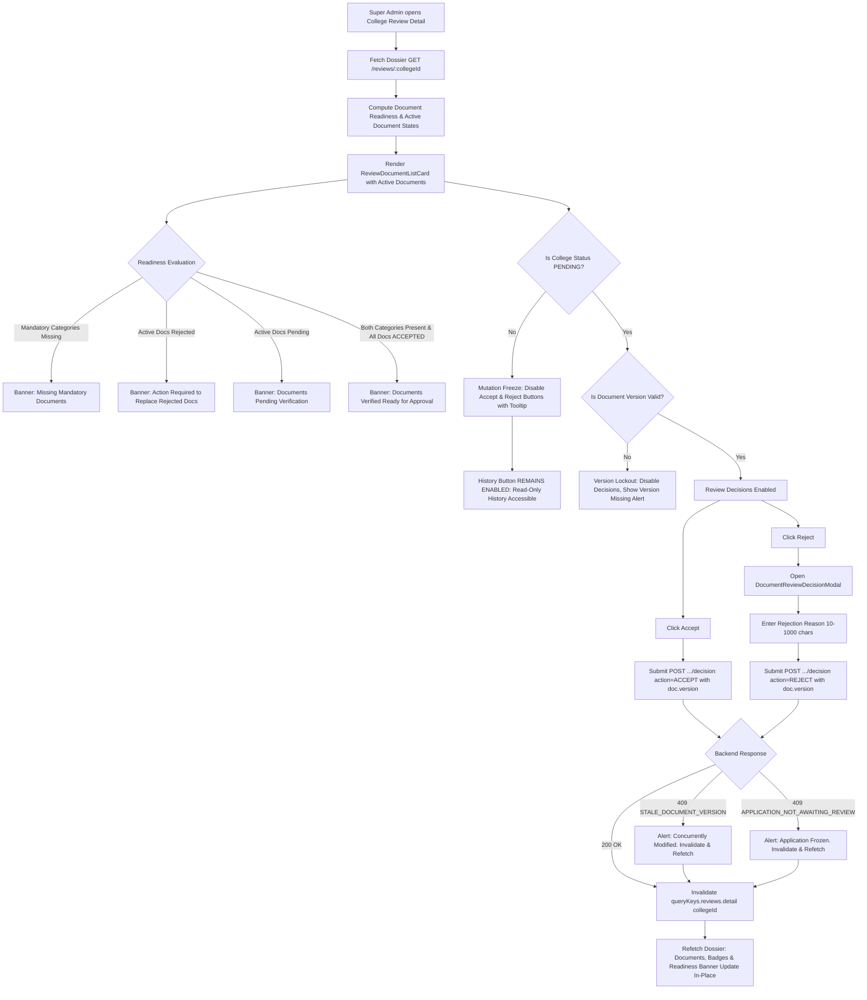
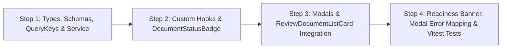

# Acadlytic — Phase 03: Super Admin Frontend Document Review Workflow
## Consolidated Planning Report v1.1

**Document Reference:** `docs/03-phase/Module-03-Frontend-Document-Review-Planning-Report-v1.1.md`  
**Author:** DeepMind Antigravity Coding Agent  
**Date:** 2026-11-26  
**Status:** `PLANNING_COMPLETE` — Awaiting Project Owner Review & Implementation Authorization  
**Target Milestone:** Phase 03 — Super Admin Frontend Document Review Workflow (Unassigned)  
**Supersedes:** `Module-03-Frontend-Document-Review-Planning-Report-v1.0.md`  

---

## Revision History

| Version | Date | Description | Status |
| :--- | :--- | :--- | :--- |
| **v1.0** | 2026-11-26 | Initial discovery and planning report covering architecture, backend contracts, UI workflows, concurrency, and test strategy. | Superseded |
| **v1.1** | 2026-11-26 | Consolidated planning revision: (1) Mandatory category readiness checks (`UNIVERSITY_AFFILIATION_CERTIFICATE` & `AUTHORIZED_SIGNATORY_ID`); (2) Document version safety and invalid version locking; (3) Required TypeScript fields for backend-guaranteed verification attributes; (4) Clear lifecycle distinction between mutation freeze and unblocked read-only history access; (5) Strict closed typing for document history actions (`'ACCEPTED' \| 'REJECTED'`); (6) Reconciled exact created/modified/test file inventories across all report sections. | **Current Approved Draft** |

---

## Executive Summary

This report establishes the complete, corrected, evidence-based technical architecture, component boundaries, data contracts, and implementation plan for the **Super Admin Frontend Document Review Workflow** within **Phase 03**.

Between 2026-11-25 and 2026-11-26, the backend infrastructure for document-level review was approved and locked across three modules:
1. **Module 3.6A (APPROVED):** Database Schema & Flyway V6 Migration (`college_registration_documents` schema extension, `college_document_reviews` append-only audit trail, Flyway Java preflight callback).
2. **Module 3.6B (APPROVED):** Backend Document Review Service & APIs (`POST .../decision`, `GET .../history`, hierarchical pessimistic locking, idempotency with version validation, cross-revision isolation).
3. **Module 3.6C (APPROVED):** Backend College Approval Integration & Lifecycle (document verification gates requiring active submitted documents to be `ACCEPTED` before college `APPROVE` can succeed; blocking on missing mandatory categories, `PENDING` documents, or `REJECTED` documents).

Currently, the Super Admin frontend ([CollegeReviewDetailPage.tsx](file:///c:/React/Acadlytic/frontend/src/pages/admin/CollegeReviewDetailPage.tsx) and [ReviewDocumentListCard.tsx](file:///c:/React/Acadlytic/frontend/src/components/review/ReviewDocumentListCard.tsx)) provides basic document inspection (category, filename, size, checksum) and binary download streaming. However, it lacks document verification state visualization, Super Admin review decision controls, rejection modal flows, document history auditing, and concurrency controls.

This **v1.1 revision** resolves six specific findings identified during Project Owner review:
- **Mandatory Document Readiness:** Approval readiness requires explicit presence of both mandatory categories (`UNIVERSITY_AFFILIATION_CERTIFICATE` and `AUTHORIZED_SIGNATORY_ID`) and every active uploaded document to be `ACCEPTED`. Readiness is never inferred from pending/rejected counts alone.
- **Document Version Safety:** Concurrency locking strictly consumes the selected document's authoritative `version`. College concurrency version is never substituted. If document version is missing or invalid, decision actions are locked with a safe error state.
- **Verification Field Safety:** Backend response guarantees `verificationStatus`, `verificationProvenance`, and `version` for every active document. TypeScript presentation models define these as required fields. Malformed or missing data does not silently fall back to authoritative statuses.
- **Lifecycle & History Access:** Clear separation between document mutation freeze (blocked when college is not `PENDING`) and read-only history access (remains accessible across the entire institutional lifecycle).
- **History Typing:** Closed union typing (`'ACCEPTED' | 'REJECTED'`) matching exact backend audit values without open `| string` types.
- **Report Consistency:** Complete reconciliation of all created (3), modified (9), and test (1) file counts across all sections of the report.

---

## 1. Current Frontend Architecture & Codebase Inspection

### 1.1 Frontend Technology Stack
- **Framework & Runtime:** React 18.3+, TypeScript 5.5+, Vite 5.4.
- **Styling & UI:** Tailwind CSS 3.4, Lucide React icons.
- **State Management & Data Fetching:** TanStack Query 5 (React Query), Axios HTTP client with credentials and CSRF interceptors, Zustand 5 stores.
- **Forms & Validation:** React Hook Form 7.52+, Zod 3.23+ schemas.
- **Testing:** Vitest 2.0+, React Testing Library, jsdom.

### 1.2 Reconciled File & Component Inventory

| File Path | Role in Architecture | Planned Action |
| :--- | :--- | :--- |
| `frontend/src/types/index.ts` | Global TypeScript DTOs, enums, presentation models. | **Modify (1/9):** Enrich `DocumentResponse` with required verification fields; add `DocumentVerificationStatus`, `DocumentVerificationProvenance`, `DocumentReviewAction`, `DocumentHistoryAction`, and review request/response DTOs. |
| `frontend/src/services/reviewService.ts` | Super Admin review API client communicating with backend `CollegeReviewController`. | **Modify (2/9):** Add `recordDocumentDecision()` and `getDocumentReviewHistory()`. Enrich `normalizeReviewDetail()`. |
| `frontend/src/services/queryKeys.ts` | Centralized TanStack Query key factory. | **Modify (3/9):** Add document review history query key factory `reviews.documentHistory(collegeId, documentId)`. |
| `frontend/src/schemas/reviewSchema.ts` | Zod validation schemas for review actions and filters. | **Modify (4/9):** Add `documentReviewDecisionSchema` (10–1000 chars rejection reason for REJECT, null for ACCEPT, integer >= 0 for document version). |
| `frontend/src/hooks/useCollegeReview.ts` | React Query custom hooks for review queue and detail. | **Modify (5/9):** Add `useRecordDocumentDecision()` mutation hook and `useDocumentReviewHistory()` query hook. |
| `frontend/src/components/review/ReviewDocumentListCard.tsx` | Active verification documents table in the college review detail page. | **Modify (6/9):** Integrate verification status badges, provenance badges, Accept/Reject action buttons, History viewer trigger, replacement indicators, safe version locking, and lifecycle freeze handling. |
| `frontend/src/components/review/ReviewDecisionPanel.tsx` | College-level decision panel (APPROVE, REQUEST_ACTION, REJECT). | **Modify (7/9):** Add proactive readiness banner checking both mandatory categories and document statuses. |
| `frontend/src/components/review/ReviewDecisionModal.tsx` | College-level decision modal. | **Modify (8/9):** Add targeted error mapping for backend `400 REQUIRED_DOCUMENTS_MISSING`, `409 DOCUMENTS_NOT_VERIFIED`, and `409 DOCUMENTS_REJECTED`. |
| `frontend/src/components/review/index.ts` | Barrel export file for review components. | **Modify (9/9):** Re-export `DocumentStatusBadge`, `DocumentReviewDecisionModal`, and `DocumentReviewHistoryModal`. |
| `frontend/src/components/review/DocumentStatusBadge.tsx` | Standardized status and provenance badge component. | **Create (1/3):** Visual indicators for `PENDING`, `ACCEPTED`, `REJECTED`, and provenance origins (`NOT_REVIEWED`, `DIRECT_REVIEW`, `CARRIED_FORWARD`, `LEGACY_COLLEGE_APPROVAL`). |
| `frontend/src/components/review/DocumentReviewDecisionModal.tsx` | Modal dialog for inputting rejection reasons and submitting document review decisions. | **Create (2/3):** Accessible modal form with character counting (10–1000 chars), validation feedback, and document version binding. |
| `frontend/src/components/review/DocumentReviewHistoryModal.tsx` | Modal dialog displaying chronological audit history for an individual document. | **Create (3/3):** Timeline viewer rendering historical decisions, timestamps, reviewer emails, and rejection reasons. |
| `frontend/src/test/super-admin-review.test.tsx` | Vitest test suite for Super Admin review workflows. | **Test (1/1):** Expand existing test suite to cover document review decisions, validation, concurrency locking, history viewing, and lifecycle freeze. |

**Total Files Affected:** **13 files** (3 Created, 9 Modified, 1 Test).

---

## 2. Existing Functionality That Can Be Reused

1. **Secure Document Download Mechanism:**
   - `reviewService.downloadReviewDocument(collegeId, documentId, originalFilename)`: Streams binary content from `GET /api/v1/super-admin/colleges/reviews/{collegeId}/documents/{documentId}` with delayed object URL revocation (60 seconds) to ensure browser download spools completely. Fully tested in [ReviewDocumentListCard.tsx](file:///c:/React/Acadlytic/frontend/src/components/review/ReviewDocumentListCard.tsx#L47-L69).
2. **Category Label Mapping & Byte Formatter:**
   - `REVIEW_DOCUMENT_CATEGORY_LABELS` and `formatBytes()` in `ReviewDocumentListCard.tsx` provide standard human-readable labels and size formatting.
3. **UI Primitives:**
   - [Modal.tsx](file:///c:/React/Acadlytic/frontend/src/components/ui/Modal.tsx), [Button.tsx](file:///c:/React/Acadlytic/frontend/src/components/ui/Button.tsx), [Textarea.tsx](file:///c:/React/Acadlytic/frontend/src/components/ui/Textarea.tsx), and [Alert.tsx](file:///c:/React/Acadlytic/frontend/src/components/ui/Alert.tsx) provide accessibility (`aria-modal`, keyboard focus trap, Esc dismissal), layout styling, and validation error presentation.
4. **API Client & Error Classification:**
   - `isApiError()` and `ApiError` in [api.ts](file:///c:/React/Acadlytic/frontend/src/services/api.ts#L37-L52) provide strongly-typed error parsing for HTTP status codes and backend `errorCode` strings (`STALE_DOCUMENT_VERSION`, `APPLICATION_NOT_AWAITING_REVIEW`, `DOCUMENTS_NOT_VERIFIED`, `DOCUMENTS_REJECTED`, `REQUIRED_DOCUMENTS_MISSING`).
5. **TanStack Query Invalidation Patterns:**
   - Invalidation of `queryKeys.reviews.detail(collegeId)` automatically refetches the authoritative `CollegeReviewDetailResponse`, synchronizing `activeDocuments` in-place.

---

## 3. Verified Backend API Contracts & Field Guarantees

### 3.1 Document Decision API
- **Endpoint:** `POST /api/v1/super-admin/colleges/reviews/{collegeId}/documents/{documentId}/decision`
- **Controller Method:** `CollegeReviewController.recordDocumentDecision` ([CollegeReviewController.java:138-146](file:///c:/React/Acadlytic/backend/src/main/java/com/acadlytic/modules/colleges/controller/CollegeReviewController.java#L138-L146))
- **Service Implementation:** `CollegeReviewService.recordDocumentDecision` ([CollegeReviewService.java:735-955](file:///c:/React/Acadlytic/backend/src/main/java/com/acadlytic/modules/colleges/service/CollegeReviewService.java#L735-L955))
- **Authorization:** `hasRole('SUPER_ADMIN')`
- **Request Payload (`DocumentReviewDecisionRequest`):**
  ```json
  {
    "action": "ACCEPT | REJECT",
    "notes": "Optional reviewer notes (max 1000 chars)",
    "rejectionReason": "Mandatory for REJECT (10-1000 chars); must be null for ACCEPT",
    "expectedDocumentVersion": 2
  }
  ```
  *(Supported by [DocumentReviewDecisionRequest.java:10-23](file:///c:/React/Acadlytic/backend/src/main/java/com/acadlytic/modules/colleges/dto/DocumentReviewDecisionRequest.java#L10-L23))*
- **Response Payload (`DocumentReviewDecisionResponse`):**
  ```json
  {
    "success": true,
    "message": "Document review decision recorded successfully.",
    "data": {
      "documentId": 201,
      "registrationId": 101,
      "documentCategory": "UNIVERSITY_AFFILIATION_CERTIFICATE",
      "verificationStatus": "ACCEPTED",
      "verificationProvenance": "DIRECT_REVIEW",
      "rejectionReason": null,
      "lastReviewedAt": "2026-11-26T12:00:00Z",
      "lastReviewedByUserId": 1,
      "reviewerEmail": "superadmin@acadlytic.com",
      "version": 3
    },
    "timestamp": "2026-11-26T12:00:00Z"
  }
  ```
  *(Supported by [DocumentReviewDecisionResponse.java:12-23](file:///c:/React/Acadlytic/backend/src/main/java/com/acadlytic/modules/colleges/dto/DocumentReviewDecisionResponse.java#L12-L23))*

- **Error Codes:**
  - `400 BAD_REQUEST / VALIDATION_ERROR`: Missing action, rejection reason `< 10` or `> 1000` on `REJECT`, notes `> 1000`, non-null rejection reason on `ACCEPT`, or negative `expectedDocumentVersion`.
  - `404 NOT_FOUND / COLLEGE_NOT_FOUND`: Target college does not exist.
  - `404 NOT_FOUND / DOCUMENT_NOT_FOUND`: Document does not exist or does not belong to target college.
  - `409 CONFLICT / APPLICATION_NOT_AWAITING_REVIEW`: Target college is not currently `PENDING` review, or document does not belong to the current submitted revision.
  - `409 CONFLICT / STALE_DOCUMENT_VERSION`: `expectedDocumentVersion` does not match `CollegeRegistrationDocument.version`.
  - `409 CONFLICT / LOCK_ACQUISITION_TIMEOUT`: Transient pessimistic lock failure exhausted after 3 retry attempts.

### 3.2 Document Review History API & Lifecycle Accessibility
- **Endpoint:** `GET /api/v1/super-admin/colleges/reviews/{collegeId}/documents/{documentId}/history`
- **Controller Method:** `CollegeReviewController.getDocumentReviewHistory` ([CollegeReviewController.java:156-163](file:///c:/React/Acadlytic/backend/src/main/java/com/acadlytic/modules/colleges/controller/CollegeReviewController.java#L156-L163))
- **Service Implementation:** `CollegeReviewService.getDocumentReviewHistory` ([CollegeReviewService.java:960-1006](file:///c:/React/Acadlytic/backend/src/main/java/com/acadlytic/modules/colleges/service/CollegeReviewService.java#L960-L1006))
- **Authorization:** `hasRole('SUPER_ADMIN')`
- **Crucial Lifecycle Distinction (Verified in Code):**
  - Unlike `recordDocumentDecision` (which enforces `validatePendingReviewEligibility`), `getDocumentReviewHistory` **does NOT block on non-PENDING college statuses**.
  - Read-only audit history remains **fully accessible** after college-level `APPROVE`, `REQUEST_ACTION`, or `REJECT`.
  - Only document mutation is frozen; history inspection is never frozen.
- **Response Payload (`List<DocumentReviewHistoryItemResponse>`):**
  ```json
  {
    "success": true,
    "message": "Document review history retrieved successfully.",
    "data": [
      {
        "id": 501,
        "reviewId": 501,
        "documentId": 201,
        "registrationId": 101,
        "collegeId": 10,
        "action": "ACCEPTED",
        "rejectionReason": null,
        "reviewerUserId": 1,
        "reviewerEmail": "superadmin@acadlytic.com",
        "reviewedAt": "2026-11-26T12:00:00Z",
        "createdAt": "2026-11-26T12:00:00Z"
      }
    ],
    "timestamp": "2026-11-26T12:00:00Z"
  }
  ```
  *(Supported by [DocumentReviewHistoryItemResponse.java:8-35](file:///c:/React/Acadlytic/backend/src/main/java/com/acadlytic/modules/colleges/dto/DocumentReviewHistoryItemResponse.java#L8-L35))*
- **Action Field Values:**
  - The backend writes strictly `"ACCEPTED"` or `"REJECTED"` via `DocumentReviewAction.toHistoryAction()` ([DocumentReviewAction.java:32-34](file:///c:/React/Acadlytic/backend/src/main/java/com/acadlytic/modules/colleges/dto/DocumentReviewAction.java#L32-L34)).
  - The frontend presentation model strictly defines `action: 'ACCEPTED' | 'REJECTED'`. Open `| string` union is prohibited.

### 3.3 Authoritative Document Response Field Guarantees
- In `CollegeReviewService.toDocumentResponse` ([CollegeReviewService.java:706-725](file:///c:/React/Acadlytic/backend/src/main/java/com/acadlytic/modules/colleges/service/CollegeReviewService.java#L706-L725)):
  ```java
  return new DocumentResponse(
      doc.getId(),
      doc.getRegistrationId(),
      doc.getDocumentCategory(),
      doc.getOriginalFilename(),
      doc.getMimeType(),
      doc.getFileSizeBytes(),
      doc.getSha256Checksum(),
      doc.getReplacesDocumentId(),
      doc.getCreatedAt(),
      doc.getVerificationStatus() != null ? doc.getVerificationStatus() : DocumentVerificationStatus.PENDING,
      doc.getVerificationProvenance() != null ? doc.getVerificationProvenance() : DocumentVerificationProvenance.NOT_REVIEWED,
      doc.getRejectionReason(),
      doc.getLastReviewedAt(),
      doc.getLastReviewedByUserId(),
      doc.getVersion() != null ? doc.getVersion() : 0L
  );
  ```
- **Backend Guarantees:**
  - `verificationStatus`: Guaranteed non-null (`PENDING`, `ACCEPTED`, `REJECTED`).
  - `verificationProvenance`: Guaranteed non-null (`NOT_REVIEWED`, `DIRECT_REVIEW`, `CARRIED_FORWARD`, `LEGACY_COLLEGE_APPROVAL`).
  - `version`: Guaranteed non-null `Long` (>= 0).
  - `rejectionReason`: `String` (nullable).
  - `lastReviewedAt`: `Instant` (nullable).
  - `lastReviewedByUserId`: `Long` (nullable).
- **TypeScript Presentation Model Rule:**
  - In `frontend/src/types/index.ts`, `verificationStatus`, `verificationProvenance`, and `version` must be defined as **required** fields (`status: DocumentVerificationStatus; provenance: DocumentVerificationProvenance; version: number;`).
  - In defensive normalizers or mock handlers, if any of these fields are missing, the UI must NOT silently invent or coerce an authoritative status (e.g. converting undefined to ACCEPTED). If `version` is missing/invalid, decisions are locked.

### 3.4 College-Level Approval Integration Gates (Module 3.6C)
- When submitting `APPROVE` on `POST /api/v1/super-admin/colleges/reviews/{collegeId}/decision`:
  1. **Mandatory Categories Check:** Both `UNIVERSITY_AFFILIATION_CERTIFICATE` and `AUTHORIZED_SIGNATORY_ID` must exist among active documents. Missing category -> `400 REQUIRED_DOCUMENTS_MISSING` ([CollegeReviewService.java:533-540](file:///c:/React/Acadlytic/backend/src/main/java/com/acadlytic/modules/colleges/service/CollegeReviewService.java#L533-L540)).
  2. **Rejected Documents Check:** If any active document is `REJECTED` -> `409 DOCUMENTS_REJECTED` ([CollegeReviewService.java:544-557](file:///c:/React/Acadlytic/backend/src/main/java/com/acadlytic/modules/colleges/service/CollegeReviewService.java#L544-L557)).
  3. **Pending Documents Check:** If any active document is not `ACCEPTED` (e.g. `PENDING`) -> `409 DOCUMENTS_NOT_VERIFIED` ([CollegeReviewService.java:561-574](file:///c:/React/Acadlytic/backend/src/main/java/com/acadlytic/modules/colleges/service/CollegeReviewService.java#L561-L574)).

---

## 4. Proposed User Workflow & State Management



### 4.1 Mandatory Document Readiness Calculation

Document readiness cannot be inferred solely from pending or rejected counts. A college application with 0 documents or only an optional supporting document would have `pendingCount = 0` and `rejectedCount = 0`, yet college approval would immediately fail with `400 REQUIRED_DOCUMENTS_MISSING`.

The frontend must calculate readiness explicitly:
```typescript
export interface DocumentReadinessAssessment {
  hasAffiliationCertificate: boolean;
  hasAuthorizedSignatoryId: boolean;
  mandatoryCategoriesPresent: boolean;
  missingMandatoryLabels: string[];
  totalActiveCount: number;
  acceptedCount: number;
  rejectedCount: number;
  pendingCount: number;
  hasRejectedDocuments: boolean;
  hasPendingDocuments: boolean;
  allActiveDocumentsAccepted: boolean;
  isReadyForApproval: boolean;
}

export function assessDocumentReadiness(
  documents: DocumentResponse[] = []
): DocumentReadinessAssessment {
  const activeDocs = documents ?? [];
  const categories = new Set(activeDocs.map((d) => d.documentCategory));

  const hasAffiliationCertificate = categories.has('UNIVERSITY_AFFILIATION_CERTIFICATE');
  const hasAuthorizedSignatoryId = categories.has('AUTHORIZED_SIGNATORY_ID');
  const mandatoryCategoriesPresent = hasAffiliationCertificate && hasAuthorizedSignatoryId;

  const missingMandatoryLabels: string[] = [];
  if (!hasAffiliationCertificate) {
    missingMandatoryLabels.push('University Affiliation Certificate');
  }
  if (!hasAuthorizedSignatoryId) {
    missingMandatoryLabels.push('Authorized Signatory ID');
  }

  const acceptedCount = activeDocs.filter((d) => d.verificationStatus === 'ACCEPTED').length;
  const rejectedCount = activeDocs.filter((d) => d.verificationStatus === 'REJECTED').length;
  const pendingCount = activeDocs.filter(
    (d) => d.verificationStatus === 'PENDING' || !d.verificationStatus
  ).length;

  const hasRejectedDocuments = rejectedCount > 0;
  const hasPendingDocuments = pendingCount > 0;
  const allActiveDocumentsAccepted =
    activeDocs.length > 0 && acceptedCount === activeDocs.length;

  const isReadyForApproval =
    mandatoryCategoriesPresent &&
    allActiveDocumentsAccepted &&
    !hasRejectedDocuments &&
    !hasPendingDocuments;

  return {
    hasAffiliationCertificate,
    hasAuthorizedSignatoryId,
    mandatoryCategoriesPresent,
    missingMandatoryLabels,
    totalActiveCount: activeDocs.length,
    acceptedCount,
    rejectedCount,
    pendingCount,
    hasRejectedDocuments,
    hasPendingDocuments,
    allActiveDocumentsAccepted,
    isReadyForApproval,
  };
}
```

### 4.2 Proactive Readiness Presentation in `ReviewDecisionPanel`

In [ReviewDecisionPanel.tsx](file:///c:/React/Acadlytic/frontend/src/components/review/ReviewDecisionPanel.tsx):
- When `college.approvalStatus === 'PENDING'`:
  - Calculate `readiness = assessDocumentReadiness(activeDocuments)`.
  - Render an informative callout banner directly above the action buttons:
    - **Case 1: Missing Mandatory Documents (`!readiness.mandatoryCategoriesPresent`):**
      `Alert variant="warning"`: *"Mandatory verification documents missing: {missingMandatoryLabels.join(', ')}. College cannot be approved until both mandatory documents are uploaded and accepted."*
    - **Case 2: Active Documents Rejected (`readiness.hasRejectedDocuments`):**
      `Alert variant="error"`: *"Cannot approve application: {readiness.rejectedCount} document(s) are rejected. You must 'Request Action' to unlock a correction revision before approval can be granted."*
    - **Case 3: Active Documents Pending (`readiness.hasPendingDocuments`):**
      `Alert variant="info"`: *"{readiness.pendingCount} document(s) pending verification. All active documents must be accepted before college approval."*
    - **Case 4: Ready for Approval (`readiness.isReadyForApproval`):**
      `Alert variant="success"`: *"All mandatory and uploaded verification documents ({readiness.acceptedCount}/{readiness.totalActiveCount}) are verified and accepted. Application is ready for approval decision."*

### 4.3 Document Version Safety & Concurrency Locking

- **Rule 1: Dedicated Concurrency Version:**
  `expectedDocumentVersion` must strictly consume `doc.version` from the selected document row. It must **never** substitute `college.concurrencyVersion` or any synthetic number.
- **Rule 2: Concurrency Version Validation:**
  ```typescript
  const isDocumentVersionValid =
    typeof doc.version === 'number' &&
    Number.isSafeInteger(doc.version) &&
    doc.version >= 0;
  ```
- **Rule 3: Invalid Version Lockout:**
  If `!isDocumentVersionValid`:
  - The `Accept` and `Reject` buttons for that document row are rendered in `disabled` state.
  - A warning badge or tooltip is rendered: *"Authoritative document version is unavailable. Review decisions are locked to prevent state corruption."*
  - The decision modal will block submission if `doc.version` is missing.
- **Rule 4: Stale Version Conflict Handling (`409 STALE_DOCUMENT_VERSION`):**
  If concurrent review occurs, the backend rejects with `409 STALE_DOCUMENT_VERSION`. The frontend:
  1. Catches `err.errorCode === 'STALE_DOCUMENT_VERSION'`.
  2. Displays an Alert banner: *"This document was reviewed or updated concurrently by another administrator. Application details have been refreshed below. Please check current document status."*
  3. Automatically closes `DocumentReviewDecisionModal` (if open).
  4. Triggers `refetch()` on `queryKeys.reviews.detail(collegeId)`.

### 4.4 Lifecycle Freeze vs. Read-Only History Accessibility

1. **Document Mutation Freeze:**
   - When `college.approvalStatus !== 'PENDING'`, document review is frozen.
   - The frontend disables `Accept` and `Reject` buttons with tooltip: *"Document review locked (Application is {college.approvalStatus})"*.
   - If an in-flight mutation hits the backend after freeze, backend returns `409 APPLICATION_NOT_AWAITING_REVIEW`. Frontend displays: *"This application is no longer awaiting review. Review decisions are frozen."* and refetches.
2. **Read-Only History Access:**
   - **History button remains enabled at all times**, regardless of whether `college.approvalStatus` is `PENDING`, `APPROVED`, `ACTION_REQUIRED`, or `REJECTED`.
   - The backend `getDocumentReviewHistory` endpoint is completely read-only and does not check `validatePendingReviewEligibility`. Reviewers can inspect the complete audit trail of decisions made during past review sessions at any time.

### 4.5 Idempotent Retries

- If a Super Admin submits an identical decision (same target status and rejection reason) on the current or immediate prior version (`doc.version - 1`), the backend returns `200 OK` without duplicating audit rows or incrementing version.
- The frontend treats this as a standard success and synchronizes state cleanly without error prompts.

---

## 5. Proposed Component & Service Boundaries

### 5.1 Component Hierarchy

```
CollegeReviewDetailPage
  ├── CollegeReviewHeader
  ├── ReviewDecisionPanel (enhanced with assessDocumentReadiness callout banner)
  ├── 2-Column Institutional Overview
  │     ├── CollegeProfileReviewCard
  │     └── ReviewAdminUserCard
  ├── ReviewDocumentListCard (enhanced with status badges, version locks, freeze, action triggers)
  │     ├── DocumentStatusBadge (NEW: status + provenance visual indicators)
  │     ├── Table Row Action Buttons:
  │     │     ├── DownloadButton (existing streaming download)
  │     │     ├── AcceptButton (mutation trigger with doc.version)
  │     │     ├── RejectButton (opens DocumentReviewDecisionModal)
  │     │     └── HistoryButton (opens DocumentReviewHistoryModal; ALWAYS enabled)
  │     └── RejectionReasonCallout (collapsible reason row for REJECTED documents)
  ├── RevisionHistoryTimelineCard
  ├── ReviewDecisionModal (college-level; enhanced with 400/409 document gate error mapping)
  ├── DocumentReviewDecisionModal (NEW: document rejection reason dialog)
  └── DocumentReviewHistoryModal (NEW: audit timeline viewer)
```

### 5.2 Required Type Extensions (`frontend/src/types/index.ts`)

```typescript
// ==========================================
// Document Verification Types & Enums (Module 3.6)
// ==========================================

export type DocumentVerificationStatus = 'PENDING' | 'ACCEPTED' | 'REJECTED';

export type DocumentVerificationProvenance =
  | 'NOT_REVIEWED'
  | 'DIRECT_REVIEW'
  | 'CARRIED_FORWARD'
  | 'LEGACY_COLLEGE_APPROVAL';

export type DocumentReviewAction = 'ACCEPT' | 'REJECT';

// Strict closed typing matching backend CollegeDocumentReview.action
export type DocumentHistoryAction = 'ACCEPTED' | 'REJECTED';

// Enriched Document Presentation Model matching backend DocumentResponse
export interface DocumentResponse {
  id: number;
  registrationId: number;
  documentCategory: DocumentCategory;
  originalFilename: string;
  mimeType: string;
  fileSizeBytes: number;
  sha256Checksum: string;
  replacesDocumentId: number | null;
  createdAt: string;
  // Guaranteed required by Module 3.6 backend toDocumentResponse:
  verificationStatus: DocumentVerificationStatus;
  verificationProvenance: DocumentVerificationProvenance;
  rejectionReason: string | null;
  lastReviewedAt: string | null;
  lastReviewedByUserId: number | null;
  version: number;
}

// Document Review Decision Request matching backend DocumentReviewDecisionRequest
export interface DocumentReviewDecisionRequest {
  action: DocumentReviewAction;
  notes?: string | null;
  rejectionReason?: string | null;
  expectedDocumentVersion: number;
}

// Document Review Decision Response matching backend DocumentReviewDecisionResponse
export interface DocumentReviewDecisionResponse {
  documentId: number;
  registrationId: number;
  documentCategory: DocumentCategory;
  verificationStatus: DocumentVerificationStatus;
  verificationProvenance: DocumentVerificationProvenance;
  rejectionReason: string | null;
  lastReviewedAt: string;
  lastReviewedByUserId: number;
  reviewerEmail?: string | null;
  version: number;
}

// Document Review History Record matching backend DocumentReviewHistoryItemResponse
export interface DocumentReviewHistoryItemResponse {
  id: number;
  reviewId?: number;
  documentId: number;
  registrationId: number;
  collegeId: number;
  action: DocumentHistoryAction;
  rejectionReason: string | null;
  reviewerUserId: number | null;
  reviewerEmail: string | null;
  reviewedAt: string;
  createdAt: string;
}
```

### 5.3 Service Method Extensions (`frontend/src/services/reviewService.ts`)

```typescript
// Add to reviewService:

/**
 * Records an authoritative Super Admin review decision (ACCEPT or REJECT) for an individual document.
 * Enforces optimistic version locking via expectedDocumentVersion.
 * Endpoint: POST /api/v1/super-admin/colleges/reviews/{collegeId}/documents/{documentId}/decision
 */
async recordDocumentDecision(
  collegeId: number,
  documentId: number,
  request: DocumentReviewDecisionRequest
): Promise<DocumentReviewDecisionResponse> {
  const payload = {
    action: request.action,
    expectedDocumentVersion: request.expectedDocumentVersion,
    notes: request.notes?.trim() ? request.notes.trim() : null,
    rejectionReason: request.rejectionReason?.trim() ? request.rejectionReason.trim() : null,
  };
  const response = await apiClient.post<ApiResponse<DocumentReviewDecisionResponse>>(
    `/super-admin/colleges/reviews/${collegeId}/documents/${documentId}/decision`,
    payload
  );
  return response.data.data;
},

/**
 * Retrieves chronological review decision history records for an individual document.
 * Remains accessible across all college lifecycle states (read-only audit).
 * Endpoint: GET /api/v1/super-admin/colleges/reviews/{collegeId}/documents/{documentId}/history
 */
async getDocumentReviewHistory(
  collegeId: number,
  documentId: number
): Promise<DocumentReviewHistoryItemResponse[]> {
  const response = await apiClient.get<ApiResponse<DocumentReviewHistoryItemResponse[]>>(
    `/super-admin/colleges/reviews/${collegeId}/documents/${documentId}/history`
  );
  return response.data.data;
}
```

### 5.4 Query Key & Hook Extensions

1. **`frontend/src/services/queryKeys.ts`:**
   ```typescript
   reviews: {
     all: ['reviews'] as const,
     queueRoot: () => [...queryKeys.reviews.all, 'queue'] as const,
     queue: (params?: ReviewQueueParams) =>
       [...queryKeys.reviews.queueRoot(), params] as const,
     detail: (collegeId: number) =>
       [...queryKeys.reviews.all, 'detail', collegeId] as const,
     documentHistory: (collegeId: number, documentId: number) =>
       [...queryKeys.reviews.detail(collegeId), 'documents', documentId, 'history'] as const,
   }
   ```

2. **`frontend/src/hooks/useCollegeReview.ts`:**
   ```typescript
   /**
    * Hook to submit a document review decision (ACCEPT or REJECT).
    * On success, invalidates parent college review detail to refresh document status, badges, and versions.
    */
   export function useRecordDocumentDecision(collegeId: number) {
     const queryClient = useQueryClient();
     return useMutation({
       mutationFn: ({
         documentId,
         request,
       }: {
         documentId: number;
         request: DocumentReviewDecisionRequest;
       }) => reviewService.recordDocumentDecision(collegeId, documentId, request),
       onSuccess: (_, variables) => {
         queryClient.invalidateQueries({
           queryKey: queryKeys.reviews.detail(collegeId),
         });
         queryClient.invalidateQueries({
           queryKey: queryKeys.reviews.documentHistory(collegeId, variables.documentId),
         });
       },
     });
   }

   /**
    * Hook to fetch chronological review history for an individual document.
    * Unblocked by college lifecycle freeze.
    */
   export function useDocumentReviewHistory(
     collegeId: number,
     documentId: number,
     enabled: boolean
   ) {
     return useQuery({
       queryKey: queryKeys.reviews.documentHistory(collegeId, documentId),
       queryFn: () => reviewService.getDocumentReviewHistory(collegeId, documentId),
       enabled: Boolean(enabled && collegeId > 0 && documentId > 0),
     });
   }
   ```

### 5.5 Zod Schema Specification (`frontend/src/schemas/reviewSchema.ts`)

```typescript
/**
 * Zod validation schema for individual document review decisions.
 * Enforces:
 * - action: ACCEPT or REJECT.
 * - expectedDocumentVersion: integer >= 0 matching current document version.
 * - notes: optional, max 1000 characters.
 * - rejectionReason: mandatory if REJECT (10-1000 characters); must be empty/null if ACCEPT.
 */
export const documentReviewDecisionSchema = z
  .object({
    action: z.enum(['ACCEPT', 'REJECT'] as const, {
      required_error: 'Review action is required.',
    }),
    expectedDocumentVersion: z
      .number({ required_error: 'Document version is required.' })
      .int('Document version must be an integer.')
      .min(0, 'Invalid document version.'),
    notes: z
      .string()
      .max(1000, 'Review notes cannot exceed 1000 characters.')
      .optional()
      .nullable(),
    rejectionReason: z
      .string()
      .max(1000, 'Rejection reason cannot exceed 1000 characters.')
      .optional()
      .nullable(),
  })
  .superRefine((data, ctx) => {
    if (data.action === 'REJECT') {
      const trimmed = typeof data.rejectionReason === 'string' ? data.rejectionReason.trim() : '';
      if (trimmed.length < 10) {
        ctx.addIssue({
          code: z.ZodIssueCode.custom,
          path: ['rejectionReason'],
          message: 'Rejection reason must be at least 10 characters when rejecting a document.',
        });
      }
    }
    if (data.action === 'ACCEPT') {
      const trimmed = typeof data.rejectionReason === 'string' ? data.rejectionReason.trim() : '';
      if (trimmed.length > 0) {
        ctx.addIssue({
          code: z.ZodIssueCode.custom,
          path: ['rejectionReason'],
          message: 'Rejection reason must be empty when accepting a document.',
        });
      }
    }
  });

export type DocumentReviewDecisionFormValues = z.infer<typeof documentReviewDecisionSchema>;
```

---

## 6. Accessibility, Usability & UI Design

1. **Accessibility (WCAG 2.1 AA Compliance):**
   - Action buttons (`Accept`, `Reject`, `History`, `Download`) include explicit `aria-label` attributes incorporating document category and filename (e.g. `aria-label="Reject Authorized Signatory ID: signatory_scan.pdf"`).
   - Dialog modals (`DocumentReviewDecisionModal`, `DocumentReviewHistoryModal`) use `Modal.tsx` providing `role="dialog"`, `aria-modal="true"`, focus trapping, auto-focus on first interactive input, and Esc-key dismissal.
   - Status badges use distinct iconography (CheckCircle2, AlertCircle, Clock) alongside color to communicate status without relying on color alone.

2. **Reviewer Ergonomics:**
   - **One-click Accept:** Mutation executes with inline spinner feedback and optimistic query invalidation.
   - **Rejection Character Counter:** Real-time visual feedback (`{val.length}/1000`, minimum 10 characters).
   - **Bound Version Indicator:** Rejection modal explicitly shows `Bound to document version #${doc.version}` so reviewers know optimistic locking is active.

3. **Color Palette Tokens:**
   - `ACCEPTED`: Emerald theme (`bg-emerald-50 text-emerald-800 border-emerald-200`).
   - `REJECTED`: Rose/Red theme (`bg-red-50 text-red-800 border-red-200`).
   - `PENDING`: Amber theme (`bg-amber-50 text-amber-800 border-amber-200`).
   - `CARRIED_FORWARD`: Indigo theme (`bg-indigo-50 text-indigo-800 border-indigo-200`).
   - `NOT_REVIEWED`: Slate theme (`bg-slate-100 text-slate-700 border-slate-200`).
   - `LEGACY_COLLEGE_APPROVAL`: Blue-slate theme (`bg-sky-50 text-sky-800 border-sky-200`).

---

## 7. Comprehensive Test Plan

The frontend test suite currently has 200/200 passing tests across 13 test files. The expanded test plan covers unit, component, dialog, and integration scenarios:

### 7.1 Unit & Schema Tests (`super-admin-review.test.tsx`)
1. **Schema Validation:**
   - Validate `documentReviewDecisionSchema` passes for `ACCEPT` with empty/null rejection reason and valid `expectedDocumentVersion`.
   - Validate `ACCEPT` fails if `rejectionReason` is provided.
   - Validate `REJECT` fails if `rejectionReason` is missing or `< 10` characters.
   - Validate `REJECT` fails if `rejectionReason` is `> 1000` characters.
   - Validate `REJECT` passes with valid rejection reason (10–1000 characters).
   - Validate negative or non-integer `expectedDocumentVersion` fails validation.
2. **Readiness Calculation Unit Test:**
   - Test `assessDocumentReadiness`:
     - Empty document list: `isReadyForApproval: false`, lists both missing mandatory categories.
     - Only optional supporting document accepted: `isReadyForApproval: false`, lists missing mandatory categories.
     - Mandatory categories present but 1 pending: `isReadyForApproval: false`, `hasPendingDocuments: true`.
     - Mandatory categories present but 1 rejected: `isReadyForApproval: false`, `hasRejectedDocuments: true`.
     - Both mandatory categories present and all active documents accepted: `isReadyForApproval: true`.

### 7.2 Component Tests (`ReviewDocumentListCard.tsx`)
1. **Status Badge Rendering:** Renders correct visual badges for `PENDING`, `ACCEPTED`, and `REJECTED`.
2. **Provenance Badge Rendering:** Renders `NOT_REVIEWED`, `DIRECT_REVIEW`, `CARRIED_FORWARD`, and `LEGACY_COLLEGE_APPROVAL`.
3. **Replacement Context:** Displays replacement indicator when `replacesDocumentId` is non-null.
4. **Invalid Version Locking:** If `doc.version` is missing/null/negative, disables `Accept` and `Reject` buttons and shows warning badge.
5. **Mutation Freeze:** When `college.approvalStatus !== 'PENDING'`, disables `Accept` and `Reject` buttons with freeze tooltip.
6. **History Button Accessibility:** History button remains clickable and enabled even when `college.approvalStatus !== 'PENDING'`.
7. **Rejection Reason Callout:** Renders collapsible rejection reason callout when `verificationStatus === 'REJECTED'`.

### 7.3 Modal Dialog Tests
1. **`DocumentReviewDecisionModal`:**
   - Renders document details (category, filename, version).
   - Character counter updates in real time; submit button is disabled until 10 characters are entered.
   - Submits payload with `action: 'REJECT'`, trimmed reason, and authoritative `doc.version`.
   - Catches `409 STALE_DOCUMENT_VERSION`: displays conflict alert and closes modal.
   - Catches `409 APPLICATION_NOT_AWAITING_REVIEW`: displays freeze alert and closes modal.
2. **`DocumentReviewHistoryModal`:**
   - Displays loading spinner while querying history.
   - Renders chronological timeline items with strict action badges (`ACCEPTED`, `REJECTED`), reviewer emails, timestamps, and rejection reasons.
   - Renders empty state message if no history records exist.

### 7.4 Integration Tests (`ReviewDecisionPanel` & `ReviewDecisionModal`)
1. **Readiness Banner:**
   - Displays warning when mandatory categories are missing.
   - Displays error guidance when an active document is rejected.
   - Displays info guidance when documents are pending.
   - Displays success guidance when all documents are verified.
2. **College Approval Gate Error Mapping:**
   - When college `APPROVE` mutation receives `400 REQUIRED_DOCUMENTS_MISSING`, renders clear message identifying missing mandatory documents.
   - When college `APPROVE` mutation receives `409 DOCUMENTS_REJECTED`, renders guidance that rejected documents must be replaced via action request.
   - When college `APPROVE` mutation receives `409 DOCUMENTS_NOT_VERIFIED`, renders guidance that all documents must be accepted before approving.

---

## 8. Exact Files Expected to Be Created or Modified

### 8.1 Files to Be Created (3 files)
1. `frontend/src/components/review/DocumentStatusBadge.tsx`
2. `frontend/src/components/review/DocumentReviewDecisionModal.tsx`
3. `frontend/src/components/review/DocumentReviewHistoryModal.tsx`

### 8.2 Files to Be Modified (9 files)
1. `frontend/src/types/index.ts` (enrich `DocumentResponse`, add DTOs, enums, closed history action)
2. `frontend/src/services/reviewService.ts` (add `recordDocumentDecision`, `getDocumentReviewHistory`)
3. `frontend/src/services/queryKeys.ts` (add `reviews.documentHistory` query key)
4. `frontend/src/schemas/reviewSchema.ts` (add `documentReviewDecisionSchema`)
5. `frontend/src/hooks/useCollegeReview.ts` (add `useRecordDocumentDecision`, `useDocumentReviewHistory`)
6. `frontend/src/components/review/ReviewDocumentListCard.tsx` (integrate badges, version lock, freeze, action triggers)
7. `frontend/src/components/review/ReviewDecisionPanel.tsx` (integrate `assessDocumentReadiness` banner)
8. `frontend/src/components/review/ReviewDecisionModal.tsx` (map `REQUIRED_DOCUMENTS_MISSING`, `DOCUMENTS_NOT_VERIFIED`, `DOCUMENTS_REJECTED`)
9. `frontend/src/components/review/index.ts` (re-export new review components)

### 8.3 Test Files to Be Extended (1 file)
1. `frontend/src/test/super-admin-review.test.tsx` (comprehensive unit, component, conflict, and integration tests)

**Total Count:** **13 files** (3 Created, 9 Modified, 1 Test).

---

## 9. Dependencies & Implementation Sequence



1. **Step 1: Core Contracts, Schemas, and Service Client (4 files modified)**
   - Update `types/index.ts` with required verification fields and closed `DocumentHistoryAction`.
   - Update `schemas/reviewSchema.ts` with `documentReviewDecisionSchema`.
   - Update `queryKeys.ts` and `reviewService.ts` with endpoints.
   - Verify zero compilation errors with `npx tsc -b`.

2. **Step 2: Hooks and Status Badge Primitive (1 file modified, 1 file created)**
   - Add `useRecordDocumentDecision` and `useDocumentReviewHistory` to `useCollegeReview.ts`.
   - Create `DocumentStatusBadge.tsx`.

3. **Step 3: Modals and Document Table Integration (2 files created, 2 files modified)**
   - Create `DocumentReviewDecisionModal.tsx` and `DocumentReviewHistoryModal.tsx`.
   - Integrate actions, badges, version locking, and freeze into `ReviewDocumentListCard.tsx`.
   - Re-export in `index.ts`.

4. **Step 4: Readiness Banner, College Modal Mapping & Vitest Suite (2 files modified, 1 test file modified)**
   - Add `assessDocumentReadiness` and guidance banner to `ReviewDecisionPanel.tsx`.
   - Enhance `ReviewDecisionModal.tsx` with error mapping for document gating codes.
   - Add comprehensive tests in `super-admin-review.test.tsx`.
   - Run `npx vitest run`, `npx tsc -b`, and `npm run build`.

---

## 10. Risks, Assumptions & Unresolved Questions

### 10.1 Risks & Mitigation

| Risk | Impact | Mitigation Strategy |
| :--- | :--- | :--- |
| **Concurrent Document Reviews:** Multiple administrators review the same document simultaneously. | Medium | Strictly pass authoritative `doc.version` as `expectedDocumentVersion`. Backend enforces optimistic locking; frontend catches `409 STALE_DOCUMENT_VERSION`, alerts user, and auto-refetches dossier. |
| **Reviewing During/After College Decision:** Super Admin acts on a document after application is approved or rejected. | Low | Backend enforces `APPLICATION_NOT_AWAITING_REVIEW`. Frontend checks `college.approvalStatus !== 'PENDING'` and disables buttons. Read-only history remains accessible. |
| **Missing Mandatory Category False Readiness:** Admin assumes zero pending documents means college can be approved. | Low | `assessDocumentReadiness` explicitly validates the presence of both `UNIVERSITY_AFFILIATION_CERTIFICATE` and `AUTHORIZED_SIGNATORY_ID` before declaring readiness. |
| **Missing Concurrency Version in Frontend:** Document payload missing `version` attribute. | Low | Version safety rule: if `doc.version` is missing or invalid, decision buttons are locked and warning state is rendered. College concurrency version is never substituted. |

### 10.2 Assumptions
- Backend endpoints and DTO contracts deployed in Modules 3.6B and 3.6C are complete and fully operational (verified with 291/291 passing backend tests).
- Document downloads continue to use existing secure streaming endpoint `GET .../documents/{documentId}`.
- Active documents list returned by `GET .../reviews/{collegeId}` contains all active documents (including replacement documents, excluding superseded documents).

### 10.3 Unresolved Questions
- **None.** All API contracts, DTO mappings, business rules, concurrency mechanisms, and error codes were directly verified in the codebase.

---

## 11. Conclusions & Recommendations

### 11.1 Recommended Scope
Implement the **Super Admin Frontend Document Review Workflow** as detailed in this consolidated v1.1 plan:
1. Enrich `DocumentResponse` with required verification fields and closed history action types.
2. Extend `reviewService.ts` and `useCollegeReview.ts` for document review decisions and history retrieval.
3. Implement `documentReviewDecisionSchema` in `schemas/reviewSchema.ts`.
4. Create `DocumentStatusBadge`, `DocumentReviewDecisionModal`, and `DocumentReviewHistoryModal`.
5. Enhance `ReviewDocumentListCard` with status badges, provenance indicators, Accept/Reject actions, History view, safe version locking, and lifecycle freeze disabling.
6. Enhance `ReviewDecisionPanel` with proactive `assessDocumentReadiness` banner.
7. Enhance `ReviewDecisionModal` with error mapping for `REQUIRED_DOCUMENTS_MISSING`, `DOCUMENTS_NOT_VERIFIED`, and `DOCUMENTS_REJECTED`.
8. Expand `super-admin-review.test.tsx` to verify all workflows, edge cases, and conflict handling.

### 11.2 Reconciled Files to Be Changed
- **Created (3 files):**
  1. `frontend/src/components/review/DocumentStatusBadge.tsx`
  2. `frontend/src/components/review/DocumentReviewDecisionModal.tsx`
  3. `frontend/src/components/review/DocumentReviewHistoryModal.tsx`
- **Modified (9 files):**
  1. `frontend/src/types/index.ts`
  2. `frontend/src/services/reviewService.ts`
  3. `frontend/src/services/queryKeys.ts`
  4. `frontend/src/schemas/reviewSchema.ts`
  5. `frontend/src/hooks/useCollegeReview.ts`
  6. `frontend/src/components/review/ReviewDocumentListCard.tsx`
  7. `frontend/src/components/review/ReviewDecisionPanel.tsx`
  8. `frontend/src/components/review/ReviewDecisionModal.tsx`
  9. `frontend/src/components/review/index.ts`
- **Test Extended (1 file):**
  1. `frontend/src/test/super-admin-review.test.tsx`

**Total Files Affected:** **13 files**.

### 11.3 Material Blockers
- **None.** All necessary backend endpoints (`POST .../decision`, `GET .../history`, `GET .../download`, `GET .../{collegeId}`) are implemented, verified by 291/291 backend tests, and fully operational.

### 11.4 Implementation Readiness
- **Status:** **`IMPLEMENTATION-READY`**
- All API contracts, DTO mappings, business rules, concurrency mechanisms, error codes, and accessibility requirements are documented and verified.
- Zero backend, database, or Flyway schema changes are needed.
- No module numbers or approvals have been assigned.

---

## 12. Revision v1.1 Change Summary & Issue Resolution Verification

| # | Review Finding | Action Taken in v1.1 Report | Verification & Resolution Status |
| :--- | :--- | :--- | :--- |
| **1** | **Mandatory document readiness:** Missing check for mandatory categories (`UNIVERSITY_AFFILIATION_CERTIFICATE`, `AUTHORIZED_SIGNATORY_ID`); readiness inferred only from pending/rejected counts. | Formulated `assessDocumentReadiness()` function (Section 4.1). Explicitly checks both mandatory categories. Readiness requires both categories present AND every active document `ACCEPTED`. Detailed in Sections 4.1, 4.2, and 7.1. | **RESOLVED:** Readiness strictly enforces both mandatory categories and zero pending/rejected documents. |
| **2** | **Document version safety:** Ensure `expectedDocumentVersion` comes from document's authoritative version; never substitute college version; lock decisions if missing/invalid. | Added Document Version Safety rules (Section 4.3). Explicitly prohibited substituting college concurrency version. If `doc.version` is missing/invalid, decisions are locked with safe warning state. | **RESOLVED:** Concurrency locking strictly isolated to document version with safe lockout fallback. |
| **3** | **Verification field safety:** Verify backend guarantees; prefer required TypeScript fields; prevent unknown values from silently becoming authoritative statuses. | Verified `CollegeReviewService.toDocumentResponse` guarantees `verificationStatus`, `verificationProvenance`, and `version`. Defined all three as required in `DocumentResponse` (Section 5.2). Added rule against silent fallback. | **RESOLVED:** Required presentation typing enforced matching backend wire guarantees. |
| **4** | **Lifecycle and history:** Distinguish document mutation freeze from read-only history access; verify whether history remains accessible after college decision. | Verified `getDocumentReviewHistory` does NOT enforce `validatePendingReviewEligibility` (Section 3.2). Document mutation is frozen when not PENDING, but history viewing remains unblocked and accessible across all lifecycle states (Section 4.4). | **RESOLVED:** Mutation freeze and persistent read-only history access clearly separated. |
| **5** | **History typing:** Match exact backend action values; avoid broad `\| string` union. | Inspected backend `CollegeDocumentReview.action` and `DocumentReviewAction.toHistoryAction()`. Defined strict closed type `DocumentHistoryAction = 'ACCEPTED' \| 'REJECTED'` without `\| string` (Section 5.2). | **RESOLVED:** Closed history action union type enforced. |
| **6** | **Report consistency:** Reconcile created/modified/test file counts across all sections. | Fully reconciled file counts: exactly 3 created, 9 modified, 1 test = 13 total files. Synchronized across Sections 1.2, 8, 9, and 11. | **RESOLVED:** Complete file inventory alignment achieved. |

---

*Awaiting explicit Project Owner review and authorization before proceeding with implementation.*
