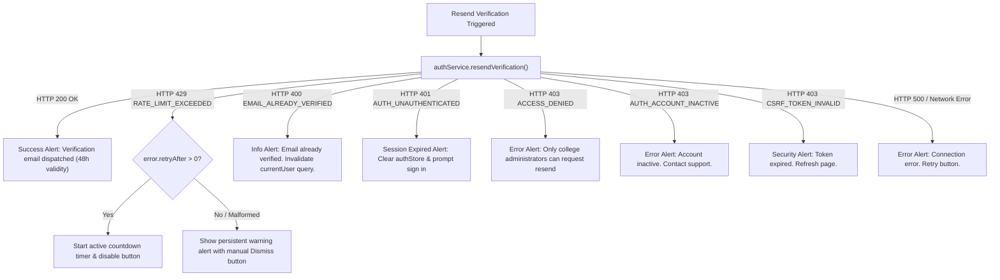

# Acadlytic — Phase 03, Module 3.2 Frontend Inspection & Planning Report
## Email Verification & Account Activation (Frontend) — v1.1

**Document Reference:** `docs/03-phase/phase-03-module-3.2-frontend-inspection-and-planning-report.md`  
**Target Module:** Phase 03, Module 3.2 — Email Verification & Account Activation (Frontend)  
**Authoritative Context Reference:** `docs/00-project-overview/ACADLYTIC_MASTER_CONTEXT.md`  
**Backend Reference Report:** `docs/03-phase/phase-03-module-3.2-inspection-and-planning-report.md` (v2.0.0)  
**Execution Mode:** Inspection & Planning Mode ONLY (No source code or status changes)  
**Status:** `INSPECTION_AND_PLANNING` (v1.1 Consolidated Revision)  
**Date:** 2026-11-24  

---

## 1. Executive Summary

This document presents the consolidated, authoritative inspection and implementation plan for **Phase 03, Module 3.2 — Email Verification & Account Activation (Frontend)**.

Following the approved backend implementation of Module 3.2 (verified with 237/237 tests on Testcontainers MySQL 8.0.36) and the approved frontend implementation of Module 3.1B (Public College Registration Portal), Module 3.2 delivers the user-facing verification experience. It enables newly registered institutions to redeem single-use 48-hour email verification tokens, handles all edge cases (expired, already-used, revoked, malformed tokens, inactive accounts), provides clear next-step onboarding guidance, and enables authenticated administrators to request fresh verification links under strict dual-layer rate limiting.

### Core Architectural Invariants
1. **Zero Session Creation on Token Redemption:** Consuming a verification token via `POST /api/v1/auth/verify-email` confirms email address ownership and timestamps `users.email_verified_at = NOW()`, but does **not** create an authenticated session (`ACADLYTIC_SID` is not set). Unauthenticated visitors remain guests and are directed to sign in at `/auth/login`.
2. **Strict Lifecycle Separation:** Email verification does **not** approve or activate a college. The institution remains in `CollegeApprovalStatus.PENDING` and `CollegeStatus.PENDING_VERIFICATION`. Academic management endpoints remain forbidden (`403 COLLEGE_NOT_APPROVED`). College approval remains the exclusive responsibility of Super Admin review (Module 3.4/3.5).
3. **Authenticated-Only Resend Quota:** `POST /api/v1/auth/resend-verification` strictly requires an authenticated `COLLEGE_ADMIN` session (`requireCurrentUserId()`). It cannot be called anonymously with arbitrary email addresses, eliminating email flooding and identity enumeration vectors.
4. **Authoritative Resolution of Unverified Login:** As verified empirically in backend code and integration tests, an `ACTIVE` but email-unverified `COLLEGE_ADMIN` **can authenticate** via `/api/v1/auth/login`. Upon login, `CollegeApprovalGuard` directs them to `/onboarding-status`. This provides the necessary recovery bridge: an unverified administrator who lost their initial email can log in to their restricted onboarding account to trigger resend.
5. **Robust Token URL Sanitization:** The sensitive token parameter is extracted and immediately sanitized from the URL using a React Router-compatible `setSearchParams(nextParams, { replace: true, state: location.state })` call before or concurrent with API dispatch. This preserves React Router history state, avoids duplicate requests, and prevents credential leakage in browser history, bookmarks, screenshots, or referrer headers.
6. **Rate-Limit Resilience:** Rate limit rejections (`429 RATE_LIMIT_EXCEEDED`) on resend requests reuse the centralized `parseRetryAfter` helper from Module 3.1B, enforcing active countdown timers without fabricating fallback durations.

---

## 2. Authoritative Inspection: Resolution of the Unverified Login Behavior

### 2.1 Backend Implementation & Filter Inspection

A rigorous inspection of the backend authentication pipeline was conducted across `AuthService.java`, `SecurityConfig.java`, `SessionValidationFilter.java`, and `EmailVerificationIntegrationTest.java`:

1. **`AuthService.login(LoginRequest, HttpServletRequest, HttpServletResponse)`:**
   - Lines 150–219 check:
     - Password hash match via BCrypt (`passwordEncoder.matches`).
     - MVP role enablement (`user.getRole().isActiveInMvp()`).
     - User suspension (`user.getStatus() == UserStatus.SUSPENDED`).
     - User activation (`user.getStatus() != UserStatus.ACTIVE`).
     - College tenant restrictions via `validateCollegeAllowsLogin(user, clientIp)`:
       - Associated college exists.
       - College is not permanently rejected (`college.isPermanentlyRejected()`).
       - College is not suspended (`college.getStatus() == CollegeStatus.SUSPENDED`).
       - College is not inactive/archived (`college.getStatus() == CollegeStatus.INACTIVE || college.getArchivedAt() != null`).
   - **Crucial Finding:** `AuthService.login` contains **no check** requiring `user.getEmailVerifiedAt() != null`. An unverified user whose status is `ACTIVE` and whose college status is `PENDING_VERIFICATION` passes all login checks and receives a valid `ACADLYTIC_SID` session cookie.

2. **`SessionValidationFilter.java`:**
   - Validates live session attributes on every authenticated request: session absolute lifetime (12h), user existence, active user status, active college status.
   - Contains **no check** blocking unverified emails from maintaining an authenticated session.

3. **`CollegeOnboardingService.java` (The Actual Gate):**
   - Line 689 explicitly checks `user.getEmailVerifiedAt() == null` **only when submitting the application for Super Admin review** (`POST /api/v1/college/onboarding/submit`):
     ```java
     if (user.getEmailVerifiedAt() == null) {
         throw new AppException(
                 "EMAIL_NOT_VERIFIED",
                 "Email must be verified before submitting registration application for review.",
                 HttpStatus.BAD_REQUEST);
     }
     ```
   - Viewing onboarding application data, reading the onboarding checklist, and requesting verification resend are fully permitted while authenticated.

4. **Authoritative Integration Test Evidence:**
   In [EmailVerificationIntegrationTest.java](file:///c:/React/Acadlytic/backend/src/test/java/com/acadlytic/modules/auth/EmailVerificationIntegrationTest.java#L424-L436), test `resendRateLimitingEnforcesMaxThreeRequestsPerUser()` executes:
   ```java
   registerCollegeAndGetToken("VERIFY-9", "admin9@horizon.edu");
   // user.getEmailVerifiedAt() is strictly NULL at this point!
   SessionCookies session = login("admin9@horizon.edu", ADMIN_PASSWORD);
   assertThat(session.sessionCookie()).isNotNull();

   // The unverified user successfully invokes authenticated resend:
   mockMvc.perform(post("/api/v1/auth/resend-verification")
                   .cookie(session.sessionCookie())
                   .cookie(session.xsrfCookie())
                   .header("X-XSRF-TOKEN", session.xsrfCookie().getValue()))
           .andExpect(status().isOk());
   ```
   This integration test conclusively proves that:
   - An unverified college administrator can log in.
   - An unverified college administrator must be authenticated to invoke `POST /api/v1/auth/resend-verification`.

### 2.2 Reconciliation with Module 3.1B Registration Success Guidance

- In Module 3.1B's `RegistrationSuccessView.tsx`, an informational note stated:  
  `"Note: You will be able to sign in once your email address is verified."`
- **Reconciliation:** That note reflected ideal user onboarding guidance (directing users to follow the primary email verification path first), but it was not a backend security barrier.
- If an unverified user navigates to `/auth/login` and signs in:
  1. Backend returns HTTP 200 with `CurrentUser` (`emailVerified: false`, `collegeApprovalStatus: "PENDING"`).
  2. Frontend `CollegeApprovalGuard` intercepts the unapproved administrator and routes them to `/onboarding-status`.
  3. On `/onboarding-status`, the application displays:
     `"Action Required: Email Address Not Verified"` along with the `<ResendVerificationButton />`.
- **Architectural Necessity:** This design is intentional and prevents a permanent lockout. If an unverified user were blocked from logging in, and their original verification email expired or was accidentally deleted, they could never call `POST /api/v1/auth/resend-verification` (which requires an authenticated session) and would be permanently trapped.
- **Blocker Assessment:** There is **no conflict** between backend implementation and core business rules. The backend contract is authoritative. The frontend planning report adopts this behavior without any backend code or rule changes.

---

## 3. Exact Backend API Contract Inventory

### 3.1 Email Verification Intake (`POST /api/v1/auth/verify-email`)

| Property | Value |
| :--- | :--- |
| **Endpoint URL** | `/api/v1/auth/verify-email` |
| **HTTP Method** | `POST` |
| **Authentication** | `Public` (`permitAll()` in Spring Security) |
| **CSRF Requirement** | Required (`X-XSRF-TOKEN` header matching `XSRF-TOKEN` cookie; auto-managed by `apiClient`) |
| **Request DTO** | `VerifyEmailRequest`: `token` (String, required, 20–255 chars) |
| **Success Envelope** | `ApiResponse<VerifyEmailResponse>` (HTTP 200 OK) |
| **Response Body** | `{"success": true, "message": "Email address verified successfully.", "data": {"email": "admin@horizon.edu", "emailVerified": true, "verifiedAt": "2026-11-24T19:00:00Z"}}` |
| **Session Impact** | **None.** No session cookie issued. Guest remains a guest. |

#### Error Matrix (`POST /verify-email`)
- `400 Bad Request` — `INVALID_OR_EXPIRED_TOKEN`: Token missing, expired (>48h), already consumed (`used_at != null`), revoked by resend (`revoked_at != null`), or target email mismatch. Message: `"The token is invalid or has expired."`
- `400 Bad Request` — `EMAIL_ALREADY_VERIFIED`: User account already has `email_verified_at != null`. Message: `"Your email address is already verified."`
- `400 Bad Request` — `VALIDATION_ERROR`: Token format invalid (blank, <20 or >255 chars).
- `403 Forbidden` — `AUTH_ACCOUNT_INACTIVE`: User status is not `ACTIVE`. Message: `"Your account is not active."`
- `403 Forbidden` — `CSRF_TOKEN_INVALID`: CSRF cookie missing or invalid header.
- `500 Internal Server Error` — `INTERNAL_ERROR`: Unexpected database error.

---

### 3.2 Authenticated Verification Resend (`POST /api/v1/auth/resend-verification`)

| Property | Value |
| :--- | :--- |
| **Endpoint URL** | `/api/v1/auth/resend-verification` |
| **HTTP Method** | `POST` |
| **Authentication** | `Authenticated` (`COLLEGE_ADMIN` session with `ACADLYTIC_SID` cookie) |
| **CSRF Requirement** | Required (`X-XSRF-TOKEN` header matching `XSRF-TOKEN` cookie) |
| **Request DTO** | Empty body (`{}`) |
| **Success Envelope** | `ApiResponse<Void>` (HTTP 200 OK) |
| **Response Body** | `{"success": true, "message": "A verification email has been sent to your registered email address.", "data": null}` |

#### Error Matrix (`POST /resend-verification`)
- `401 Unauthorized` — `AUTH_UNAUTHENTICATED`: No active session cookie or session expired. Message: `"Authenticated account not found."`
- `403 Forbidden` — `ACCESS_DENIED`: Caller role is not `COLLEGE_ADMIN` (e.g. `SUPER_ADMIN`). Message: `"Only college administrators can request verification resend."`
- `403 Forbidden` — `AUTH_ACCOUNT_INACTIVE`: Caller account is inactive/suspended.
- `403 Forbidden` — `CSRF_TOKEN_INVALID`: CSRF cookie/header expired or invalid after retry.
- `400 Bad Request` — `EMAIL_ALREADY_VERIFIED`: Caller email is already verified.
- `400 Bad Request` — `VALIDATION_ERROR`: Malformed request.
- `429 Too Many Requests` — `RATE_LIMIT_EXCEEDED`: Exceeded 3 requests / 15 min per user or 5 requests / 60 min per IP. Attaches standard `Retry-After: <seconds>` response header.

---

## 4. Finalized Route Architecture & Access Control

### 4.1 Route Placement & Guard Architecture

In `frontend/src/routes/index.tsx`, authentication routes under `/auth/*` are currently wrapped by `PublicOnlyRoute`:
```tsx
export const PublicOnlyRoute: React.FC = () => {
  const { isAuthenticated, user, isLoading } = useAuthStore();
  if (isAuthenticated && user) {
    if (user.role === 'SUPER_ADMIN') return <Navigate to="/admin/dashboard" replace />;
    return <Navigate to="/college/dashboard" replace />;
  }
  return <Outlet />;
};
```
If the verification route were placed inside `PublicOnlyRoute`, an authenticated administrator who clicks an email verification link (e.g., in the same browser) would be immediately redirected to `/college/dashboard` (which forwards to `/onboarding-status`), **never reaching the verification controller**.

#### Proposed Routing Hierarchy (`src/routes/index.tsx`)
Mount the verification page outside `PublicOnlyRoute` and outside `ProtectedRoute`, wrapped directly in `AuthLayout` for visual consistency:

```tsx
export const router = createBrowserRouter([
  {
    path: '/',
    element: <RootLayout />,
    children: [
      // 1. Dual-Mounted Verification Route (Accessible to BOTH Guest and Authenticated users)
      {
        element: <AuthLayout />,
        children: [
          {
            path: 'verify-email',
            element: <VerifyEmailPage />,
          },
          {
            path: 'auth/verify-email',
            element: <VerifyEmailPage />,
          },
        ],
      },

      // 2. Guest-Only Authentication Routes (Wrapped in PublicOnlyRoute)
      {
        path: 'auth',
        element: <PublicOnlyRoute />,
        children: [
          {
            element: <AuthLayout />,
            children: [
              { path: 'login', element: <LoginPage /> },
              { path: 'forgot-password', element: <ForgotPasswordPage /> },
              { path: 'reset-password', element: <ResetPasswordPage /> },
              { path: 'register-college', element: <RegisterCollegePage /> },
            ],
          },
        ],
      },
      ...
```

### 4.2 Benefits of Dual-Mount Architecture
1. **Direct Backend Alignment:** `EmailTemplateRenderer.java` generates `frontendBaseUrl + "/verify-email?token=" + token`. Mounting `/verify-email` ensures 100% link validity when clicked from email clients.
2. **Namespace Consistency:** Mounting `/auth/verify-email` ensures internal navigation and test paths remain fully functional.
3. **Zero Unintended Bounces:** Neither guest nor authenticated users are redirected away by guards prior to token evaluation.

---

## 5. Hardened React Router-Compatible Token URL Sanitization

### 5.1 Critique of `window.history.replaceState`
Executing `window.history.replaceState({}, '', window.location.pathname)` has known architectural drawbacks:
1. Overwrites `window.history.state` with an empty object `{}`.
2. Obliterates React Router's internal history state keys (`usr`, `key`, `idx`), breaking back/forward history traversal and clearing location state (such as `location.state.from`).
3. Leaves React Router's internal `useSearchParams` hook desynchronized until a subsequent router navigation occurs.

### 5.2 React Router v6-Native Sanitization Strategy
We adopt React Router's native `useSearchParams` updater with history replacement and state preservation:

```tsx
import { useSearchParams, useLocation } from 'react-router-dom';
import { useRef, useEffect } from 'react';

export const VerifyEmailPage: React.FC = () => {
  const [searchParams, setSearchParams] = useSearchParams();
  const location = useLocation();

  // Read raw token once into memory
  const initialToken = searchParams.get('token');
  const tokenToVerifyRef = useRef<string | null>(initialToken);
  const hasExecutedRef = useRef<boolean>(false);

  useEffect(() => {
    const rawToken = tokenToVerifyRef.current;

    // 1. If token is present and execution has not commenced:
    if (rawToken && !hasExecutedRef.current) {
      hasExecutedRef.current = true;

      // 2. Strip 'token' param using React Router, preserving existing router state:
      const nextParams = new URLSearchParams(searchParams);
      nextParams.delete('token');
      setSearchParams(nextParams, {
        replace: true,
        state: location.state,
      });

      // 3. Dispatch single-use verification mutation
      verifyEmailMutation.mutate({ token: rawToken });
    }
  }, [searchParams, setSearchParams, location.state]);
```

### 5.3 Behavior on Lifecycle Events
- **Initial Link Click:** URL `/verify-email?token=abc...` $\to$ Token captured in `tokenToVerifyRef` $\to$ Address bar cleanly updated to `/verify-email` via `replace: true` $\to$ Mutation dispatched $\to$ Zero history pollution.
- **React 18 StrictMode Double-Mount:** `hasExecutedRef.current` flags `true` on the first synchronous pass, strictly preventing duplicate mutation calls.
- **Browser Refresh:** Because the URL was already sanitized to `/verify-email` on mount, a browser refresh sees `token === null`. The page renders the clean `MISSING_TOKEN` state with options to sign in, rather than firing an expired token mutation.
- **Direct Access (No Query Param):** Mounts with `token === null` $\to$ Renders `MISSING_TOKEN` state immediately without firing network requests.

---

## 6. Complete Resend Error State Handling

When invoking `POST /api/v1/auth/resend-verification`, the frontend maps every backend HTTP status and error code to actionable UX states:



### 6.1 Exhaustive Error Handling Specifications

| HTTP Status | Error Code | UI Behavior & Recovery Action |
| :--- | :--- | :--- |
| **429** | `RATE_LIMIT_EXCEEDED` | **Valid `retryAfter`:** Sets `countdown = retryAfter`. Button disabled. Shows: *"Too many resend requests. Please wait {countdown} seconds before requesting another email."*<br>**Missing/Invalid `retryAfter`:** Shows persistent warning: *"Too many resend requests from this IP address. Please wait a while before retrying."* Button remains enabled with manual "Dismiss". Zero invented countdowns. |
| **400** | `EMAIL_ALREADY_VERIFIED` | Info Alert: *"Your email address is already verified."* Hides resend button. Triggers `queryClient.invalidateQueries(queryKeys.auth.currentUser())` to sync authenticated state. |
| **401** | `AUTH_UNAUTHENTICATED` | Session has expired. Triggers `useAuthStore.getState().clearAuth()`. Displays Alert: *"Your session has expired. Please sign in again to request a new verification email."* Provides button linking to `/auth/login`. |
| **403** | `ACCESS_DENIED` | Error Alert: *"Access Denied: Only college administrators can request verification resend."* Resend button disabled. |
| **403** | `AUTH_ACCOUNT_INACTIVE` | Error Alert: *"Account Inactive: Your account has been suspended or deactivated. Please contact Acadlytic platform support."* |
| **403** | `CSRF_TOKEN_INVALID` | Security Alert: *"Security Token Error: Your session security token has expired. Please refresh the page and try again."* |
| **400** | `VALIDATION_ERROR` | Error Alert: *"Invalid Request: Unable to process verification resend. Please contact support."* |
| **500** | `INTERNAL_ERROR` / Network | Connection Alert: *"Unable to reach Acadlytic. Please check your internet connection and try again."* Enables manual retry. |

---

## 7. Mutation Lifecycle, State Transitions & Concurrency Invariants

### 7.1 `currentUser` Cache Invalidation Rules
- **Guest Verification (Unauthenticated):**
  - Caller has no session cookie. `queryClient.invalidateQueries(queryKeys.auth.currentUser())` is a no-op (or guest 401 probe).
  - When the user subsequently logs in via `/auth/login`, `login` automatically writes the fresh `CurrentUser` (`emailVerified: true`) to the store.
- **Authenticated Verification:**
  - Caller has an active `ACADLYTIC_SID` session (e.g., verifying while already logged in).
  - Executing `queryClient.invalidateQueries(queryKeys.auth.currentUser())` on verification success is **mandatory**.
  - It refetches `GET /api/v1/auth/me`, updating `useAuthStore` with `emailVerified = true`.
  - On `/onboarding-status`, this immediately clears the unverified warning banner and enables document submission gates without requiring a manual sign-out/sign-in cycle.

### 7.2 Concurrency & Race-Condition Prevention
- **Resend vs. Verification Mutual Exclusion:**
  - In the backend, invoking `resendVerification` immediately revokes all prior active tokens (`authTokenService.revokeActiveTokensForUser`).
  - If a user clicks "Resend" while a verification request is in-flight, the verification request could be invalidated mid-flight.
  - **Invariant:** The `<ResendVerificationButton />` is strictly disabled whenever a verification mutation is pending (`verifyEmailMutation.isPending`).
  - Conversely, while a resend request is in-flight (`resendMutation.isPending`), verification triggers are locked.
- **Duplicate Verification Prevention:**
  - `hasExecutedRef.current` ensures that only one `verifyEmail` mutation is dispatched per page mount.
  - The submit/retry button is disabled during in-flight states (`isPending === true`).

---

## 8. Proposed Component & Service Specifications

### 8.1 Proposed File Inventory

```text
frontend/src/
├── types/
│   └── index.ts                                         [MODIFIED: Add VerifyEmailRequest & VerifyEmailResponse]
├── schemas/
│   └── verificationSchema.ts                           [CREATED: Zod validation for token]
├── services/
│   ├── authService.ts                                  [MODIFIED: Add verifyEmail & resendVerification API methods]
│   └── queryKeys.ts                                    [MODIFIED: Add emailVerification query keys]
├── hooks/
│   └── useEmailVerification.ts                         [CREATED: TanStack mutation hooks for verify & resend]
├── components/
│   └── verification/
│       ├── VerifyEmailStatusCard.tsx                   [CREATED: Presentational state card for verification lifecycle]
│       └── ResendVerificationButton.tsx                [CREATED: Self-contained resend button with countdown]
├── pages/
│   ├── auth/
│   │   └── VerifyEmailPage.tsx                         [CREATED: Main verification page controller]
│   └── OnboardingStatusPage.tsx                        [MODIFIED: Add email verification status banner + resend]
├── routes/
│   └── index.tsx                                       [MODIFIED: Mount /verify-email and /auth/verify-email]
└── test/
    └── email-verification.test.tsx                     [CREATED: Comprehensive Vitest suite]
```

### 8.2 Exact Type Definitions (`src/types/index.ts`)

```ts
// Request payload for verifying email token
export interface VerifyEmailRequest {
  token: string;
}

// Response payload confirming email verification
export interface VerifyEmailResponse {
  email: string;
  emailVerified: boolean;
  verifiedAt: string; // ISO-8601 timestamp string
}
```

### 8.3 Validation Schema (`src/schemas/verificationSchema.ts`)

```ts
import { z } from 'zod';

export const verifyEmailSchema = z.object({
  token: z
    .string({ required_error: 'Verification token is required' })
    .trim()
    .min(20, 'Verification token is invalid')
    .max(255, 'Verification token is invalid'),
});

export type VerifyEmailFormValues = z.infer<typeof verifyEmailSchema>;
```

### 8.4 Service Enhancements (`src/services/authService.ts`)

```ts
  /**
   * Redeems a single-use 48-hour email verification token.
   * Public endpoint; does NOT establish an authenticated session.
   */
  verifyEmail: async (
    payload: VerifyEmailRequest
  ): Promise<VerifyEmailResponse> => {
    const response = await apiClient.post<ApiResponse<VerifyEmailResponse>>(
      '/auth/verify-email',
      payload
    );
    return response.data.data;
  },

  /**
   * Requests a fresh 48-hour verification token for the authenticated COLLEGE_ADMIN.
   * Enforces dual-layer rate limits (3 requests / 15 min per user, 5 / 60 min per IP).
   */
  resendVerification: async (): Promise<void> => {
    await apiClient.post<ApiResponse<void>>('/auth/resend-verification');
  },
```

### 8.5 TanStack Query Hooks (`src/hooks/useEmailVerification.ts`)

- **`useVerifyEmail`:**
  - Mutation executing `authService.verifyEmail`.
  - `onSuccess`: Invalidates `queryKeys.auth.currentUser()`.
  - Exposes typed `ApiError` to the caller.
- **`useResendVerification`:**
  - Mutation executing `authService.resendVerification`.
  - Manages `countdown` timer state.
  - On 429: extracts `error.retryAfter` using `parseRetryAfter` and engages timer.
  - Cleans up active `setInterval` on component unmount.

---

## 9. Comprehensive Acceptance Test Plan

Testing will be implemented in `frontend/src/test/email-verification.test.tsx` using Vitest, React Testing Library, and MSW/mock handlers.

### Proposed Test Scenarios (24 Scenarios)

| # | Scenario Description | Expected Outcome |
| :---: | :--- | :--- |
| **1** | URL token extraction and address bar sanitization | Reads `?token=abc...`, strips token from URL via `setSearchParams({ replace: true })`, dispatches API call once. |
| **2** | Preservation of React Router history state | Verifies `location.state` (e.g. `{ from: '/custom' }`) is preserved after token removal. |
| **3** | Dual-route mount: `/verify-email` access | Successfully mounts and verifies when visiting `/verify-email?token=...`. |
| **4** | Dual-route mount: `/auth/verify-email` access | Successfully mounts and verifies when visiting `/auth/verify-email?token=...`. |
| **5** | Authenticated user verification page access | Authenticated user visits `/verify-email` and is NOT redirected to `/college/dashboard` by `PublicOnlyRoute`. |
| **6** | Successful verification (HTTP 200) as Guest | Displays `"Email Verified Successfully"`, verified email, timestamp, and button linking to `/auth/login`. |
| **7** | Successful verification as Authenticated User | Displays success view and button linking to `/onboarding-status`. Invalidates `currentUser` query. |
| **8** | Separation notice: college review is separate | Displays explicit notice that institution review remains pending Super Admin evaluation. |
| **9** | Missing token parameter in URL | Renders `"No Verification Token Found"` card with links to `/auth/login` and `/auth/register-college`. |
| **10** | Token length < 20 characters | Client-side validation rejects token before API dispatch, displaying format warning. |
| **11** | Expired or invalid token (`INVALID_OR_EXPIRED_TOKEN` 400) | Displays `"Verification Link Invalid or Expired"`, advises token expires in 48h. |
| **12** | Guest view on expired token | Prompts user to sign in to request a fresh verification email. |
| **13** | Authenticated view on expired token | Renders active `<ResendVerificationButton />` allowing direct resend. |
| **14** | Already verified token (`EMAIL_ALREADY_VERIFIED` 400) | Displays `"Email Already Verified"` card with direct link to sign in. |
| **15** | Inactive user account (`AUTH_ACCOUNT_INACTIVE` 403) | Displays `"Account Inactive"` error card advising user to contact support. |
| **16** | Access denied on resend (`ACCESS_DENIED` 403) | Displays `"Access Denied: Only college administrators can request verification resend."` |
| **17** | Terminal CSRF token failure (`CSRF_TOKEN_INVALID` 403) | Displays security token error alert after interceptor retry exhaustion. |
| **18** | Resend rate limit exceeded with valid `Retry-After: 60` | Disables button, displays active countdown timer (60s decrementing). |
| **19** | Resend rate limit exceeded with missing/malformed header | Displays persistent warning without fabricated countdown; button remains usable with dismiss. |
| **20** | Duplicate verification submission prevention | StrictMode double-mount or fast double-render triggers API request strictly once. |
| **21** | Duplicate resend submission prevention | In-flight resend mutation disables button, preventing concurrent clicks. |
| **22** | Concurrency lock between verify and resend | Resend button is disabled while email verification is pending. |
| **23** | Component remount after token sanitization | Page refresh after token strip sees no query param and renders clean direct-access view. |
| **24** | `OnboardingStatusPage` dynamic email banner | Shows verification warning and resend button when `emailVerified: false`; hides when `emailVerified: true`. |

---

## 10. Dependencies, Implementation Sequence & Risk Management

### 10.1 Implementation Sequence (Upon Formal Approval)
1. **Step 1 — Types & Schemas:** Update `frontend/src/types/index.ts` and create `frontend/src/schemas/verificationSchema.ts`.
2. **Step 2 — Services & Query Keys:** Update `frontend/src/services/authService.ts` and `frontend/src/services/queryKeys.ts`.
3. **Step 3 — Mutation Hooks:** Create `frontend/src/hooks/useEmailVerification.ts`.
4. **Step 4 — Components:** Create `VerifyEmailStatusCard.tsx` and `ResendVerificationButton.tsx`.
5. **Step 5 — Pages & Routing:** Create `VerifyEmailPage.tsx`, update `routes/index.tsx`, and enhance `OnboardingStatusPage.tsx`.
6. **Step 6 — Automated Verification:** Implement `src/test/email-verification.test.tsx` (24 scenarios), run full test suite (`npm test`), and verify production build (`npm run build`).
7. **Step 7 — Documentation:** Generate `docs/03-phase/phase-03-module-3.2-frontend-implementation-report.md`.

### 10.2 Risk Mitigation Matrix

| Potential Risk | Severity | Mitigation Strategy |
| :--- | :---: | :--- |
| **Email Link Path Mismatch** | Medium | Mount route at **both** `/verify-email` and `/auth/verify-email`. |
| **History State Corruption** | High | Use React Router's `setSearchParams(..., { replace: true, state: location.state })` rather than raw `window.history.replaceState({}, ...)`. |
| **Strict Mode Double-Consumption** | High | Enforce `hasExecutedRef.current` guard before dispatching mutation. |
| **Unverified Admin Locked Out** | Critical | Verified that `login` is permitted for unverified active college admins, providing direct access to resend on `/onboarding-status`. |

---

## 11. Verification and Approval Boundary

In accordance with strict planning discipline:
- **Zero application source code files were modified.**
- **Zero backend code, migrations, or contracts were altered.**
- **`ACADLYTIC_MASTER_CONTEXT.md` was NOT modified.**
- **Module 3.2 remains in `NOT_STARTED` / `INSPECTION_AND_PLANNING` status.**
- Ready for formal developer review and implementation authorization.
