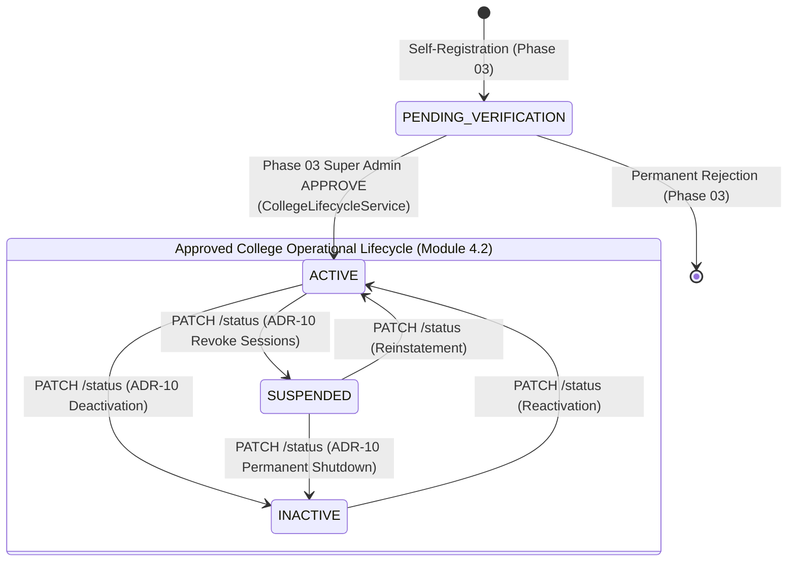

# Acadlytic — Module 4.2 Detailed Implementation Plan v1.0
## Super Admin College Management APIs (Backend)

**Module:** 4.2 — Super Admin College Management APIs  
**Phase:** 04 — College Management (Tenant Management & Profile)  
**Parent Epic:** Epic E2 — Tenant Management & Profile  
**Approved Phase Plan:** `docs/04-phase/Acadlytic_Phase_04_Final_Module_Breakdown_and_Dependency_Plan_v1.2.md`  
**Approved Dependency Baseline:** Module 4.1 Plan v1.2 & Implementation (APPROVED 2026-11-28)  
**Document Version:** 1.0  
**Planning Status:** DRAFT — PENDING DEVELOPER REVIEW & APPROVAL  
**Implementation Status:** NOT_STARTED  

---

## 1. Executive Summary & Scope

### 1.1 Purpose
This document provides the implementation-ready technical plan for **Module 4.2: Super Admin College Management APIs**. 

Module 4.2 delivers the central administrative backend capabilities enabling platform Super Administrators (`SUPER_ADMIN`) to govern the multi-tenant directory of colleges across the Acadlytic SaaS platform. It provides enterprise-grade tenant visibility, search, multi-field filtering, deterministic pagination, deep college profile inspection, and controlled operational lifecycle transitions with immediate server-side session invalidation under ADR-05 and ADR-10.

### 1.2 Module Scope Boundaries
Module 4.2 is strictly a **Backend API module** owned by Epic E2.

```
┌────────────────────────────────────────────────────────────────────────────────┐
│                           PHASE 04 MODULE TOPOLOGY                             │
├──────────────────────────────┬─────────────────────────────┬───────────────────┤
│ Module 4.1 (APPROVED)        │ Module 4.2 (THIS PLAN)      │ Module 4.3        │
│ Schema & Profile Foundation  │ Super Admin College APIs    │ College Admin APIs│
│ - Flyway V7 Migration        │ - Directory Listing API     │ - Self-Service    │
│ - Entity Extension           │ - College Details API       │   Profile API     │
│ - Authoritative Backfill     │ - Status Transition Engine  │   (Module 4.3)    │
│ - Lifecycle Sync Hook        │ - ADR-10 Session Revocation │                   │
├──────────────────────────────┼─────────────────────────────┼───────────────────┤
│ Module 4.4                   │ Module 4.5 & 4.6            │ Module 4.7        │
│ Admin Assignment/Succession  │ Frontend UIs                │ Hardening & IDOR  │
│ - Admin Succession API       │ - Super Admin UI (4.5)      │ - Multi-Tenant    │
│ - ADR-05/06 Token/Lockout    │ - College Admin UI (4.6)    │   Penetration Test│
└──────────────────────────────┴─────────────────────────────┴───────────────────┘
```

#### In Scope for Module 4.2:
1. **Platform Directory Listing Endpoint (`GET /api/v1/super-admin/colleges`):**
   - Paginated, filterable, searchable directory of all tenant colleges.
   - Dynamic search across college identity fields (`name`, `code`, `contactEmail`, `affiliatedUniversityName`).
   - Filtering by operational status (`status`), approval status (`approvalStatus`), university affiliation (`affiliatedUniversity`), city, and state.
   - Deterministic sorting with secondary tie-breaker (`id ASC`) and pagination boundaries (`page >= 0`, `size 1..100`, default `20`).
   - Zero N+1 query guarantee: batch-fetching active `COLLEGE_ADMIN` profiles for the retrieved page in O(1) database queries.
2. **College Details Endpoint (`GET /api/v1/super-admin/colleges/{id}`):**
   - Comprehensive read-model returning core tenant identity, all 13 operational profile attributes, onboarding/revision metadata, and active `COLLEGE_ADMIN` profile summary.
   - Strict field isolation: sensitive credentials, hashes, auth tokens, session IDs, and private registration document storage keys are never exposed.
3. **Controlled Operational Status Management (`PATCH /api/v1/super-admin/colleges/{id}/status`):**
   - Explicit state machine governing operational status transitions (`ACTIVE`, `SUSPENDED`, `INACTIVE`).
   - Strict decoupling between onboarding approval status (`approvalStatus`) and operational status (`status`).
   - Mandatory transition preconditions preventing mutation of unapproved (`PENDING_VERIFICATION`), permanently rejected (`permanentlyRejected = true`), or archived (`archivedAt != null`) colleges.
   - Mandatory execution of **ADR-10** immediate session revocation via `SessionRevocationService.revokeAllSessionsForCollege(collegeId)` upon suspension or deactivation.
   - Optimistic concurrency control via `@Version` detecting and rejecting stale updates with HTTP 409 `STALE_RECORD_VERSION`.
4. **Super Admin Profile Update Endpoint (`PUT /api/v1/super-admin/colleges/{id}`):**
   - Allows platform Super Administrators to administratively correct or update operational profile attributes.
   - Preserves immutable identity constraints (`code` is strictly immutable).
   - Enforces College Name Governance: college legal name updates are audited with prior/new values.
5. **Auditing & Outbox Integration:**
   - Transactional audit event recording via existing `AuditEventService`.
   - Transactional outbox email notification dispatch via existing `OutboxEmailService` notifying the active `COLLEGE_ADMIN` when tenant status changes.

#### Explicitly Out of Scope for Module 4.2:
- Direct college creation: Public self-registration (`POST /api/v1/college-registrations`) in Phase 03 remains the sole MVP college intake path.
- College Admin self-service profile updates: Owned exclusively by **Module 4.3** (`/api/v1/colleges/my-college`).
- College Admin assignment, succession, or invitation token mechanics: Owned exclusively by **Module 4.4** (`/api/v1/super-admin/colleges/{id}/admin`).
- Frontend user interfaces: Owned by **Module 4.5** (Super Admin) and **Module 4.6** (College Admin).
- Binary college logo upload/streaming: Post-MVP per Phase 04 v1.2 decision; only `logoStorageKey` metadata is managed.

---

## 2. Repository Findings & Existing Reusable Components

Inspection of the actual codebase confirms the following foundational assets and conventions:

### 2.1 Confirmed Entities & Enums
- **`College.java` (`com.acadlytic.modules.colleges.entity.College`):**
  - Extended in Module 4.1 with all 13 operational profile fields (`addressLine1`, `addressLine2`, `city`, `state`, `country`, `postalCode`, `contactPhone`, `contactEmail`, `websiteUrl`, `affiliatedUniversityName`, `establishedYear`, `accreditationDetails`, `logoStorageKey`).
  - Contains optimistic concurrency version: `@Version @Column(name = "version", nullable = false) private Long version = 0L;`.
  - Enforces DB-generated virtual column: `active_college_code` ensuring unique codes among non-archived, non-rejected colleges.
  - Contains helper method: `isManagementUnlocked()` requiring `approvalStatus == APPROVED && status == ACTIVE && !permanentlyRejected && archivedAt == null`.
- **`CollegeStatus.java`:**
  - Enum constants: `PENDING_VERIFICATION`, `ACTIVE`, `INACTIVE`, `SUSPENDED`.
- **`CollegeApprovalStatus.java`:**
  - Enum constants: `PENDING`, `ACTION_REQUIRED`, `APPROVED`, `REJECTED`.
- **`CollegeRepository.java`:**
  - Currently extends `JpaRepository<College, Long>`.
  - Can extend `JpaSpecificationExecutor<College>` to support type-safe, dynamic predicate assembly for multi-field filtering and search without manual SQL concatenation.

### 2.2 Security, Guards & Session Invalidation
- **`CollegeAccessGuard.java` (`com.acadlytic.security.CollegeAccessGuard`):**
  - `requireSuperAdmin()`: Validates current authenticated principal has `Role.SUPER_ADMIN`, throwing HTTP 403 `ACCESS_DENIED`.
  - `requireSameTenant(Long targetCollegeId)`: Blocks cross-tenant access.
  - `requireApprovedAndActiveCollege(Long targetCollegeId)`: Live database check throwing HTTP 403 `COLLEGE_SUSPENDED`, `COLLEGE_INACTIVE`, or `COLLEGE_NOT_APPROVED`.
- **`SessionRevocationService.java` (`com.acadlytic.security.SessionRevocationService`):**
  - Fully implemented and verified in Phase 02/03.
  - Method `revokeAllSessionsForCollege(Long collegeId)` queries `userRepository.findByCollegeId(collegeId)` and deletes all active session records from `SPRING_SESSION` via `FindByIndexNameSessionRepository`.
  - Directly satisfies **ADR-05** and **ADR-10**.

### 2.3 Auditing & Outbox Infrastructure
- **`AuditEventService.java` (`com.acadlytic.modules.auth.service.AuditEventService`):**
  - Method `record(...)`: Enforces `Propagation.REQUIRED` inside existing transaction, stripping sensitive credentials, tokens, and hashes.
  - Method `recordIndependently(...)`: Enforces `Propagation.REQUIRES_NEW` for recording security denials even if outer transaction rolls back.
  - `AuditEventType.java`: Contains `COLLEGE_ACTIVATED`, `COLLEGE_PERMANENTLY_REJECTED`, `COLLEGE_ADMIN_DEACTIVATED`. Requires non-breaking Java enum additions: `COLLEGE_SUSPENDED`, `COLLEGE_DEACTIVATED`, `COLLEGE_PROFILE_UPDATED`.
  - Underlying database column `audit_events.event_type` is `VARCHAR(64) NOT NULL` with zero check constraints; adding enum values in Java requires **zero Flyway database migration**.
- **`OutboxEmailService.java` (`com.acadlytic.modules.outbox.service.OutboxEmailService`):**
  - Method `enqueue(eventType, recipientEmail, subject, templateKey, payload)` enqueues outbound email records inside the caller's transaction under ADR-18.
  - Dispatched asynchronously by `OutboxEmailWorker` strictly outside database transactions.

### 2.4 Existing Response & Pagination Conventions
- **`ApiResponse<T>` (`com.acadlytic.common.response.ApiResponse`):**
  - Standard JSON envelope: `{ "success": true, "message": "...", "data": { ... }, "timestamp": "..." }`.
- **`PageResponse<T>` (`com.acadlytic.common.dto.PageResponse`):**
  - Standard pagination envelope: `{ "content": [ ... ], "page": 0, "size": 20, "totalElements": 42, "totalPages": 3, "last": false }`.
- **`AppException.java` & `GlobalExceptionHandler.java`:**
  - Standardized error codes translated to HTTP status codes (e.g. 400 `VALIDATION_ERROR`, 403 `ACCESS_DENIED`, 404 `COLLEGE_NOT_FOUND`, 409 `CONFLICT` / `STALE_RECORD_VERSION`).

---

## 3. Functional Requirements

### 3.1 College Listing & Directory (`FR-4.2-01`)
- **FR-4.2-01.1:** The endpoint must accept optional query parameters: `search`, `status`, `approvalStatus`, `affiliatedUniversity`, `city`, `state`, `page`, `size`, and `sort`.
- **FR-4.2-01.2:** When `search` is provided (trimmed, 1..100 characters), the query must match case-insensitively against `colleges.name`, `colleges.code`, `colleges.contact_email`, or `colleges.affiliated_university_name`.
- **FR-4.2-01.3:** Filter parameters must be combined using logical `AND`. An omitted or blank parameter must not restrict the query.
- **FR-4.2-01.4:** Pagination parameters must validate `page >= 0` and `1 <= size <= 100`. Default `page` is `0`; default `size` is `20`.
- **FR-4.2-01.5:** Sort parameters must validate against a strict whitelist: `name`, `code`, `status`, `approvalStatus`, `createdAt`, `updatedAt`, `city`, `state`, `affiliatedUniversityName`. Default sort is `createdAt,desc`.
- **FR-4.2-01.6:** Every sort specification must deterministically append secondary tie-breaker `id ASC` to prevent row displacement across paginated requests.
- **FR-4.2-01.7:** The directory response must batch-fetch active `COLLEGE_ADMIN` summaries for all colleges on the page in a single query (`findByCollegeIdInAndRoleAndStatus`), guaranteeing zero N+1 database queries.
- **FR-4.2-01.8:** Null or incomplete profile attributes must serialize as `null` without throwing NullPointerExceptions.

### 3.2 College Details Retrieval (`FR-4.2-02`)
- **FR-4.2-02.1:** Retrieves full college details by path parameter `id`. Returns HTTP 404 `COLLEGE_NOT_FOUND` if the ID does not exist.
- **FR-4.2-02.2:** Exposes core identity (`id`, `name`, `code`, `approvalStatus`, `status`, `permanentlyRejected`, `archivedAt`, `version`, timestamps).
- **FR-4.2-02.3:** Exposes all 13 operational profile attributes populated in Module 4.1 (`addressLine1`, `addressLine2`, `city`, `state`, `country`, `postalCode`, `contactPhone`, `contactEmail`, `websiteUrl`, `affiliatedUniversityName`, `establishedYear`, `accreditationDetails`, `logoStorageKey`).
- **FR-4.2-02.4:** Returns a derived boolean flag `hasLogo` (`logoStorageKey != null && !logoStorageKey.isBlank()`).
- **FR-4.2-02.5:** Exposes registration/approval lifecycle metadata: `currentRegistrationId`, `resubmissionCount`, `actionRequiredCount`, and the latest submitted revision's version number and timestamp.
- **FR-4.2-02.6:** Exposes active `COLLEGE_ADMIN` summary: `adminUserId`, `adminFirstName`, `adminLastName`, `adminFullName`, `adminEmail`, `adminStatus`, `adminEmailVerified`. If no active admin is assigned, these fields return `null`.
- **FR-4.2-02.7:** Strict security isolation: never returns user passwords, password hashes, auth tokens, session IDs, or private document storage keys.

### 3.3 Controlled Operational Status Transitions (`FR-4.2-03`)
- **FR-4.2-03.1:** The endpoint must accept path parameter `id` and payload containing `status` (`CollegeStatus`), mandatory `reason` (5..500 characters), and optional `version` (`Long`) for concurrency verification.
- **FR-4.2-03.2:** Rejects transition requests on unapproved colleges (`approvalStatus != APPROVED` or `status == PENDING_VERIFICATION`) with HTTP 409 `COLLEGE_NOT_APPROVED`.
- **FR-4.2-03.3:** Rejects transition requests on permanently rejected colleges (`permanentlyRejected == true`) with HTTP 409 `REGISTRATION_PERMANENTLY_REJECTED`.
- **FR-4.2-03.4:** Rejects transition requests on archived colleges (`archivedAt != null`) with HTTP 409 `COLLEGE_ARCHIVED`.
- **FR-4.2-03.5:** Validates state machine rules (Section 6). Disallowed transitions return HTTP 400 `INVALID_STATUS_TRANSITION`.
- **FR-4.2-03.6:** Requests setting the same status as current return HTTP 400 `SAME_STATUS_NOOP` with an informative error message.
- **FR-4.2-03.7:** Suspending (`ACTIVE -> SUSPENDED`) or deactivating (`ACTIVE -> INACTIVE` or `SUSPENDED -> INACTIVE`) a college must execute **ADR-10** immediate session revocation: calling `sessionRevocationService.revokeAllSessionsForCollege(college.getId())`.
- **FR-4.2-03.8:** Records an audit event (`COLLEGE_SUSPENDED`, `COLLEGE_DEACTIVATED`, or `COLLEGE_ACTIVATED`) with actor, target college, previous status, new status, and reason inside the transaction.
- **FR-4.2-03.9:** Enqueues an outbox email notification to the active College Admin informing them of the status change and reason.

### 3.4 Super Admin Profile Update (`FR-4.2-04`)
- **FR-4.2-04.1:** Accepts path parameter `id` and request body containing editable operational profile fields and optimistic locking `version`.
- **FR-4.2-04.2:** College `code` is strictly immutable; any payload attempting to alter `code` is ignored or rejected with HTTP 400 `FIELD_IMMUTABLE`.
- **FR-4.2-04.3:** College `approvalStatus` and `status` cannot be altered via PUT; they must be managed via dedicated lifecycle and status endpoints.
- **FR-4.2-04.4:** College `name` can be updated by Super Admin; if updated, an audit event recording `oldName` and `newName` is mandatory.
- **FR-4.2-04.5:** Optimistic locking check: if `request.version != college.version`, throws HTTP 409 `STALE_RECORD_VERSION`.

---

## 4. Endpoint Contract Table

All endpoints are mapped under the Super Admin namespace and enforce role `SUPER_ADMIN`.

| Method | Endpoint Path | Description | Request Body | Response Body | HTTP Status |
| :--- | :--- | :--- | :--- | :--- | :--- |
| `GET` | `/api/v1/super-admin/colleges` | Paginated college directory with search and multi-filtering | None (Query params) | `ApiResponse<PageResponse<SuperAdminCollegeListItemResponse>>` | 200, 400, 401, 403 |
| `GET` | `/api/v1/super-admin/colleges/{id}` | Deep college inspection, full operational profile & admin summary | None | `ApiResponse<SuperAdminCollegeDetailResponse>` | 200, 401, 403, 404 |
| `PATCH`| `/api/v1/super-admin/colleges/{id}/status` | Controlled operational status transition with ADR-10 revocation | `UpdateCollegeStatusRequest` | `ApiResponse<CollegeStatusTransitionResponse>` | 200, 400, 401, 403, 404, 409 |
| `PUT` | `/api/v1/super-admin/colleges/{id}` | Super Admin operational profile update with concurrency check | `SuperAdminUpdateCollegeProfileRequest` | `ApiResponse<SuperAdminCollegeDetailResponse>` | 200, 400, 401, 403, 404, 409 |

---

## 5. DTO Specifications

All DTOs are Java records implementing clean, immutable contract serialization.

### 5.1 Request DTOs

#### `UpdateCollegeStatusRequest.java`
```java
package com.acadlytic.modules.colleges.dto;

import com.acadlytic.modules.colleges.entity.CollegeStatus;
import jakarta.validation.constraints.NotBlank;
import jakarta.validation.constraints.NotNull;
import jakarta.validation.constraints.Size;

public record UpdateCollegeStatusRequest(
        @NotNull(message = "Target operational status is required.")
        CollegeStatus targetStatus,

        @NotBlank(message = "Reason for status transition is mandatory.")
        @Size(min = 5, max = 500, message = "Reason must be between 5 and 500 characters.")
        String reason,

        Long expectedVersion
) {}
```

#### `SuperAdminUpdateCollegeProfileRequest.java`
```java
package com.acadlytic.modules.colleges.dto;

import jakarta.validation.constraints.Email;
import jakarta.validation.constraints.Min;
import jakarta.validation.constraints.NotNull;
import jakarta.validation.constraints.Pattern;
import jakarta.validation.constraints.Size;

public record SuperAdminUpdateCollegeProfileRequest(
        @Size(max = 255, message = "College name must not exceed 255 characters.")
        String name,

        @Size(max = 255, message = "Address Line 1 must not exceed 255 characters.")
        String addressLine1,

        @Size(max = 255, message = "Address Line 2 must not exceed 255 characters.")
        String addressLine2,

        @Size(max = 100, message = "City must not exceed 100 characters.")
        String city,

        @Size(max = 100, message = "State must not exceed 100 characters.")
        String state,

        @Size(max = 100, message = "Country must not exceed 100 characters.")
        String country,

        @Pattern(regexp = "^[0-9]{5,10}$|^$", message = "Postal code must be 5 to 10 digits.")
        String postalCode,

        @Pattern(regexp = "^\\+?[0-9\\s\\-\\(\\)]{7,25}$|^$", message = "Invalid phone number format.")
        String contactPhone,

        @Email(message = "Invalid institutional contact email format.")
        @Size(max = 255, message = "Contact email must not exceed 255 characters.")
        String contactEmail,

        @Pattern(regexp = "^(https?://)?[a-zA-Z0-9\\-\\.]+\\.[a-zA-Z]{2,}(/.*)?$|^$", message = "Invalid website URL format.")
        @Size(max = 255, message = "Website URL must not exceed 255 characters.")
        String websiteUrl,

        @Size(max = 255, message = "Affiliated university name must not exceed 255 characters.")
        String affiliatedUniversityName,

        @Min(value = 1800, message = "Established year must be valid (>= 1800).")
        Integer establishedYear,

        @Size(max = 255, message = "Accreditation details must not exceed 255 characters.")
        String accreditationDetails,

        @Size(max = 255, message = "Logo storage key must not exceed 255 characters.")
        String logoStorageKey,

        @NotNull(message = "Optimistic locking version is mandatory for updates.")
        Long version
) {}
```

### 5.2 Response DTOs

#### `SuperAdminCollegeListItemResponse.java`
```java
package com.acadlytic.modules.colleges.dto;

import com.acadlytic.modules.colleges.entity.CollegeApprovalStatus;
import com.acadlytic.modules.colleges.entity.CollegeStatus;

import java.time.Instant;

public record SuperAdminCollegeListItemResponse(
        Long id,
        String name,
        String code,
        CollegeApprovalStatus approvalStatus,
        CollegeStatus status,
        boolean permanentlyRejected,
        String city,
        String state,
        String affiliatedUniversityName,
        String contactPhone,
        String contactEmail,
        String logoStorageKey,
        boolean hasLogo,
        Long adminUserId,
        String adminFullName,
        String adminEmail,
        Instant createdAt,
        Instant updatedAt
) {}
```

#### `SuperAdminCollegeDetailResponse.java`
```java
package com.acadlytic.modules.colleges.dto;

import com.acadlytic.modules.auth.entity.UserStatus;
import com.acadlytic.modules.colleges.entity.CollegeApprovalStatus;
import com.acadlytic.modules.colleges.entity.CollegeStatus;

import java.time.Instant;

public record SuperAdminCollegeDetailResponse(
        // Core Identity
        Long id,
        String name,
        String code,
        CollegeApprovalStatus approvalStatus,
        CollegeStatus status,
        boolean permanentlyRejected,
        Instant archivedAt,

        // Operational Profile Attributes
        String addressLine1,
        String addressLine2,
        String city,
        String state,
        String country,
        String postalCode,
        String contactPhone,
        String contactEmail,
        String websiteUrl,
        String affiliatedUniversityName,
        Integer establishedYear,
        String accreditationDetails,
        String logoStorageKey,
        boolean hasLogo,

        // Lifecycle & Revision Context
        Long currentRegistrationId,
        Integer currentRegistrationVersion,
        Instant currentRegistrationSubmittedAt,
        int resubmissionCount,
        int actionRequiredCount,

        // Active Administrator Summary
        AdminSummary admin,

        // Audit & Concurrency Metadata
        Long version,
        Instant createdAt,
        Instant updatedAt
) {
    public record AdminSummary(
            Long userId,
            String firstName,
            String lastName,
            String fullName,
            String email,
            UserStatus status,
            boolean emailVerified
    ) {}
}
```

#### `CollegeStatusTransitionResponse.java`
```java
package com.acadlytic.modules.colleges.dto;

import com.acadlytic.modules.colleges.entity.CollegeStatus;

import java.time.Instant;

public record CollegeStatusTransitionResponse(
        Long collegeId,
        String collegeCode,
        CollegeStatus previousStatus,
        CollegeStatus currentStatus,
        String reason,
        int revokedSessionsCount,
        Long version,
        Instant updatedAt
) {}
```

---

## 6. Operational Status Transition Matrix

The operational status lifecycle is strictly partitioned from the Phase 03 onboarding approval lifecycle.



### 6.1 Transition Rules & Enforcement Table

| Source State | Target State | Allowed? | Preconditions & Invariants | Session Revocation (ADR-10) | Audit Event | Outbox Email | Error Code on Failure |
| :--- | :--- | :--- | :--- | :--- | :--- | :--- | :--- |
| `PENDING_VERIFICATION` | *Any* | **NO** | Operational status cannot be patched before onboarding approval. | None | `UNAUTHORIZED_ACCESS_DENIED` | None | `409 COLLEGE_NOT_APPROVED` |
| *Any* | `PENDING_VERIFICATION`| **NO** | Approved college cannot revert to pending verification. | None | `UNAUTHORIZED_ACCESS_DENIED` | None | `400 INVALID_STATUS_TRANSITION` |
| `ACTIVE` | `SUSPENDED` | **YES** | `approvalStatus == APPROVED`, not permanently rejected, not archived. Reason mandatory. | **Mandatory:** `revokeAllSessionsForCollege` | `COLLEGE_SUSPENDED` | `COLLEGE_SUSPENDED` | `400 / 409` |
| `ACTIVE` | `INACTIVE` | **YES** | `approvalStatus == APPROVED`, not permanently rejected, not archived. Reason mandatory. | **Mandatory:** `revokeAllSessionsForCollege` | `COLLEGE_DEACTIVATED`| `COLLEGE_DEACTIVATED`| `400 / 409` |
| `SUSPENDED` | `ACTIVE` | **YES** | `approvalStatus == APPROVED`, not permanently rejected, not archived. Reason mandatory. | None (No active sessions exist) | `COLLEGE_ACTIVATED` | `COLLEGE_ACTIVATED` | `400 / 409` |
| `SUSPENDED` | `INACTIVE` | **YES** | `approvalStatus == APPROVED`, not permanently rejected, not archived. Reason mandatory. | **Mandatory (Defensive):** `revokeAllSessionsForCollege` | `COLLEGE_DEACTIVATED`| `COLLEGE_DEACTIVATED`| `400 / 409` |
| `INACTIVE` | `ACTIVE` | **YES** | `approvalStatus == APPROVED`, not permanently rejected, not archived. Reason mandatory. | None (Users re-authenticate) | `COLLEGE_ACTIVATED` | `COLLEGE_ACTIVATED` | `400 / 409` |
| `INACTIVE` | `SUSPENDED` | **NO** | An inactive college cannot be suspended directly; must be activated first. | None | None | None | `400 INVALID_STATUS_TRANSITION` |
| `X` | `X` (Same state) | **NO** | Transition to identical status is rejected as a redundant no-op. | None | None | None | `400 SAME_STATUS_NOOP` |
| *Any* (Perm Rejected) | *Any* | **NO** | Permanently rejected colleges (`permanentlyRejected == true`) are locked permanently. | None | `UNAUTHORIZED_ACCESS_DENIED` | None | `409 REGISTRATION_PERMANENTLY_REJECTED` |
| *Any* (Archived) | *Any* | **NO** | Archived colleges (`archivedAt != null`) cannot be modified. | None | `UNAUTHORIZED_ACCESS_DENIED` | None | `409 COLLEGE_ARCHIVED` |

---

## 7. Authorization & Tenant Isolation Design

### 7.1 Server-Side Role Enforcement
- Every endpoint in Module 4.2 enforces `@PreAuthorize("hasRole('SUPER_ADMIN')")` at the controller class level.
- Defense-in-depth: `CollegeAccessGuard.requireSuperAdmin()` is called within `CollegeManagementService` before executing query or mutation logic.
- Non-Super Admin principals (including `COLLEGE_ADMIN`, `ACADEMIC_STAFF`, or unauthenticated requests) receive HTTP 403 Forbidden.

### 7.2 IDOR & Query-Level Scoping
- **Super Admin Platform Scope:** Super Admin is authorized across all tenants. However, client-supplied `collegeId` is never trusted without database verification.
- **Entity Existence Check:** If `collegeRepository.findById(id)` returns empty, the service throws HTTP 404 `COLLEGE_NOT_FOUND` ("College not found with ID: " + id).
- **Regression Defense:** Dedicated security regression tests must prove that:
  1. A `COLLEGE_ADMIN` session attempting to call `GET /api/v1/super-admin/colleges` receives HTTP 403.
  2. A `COLLEGE_ADMIN` session attempting to call `PATCH /api/v1/super-admin/colleges/{ownCollegeId}/status` receives HTTP 403.
  3. A `COLLEGE_ADMIN` session attempting to call `PATCH /api/v1/super-admin/colleges/{otherCollegeId}/status` receives HTTP 403.

---

## 8. Audit and Session/Outbox Behavior

### 8.1 Audit Trail Integration
Audit records are persisted through `AuditEventService` inside the transaction:
- **Status Change Audit Event:**
  - `eventType`: `COLLEGE_SUSPENDED`, `COLLEGE_DEACTIVATED`, or `COLLEGE_ACTIVATED`.
  - `actorUserId`: ID of authenticated Super Admin.
  - `actorRole`: `Role.SUPER_ADMIN`.
  - `targetUserId`: Active College Admin user ID (if assigned).
  - `collegeId`: Target college ID.
  - `outcome`: `AuditOutcome.SUCCESS`.
  - `metadataJson`:
    ```json
    {
      "collegeCode": "VCET",
      "previousStatus": "ACTIVE",
      "newStatus": "SUSPENDED",
      "reason": "Regulatory compliance audit pending documentation",
      "revokedSessionsCount": 3,
      "expectedVersion": 4
    }
    ```
- **Profile Mutation Audit Event:**
  - `eventType`: `COLLEGE_PROFILE_UPDATED`.
  - Metadata includes modified field names, with specific tracking of `previousName` and `newName` when college name is altered.
- **Unauthorized / Blocked Attempt Auditing:**
  - Attempting to modify permanently rejected or archived colleges invokes `auditEventService.recordIndependently(AuditEventType.UNAUTHORIZED_ACCESS_DENIED, ...)` in `Propagation.REQUIRES_NEW`.

### 8.2 ADR-10 Session Revocation Mechanics
When status transitions to `SUSPENDED` or `INACTIVE`:
1. `sessionRevocationService.revokeAllSessionsForCollege(college.getId())` is called.
2. The service queries `userRepository.findByCollegeId(college.getId())`.
3. For every user belonging to that college, it locates all session IDs in `SPRING_SESSION` indexed by principal name (`user:<id>`) and deletes them.
4. Returns the total count of revoked sessions for logging and response metadata.
5. In accordance with ADR-10, any in-flight or subsequent request from an affected user session immediately fails authentication/session lookup (HTTP 401) or is blocked by `CollegeAccessGuard` (HTTP 403 `COLLEGE_SUSPENDED` / `COLLEGE_INACTIVE`).

### 8.3 Outbox Email Notification
Inside the status transition transaction:
- Calls `outboxEmailService.enqueue(...)`:
  - `eventType`: `"COLLEGE_STATUS_UPDATED"`
  - `recipientEmail`: Active `COLLEGE_ADMIN.email`
  - `subject`: `"Important: Acadlytic College Account Status Update - " + college.getName()`
  - `templateKey`: `targetStatus.name()` (e.g. `"COLLEGE_SUSPENDED"`, `"COLLEGE_DEACTIVATED"`, `"COLLEGE_ACTIVATED"`)
  - `payload`: `{ "firstName": admin.getFirstName(), "collegeName": college.getName(), "status": targetStatus.name(), "reason": reason }`

---

## 9. Transaction and Concurrency Design

### 9.1 Transaction Boundaries
- **Read Operations (`getColleges`, `getCollegeDetail`):** Annotated with `@Transactional(readOnly = true)`.
- **Status Transition (`updateCollegeStatus`):** Annotated with `@Transactional(propagation = Propagation.REQUIRED)`. Ensures college update, audit logging, session deletion, and outbox enqueueing succeed atomically.
- **Profile Update (`updateCollegeProfile`):** Annotated with `@Transactional(propagation = Propagation.REQUIRED)`.

### 9.2 Optimistic Locking (@Version)
- Both `PATCH /status` and `PUT` verify optimistic concurrency via `College.version`.
- If the incoming request specifies `expectedVersion` or `version`, the service verifies `Objects.equals(college.getVersion(), request.version())`.
- If a mismatch occurs, or if JPA detects a concurrent database update via `OptimisticLockException` / `ObjectOptimisticLockingFailureException`, the system translates it to HTTP 409 Conflict:
  ```json
  {
    "success": false,
    "errorCode": "STALE_RECORD_VERSION",
    "message": "The college record has been modified by another administrator. Please refresh and try again."
  }
  ```

---

## 10. Error Codes and Validation Behavior

The API translates domain exceptions into standard HTTP responses:

| HTTP Status | Error Code | Trigger Condition |
| :--- | :--- | :--- |
| `400 Bad Request` | `VALIDATION_ERROR` | Validation failure on pagination, search length (>100 chars), or profile field formats. |
| `400 Bad Request` | `INVALID_SORT_PROPERTY`| Sort property requested is not in the allowed sort whitelist. |
| `400 Bad Request` | `INVALID_STATUS_TRANSITION` | Transition violates the state machine (e.g. `INACTIVE -> SUSPENDED`). |
| `400 Bad Request` | `SAME_STATUS_NOOP` | Target status equals current status. |
| `400 Bad Request` | `FIELD_IMMUTABLE` | Attempting to mutate immutable identity (`code`) via PUT. |
| `401 Unauthorized`| `UNAUTHENTICATED` | Request missing valid session cookie. |
| `403 Forbidden`   | `ACCESS_DENIED` | Non-Super Admin user invoking Super Admin APIs. |
| `404 Not Found`   | `COLLEGE_NOT_FOUND` | College ID not found in database. |
| `409 Conflict`    | `COLLEGE_NOT_APPROVED` | Attempting operational status transition on an unapproved college (`PENDING_VERIFICATION`). |
| `409 Conflict`    | `REGISTRATION_PERMANENTLY_REJECTED`| Attempting operational status transition on a permanently rejected college. |
| `409 Conflict`    | `COLLEGE_ARCHIVED` | Attempting operational status transition on an archived college. |
| `409 Conflict`    | `STALE_RECORD_VERSION`| Concurrent update conflict detected via `@Version`. |

---

## 11. Database / Query / Index Strategy

### 11.1 Dynamic Query Specification (`CollegeSpecifications.java`)
To handle combinations of search and multiple filters without fragile JPQL string manipulation, `CollegeRepository` extends `JpaSpecificationExecutor<College>`. A dedicated specification builder assembles predicates:

```java
public class CollegeSpecifications {
    public static Specification<College> withFilters(
            String search,
            CollegeStatus status,
            CollegeApprovalStatus approvalStatus,
            String affiliatedUniversity,
            String city,
            String state) {
        return (root, query, cb) -> {
            List<Predicate> predicates = new ArrayList<>();

            if (search != null && !search.isBlank()) {
                String pattern = "%" + search.trim().toLowerCase() + "%";
                Predicate nameMatch = cb.like(cb.lower(root.get("name")), pattern);
                Predicate codeMatch = cb.like(cb.lower(root.get("code")), pattern);
                Predicate emailMatch = cb.like(cb.lower(root.get("contactEmail")), pattern);
                Predicate uniMatch = cb.like(cb.lower(root.get("affiliatedUniversityName")), pattern);
                predicates.add(cb.or(nameMatch, codeMatch, emailMatch, uniMatch));
            }

            if (status != null) {
                predicates.add(cb.equal(root.get("status"), status));
            }
            if (approvalStatus != null) {
                predicates.add(cb.equal(root.get("approvalStatus"), approvalStatus));
            }
            if (affiliatedUniversity != null && !affiliatedUniversity.isBlank()) {
                predicates.add(cb.like(cb.lower(root.get("affiliatedUniversityName")), "%" + affiliatedUniversity.trim().toLowerCase() + "%"));
            }
            if (city != null && !city.isBlank()) {
                predicates.add(cb.like(cb.lower(root.get("city")), "%" + city.trim().toLowerCase() + "%"));
            }
            if (state != null && !state.isBlank()) {
                predicates.add(cb.like(cb.lower(root.get("state")), "%" + state.trim().toLowerCase() + "%"));
            }

            return cb.and(predicates.toArray(new Predicate[0]));
        };
    }
}
```

### 11.2 Index Verification & Assessment
- **Existing Indexes (Confirmed):**
  - `idx_colleges_approval_status ON colleges(approval_status)` (Flyway V3)
  - `idx_colleges_status ON colleges(status)` (Flyway V3)
  - `uq_colleges_active_college_code UNIQUE (active_college_code)` (Flyway V3)
  - `PRIMARY KEY (id)`
- **Assessment for MVP Scale:**
  - In MVP, the number of college tenants is bounded (hundreds to low thousands).
  - Existing indexes on `status` and `approval_status` satisfy standard directory filtering.
  - Adding an index on `name` or `affiliated_university_name` is **not required for MVP scale** and would introduce schema migration overhead without performance justification.
  - **Decision:** Zero database migrations required for Module 4.2.

---

## 12. Concrete Test Matrix

All tests must execute against real **Testcontainers MySQL 8.0.36** via `AbstractMySqlIntegrationTest` (or service unit tests where isolated logic is verified). Zero H2 substitution.

### 12.1 Directory Listing & Search Integration Tests (`DIR-01` to `DIR-08`)
- `DIR-01 (Default Listing)`: Super Admin calls `GET /api/v1/super-admin/colleges` with no parameters. Verifies default pagination (`page=0, size=20`), sorting by `createdAt DESC, id ASC`, and batch-fetched admin summaries.
- `DIR-02 (Pagination Boundaries)`: Verify `page=1, size=5` returns exact slice and correct `totalPages`, `totalElements`, and `last` flags. Verify `page < 0` or `size > 100` returns HTTP 400 `VALIDATION_ERROR`.
- `DIR-03 (Identity Search)`: Search string `"Tech"` matches college name `"Tech University"`, code `"TECH-01"`, contact email `"admin@tech.edu"`, or university `"State Tech University"`.
- `DIR-04 (Multi-Filter Combination)`: Filter by `status=ACTIVE` AND `approvalStatus=APPROVED` AND `state=Maharashtra`. Verifies query returns only colleges matching all predicates simultaneously.
- `DIR-05 (Null & Partial Profile Colleges)`: Seed colleges with null operational profile fields (from fresh registration or legacy backfill). Verify directory listing returns cleanly without NPEs and represents nulls correctly in JSON.
- `DIR-06 (Empty Results Handling)`: Query matching no records returns HTTP 200 with `content: []`, `totalElements: 0`, and `totalPages: 0`.
- `DIR-07 (Whitelisted Sorting)`: Verify sorting by `name,asc`, `status,desc`, `city,asc` works correctly and rejects invalid sort properties with HTTP 400 `INVALID_SORT_PROPERTY`.
- `DIR-08 (Zero N+1 Query Verification)`: Verify using Hibernate SQL query interceptor or statement count logger that page of 20 colleges executes strictly 3 queries (count + colleges + admins).

### 12.2 College Details Integration Tests (`DET-01` to `DET-04`)
- `DET-01 (Full Detail Inspection)`: Query existing approved college with active admin and operational fields. Verify all 13 profile fields, derived `hasLogo`, revision numbers, and admin details are returned.
- `DET-02 (Sensitive Field Exclusion)`: Inspect JSON payload of details response; assert that `password`, `passwordHash`, `token`, `secret`, `sessionId`, and document storage paths are completely absent.
- `DET-03 (College Not Found)`: Query non-existent ID `999999`. Verify returns HTTP 404 with error code `COLLEGE_NOT_FOUND`.
- `DET-04 (Unassigned Admin Details)`: Query approved college where no active College Admin is assigned. Verify `admin` object returns `null` without error.

### 12.3 Status Transition Integration Tests (`STA-01` to `STA-10`)
- `STA-01 (Active to Suspended with ADR-10)`: Transition `ACTIVE -> SUSPENDED`. Verify database status updated, audit event `COLLEGE_SUSPENDED` created, outbox email enqueued, and `sessionRevocationService.revokeAllSessionsForCollege` called.
- `STA-02 (Suspension Immediate Lockout)`: Log in as College Admin to obtain active session. Call `PATCH /status` to `SUSPENDED` as Super Admin. Execute subsequent request with College Admin session; verify immediately rejected with HTTP 401 or HTTP 403 `COLLEGE_SUSPENDED`.
- `STA-03 (Suspended to Active Reinstatement)`: Transition `SUSPENDED -> ACTIVE`. Verify status updated to `ACTIVE`, audit event `COLLEGE_ACTIVATED` recorded, and College Admin can log in again.
- `STA-04 (Active to Inactive Deactivation)`: Transition `ACTIVE -> INACTIVE`. Verify status updated to `INACTIVE`, all active sessions revoked, and audit event `COLLEGE_DEACTIVATED` recorded.
- `STA-05 (Suspended to Inactive)`: Transition `SUSPENDED -> INACTIVE`. Verify status updated to `INACTIVE`.
- `STA-06 (Inactive to Suspended Rejection)`: Transition `INACTIVE -> SUSPENDED`. Verify rejected with HTTP 400 `INVALID_STATUS_TRANSITION`.
- `STA-07 (Same Status Redundant Request)`: Request transition `ACTIVE -> ACTIVE`. Verify rejected with HTTP 400 `SAME_STATUS_NOOP`.
- `STA-08 (Pending Verification Lockout)`: Attempt `PATCH /status` on college with `status=PENDING_VERIFICATION`. Verify rejected with HTTP 409 `COLLEGE_NOT_APPROVED`.
- `STA-09 (Permanently Rejected Lockout)`: Attempt `PATCH /status` on college with `permanentlyRejected=true`. Verify rejected with HTTP 409 `REGISTRATION_PERMANENTLY_REJECTED`.
- `STA-10 (Archived College Lockout)`: Attempt `PATCH /status` on college with `archivedAt != null`. Verify rejected with HTTP 409 `COLLEGE_ARCHIVED`.

### 12.4 Concurrency & Profile Update Tests (`CON-01` to `CON-04`)
- `CON-01 (Optimistic Locking Status Collision)`: Two concurrent status updates send stale version `0`. The second request fails with HTTP 409 `STALE_RECORD_VERSION`.
- `CON-02 (Super Admin Profile Update)`: Super Admin updates operational profile attributes (`city`, `websiteUrl`, `contactPhone`). Verify attributes persist and version increments.
- `CON-03 (College Name Mutation & Auditing)`: Super Admin updates college `name`. Verify name updates and audit event `COLLEGE_PROFILE_UPDATED` records previous and new name.
- `CON-04 (Immutable Code Protection)`: Attempt `PUT` with altered `code`. Verify `code` remains unchanged in the database.

### 12.5 Security, Role & IDOR Tests (`SEC-01` to `SEC-04`)
- `SEC-01 (College Admin Directory Rejection)`: College Admin calls `GET /api/v1/super-admin/colleges`. Verify HTTP 403 `ACCESS_DENIED`.
- `SEC-02 (College Admin Details Rejection)`: College Admin calls `GET /api/v1/super-admin/colleges/{ownId}`. Verify HTTP 403 `ACCESS_DENIED`.
- `SEC-03 (College Admin Status Patch Rejection)`: College Admin calls `PATCH /api/v1/super-admin/colleges/{ownId}/status`. Verify HTTP 403 `ACCESS_DENIED`.
- `SEC-04 (Unauthenticated Directory Rejection)`: Unauthenticated request to Super Admin APIs returns HTTP 401 Unauthorized.

---

## 13. File-Level Implementation Map

```
backend/
├── src/main/java/com/acadlytic/
│   ├── modules/
│   │   ├── auth/
│   │   │   └── entity/
│   │   │       └── AuditEventType.java                  [MODIFY: add COLLEGE_SUSPENDED, COLLEGE_DEACTIVATED, COLLEGE_PROFILE_UPDATED]
│   │   ├── colleges/
│   │   │   ├── controller/
│   │   │   │   └── SuperAdminCollegeController.java     [CREATE: 4 Super Admin REST endpoints]
│   │   │   ├── dto/
│   │   │   │   ├── SuperAdminCollegeListItemResponse.java [CREATE: Directory list DTO]
│   │   │   │   ├── SuperAdminCollegeDetailResponse.java   [CREATE: Deep inspection DTO]
│   │   │   │   ├── UpdateCollegeStatusRequest.java        [CREATE: Status mutation request DTO]
│   │   │   │   ├── SuperAdminUpdateCollegeProfileRequest.java [CREATE: Profile update request DTO]
│   │   │   │   └── CollegeStatusTransitionResponse.java   [CREATE: Status mutation response DTO]
│   │   │   ├── repository/
│   │   │   │   ├── CollegeRepository.java                 [MODIFY: extend JpaSpecificationExecutor<College>]
│   │   │   │   └── CollegeSpecifications.java             [CREATE: dynamic predicate builder]
│   │   │   └── service/
│   │   │       └── CollegeManagementService.java          [CREATE: business logic, state machine, ADR-10 revocation]
│   │   └── outbox/
│   │       └── service/
│   │           └── EmailTemplateRenderer.java           [MODIFY: add COLLEGE_SUSPENDED, COLLEGE_DEACTIVATED, COLLEGE_ACTIVATED cases]
└── src/test/java/com/acadlytic/modules/colleges/
    ├── SuperAdminCollegeIntegrationTest.java            [CREATE: complete Testcontainers MockMvc test suite]
    └── service/
        └── CollegeManagementServiceUnitTest.java        [CREATE: isolated state machine & revocation unit tests]
```

---

## 14. Dependencies and Explicit Exclusions

### 14.1 Prerequisites
- **Module 4.1:** Flyway V7 schema migration, operational profile columns, and `College.java` extensions are approved and functional.
- **Phase 03 Baseline:** Document review gates and approval lifecycle remain untouched.

### 14.2 Module Boundaries & Downstream Dependencies
- **Module 4.3 (College Admin Profile APIs):**
  - Module 4.3 will implement `GET /api/v1/colleges/my-college` and `PUT /api/v1/colleges/my-college`.
  - Module 4.2 does **NOT** expose `/api/v1/colleges/my-college`.
- **Module 4.4 (College Admin Assignment & Succession):**
  - Module 4.4 will implement admin succession, invitation token generation, and virtual column (`active_college_admin`) enforcement.
  - Module 4.2 details endpoint returns **read-only** summary of the active admin; it does not assign or replace admins.
- **Module 4.5 (Super Admin UI):**
  - Module 4.5 will consume the endpoints delivered by Module 4.2.

---

## 15. Open Decisions & Risks

| # | Topic | Proposed Plan Recommendation | Trade-off / Impact | Status |
| :--- | :--- | :--- | :--- | :--- |
| **1** | **College Name Mutation Governance** | Permit Super Admin update of `name` via PUT with mandatory audit logging (`COLLEGE_PROFILE_UPDATED`). Keep `code` strictly immutable. | Allows correction of typos in official name without bypassing review audit trail. | **RECOMMENDED** (Awaiting Owner Confirmation) |
| **2** | **Redundant Same-Status Requests** | Return HTTP 400 `SAME_STATUS_NOOP` if target status equals current status. | Clarifies intent, prevents false-positive audit logs and unnecessary session revocation. | **RECOMMENDED** |
| **3** | **Active Admin Summary in Details DTO** | Include basic read-only admin summary (`userId`, `fullName`, `email`, `status`) in `SuperAdminCollegeDetailResponse`. | Provides complete tenant context to Super Admin UI without separate network requests. | **RECOMMENDED** |
| **4** | **Database Index Migration** | Do not add new database indexes in Module 4.2. Existing indexes on `status` and `approval_status` are sufficient. | Avoids unnecessary Flyway migration overhead for low-volume tenant table. | **CONFIRMED** |

---

## 16. Acceptance Criteria and Implementation Sequence

### 16.1 Acceptance Criteria
1. `GET /api/v1/super-admin/colleges` supports search, multi-filtering, deterministic sorting, and pagination with zero N+1 queries.
2. `GET /api/v1/super-admin/colleges/{id}` returns complete operational profile, registration context, and active admin summary without exposing credentials or internal storage paths.
3. `PATCH /api/v1/super-admin/colleges/{id}/status` enforces state transitions, optimistic locking, audit logging, and **ADR-10** session revocation upon suspension/deactivation.
4. `PUT /api/v1/super-admin/colleges/{id}` enables operational profile update, enforces optimistic locking, and protects immutable code.
5. All endpoints strictly enforce `SUPER_ADMIN` authorization; all non-Super Admin requests are rejected with HTTP 403.
6. All 26+ integration and unit test scenarios pass cleanly on Testcontainers MySQL 8.0.36.

### 16.2 Recommended Implementation Sequence
1. **Step 1:** Extend `AuditEventType.java` with operational management events (`COLLEGE_SUSPENDED`, `COLLEGE_DEACTIVATED`, `COLLEGE_PROFILE_UPDATED`).
2. **Step 2:** Update `EmailTemplateRenderer.java` with template rendering cases for college status changes.
3. **Step 3:** Extend `CollegeRepository.java` with `JpaSpecificationExecutor<College>` and implement `CollegeSpecifications.java`.
4. **Step 4:** Author request and response DTOs in `com.acadlytic.modules.colleges.dto`.
5. **Step 5:** Implement `CollegeManagementService.java` with status transition state machine, optimistic locking translation, and ADR-10 session revocation.
6. **Step 6:** Implement `SuperAdminCollegeController.java` with OpenAPI documentation and role authorization annotations.
7. **Step 7:** Author unit tests in `CollegeManagementServiceUnitTest.java`.
8. **Step 8:** Author complete integration test suite in `SuperAdminCollegeIntegrationTest.java` running on Testcontainers MySQL 8.0.36.
9. **Step 9:** Execute full backend regression suite to ensure zero regressions across Phase 01–03 tests.

---

### End of Plan (v1.0)
*Artifact File Path:* `docs/04-phase/Acadlytic_Module_4.2_Detailed_Implementation_Plan_v1.0.md`
