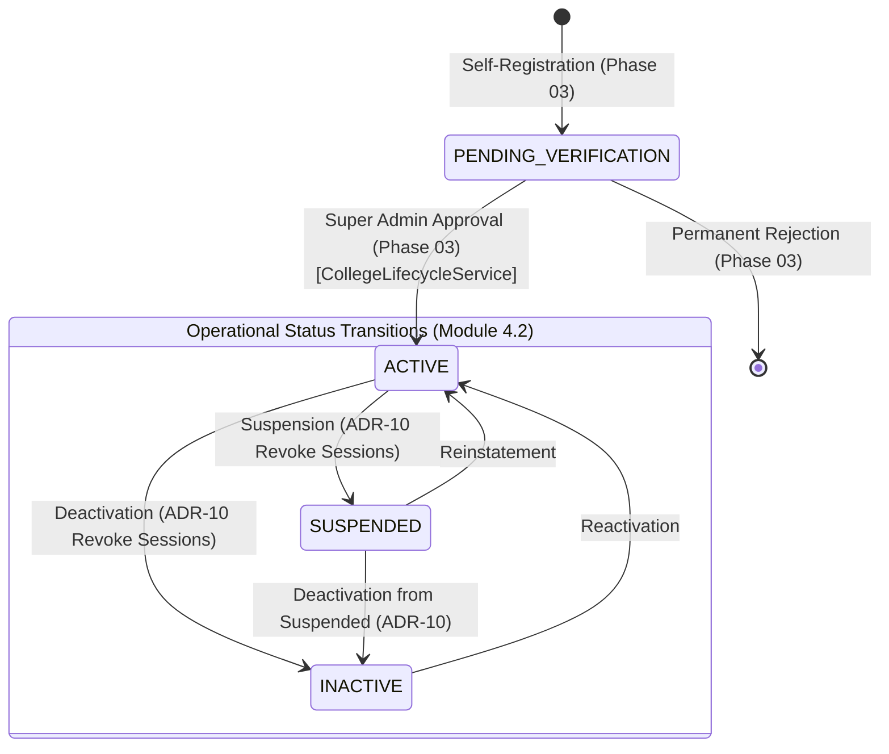

# Acadlytic — Module 4.2 Detailed Implementation Plan v1.1
## Super Admin College Management APIs (Backend)

**Module:** 4.2 — Super Admin College Management APIs  
**Phase:** 04 — College Management (Tenant Management & Profile)  
**Parent Epic:** Epic E2 — Tenant Management & Profile  
**Approved Phase Plan:** `docs/04-phase/Acadlytic_Phase_04_Final_Module_Breakdown_and_Dependency_Plan_v1.2.md`  
**Approved Dependency Baseline:** Module 4.1 Plan v1.2 & Implementation (APPROVED 2026-11-28)  
**Document Version:** 1.1 (Consolidated Revision resolving Developer Review Findings)  
**Planning Status:** DRAFT — PENDING DEVELOPER REVIEW & APPROVAL  
**Implementation Status:** NOT_STARTED  

---

## 1. Executive Summary & Scope

### 1.1 Purpose
This document provides the consolidated, implementation-ready technical plan (v1.1) for **Module 4.2: Super Admin College Management APIs**. 

Module 4.2 delivers the central administrative backend capabilities enabling platform Super Administrators (`SUPER_ADMIN`) to govern the multi-tenant directory of colleges across the Acadlytic SaaS platform. It provides enterprise-grade tenant visibility, search, multi-field filtering, deterministic pagination, deep college profile inspection, and controlled operational lifecycle transitions with immediate server-side session invalidation under ADR-05 and ADR-10.

Version 1.1 resolves all material findings identified during developer review of v1.0, specifically:
1. Reconciling operational status semantics (`ACTIVE`, `SUSPENDED`, `INACTIVE`) and distinguishing reversible administrative deactivation from permanently irreversible actions.
2. Establishing a mandatory optimistic concurrency contract (`expectedVersion`) with explicit two-tier collision defense (pre-check and database flush) and genuine multi-threaded integration verification.
3. Defining a strict full-replacement profile update (PUT) contract with explicit clearing semantics, field immutability, and open governance tracking for college name editing.
4. Protecting internal storage metadata by replacing raw `logoStorageKey` exposure with safe `hasLogo` boolean and non-sensitive metadata.
5. Grounding college revision context strictly on the verified authoritative `College.currentRegistrationId` pointer without leaking private document keys.
6. Aligning audit event types (`COLLEGE_SUSPENDED`, `COLLEGE_DEACTIVATED`, `COLLEGE_REACTIVATED`, `COLLEGE_PROFILE_UPDATED`) and outbox email contracts with existing transactional infrastructure.
7. Correcting directory search input normalization, wildcard escaping (`%`, `_`), and bounded O(1) query-count verification.

### 1.2 Module Scope Boundaries
Module 4.2 is strictly a **Backend API module** owned by Epic E2.

```
┌────────────────────────────────────────────────────────────────────────────────┐
│                           PHASE 04 MODULE TOPOLOGY                             │
├──────────────────────────────┬─────────────────────────────┬───────────────────┤
│ Module 4.1 (APPROVED)        │ Module 4.2 (THIS PLAN v1.1) │ Module 4.3        │
│ Schema & Profile Foundation  │ Super Admin College APIs    │ College Admin APIs│
│ - Flyway V7 Migration        │ - Directory Listing API     │ - Self-Service    │
│ - Entity Extension           │ - College Details API       │   Profile API     │
│ - Authoritative Backfill     │ - Status Transition Engine  │   (Module 4.3)    │
│ - Lifecycle Sync Hook        │ - ADR-10 Session Revocation │                   │
├──────────────────────────────┼─────────────────────────────┼───────────────────┤
│ Module 4.4                   │ Module 4.5 & 4.6            │ Module 4.7        │
│ Admin Assignment/Succession  │ Frontend UIs                │ Hardening & IDOR  │
│ - Admin Succession API       │ - Super Admin UI (4.5)      │ - Multi-Tenant    │
│ - ADR-05/06 Token/Lockout    │ - College Admin UI (4.6)    │   Penetration Test│
└──────────────────────────────┴─────────────────────────────┴───────────────────┘
```

#### In Scope for Module 4.2:
1. **Platform Directory Listing Endpoint (`GET /api/v1/super-admin/colleges`):**
   - Paginated, filterable, searchable directory of all tenant colleges.
   - Dynamic search across college identity fields (`name`, `code`, `contactEmail`, `affiliatedUniversityName`) with SQL wildcard escaping.
   - Filtering by operational status (`status`), approval status (`approvalStatus`), university affiliation (`affiliatedUniversity`), city, and state.
   - Deterministic sorting with secondary tie-breaker (`id ASC`) and pagination boundaries (`page >= 0`, `size 1..100`, default `20`).
   - Zero N+1 query guarantee: batch-fetching active `COLLEGE_ADMIN` profiles for the retrieved page in bounded O(1) database queries.
2. **College Details Endpoint (`GET /api/v1/super-admin/colleges/{id}`):**
   - Comprehensive read-model returning core tenant identity, all 13 operational profile attributes, safe onboarding revision metadata via `currentRegistrationId`, and active `COLLEGE_ADMIN` profile summary.
   - Strict field isolation: sensitive credentials, hashes, auth tokens, session IDs, internal document storage keys, and private reviewer notes are never exposed.
3. **Controlled Operational Status Management (`PATCH /api/v1/super-admin/colleges/{id}/status`):**
   - Explicit state machine governing operational status transitions (`ACTIVE`, `SUSPENDED`, `INACTIVE`).
   - Strict decoupling between onboarding approval status (`approvalStatus`) and operational status (`status`).
   - Mandatory transition preconditions preventing mutation of unapproved (`PENDING_VERIFICATION`), permanently rejected (`permanentlyRejected = true`), or archived (`archivedAt != null`) colleges.
   - Mandatory execution of **ADR-10** immediate session revocation via `SessionRevocationService.revokeAllSessionsForCollege(collegeId)` upon suspension or deactivation.
   - Mandatory `expectedVersion` concurrency control with database-level flush verifying optimistic locks.
4. **Super Admin Profile Update Endpoint (`PUT /api/v1/super-admin/colleges/{id}`):**
   - Full-replacement profile update allowing Super Administrators to administratively correct operational profile attributes.
   - Preserves immutable identity constraints (`code` is strictly immutable).
   - Explicit field-clearing semantics for nullable optional attributes.
   - Concurrency control via mandatory `version`.
5. **Auditing & Outbox Integration:**
   - Transactional audit event recording via existing `AuditEventService`.
   - Transactional outbox email notification dispatch via existing `OutboxEmailService` notifying the active `COLLEGE_ADMIN` when tenant status changes, with safe handling when no admin exists.

#### Explicitly Out of Scope for Module 4.2:
- Direct college creation: Public self-registration (`POST /api/v1/college-registrations`) in Phase 03 remains the sole MVP college intake path.
- College Admin self-service profile updates: Owned exclusively by **Module 4.3** (`/api/v1/colleges/my-college`).
- College Admin assignment, succession, or invitation token mechanics: Owned exclusively by **Module 4.4** (`/api/v1/super-admin/colleges/{id}/admin`).
- Frontend user interfaces: Owned by **Module 4.5** (Super Admin) and **Module 4.6** (College Admin).
- Binary college logo upload/streaming: Post-MVP per Phase 04 v1.2 decision.

---

## 2. Repository Findings & Existing Reusable Components

Re-inspection of the actual codebase establishes the following verified components, contracts, and discrepancies:

### 2.1 Confirmed Entities & DB Invariants
- **`College.java` (`com.acadlytic.modules.colleges.entity.College`):**
  - Contains core fields: `id`, `name`, `code`, `approvalStatus`, `status`, `permanentlyRejected`, `currentRegistrationId`, `archivedAt`, and `@Version Long version`.
  - Operational profile attributes (added in V7 / Module 4.1): `addressLine1`, `addressLine2`, `city`, `state`, `country`, `postalCode`, `contactPhone`, `contactEmail`, `websiteUrl`, `affiliatedUniversityName`, `establishedYear`, `accreditationDetails`, `logoStorageKey`.
  - Database constraint: `uq_colleges_active_college_code UNIQUE (active_college_code)` via virtual column.
- **`CollegeRegistration.java`:**
  - Immutable versioned onboarding application record linked to `College` via `college.getCurrentRegistrationId()`.
  - Contains revision fields: `versionNumber`, `status`, `submittedForReviewAt`, `reviewedAt`.
- **`User.java` & Active College Admin Invariant (ADR-06):**
  - Database column `active_college_admin_college_id` is a virtual generated column: `CASE WHEN role = 'COLLEGE_ADMIN' AND status = 'ACTIVE' THEN college_id ELSE NULL END`.
  - Database constraint: `uq_users_active_college_admin_college_id UNIQUE (active_college_admin_college_id)` guarantees **strictly at most one active COLLEGE_ADMIN per college** in MySQL.
  - `UserRepository.java` already provides `findByCollegeIdInAndRoleAndStatus(Collection<Long> collegeIds, Role role, UserStatus status)`.
- **`CollegeStatus.java`:** Enum values: `PENDING_VERIFICATION`, `ACTIVE`, `INACTIVE`, `SUSPENDED`.
- **`CollegeApprovalStatus.java`:** Enum values: `PENDING`, `ACTION_REQUIRED`, `APPROVED`, `REJECTED`.

### 2.2 Security, Guards & Session Invalidation
- **`CollegeAccessGuard.java`:**
  - `requireSuperAdmin()`: Asserts authenticated caller has `Role.SUPER_ADMIN`, throwing HTTP 403 `ACCESS_DENIED`.
  - `requireApprovedAndActiveCollege(Long targetCollegeId)`: Blocks access if college is not approved or suspended.
- **`SessionRevocationService.java` (ADR-05 & ADR-10):**
  - `revokeAllSessionsForCollege(Long collegeId)` returns `int` (total count of sessions revoked).
  - Deletes all session records matching the college's user IDs from `SPRING_SESSION` via `FindByIndexNameSessionRepository`.
  - Operates synchronously during the administrative transaction.

### 2.3 Auditing & Outbox Infrastructure
- **`AuditEventService.java`:**
  - `record(eventType, actorUserId, actorRole, targetUserId, collegeId, outcome, ipAddress, metadata)`: Executes in caller transaction (`Propagation.REQUIRED`).
  - `recordIndependently(...)`: Executes in `Propagation.REQUIRES_NEW` for preserving security denials.
  - Underlying DB column `audit_events.event_type` is `VARCHAR(64) NOT NULL` without check constraints. Adding new enum values to `AuditEventType.java` requires **zero Flyway database migration**.
- **`OutboxEmailService.java` (ADR-18):**
  - `enqueue(String eventType, String recipientEmail, String subject, String templateKey, Map<String, Object> payload)` returns `OutboxEmail`.
  - Enqueues records inside caller transaction. `OutboxEmailWorker` polls and sends strictly outside transactions after commit.
  - `EmailTemplateRenderer.java` parses `templateKey` via a `switch` expression. New template cases must be added for status updates.

### 2.4 Exception Handling & Concurrency Conventions
- **`GlobalExceptionHandler.java`:**
  - Maps `AppException` to standard `ApiResponse.errorWithCode(ex.getErrorCode(), ex.getMessage())`.
  - Maps `MethodArgumentNotValidException` to HTTP 400 `VALIDATION_ERROR`.
  - Maps `AccessDeniedException` to HTTP 403 `ACCESS_DENIED`.
  - **Discrepancy in v1.0:** `GlobalExceptionHandler` does not have an explicit handler for `ObjectOptimisticLockingFailureException`. Therefore, service-level updates must execute `saveAndFlush` within a try-catch translating `OptimisticLockException` / `ObjectOptimisticLockingFailureException` into `AppException("STALE_COLLEGE_VERSION", ..., HttpStatus.CONFLICT)`.

---

## 3. Functional Requirements

### 3.1 College Listing & Directory (`FR-4.2-01`)
- **FR-4.2-01.1 (Query Parameters):** Accepts optional parameters: `search`, `status`, `approvalStatus`, `affiliatedUniversity`, `city`, `state`, `page`, `size`, and `sort`.
- **FR-4.2-01.2 (Search Input Normalization & Escaping):**
  - Search string is trimmed. If empty or blank after trimming, it is treated as omitted (`null`).
  - If length exceeds 100 characters, returns HTTP 400 `VALIDATION_ERROR`.
  - Special SQL LIKE wildcard characters (`%`, `_`, `\`) in search terms are escaped (e.g. `\%`, `\_`, `\\`) to prevent wildcard injection.
  - Matches case-insensitively against `colleges.name`, `colleges.code`, `colleges.contact_email`, or `colleges.affiliated_university_name`.
- **FR-4.2-01.3 (Filter Predicate Combination):**
  - Top-level filters combine using logical `AND`.
  - Search internal matches combine using logical `OR`.
- **FR-4.2-01.4 (Pagination Boundaries):**
  - Validates `page >= 0` and `1 <= size <= 100`. Default `page` is `0`; default `size` is `20`.
- **FR-4.2-01.5 (Sort Whitelisting & Secondary Tie-Breaker):**
  - Whitelist: `name`, `code`, `status`, `approvalStatus`, `city`, `state`, `affiliatedUniversityName`, `createdAt`, `updatedAt`. Default sort: `createdAt,desc`.
  - Invalid properties return HTTP 400 `INVALID_SORT_PROPERTY`.
  - Query always appends secondary tie-breaker `id ASC` for deterministic ordering within a static snapshot.
  - *Documentation Note:* Deterministic sorting prevents row shifting within a static dataset, but does not guarantee snapshot isolation across separate HTTP calls if concurrent insertions occur.
- **FR-4.2-01.6 (Bounded O(1) Batch Queries):**
  - Retrieves content page via `CollegeRepository.findAll(Specification, Pageable)`.
  - Batch-fetches active `COLLEGE_ADMIN` profiles for all page college IDs in a single query (`findByCollegeIdInAndRoleAndStatus`), guaranteeing bounded O(1) queries (no N+1).
- **FR-4.2-01.7 (Null-Safe Exposure):**
  - Incomplete or null profile attributes serialize as `null` without throwing NullPointerExceptions.

### 3.2 College Details Retrieval (`FR-4.2-02`)
- **FR-4.2-02.1 (Tenant Lookup):** Retrieves college by path parameter `id`. Returns HTTP 404 `COLLEGE_NOT_FOUND` if ID does not exist.
- **FR-4.2-02.2 (Core Identity & Profile):** Exposes core identity (`id`, `name`, `code`, `approvalStatus`, `status`, `permanentlyRejected`, `archivedAt`, `version`, timestamps) and all 13 operational profile attributes.
- **FR-4.2-02.3 (Safe Logo Metadata):** Exposes derived boolean `hasLogo` (`logoStorageKey != null && !logoStorageKey.isBlank()`). **Does not expose internal storage keys or filesystem paths.**
- **FR-4.2-02.4 (Authoritative Registration Pointer):**
  - Uses `College.currentRegistrationId` as the sole authoritative pointer.
  - Verifies ownership: `registration.getCollegeId().equals(college.getId())`.
  - Exposes safe revision metadata: `currentRegistrationId`, `currentRegistrationVersion`, `currentRegistrationStatus`, `currentRegistrationSubmittedAt`, `currentRegistrationReviewedAt`.
  - If pointer is null or unlinked, returns `null` revision metadata without error.
  - **Does not query or expose private registration documents or internal reviewer notes.**
- **FR-4.2-02.5 (Active Administrator Summary):**
  - Queries active admin via `userRepository.findByCollegeIdInAndRoleAndStatus(List.of(collegeId), Role.COLLEGE_ADMIN, UserStatus.ACTIVE)`.
  - If present, exposes `adminUserId`, `adminFirstName`, `adminLastName`, `adminFullName`, `adminEmail`, `adminStatus`, `adminEmailVerified`.
  - If unassigned, admin object returns `null`.
- **FR-4.2-02.6 (Strict Credential Exclusion):** Never exposes user passwords, password hashes, auth tokens, session IDs, or private document keys.

### 3.3 Controlled Operational Status Transitions (`FR-4.2-03`)
- **FR-4.2-03.1 (Request Contract):** Accepts `id`, `targetStatus` (`CollegeStatus`), mandatory `reason` (5..500 characters), and mandatory `expectedVersion` (`Long`).
- **FR-4.2-03.2 (Onboarding Gate):** Rejects transition on unapproved colleges (`approvalStatus != APPROVED` or `status == PENDING_VERIFICATION`) with HTTP 409 `COLLEGE_NOT_APPROVED`.
- **FR-4.2-03.3 (Permanent Rejection Gate):** Rejects transition on permanently rejected colleges (`permanentlyRejected == true`) with HTTP 409 `REGISTRATION_PERMANENTLY_REJECTED`.
- **FR-4.2-03.4 (Archive Gate):** Rejects transition on archived colleges (`archivedAt != null`) with HTTP 409 `COLLEGE_ARCHIVED`.
- **FR-4.2-03.5 (State Machine Enforcement):** Validates transition rules (Section 6). Disallowed transitions return HTTP 400 `INVALID_STATUS_TRANSITION`.
- **FR-4.2-03.6 (Same-Status Request):** Returns HTTP 400 `SAME_STATUS_NOOP` if `targetStatus == college.getStatus()`.
- **FR-4.2-03.7 (ADR-10 Session Revocation):** When transitioning to `SUSPENDED` or `INACTIVE`, immediately revokes all active sessions for that college via `sessionRevocationService.revokeAllSessionsForCollege(college.getId())`.
- **FR-4.2-03.8 (Audit Logging):** Records audit event (`COLLEGE_SUSPENDED`, `COLLEGE_DEACTIVATED`, or `COLLEGE_REACTIVATED`) inside the transaction.
- **FR-4.2-03.9 (Outbox Notification):** If an active admin with a valid email exists, enqueues an outbox email notification. If no active admin exists, logs a warning and proceeds without failing the transaction.

### 3.4 Super Admin Profile Update (`FR-4.2-04`)
- **FR-4.2-04.1 (Full Replacement Semantics):** Implements a true full-replacement PUT contract.
  - Required fields: `addressLine1`, `city`, `state`, `country`, `postalCode`, `version`.
  - Clearable optional fields: `addressLine2`, `contactPhone`, `contactEmail`, `websiteUrl`, `affiliatedUniversityName`, `establishedYear`, `accreditationDetails`. Explicit `null` or empty string clears these fields in the database.
- **FR-4.2-04.2 (Immutable Identity Protection):** College `code` is strictly immutable. Attempting to alter `code` returns HTTP 400 `FIELD_IMMUTABLE`.
- **FR-4.2-04.3 (Status Segregation):** Operational `status` and `approvalStatus` cannot be modified via PUT; they must be managed via dedicated lifecycle endpoints.
- **FR-4.2-04.4 (College Name Governance):** Super Admin updating `name` triggers dedicated audit event recording `previousName` and `newName` in metadata.
- **FR-4.2-04.5 (Optimistic Concurrency):** Mandatory `version` field. Version mismatch or concurrent flush collision returns HTTP 409 `STALE_COLLEGE_VERSION`.

---

## 4. Endpoint Contract Table

All endpoints are mapped under the Super Admin namespace and enforce role `SUPER_ADMIN`.

| Method | Endpoint Path | Description | Request Body | Response Body | HTTP Status |
| :--- | :--- | :--- | :--- | :--- | :--- |
| `GET` | `/api/v1/super-admin/colleges` | Paginated college directory with search and multi-filtering | None (Query params) | `ApiResponse<PageResponse<SuperAdminCollegeListItemResponse>>` | 200, 400, 401, 403 |
| `GET` | `/api/v1/super-admin/colleges/{id}` | Deep college inspection, full operational profile & admin summary | None | `ApiResponse<SuperAdminCollegeDetailResponse>` | 200, 401, 403, 404 |
| `PATCH`| `/api/v1/super-admin/colleges/{id}/status` | Controlled operational status transition with ADR-10 revocation | `UpdateCollegeStatusRequest` | `ApiResponse<CollegeStatusTransitionResponse>` | 200, 400, 401, 403, 404, 409 |
| `PUT` | `/api/v1/super-admin/colleges/{id}` | Super Admin operational profile update with concurrency check | `SuperAdminUpdateCollegeProfileRequest` | `ApiResponse<SuperAdminCollegeDetailResponse>` | 200, 400, 401, 403, 404, 409 |

---

## 5. DTO Specifications

All DTOs are Java records implementing clean, immutable contract serialization.

### 5.1 Request DTOs

#### `UpdateCollegeStatusRequest.java`
```java
package com.acadlytic.modules.colleges.dto;

import com.acadlytic.modules.colleges.entity.CollegeStatus;
import jakarta.validation.constraints.NotBlank;
import jakarta.validation.constraints.NotNull;
import jakarta.validation.constraints.Size;

public record UpdateCollegeStatusRequest(
        @NotNull(message = "Target operational status is required.")
        CollegeStatus targetStatus,

        @NotBlank(message = "Reason for status transition is mandatory.")
        @Size(min = 5, max = 500, message = "Reason must be between 5 and 500 characters.")
        String reason,

        @NotNull(message = "Expected record version is mandatory for status transitions.")
        Long expectedVersion
) {}
```

#### `SuperAdminUpdateCollegeProfileRequest.java`
```java
package com.acadlytic.modules.colleges.dto;

import jakarta.validation.constraints.Email;
import jakarta.validation.constraints.Min;
import jakarta.validation.constraints.NotBlank;
import jakarta.validation.constraints.NotNull;
import jakarta.validation.constraints.Pattern;
import jakarta.validation.constraints.Size;

public record SuperAdminUpdateCollegeProfileRequest(
        @Size(max = 255, message = "College name must not exceed 255 characters.")
        String name,

        @NotBlank(message = "Address Line 1 is mandatory.")
        @Size(max = 255, message = "Address Line 1 must not exceed 255 characters.")
        String addressLine1,

        @Size(max = 255, message = "Address Line 2 must not exceed 255 characters.")
        String addressLine2,

        @NotBlank(message = "City is mandatory.")
        @Size(max = 100, message = "City must not exceed 100 characters.")
        String city,

        @NotBlank(message = "State is mandatory.")
        @Size(max = 100, message = "State must not exceed 100 characters.")
        String state,

        @NotBlank(message = "Country is mandatory.")
        @Size(max = 100, message = "Country must not exceed 100 characters.")
        String country,

        @NotBlank(message = "Postal code is mandatory.")
        @Pattern(regexp = "^[0-9]{5,10}$", message = "Postal code must be 5 to 10 digits.")
        String postalCode,

        @Pattern(regexp = "^\\+?[0-9\\s\\-\\(\\)]{7,25}$|^$", message = "Invalid phone number format.")
        String contactPhone,

        @Email(message = "Invalid institutional contact email format.")
        @Size(max = 255, message = "Contact email must not exceed 255 characters.")
        String contactEmail,

        @Pattern(regexp = "^(https?://)?[a-zA-Z0-9\\-\\.]+\\.[a-zA-Z]{2,}(/.*)?$|^$", message = "Invalid website URL format.")
        @Size(max = 255, message = "Website URL must not exceed 255 characters.")
        String websiteUrl,

        @Size(max = 255, message = "Affiliated university name must not exceed 255 characters.")
        String affiliatedUniversityName,

        @Min(value = 1800, message = "Established year must be >= 1800.")
        Integer establishedYear,

        @Size(max = 255, message = "Accreditation details must not exceed 255 characters.")
        String accreditationDetails,

        @NotNull(message = "Optimistic locking version is mandatory for updates.")
        Long version
) {}
```

### 5.2 Response DTOs

#### `SuperAdminCollegeListItemResponse.java`
```java
package com.acadlytic.modules.colleges.dto;

import com.acadlytic.modules.colleges.entity.CollegeApprovalStatus;
import com.acadlytic.modules.colleges.entity.CollegeStatus;

import java.time.Instant;

public record SuperAdminCollegeListItemResponse(
        Long id,
        String name,
        String code,
        CollegeApprovalStatus approvalStatus,
        CollegeStatus status,
        boolean permanentlyRejected,
        String city,
        String state,
        String affiliatedUniversityName,
        String contactPhone,
        String contactEmail,
        boolean hasLogo,
        Long adminUserId,
        String adminFullName,
        String adminEmail,
        Instant createdAt,
        Instant updatedAt
) {}
```

#### `SuperAdminCollegeDetailResponse.java`
```java
package com.acadlytic.modules.colleges.dto;

import com.acadlytic.modules.auth.entity.UserStatus;
import com.acadlytic.modules.colleges.entity.CollegeApprovalStatus;
import com.acadlytic.modules.colleges.entity.CollegeStatus;

import java.time.Instant;

public record SuperAdminCollegeDetailResponse(
        // Core Identity
        Long id,
        String name,
        String code,
        CollegeApprovalStatus approvalStatus,
        CollegeStatus status,
        boolean permanentlyRejected,
        Instant archivedAt,

        // Operational Profile Attributes
        String addressLine1,
        String addressLine2,
        String city,
        String state,
        String country,
        String postalCode,
        String contactPhone,
        String contactEmail,
        String websiteUrl,
        String affiliatedUniversityName,
        Integer establishedYear,
        String accreditationDetails,
        boolean hasLogo,

        // Authoritative Registration Context (via currentRegistrationId)
        Long currentRegistrationId,
        Integer currentRegistrationVersion,
        CollegeApprovalStatus currentRegistrationStatus,
        Instant currentRegistrationSubmittedAt,
        Instant currentRegistrationReviewedAt,
        int resubmissionCount,
        int actionRequiredCount,

        // Active Administrator Summary
        AdminSummary admin,

        // Audit & Concurrency Metadata
        Long version,
        Instant createdAt,
        Instant updatedAt
) {
    public record AdminSummary(
            Long userId,
            String firstName,
            String lastName,
            String fullName,
            String email,
            UserStatus status,
            boolean emailVerified
    ) {}
}
```

#### `CollegeStatusTransitionResponse.java`
```java
package com.acadlytic.modules.colleges.dto;

import com.acadlytic.modules.colleges.entity.CollegeStatus;

import java.time.Instant;

public record CollegeStatusTransitionResponse(
        Long collegeId,
        String collegeCode,
        CollegeStatus previousStatus,
        CollegeStatus currentStatus,
        String reason,
        int revokedSessionsCount,
        Long version,
        Instant updatedAt
) {}
```

---

## 6. Operational Status Transition Matrix

### 6.1 Operational Definitions
- **`ACTIVE`:** The tenant is fully operational. College Admins and users can authenticate, access management features, and process academic records.
- **`SUSPENDED`:** Temporary administrative suspension (e.g. compliance investigation, audit review, or billing freeze). All active sessions are revoked immediately (ADR-10). Subsequent requests receive HTTP 403 `COLLEGE_SUSPENDED`. Fully reversible back to `ACTIVE`.
- **`INACTIVE`:** Administrative deactivation (e.g. voluntary off-boarding or institutional shutdown). All active sessions are revoked immediately (ADR-10). Subsequent requests receive HTTP 403 `COLLEGE_INACTIVE`. Data is preserved. Reversible back to `ACTIVE` by Super Admin.
- **Genuinely Irreversible Actions:** Handled exclusively via Phase 03 `permanentlyRejected = true` (ADR-09) and database archival `archivedAt != null` (cleanup scheduler).



### 6.2 Transition Rules & Enforcement Table

| Source State | Target State | Allowed? | Preconditions & Invariants | Session Revocation (ADR-10) | Audit Event | Outbox Email | Error Code on Failure |
| :--- | :--- | :--- | :--- | :--- | :--- | :--- | :--- |
| `PENDING_VERIFICATION` | *Any* | **NO** | Operational status cannot be patched before onboarding approval. | None | None | None | `409 COLLEGE_NOT_APPROVED` |
| *Any* | `PENDING_VERIFICATION`| **NO** | Approved college cannot revert to pending verification. | None | None | None | `400 INVALID_STATUS_TRANSITION` |
| `ACTIVE` | `SUSPENDED` | **YES** | `approvalStatus == APPROVED`, not permanently rejected, not archived. Reason mandatory. | **Mandatory:** `revokeAllSessionsForCollege` | `COLLEGE_SUSPENDED` | `COLLEGE_SUSPENDED` | `400 / 409` |
| `ACTIVE` | `INACTIVE` | **YES** | `approvalStatus == APPROVED`, not permanently rejected, not archived. Reason mandatory. | **Mandatory:** `revokeAllSessionsForCollege` | `COLLEGE_DEACTIVATED`| `COLLEGE_DEACTIVATED`| `400 / 409` |
| `SUSPENDED` | `ACTIVE` | **YES** | `approvalStatus == APPROVED`, not permanently rejected, not archived. Reason mandatory. | None (No active sessions exist) | `COLLEGE_REACTIVATED`| `COLLEGE_ACTIVATED` | `400 / 409` |
| `SUSPENDED` | `INACTIVE` | **YES** | `approvalStatus == APPROVED`, not permanently rejected, not archived. Reason mandatory. | **Mandatory (Defensive):** `revokeAllSessionsForCollege` | `COLLEGE_DEACTIVATED`| `COLLEGE_DEACTIVATED`| `400 / 409` |
| `INACTIVE` | `ACTIVE` | **YES** | `approvalStatus == APPROVED`, not permanently rejected, not archived. Reason mandatory. | None (Users re-authenticate) | `COLLEGE_REACTIVATED`| `COLLEGE_ACTIVATED` | `400 / 409` |
| `INACTIVE` | `SUSPENDED` | **NO** | An inactive college cannot be suspended directly; must be activated first. | None | None | None | `400 INVALID_STATUS_TRANSITION` |
| `X` | `X` (Same state) | **NO** | Transition to identical status is rejected as a redundant no-op. | None | None | None | `400 SAME_STATUS_NOOP` |
| *Any* (Perm Rejected) | *Any* | **NO** | Permanently rejected colleges (`permanentlyRejected == true`) are locked permanently. | None | None | None | `409 REGISTRATION_PERMANENTLY_REJECTED` |
| *Any* (Archived) | *Any* | **NO** | Archived colleges (`archivedAt != null`) cannot be modified. | None | None | None | `409 COLLEGE_ARCHIVED` |

---

## 7. Authorization & Tenant Isolation Design

### 7.1 Server-Side Role Enforcement
- Every endpoint in Module 4.2 enforces `@PreAuthorize("hasRole('SUPER_ADMIN')")` at the controller class level.
- Defense-in-depth: `CollegeAccessGuard.requireSuperAdmin()` is called within `CollegeManagementService` before executing query or mutation logic.
- Non-Super Admin principals (including `COLLEGE_ADMIN`, `ACADEMIC_STAFF`, or unauthenticated requests) receive HTTP 403 Forbidden.

### 7.2 IDOR & Query-Level Scoping
- **Super Admin Platform Scope:** Super Admin is authorized across all tenants. However, client-supplied `collegeId` is never trusted without database verification.
- **Entity Existence Check:** If `collegeRepository.findById(id)` returns empty, the service throws HTTP 404 `COLLEGE_NOT_FOUND` ("College not found with ID: " + id).
- **Regression Defense:** Dedicated security regression tests prove that:
  1. A `COLLEGE_ADMIN` session attempting to call `GET /api/v1/super-admin/colleges` receives HTTP 403.
  2. A `COLLEGE_ADMIN` session attempting to call `PATCH /api/v1/super-admin/colleges/{ownCollegeId}/status` receives HTTP 403.
  3. A `COLLEGE_ADMIN` session attempting to call `PATCH /api/v1/super-admin/colleges/{otherCollegeId}/status` receives HTTP 403.

---

## 8. Audit and Session/Outbox Behavior

### 8.1 Audit Trail Integration
Audit records are persisted through `AuditEventService` inside the transaction (`Propagation.REQUIRED`):
- **Status Change Audit Event:**
  - `eventType`: `COLLEGE_SUSPENDED`, `COLLEGE_DEACTIVATED`, or `COLLEGE_REACTIVATED`.
  - *Distinction:* `COLLEGE_REACTIVATED` distinguishes operational reinstatement from initial onboarding `COLLEGE_ACTIVATED`.
  - `actorUserId`: ID of authenticated Super Admin.
  - `actorRole`: `Role.SUPER_ADMIN`.
  - `targetUserId`: Active College Admin user ID (if assigned).
  - `collegeId`: Target college ID.
  - `outcome`: `AuditOutcome.SUCCESS`.
  - `metadataJson`:
    ```json
    {
      "collegeCode": "VCET",
      "previousStatus": "ACTIVE",
      "newStatus": "SUSPENDED",
      "reason": "Regulatory compliance audit pending documentation",
      "revokedSessionsCount": 3,
      "expectedVersion": 4
    }
    ```
- **Profile Mutation Audit Event:**
  - `eventType`: `COLLEGE_PROFILE_UPDATED`.
  - Metadata includes modified field names, with specific tracking of `previousName` and `newName` when college name is altered.
- **Rejection Handling:**
  - Business rule violations (e.g. attempting to modify an archived college) throw domain exceptions (`AppException`) and are NOT audited as `UNAUTHORIZED_ACCESS_DENIED`.
  - True authorization violations (e.g. `COLLEGE_ADMIN` attempting to invoke Super Admin endpoints) are recorded as `UNAUTHORIZED_ACCESS_DENIED` via `recordIndependently` in `Propagation.REQUIRES_NEW`.

### 8.2 ADR-10 Session Revocation Mechanics
When status transitions to `SUSPENDED` or `INACTIVE`:
1. `sessionRevocationService.revokeAllSessionsForCollege(college.getId())` is called.
2. The service queries `userRepository.findByCollegeId(college.getId())`.
3. For every user belonging to that college, it locates all session IDs in `SPRING_SESSION` indexed by principal name (`user:<id>`) and deletes them.
4. Returns the total count of revoked sessions for logging and response metadata.
5. In accordance with ADR-10, any in-flight or subsequent request from an affected user session immediately fails authentication/session lookup (HTTP 401) or is blocked by `CollegeAccessGuard` (HTTP 403 `COLLEGE_SUSPENDED` / `COLLEGE_INACTIVE`).

### 8.3 Outbox Email Notification
Inside the status transition transaction:
- Checks if an active `COLLEGE_ADMIN` exists with a non-null email.
- If present, calls `outboxEmailService.enqueue(...)`:
  - `eventType`: `"COLLEGE_STATUS_UPDATED"`
  - `recipientEmail`: Active `COLLEGE_ADMIN.email`
  - `subject`: `"Important: Acadlytic College Account Status Update - " + college.getName()`
  - `templateKey`: `targetStatus.name()` (e.g. `"COLLEGE_SUSPENDED"`, `"COLLEGE_DEACTIVATED"`, `"COLLEGE_ACTIVATED"`)
  - `payload`: `{ "firstName": admin.getFirstName(), "collegeName": college.getName(), "status": targetStatus.name(), "reason": reason }`
- If no active admin exists, logs a warning and completes the status transition successfully without failing the transaction.
- Outbox worker polls and delivers emails strictly outside transactions after commit (ADR-18).

---

## 9. Transaction and Concurrency Design

### 9.1 Transaction Boundaries & Atomicity
- **Read Operations (`getColleges`, `getCollegeDetail`):** Annotated with `@Transactional(readOnly = true)`.
- **Status Transition (`updateCollegeStatus`):** Annotated with `@Transactional(propagation = Propagation.REQUIRED)`. Ensures college update, audit logging, session deletion, and outbox enqueueing succeed atomically.
- **Profile Update (`updateCollegeProfile`):** Annotated with `@Transactional(propagation = Propagation.REQUIRED)`.

### 9.2 Two-Tier Optimistic Concurrency Control
To guarantee consistent concurrency handling across both stale client versions and concurrent database collisions:
1. **Tier 1 (Service Pre-Check):**
   ```java
   if (!Objects.equals(college.getVersion(), request.expectedVersion())) {
       throw new AppException(
           "STALE_COLLEGE_VERSION",
           "College record has been modified by another administrator. Please reload the latest state.",
           HttpStatus.CONFLICT);
   }
   ```
2. **Tier 2 (Database Flush & Collision Catch):**
   ```java
   try {
       collegeRepository.saveAndFlush(college);
   } catch (OptimisticLockException | ObjectOptimisticLockingFailureException ex) {
       throw new AppException(
           "STALE_COLLEGE_VERSION",
           "College record was concurrently updated by another transaction. Please reload.",
           HttpStatus.CONFLICT);
   }
   ```
If an optimistic collision occurs, the transaction rolls back cleanly, ensuring that zero sessions are revoked and zero outbox emails are enqueued for a failed update.

---

## 10. Error Codes and Validation Behavior

The API translates domain exceptions into standard HTTP responses:

| HTTP Status | Error Code | Trigger Condition |
| :--- | :--- | :--- |
| `400 Bad Request` | `VALIDATION_ERROR` | Validation failure on pagination, search length (>100 chars), or profile field formats. |
| `400 Bad Request` | `INVALID_SORT_PROPERTY`| Sort property requested is not in the allowed sort whitelist. |
| `400 Bad Request` | `INVALID_STATUS_TRANSITION` | Transition violates the state machine (e.g. `INACTIVE -> SUSPENDED`). |
| `400 Bad Request` | `SAME_STATUS_NOOP` | Target status equals current status. |
| `400 Bad Request` | `FIELD_IMMUTABLE` | Attempting to mutate immutable identity (`code`) via PUT. |
| `401 Unauthorized`| `AUTH_UNAUTHENTICATED` | Request missing valid session cookie. |
| `403 Forbidden`   | `ACCESS_DENIED` | Non-Super Admin user invoking Super Admin APIs. |
| `404 Not Found`   | `COLLEGE_NOT_FOUND` | College ID not found in database. |
| `409 Conflict`    | `COLLEGE_NOT_APPROVED` | Attempting operational status transition on an unapproved college (`PENDING_VERIFICATION`). |
| `409 Conflict`    | `REGISTRATION_PERMANENTLY_REJECTED`| Attempting operational status transition on a permanently rejected college. |
| `409 Conflict`    | `COLLEGE_ARCHIVED` | Attempting operational status transition on an archived college. |
| `409 Conflict`    | `STALE_COLLEGE_VERSION`| Concurrent update conflict detected via `@Version` pre-check or flush. |

---

## 11. Database / Query / Index Strategy

### 11.1 Dynamic Query Specification (`CollegeSpecifications.java`)
`CollegeRepository` extends `JpaSpecificationExecutor<College>`. A dedicated specification builder assembles predicates with wildcard escaping:

```java
public class CollegeSpecifications {

    public static Specification<College> withFilters(
            String search,
            CollegeStatus status,
            CollegeApprovalStatus approvalStatus,
            String affiliatedUniversity,
            String city,
            String state) {
        return (root, query, cb) -> {
            List<Predicate> predicates = new ArrayList<>();

            if (search != null && !search.isBlank()) {
                String sanitized = escapeLikeWildcards(search.trim().toLowerCase());
                String pattern = "%" + sanitized + "%";
                Predicate nameMatch = cb.like(cb.lower(root.get("name")), pattern);
                Predicate codeMatch = cb.like(cb.lower(root.get("code")), pattern);
                Predicate emailMatch = cb.like(cb.lower(root.get("contactEmail")), pattern);
                Predicate uniMatch = cb.like(cb.lower(root.get("affiliatedUniversityName")), pattern);
                predicates.add(cb.or(nameMatch, codeMatch, emailMatch, uniMatch));
            }

            if (status != null) {
                predicates.add(cb.equal(root.get("status"), status));
            }
            if (approvalStatus != null) {
                predicates.add(cb.equal(root.get("approvalStatus"), approvalStatus));
            }
            if (affiliatedUniversity != null && !affiliatedUniversity.isBlank()) {
                String sanitized = escapeLikeWildcards(affiliatedUniversity.trim().toLowerCase());
                predicates.add(cb.like(cb.lower(root.get("affiliatedUniversityName")), "%" + sanitized + "%"));
            }
            if (city != null && !city.isBlank()) {
                String sanitized = escapeLikeWildcards(city.trim().toLowerCase());
                predicates.add(cb.like(cb.lower(root.get("city")), "%" + sanitized + "%"));
            }
            if (state != null && !state.isBlank()) {
                String sanitized = escapeLikeWildcards(state.trim().toLowerCase());
                predicates.add(cb.like(cb.lower(root.get("state")), "%" + sanitized + "%"));
            }

            return cb.and(predicates.toArray(new Predicate[0]));
        };
    }

    private static String escapeLikeWildcards(String input) {
        return input.replace("\\", "\\\\")
                    .replace("%", "\\%")
                    .replace("_", "\\_");
    }
}
```

### 11.2 Index Verification & Assessment
- **Existing Indexes (Confirmed):**
  - `idx_colleges_approval_status ON colleges(approval_status)` (Flyway V3)
  - `idx_colleges_status ON colleges(status)` (Flyway V3)
  - `uq_colleges_active_college_code UNIQUE (active_college_code)` (Flyway V3)
  - `PRIMARY KEY (id)`
- **Assessment for MVP Scale:**
  - Tenant count is bounded (hundreds to low thousands).
  - Existing indexes on `status` and `approval_status` satisfy standard directory filtering.
  - Adding indexes on `name` or `affiliated_university_name` is not required for MVP scale.
  - **Decision:** Zero database migrations required for Module 4.2.

---

## 12. Concrete Test Matrix

All tests execute against real **Testcontainers MySQL 8.0.36** via `AbstractMySqlIntegrationTest` (or service unit tests where isolated logic is verified). Zero H2 substitution.

### 12.1 Directory Listing & Search Integration Tests (`DIR-01` to `DIR-09`)
- `DIR-01 (Default Listing)`: Super Admin calls `GET /api/v1/super-admin/colleges`. Verifies default pagination (`page=0, size=20`), sorting by `createdAt DESC, id ASC`, and batch-fetched admin summaries.
- `DIR-02 (Pagination Boundaries)`: Verify `page=1, size=5` returns exact slice and correct `totalPages`, `totalElements`, and `last` flags. Verify `page < 0` or `size > 100` returns HTTP 400 `VALIDATION_ERROR`.
- `DIR-03 (Identity Search)`: Search string `"Tech"` matches college name, code, contact email, or university.
- `DIR-04 (Wildcard Escaping in Search)`: Search string containing `%` or `_` (e.g. `Tech_10%`) is escaped and does not act as an unescaped SQL wildcard match.
- `DIR-05 (Multi-Filter Combination)`: Filter by `status=ACTIVE` AND `approvalStatus=APPROVED` AND `state=Maharashtra`. Verifies query returns only colleges matching all predicates simultaneously.
- `DIR-06 (Null & Partial Profile Colleges)`: Seed colleges with null operational profile fields. Verify directory listing returns cleanly without NPEs and represents nulls correctly in JSON.
- `DIR-07 (Empty Results Handling)`: Query matching no records returns HTTP 200 with `content: []`, `totalElements: 0`, and `totalPages: 0`.
- `DIR-08 (Whitelisted Sorting)`: Verify sorting by `name,asc`, `status,desc`, `city,asc` works correctly and rejects invalid sort properties with HTTP 400 `INVALID_SORT_PROPERTY`.
- `DIR-09 (Bounded Query Count Verification)`: Verify that listing a page of 20 colleges executes a bounded number of database queries (strictly O(1) without N+1 growth).

### 12.2 College Details Integration Tests (`DET-01` to `DET-05`)
- `DET-01 (Full Detail Inspection)`: Query existing approved college with active admin and operational fields. Verify all 13 profile fields, derived `hasLogo=true`, revision numbers, and admin details are returned.
- `DET-02 (Sensitive Field Exclusion)`: Inspect JSON payload of details response; assert that `password`, `passwordHash`, `token`, `secret`, `sessionId`, and internal storage paths are completely absent.
- `DET-03 (Logo Storage Key Non-Exposure)`: Verify response contains `hasLogo` boolean but does NOT leak raw `logoStorageKey` internal string.
- `DET-04 (College Not Found)`: Query non-existent ID `999999`. Verify returns HTTP 404 with error code `COLLEGE_NOT_FOUND`.
- `DET-05 (Unassigned Admin Details)`: Query approved college where no active College Admin is assigned. Verify `admin` object returns `null` without error.

### 12.3 Status Transition Integration Tests (`STA-01` to `STA-11`)
- `STA-01 (Active to Suspended with ADR-10)`: Transition `ACTIVE -> SUSPENDED`. Verify database status updated, audit event `COLLEGE_SUSPENDED` created, outbox email enqueued, and `sessionRevocationService.revokeAllSessionsForCollege` called.
- `STA-02 (Suspension Immediate Lockout)`: Log in as College Admin to obtain active session. Call `PATCH /status` to `SUSPENDED` as Super Admin. Execute subsequent request with College Admin session; verify immediately rejected with HTTP 401 or HTTP 403 `COLLEGE_SUSPENDED`.
- `STA-03 (Suspended to Active Reinstatement)`: Transition `SUSPENDED -> ACTIVE`. Verify status updated to `ACTIVE`, audit event `COLLEGE_REACTIVATED` recorded, and College Admin can log in again.
- `STA-04 (Active to Inactive Deactivation)`: Transition `ACTIVE -> INACTIVE`. Verify status updated to `INACTIVE`, all active sessions revoked, and audit event `COLLEGE_DEACTIVATED` recorded.
- `STA-05 (Suspended to Inactive)`: Transition `SUSPENDED -> INACTIVE`. Verify status updated to `INACTIVE`.
- `STA-06 (Inactive to Active Reactivation)`: Transition `INACTIVE -> ACTIVE`. Verify status updated to `ACTIVE`.
- `STA-07 (Inactive to Suspended Rejection)`: Transition `INACTIVE -> SUSPENDED`. Verify rejected with HTTP 400 `INVALID_STATUS_TRANSITION`.
- `STA-08 (Same Status Redundant Request)`: Request transition `ACTIVE -> ACTIVE`. Verify rejected with HTTP 400 `SAME_STATUS_NOOP`.
- `STA-09 (Pending Verification Lockout)`: Attempt `PATCH /status` on college with `status=PENDING_VERIFICATION`. Verify rejected with HTTP 409 `COLLEGE_NOT_APPROVED`.
- `STA-10 (Permanently Rejected Lockout)`: Attempt `PATCH /status` on college with `permanentlyRejected=true`. Verify rejected with HTTP 409 `REGISTRATION_PERMANENTLY_REJECTED`.
- `STA-11 (Archived College Lockout)`: Attempt `PATCH /status` on college with `archivedAt != null`. Verify rejected with HTTP 409 `COLLEGE_ARCHIVED`.

### 12.4 Concurrency & Profile Update Tests (`CON-01` to `CON-04`)
- `CON-01 (Genuine Multi-Threaded Optimistic Lock Collision)`: Two concurrent threads attempt status updates on the same college using identical initial version. Verify one transaction commits successfully and the second fails with HTTP 409 `STALE_COLLEGE_VERSION`.
- `CON-02 (Super Admin Profile Update & Null Clearing)`: Super Admin updates operational profile attributes and passes explicit `null` for `contactPhone`. Verify attribute persists and phone is cleared to `NULL`.
- `CON-03 (College Name Mutation & Auditing)`: Super Admin updates college `name`. Verify name updates and audit event `COLLEGE_PROFILE_UPDATED` records previous and new name.
- `CON-04 (Immutable Code Protection)`: Attempt `PUT` with altered `code`. Verify `code` remains unchanged and request returns HTTP 400 `FIELD_IMMUTABLE`.

### 12.5 Security, Role & IDOR Tests (`SEC-01` to `SEC-04`)
- `SEC-01 (College Admin Directory Rejection)`: College Admin calls `GET /api/v1/super-admin/colleges`. Verify HTTP 403 `ACCESS_DENIED`.
- `SEC-02 (College Admin Details Rejection)`: College Admin calls `GET /api/v1/super-admin/colleges/{ownId}`. Verify HTTP 403 `ACCESS_DENIED`.
- `SEC-03 (College Admin Status Patch Rejection)`: College Admin calls `PATCH /api/v1/super-admin/colleges/{ownId}/status`. Verify HTTP 403 `ACCESS_DENIED`.
- `SEC-04 (Unauthenticated Directory Rejection)`: Unauthenticated request to Super Admin APIs returns HTTP 401 Unauthorized (`AUTH_UNAUTHENTICATED`).

---

## 13. File-Level Implementation Map

```
backend/
├── src/main/java/com/acadlytic/
│   ├── modules/
│   │   ├── auth/
│   │   │   └── entity/
│   │   │       └── AuditEventType.java                  [MODIFY: add COLLEGE_SUSPENDED, COLLEGE_DEACTIVATED, COLLEGE_REACTIVATED, COLLEGE_PROFILE_UPDATED]
│   │   ├── colleges/
│   │   │   ├── controller/
│   │   │   │   └── SuperAdminCollegeController.java     [CREATE: 4 Super Admin REST endpoints]
│   │   │   ├── dto/
│   │   │   │   ├── SuperAdminCollegeListItemResponse.java [CREATE: Directory list DTO]
│   │   │   │   ├── SuperAdminCollegeDetailResponse.java   [CREATE: Deep inspection DTO]
│   │   │   │   ├── UpdateCollegeStatusRequest.java        [CREATE: Status mutation request DTO with mandatory expectedVersion]
│   │   │   │   ├── SuperAdminUpdateCollegeProfileRequest.java [CREATE: Profile update request DTO with full-replacement semantics]
│   │   │   │   └── CollegeStatusTransitionResponse.java   [CREATE: Status mutation response DTO]
│   │   │   ├── repository/
│   │   │   │   ├── CollegeRepository.java                 [MODIFY: extend JpaSpecificationExecutor<College>]
│   │   │   │   └── CollegeSpecifications.java             [CREATE: dynamic predicate builder with wildcard escaping]
│   │   │   └── service/
│   │   │       └── CollegeManagementService.java          [CREATE: business logic, state machine, ADR-10 revocation, optimistic lock translation]
│   │   └── outbox/
│   │       └── service/
│   │           └── EmailTemplateRenderer.java           [MODIFY: add COLLEGE_SUSPENDED, COLLEGE_DEACTIVATED, COLLEGE_ACTIVATED cases]
└── src/test/java/com/acadlytic/modules/colleges/
    ├── SuperAdminCollegeIntegrationTest.java            [CREATE: 33 Testcontainers MockMvc test scenarios]
    └── service/
        └── CollegeManagementServiceUnitTest.java        [CREATE: isolated state machine & revocation unit tests]
```

---

## 14. Dependencies and Explicit Exclusions

### 14.1 Prerequisites
- **Module 4.1:** Flyway V7 schema migration, operational profile columns, and `College.java` extensions are approved and functional.
- **Phase 03 Baseline:** Document review gates and approval lifecycle remain untouched.

### 14.2 Module Boundaries & Downstream Dependencies
- **Module 4.3 (College Admin Profile APIs):**
  - Module 4.3 will implement `GET /api/v1/colleges/my-college` and `PUT /api/v1/colleges/my-college`.
  - Module 4.2 does **NOT** expose `/api/v1/colleges/my-college`.
- **Module 4.4 (College Admin Assignment & Succession):**
  - Module 4.4 will implement admin succession, invitation token generation, and virtual column (`active_college_admin`) enforcement.
  - Module 4.2 details endpoint returns **read-only** summary of the active admin; it does not assign or replace admins.
- **Module 4.5 (Super Admin UI):**
  - Module 4.5 will consume the endpoints delivered by Module 4.2.

---

## 15. Open Decisions & Risks

| # | Topic | Proposed Plan Recommendation | Trade-off / Impact | Status |
| :--- | :--- | :--- | :--- | :--- |
| **1** | **College Name Mutation Governance** | Permit Super Admin update of `name` via PUT with mandatory audit logging (`COLLEGE_PROFILE_UPDATED` with `previousName` and `newName`). Keep `code` strictly immutable. | Allows correction of typos in official legal name without bypassing review audit trail. | **OPEN DECISION** (Awaiting Owner Confirmation) |
| **2** | **Reversibility of Inactive Colleges (`INACTIVE -> ACTIVE`)** | Allow Super Admin to reactivate an `INACTIVE` college to `ACTIVE` with mandatory reason and audit trail. | Preserves operational recovery if an institution renews contract. Permanent shutdown remains strictly `permanentlyRejected = true`. | **OPEN DECISION** (Awaiting Owner Confirmation) |
| **3** | **Redundant Same-Status Requests** | Return HTTP 400 `SAME_STATUS_NOOP` if target status equals current status. | Clarifies intent, prevents false-positive audit logs and redundant session revocation passes. | **OPEN DECISION** (Awaiting Owner Confirmation) |
| **4** | **Reinstatement Audit Event Naming** | Introduce `COLLEGE_REACTIVATED` to distinguish operational reinstatement from initial onboarding `COLLEGE_ACTIVATED`. | Prevents audit trail ambiguity. Underlying DB column is `VARCHAR(64)` so no migration is required. | **RECOMMENDED** |
| **5** | **Logo Storage Metadata Exposure** | Do not expose raw `logoStorageKey` in API responses; expose only derived `hasLogo: boolean`. | Prevents disclosure of server-internal storage keys or paths. | **CONFIRMED** |

---

## 16. Acceptance Criteria and Implementation Sequence

### 16.1 Acceptance Criteria
1. `GET /api/v1/super-admin/colleges` supports search (with SQL wildcard escaping), multi-filtering, deterministic sorting (`id ASC` tie-breaker), and pagination with bounded O(1) query count.
2. `GET /api/v1/super-admin/colleges/{id}` returns complete operational profile, safe registration context via `currentRegistrationId`, and active admin summary without exposing credentials, private document keys, or raw `logoStorageKey`.
3. `PATCH /api/v1/super-admin/colleges/{id}/status` enforces state transitions, mandatory `expectedVersion` concurrency check, audit logging, and **ADR-10** session revocation upon suspension/deactivation.
4. `PUT /api/v1/super-admin/colleges/{id}` enables full replacement profile update with explicit field-clearing semantics, enforces optimistic locking, and protects immutable code.
5. All endpoints strictly enforce `SUPER_ADMIN` authorization; all non-Super Admin requests are rejected with HTTP 403.
6. All 33 integration test scenarios pass cleanly on Testcontainers MySQL 8.0.36.

### 16.2 Recommended Implementation Sequence
1. **Step 1:** Extend `AuditEventType.java` with operational management events (`COLLEGE_SUSPENDED`, `COLLEGE_DEACTIVATED`, `COLLEGE_REACTIVATED`, `COLLEGE_PROFILE_UPDATED`).
2. **Step 2:** Update `EmailTemplateRenderer.java` with template rendering cases for college status changes.
3. **Step 3:** Extend `CollegeRepository.java` with `JpaSpecificationExecutor<College>` and implement `CollegeSpecifications.java` with wildcard escaping.
4. **Step 4:** Author request and response DTOs in `com.acadlytic.modules.colleges.dto`.
5. **Step 5:** Implement `CollegeManagementService.java` with status transition state machine, optimistic locking translation (`STALE_COLLEGE_VERSION`), and ADR-10 session revocation.
6. **Step 6:** Implement `SuperAdminCollegeController.java` with OpenAPI documentation and role authorization annotations.
7. **Step 7:** Author unit tests in `CollegeManagementServiceUnitTest.java`.
8. **Step 8:** Author complete integration test suite in `SuperAdminCollegeIntegrationTest.java` running on Testcontainers MySQL 8.0.36 (33 scenarios).
9. **Step 9:** Execute full backend regression suite to ensure zero regressions across Phase 01–03 tests.

---

### End of Plan (v1.1)
*Artifact File Path:* `docs/04-phase/Acadlytic_Module_4.2_Detailed_Implementation_Plan_v1.1.md`
