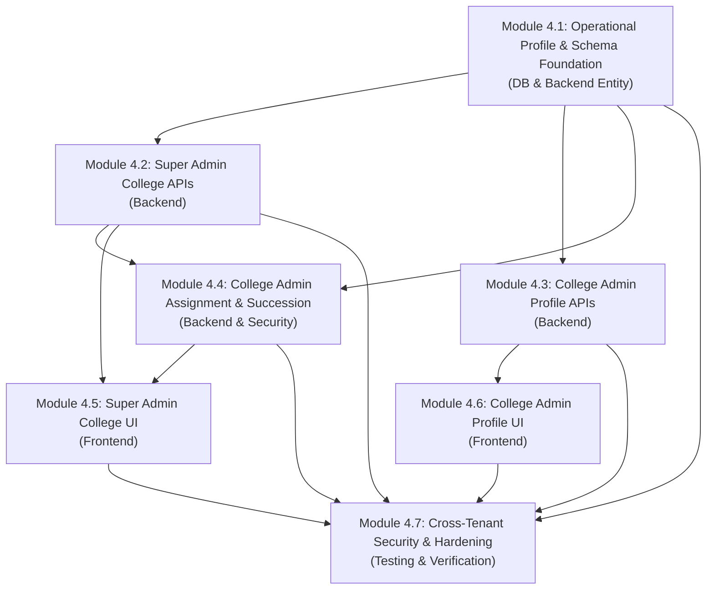

# Acadlytic — Phase 04 Final Module Breakdown & Dependency Plan v1.0

**Document Version:** 1.0  
**Status:** PROPOSED PLANNING ARTIFACT (PENDING USER APPROVAL)  
**Date:** 2026-11-27  
**Author:** Antigravity AI Assistant  
**Repository:** `c:\React\Acadlytic`  
**Target Module:** Phase 04 — College Management (Tenant Management & Profile)  
**Parent Epic:** Epic E2 (Tenant Management & Profile)  
**Preceding Phase:** Phase 03 (Registration Review & Approval Engine) — *Status: IN_PROGRESS (Manual E2E Verification Pending)*  
**Current Phase Status:** *Status: NOT_STARTED*  

---

## 1. Executive Summary

This document presents the implementation-ready phase-level module breakdown, architectural boundaries, dependency sequence, and governance plan for **Phase 04 — College Management (Tenant Management & Profile)** of the Acadlytic platform.

### Core Objectives of Phase 04
Phase 04 operationalizes colleges following their onboarding through Phase 02 (Self-Registration) and Phase 03 (Super Admin Review & Approval). It transforms the high-level onboarding record into a fully active, manageable tenant entity within Acadlytic. Specifically, Phase 04 delivers:
1. **Tenant Profile & Operational Schema:** Extension of the `colleges` relational schema from an initial onboarding placeholder to a complete operational tenant profile (address, phone, website, accreditation, branding, administrative contact, and timestamps).
2. **Super Admin College Directory & Tenant Controls:** Centralized visibility and administrative control over all onboarded colleges, including directory listing, search, filtering, operational status updates (`ACTIVE`, `SUSPENDED`, `INACTIVE`), and immediate session revocation upon suspension under **ADR-10**.
3. **College Admin Tenant Profile Management:** Self-service maintenance of operational profile data by authenticated College Admins strictly isolated to their own tenant boundary (`CollegeAccessGuard`), guarded by optimistic locking (`@Version`) under **ADR-07**.
4. **College Administrator Assignment & Succession:** Secure reassignment of the designated `COLLEGE_ADMIN` by Super Admin, deactivating the outgoing admin, revoking their active sessions under **ADR-05**, dispatching invitation/setup tokens, and strictly enforcing the single active admin invariant under **ADR-06**.
5. **Cross-Tenant Security Hardening:** Comprehensive multi-tenant boundary verification ensuring zero IDOR vulnerabilities, strict query tenant-scoping, and full audit logging of administrative mutations.

### Key Architectural Reconciliations
- **Canonical 7-Module Structure:** In accordance with user directives, all fractional and confusing sub-labels (e.g., `4.1A`, `4.1B`, `4.1C`, `4.2A`, `4.2B`) are eliminated in favor of a clean, linear, 7-module structure: **Module 4.1 through Module 4.7**.
- **Self-Registration as Sole Ingestion Path (No Direct Create in MVP):** Reconciling conflicting requirements in early feature specifications, direct college creation via `POST /api/v1/colleges` is explicitly excluded from MVP scope. All colleges must ingest through the established Phase 02/03 workflow (`POST /api/v1/college-registrations` followed by approval).
- **Flyway V7 Data Backfill Strategy:** The migration adds profile fields as nullable columns to `colleges`, executes an idempotent backfill copying verified profile data from `college_registrations` (referenced by `colleges.current_registration_id`), and synchronizes the Phase 03 approval lifecycle handler (`CollegeLifecycleService.onCollegeApproved`).
- **Strict ADR Adherence:** Fully integrates **ADR-05** (Session Revocation upon admin replacement), **ADR-06** (Single Active College Admin via database virtual generated column), **ADR-07** (Versioned Revisions & Concurrency), **ADR-08** (Approval Lifecycle), and **ADR-10** (Immediate Session Revocation upon College Suspension).

---

## 2. Inspected Documents and Source Files

The following authoritative documents, architectural records, and source files were inspected to formulate this plan:

### 2.1 Project Master Context & Roadmaps
- `docs/00-project-overview/ACADLYTIC_MASTER_CONTEXT.md` (Sections 6, 13.1, 13.2, 13.5, 13.7, 14, 15)
- `docs/08-task-breakdown/roadmap.md` (Phase 04 lines 227–252; Phase 03 lines 200–225; Phase 05–07 lines 254–300)
- `docs/08-task-breakdown/epics.md` (Epic E2 lines 6–8, 43–100)
- `docs/08-task-breakdown/tasks.md` (EPIC-04, Tasks TASK-04.01 through TASK-04.04)

### 2.2 Specifications and Implementation Notes
- `docs/09-development/feature-specifications/college-management.md` (Lines 1–1505; Super Admin & College Admin capabilities)
- `docs/09-development/implementation-notes/college-management-implementation.md` (Lines 1–2073; implementation guidance, endpoints, DTO schemas)
- `docs/05-architecture/api-architecture.md` (Sections 22–27, Lines 610–722; college management endpoint contracts)
- `docs/05-architecture/database-architecture.md` (Sections 23–24, Lines 565–614; college schema & profile extensions)
- `docs/05-architecture/data-ownership.md` (Multi-tenant data ownership and boundary enforcement)
- `docs/06-design/page-specifications.md` (Lines 164–166, 590–730; `/admin/colleges` and `/college/profile` specifications)

### 2.3 Architecture Decision Records (ADRs)
- `docs/05-architecture/adrs/ADR-05-session-revocation-token-invalidation.md` (Session revocation token versioning and Redis cache invalidation)
- `docs/05-architecture/adrs/ADR-06-single-active-college-admin.md` (Database-enforced single active college administrator invariant)
- `docs/05-architecture/adrs/ADR-07-versioned-revisions-and-concurrency.md` (Optimistic locking and revision history)
- `docs/05-architecture/adrs/ADR-08-college-approval-lifecycle.md` (College status transitions, activation, and outbox notification)
- `docs/05-architecture/adrs/ADR-10-college-suspension-session-revocation.md` (Cascade session revocation across all college users upon tenant suspension)

### 2.4 Existing Codebase Artifacts
- `backend/src/main/java/com/acadlytic/modules/colleges/entity/College.java` (Existing entity containing code, name, status, approvalStatus, version)
- `backend/src/main/java/com/acadlytic/modules/colleges/entity/CollegeRegistration.java` (Initial registration entity containing address, contact, phone, website)
- `backend/src/main/java/com/acadlytic/modules/colleges/repository/CollegeRepository.java` (JPA repository with status and code lookups)
- `backend/src/main/java/com/acadlytic/modules/colleges/service/CollegeLifecycleService.java` (Lifecycle transitions on approval)
- `backend/src/main/java/com/acadlytic/security/CollegeAccessGuard.java` (Tenant isolation and security checks)
- `backend/src/main/java/com/acadlytic/security/SessionRevocationService.java` (Session revocation implementation)
- `backend/src/main/resources/db/migration/` (Migrations V1 through V6; colleges created in V3/V4, users modified in V4)
- `frontend/src/routes/index.tsx` (Current routing; `/admin/colleges` currently aliases to `SuperAdminDashboardPage`)

---

## 3. Existing Phase 04 Scope and Identified Gaps

### 3.1 Initial Scope Summary
Phase 04 was originally scoped across four high-level tasks in `tasks.md`:
1. `TASK-04.01`: College Entity Enhancement & Migration (Database)
2. `TASK-04.02`: Super Admin College Management APIs (Backend)
3. `TASK-04.03`: College Admin College Profile API & View (Full Stack)
4. `TASK-04.04`: College Admin Assignment & Succession (Backend & Security)

### 3.2 Gaps Identified in Existing Documentation
Inspection revealed five critical gaps and ambiguities across legacy documentation:
1. **Conflicting Ingestion Models (Direct Create vs. Registration):** `feature-specifications/college-management.md` and `api-architecture.md` included `POST /api/v1/colleges` (direct Super Admin creation). However, `roadmap.md` (lines 237–243) explicitly scoped Phase 04 to exclude direct creation because colleges are provisioned via Phase 02/03 registration and review.
   *Resolution:* Exclude `POST /api/v1/colleges` from Phase 04 MVP.
2. **Missing Operational Profile Synchronization:** The existing `College` entity in Java code and the `colleges` MySQL table (V4 migration) do not hold operational fields (address, contact phone, website, established year, accreditation, logo URL). These fields currently exist only in `college_registrations`. When a college is approved in Phase 03, these fields are not copied to `colleges`.
   *Resolution:* Module 4.1 introduces Flyway V7 to extend `colleges`, backfill existing records, and update `CollegeLifecycleService.onCollegeApproved`.
3. **Fragmented Submodule Labeling:** Legacy inspection documents utilized fragmented designations (`4.1A`, `4.1B`, `4.1C`, `4.2A`, etc.), creating planning friction.
   *Resolution:* Adopt canonical Module 4.1 through Module 4.7.
4. **Missing College Admin Profile Route:** In frontend `routes/index.tsx`, there is no route or page component for `/college/profile`. The Super Admin route `/admin/colleges` currently points to the dashboard rather than a dedicated college directory.
   *Resolution:* Explicitly assign dedicated frontend modules (Module 4.5 and Module 4.6).
5. **Cross-Tenant Security and Succession Test Coverage:** While unit tests exist for guards, integrated multi-tenant negative testing (e.g., College Admin A modifying College B; College Admin updating status after suspension; concurrent profile edits triggering HTTP 409) lacked a dedicated verification boundary.
   *Resolution:* Dedicated verification module (Module 4.7).

---

## 4. Final Recommended Module Count and Division

Phase 04 is partitioned into **seven (7) canonical modules**. Each module represents a distinct, cohesive deliverable with explicit boundaries and unambiguous acceptance criteria.

```
Phase 04: College Management (Tenant Management & Profile)
├── Module 4.1: College Operational Profile & Schema Foundation (DB + Backend)
├── Module 4.2: Super Admin College Management APIs (Backend)
├── Module 4.3: College Admin Profile APIs (Backend)
├── Module 4.4: College Admin Assignment & Succession (Backend + Security)
├── Module 4.5: Super Admin College Management UI (Frontend)
├── Module 4.6: College Admin College Profile UI (Frontend)
└── Module 4.7: Cross-Tenant Security & Operational Hardening (Testing & Verification)
```

### Module Summary Table

| Module ID | Module Title | Primary Domain | Core Deliverable |
| :--- | :--- | :--- | :--- |
| **Module 4.1** | College Operational Profile & Schema Foundation | Database / Backend | Flyway V7 migration, `College` entity extension, backfill script, lifecycle hook update |
| **Module 4.2** | Super Admin College Management APIs | Backend | Search/filter directory, detail retrieval, admin profile update, status transitions with ADR-10 revocation |
| **Module 4.3** | College Admin Profile APIs | Backend | Tenant-scoped `/my-college` GET and PUT endpoints, immutable field protection, optimistic locking |
| **Module 4.4** | College Admin Assignment & Succession | Backend / Security | `/admin` replacement endpoint, ADR-06 enforcement, ADR-05 session revocation, invitation dispatch |
| **Module 4.5** | Super Admin College Management UI | Frontend | `/admin/colleges` directory table, filters, status change modals, admin reassignment modal |
| **Module 4.6** | College Admin College Profile UI | Frontend | `/college/profile` self-service view and edit forms, validation, optimistic locking conflict banner |
| **Module 4.7** | Cross-Tenant Security & Operational Hardening | Integration Testing | Multi-tenant isolation verification, IDOR penetration suite, suspension lockout tests, concurrency stress |

---

## 5. Backend / Frontend / Database / Testing Distribution

| Domain | Modules Involved | Key Deliverables & Responsibilities |
| :--- | :--- | :--- |
| **Database (DB)** | Module 4.1 | - Flyway migration `V7__add_college_profile_fields.sql`<br>- Schema columns: `address_line1`, `address_line2`, `city`, `state`, `postal_code`, `country`, `contact_phone`, `contact_email`, `website_url`, `established_year`, `accreditation_details`, `logo_url`<br>- Idempotent data backfill from `college_registrations`<br>- Database rollback/recovery scripts and integrity constraints |
| **Backend API & Services** | Modules 4.1, 4.2, 4.3, 4.4 | - Entity updates: `College.java`, DTO mappings<br>- `CollegeLifecycleService.java` update on approval<br>- `CollegeManagementService.java` (Super Admin operations)<br>- `CollegeProfileService.java` (College Admin operations)<br>- `CollegeAdminService.java` (Succession & assignment)<br>- REST Controllers: `SuperAdminCollegeController.java`, `CollegeProfileController.java`<br>- Integration of `CollegeAccessGuard`, `SessionRevocationService`, and `AuditLogService` |
| **Frontend UI & State** | Modules 4.5, 4.6 | - API client hooks (`useColleges`, `useCollegeDetail`, `useUpdateCollegeStatus`, `useCollegeProfile`, `useUpdateCollegeProfile`)<br>- Super Admin Directory View (`/admin/colleges`) with search, filter, pagination, status transition dialogs<br>- College Admin Profile View (`/college/profile`) with tabbed overview/edit forms, validation, conflict banners<br>- Routing updates in `routes/index.tsx` and sidebar navigation links |
| **Security & Integration Testing** | Modules 4.1 through 4.7 | - Unit tests for services and validators (100% target for business rules)<br>- MockMvc web tier security tests<br>- MySQL Testcontainers integration tests for database constraints and backfills<br>- End-to-end multi-tenant boundary verification and cross-tenant IDOR attack simulation<br>- Concurrency conflict tests (`409 Conflict` on concurrent revision updates) |

---

## 6. Detailed Module Definitions and Boundaries

### Module 4.1: College Operational Profile & Schema Foundation
* **Scope & Boundaries:** Database schema extension and core entity mapping. Does not implement user-facing controllers.
* **Key Tasks:**
  1. Author Flyway migration `V7__add_college_profile_fields.sql` adding nullable operational profile columns to `colleges`.
  2. Implement data migration query copying initial address, phone, website, and details from `college_registrations` where `colleges.current_registration_id = college_registrations.id`.
  3. Update `com.acadlytic.modules.colleges.entity.College.java` with corresponding JPA fields, accessors, and builder methods.
  4. Update `CollegeLifecycleService.java#onCollegeApproved` to populate the new profile fields from `CollegeRegistrationRevision` during approval.
  5. Author entity unit tests and Testcontainers migration test validating schema evolution and backfill accuracy.
* **Dependencies:** None within Phase 04. Requires Phase 03 baseline (Flyway V1–V6).

### Module 4.2: Super Admin College Management APIs
* **Scope & Boundaries:** Super Admin REST endpoints for system-wide college directory and tenant lifecycle administration.
* **Key Tasks:**
  1. Implement DTOs: `CollegeSummaryResponse`, `CollegeDetailResponse`, `SuperAdminUpdateCollegeRequest`, `CollegeStatusUpdateRequest`.
  2. Implement `CollegeManagementService.java`:
     - Dynamic search, status filtering, and paginated query execution via JPA Specifications.
     - College retrieval by ID with complete tenant metrics (user count, active admin).
     - Operational profile updates (Super Admin override capabilities).
     - Tenant status transitions: `ACTIVE` $\rightarrow$ `SUSPENDED` $\rightarrow$ `ACTIVE`, and `ACTIVE` $\rightarrow$ `INACTIVE`.
  3. Enforce **ADR-10** in status transitions: Invoking `sessionRevocationService.revokeAllUserSessionsForCollege(collegeId)` immediately upon suspension or deactivation.
  4. Implement `SuperAdminCollegeController.java`:
     - `GET /api/v1/super-admin/colleges` (search, filter, sort, page)
     - `GET /api/v1/super-admin/colleges/{id}`
     - `PUT /api/v1/super-admin/colleges/{id}`
     - `PATCH /api/v1/super-admin/colleges/{id}/status`
  5. Secure endpoints with `@PreAuthorize("hasRole('SUPER_ADMIN')")`.
  6. Record audit log events for all mutations via `AuditLogService`.
* **Dependencies:** Module 4.1.

### Module 4.3: College Admin Profile APIs
* **Scope & Boundaries:** College Admin self-service endpoints to read and update their own college profile. Strictly forbids cross-tenant access and immutable field mutation.
* **Key Tasks:**
  1. Implement DTOs: `CollegeProfileResponse`, `CollegeProfileUpdateRequest`.
  2. Implement `CollegeProfileService.java`:
     - Retrieve college profile for currently authenticated user's `college_id`.
     - Update operational fields: `contactPhone`, `contactEmail`, `websiteUrl`, `addressLine1`, `addressLine2`, `city`, `state`, `postalCode`, `country`, `logoUrl`.
     - Reject attempts to modify immutable fields (`code`, `name`, `status`, `approvalStatus`).
     - Enforce optimistic locking via `@Version Long version`; throw `OptimisticLockingFailureException` on mismatch (HTTP `409 Conflict`).
  3. Implement `CollegeProfileController.java`:
     - `GET /api/v1/colleges/my-college`
     - `PUT /api/v1/colleges/my-college`
  4. Secure endpoints with `@PreAuthorize("hasRole('COLLEGE_ADMIN')")` and `CollegeAccessGuard.requireApprovedAndActiveCurrentCollege()`.
  5. Audit log all profile updates.
* **Dependencies:** Module 4.1.

### Module 4.4: College Admin Assignment & Succession
* **Scope & Boundaries:** Administrative succession and assignment for tenant leadership, enforcing single active admin rules and session security.
* **Key Tasks:**
  1. Implement DTOs: `AssignCollegeAdminRequest`, `CollegeAdminSummaryResponse`.
  2. Implement `CollegeAdminService.java`:
     - Validate college exists and is `ACTIVE`.
     - Identify current active `COLLEGE_ADMIN` (if any).
     - Deactivate current admin: set `status = INACTIVE`, nullify `active_college_admin_college_id` in `users`.
     - Enforce **ADR-05**: Invoke `sessionRevocationService.revokeAllSessionsForUser(oldAdminId)`.
     - Assign new administrator: Create new user or update existing user with role `COLLEGE_ADMIN` and `college_id`. Enforce **ADR-06** virtual generated column unique constraint.
     - Dispatch invitation / password-setup notification via `outbox_emails`.
  3. Implement endpoint in `SuperAdminCollegeController.java`:
     - `PUT /api/v1/super-admin/colleges/{id}/admin`
  4. Audit log administrative succession with before/after user identifiers.
* **Dependencies:** Module 4.1, Module 4.2.

### Module 4.5: Super Admin College Management UI
* **Scope & Boundaries:** Frontend interface for Super Admins to manage colleges at `/admin/colleges`.
* **Key Tasks:**
  1. Build React Query hooks: `useColleges`, `useCollegeDetail`, `useUpdateCollegeStatus`, `useAssignCollegeAdmin`.
  2. Develop `CollegeDirectoryPage.tsx`:
     - Data table displaying college code, name, status, approval date, admin email, and quick actions.
     - Search bar (code, name) and filter pills (All, Active, Suspended, Inactive).
     - Server-side pagination and sorting controls.
  3. Develop `CollegeDetailModal.tsx` and `CollegeEditModal.tsx` for viewing and modifying operational profile fields.
  4. Develop `CollegeStatusDialog.tsx` prompting for confirmation and reason when suspending or deactivating a college, with explicit warnings regarding session revocation under ADR-10.
  5. Develop `AssignAdminModal.tsx` supporting admin succession.
  6. Update `routes/index.tsx` to bind `/admin/colleges` to `CollegeDirectoryPage`.
* **Dependencies:** Module 4.2, Module 4.4.

### Module 4.6: College Admin College Profile UI
* **Scope & Boundaries:** Frontend interface for College Admins to manage their tenant profile at `/college/profile`.
* **Key Tasks:**
  1. Build React Query hooks: `useCollegeProfile`, `useUpdateCollegeProfile`.
  2. Develop `CollegeProfilePage.tsx`:
     - Tabbed or card layout: Profile Overview, Contact Details, Address & Location, Branding.
     - Read-only presentation of immutable institutional metadata (`code`, `name`, `accreditation`).
     - Controlled edit forms with React Hook Form and Zod schema validation.
  3. Implement Concurrency Conflict Handling:
     - Detect HTTP `409 Conflict` responses.
     - Render `ProfileConflictBanner.tsx` notifying the user that another administrator updated the profile, offering a one-click reload.
  4. Add `/college/profile` route and navigation link in `CollegeAdminSidebar`.
* **Dependencies:** Module 4.3.

### Module 4.7: Cross-Tenant Security & Operational Hardening
* **Scope & Boundaries:** Comprehensive automated and integration verification suite covering all Phase 04 functionality.
* **Key Tasks:**
  1. Multi-Tenant Boundary Integration Tests:
     - Verify College Admin from College X cannot access `GET /api/v1/colleges/{id}` for College Y.
     - Verify College Admin cannot pass arbitrary IDs to `my-college` endpoints.
  2. Suspension & Revocation Verification:
     - Verify that suspending a college in Module 4.2 causes immediate JWT rejection on subsequent requests by any user belonging to that college (ADR-10).
     - Verify that replacing an admin in Module 4.4 invalidates the old admin's active session within the cache revocation window (ADR-05).
  3. Database Invariant & Concurrency Verification:
     - Testcontainers test verifying ADR-06 generated column constraint blocks inserting two active admins for the same college.
     - Concurrency test simulating simultaneous PUT requests to `/my-college` verifying optimistic locking and version incrementation.
* **Dependencies:** Modules 4.1 through 4.6.

---

## 7. Dependency Matrix



### Direct Dependency Mapping

| Module | Directly Depends On | Unblocks / Enables |
| :--- | :--- | :--- |
| **Module 4.1** | None (Requires Phase 03 baseline) | Module 4.2, Module 4.3, Module 4.4 |
| **Module 4.2** | Module 4.1 | Module 4.4, Module 4.5, Module 4.7 |
| **Module 4.3** | Module 4.1 | Module 4.6, Module 4.7 |
| **Module 4.4** | Module 4.1, Module 4.2 | Module 4.5, Module 4.7 |
| **Module 4.5** | Module 4.2, Module 4.4 | Module 4.7 |
| **Module 4.6** | Module 4.3 | Module 4.7 |
| **Module 4.7** | Modules 4.1, 4.2, 4.3, 4.4, 4.5, 4.6 | Final Phase 04 Completion & Sign-off |

---

## 8. Recommended Implementation Sequence

To minimize risk and ensure continuous testability, the implementation must proceed in three distinct stages:

### Stage 1: Foundational Schema & Core Backend Services (Serial)
* **Step 1: Module 4.1** (Flyway V7 migration, `College` entity extension, backfill verification, lifecycle hook).
  * *Verification Gate 1:* Testcontainers migration test passes; `College` entity maps all operational fields; existing approved colleges have non-null profile data.
* **Step 2: Module 4.2** (Super Admin College Management APIs & ADR-10 suspension revocation).
  * *Verification Gate 2:* MockMvc unit/integration tests pass for directory search, status changes, and session invalidation triggers.
* **Step 3: Module 4.3** (College Admin Profile APIs & optimistic locking).
  * *Verification Gate 3:* Unit tests verify tenant isolation, immutable field rejection, and `@Version` conflict handling.
* **Step 4: Module 4.4** (College Admin Assignment & Succession under ADR-05 and ADR-06).
  * *Verification Gate 4:* Integration tests prove outgoing admin session is revoked and unique active admin constraint holds.

### Stage 2: User Interfaces (Can Run in Parallel Following Stage 1)
* **Step 5A: Module 4.5** (Super Admin College Management UI at `/admin/colleges`).
  * *Verification Gate 5A:* Directory renders real colleges from backend; status modal successfully suspends/activates colleges.
* **Step 5B: Module 4.6** (College Admin College Profile UI at `/college/profile`).
  * *Verification Gate 5B:* Form renders current college data; edits persist via API; 409 conflict banner triggers gracefully.

### Stage 3: Phase Hardening & Final Verification (Consolidated)
* **Step 6: Module 4.7** (Cross-Tenant Security, IDOR penetration suite, suspension lockout, concurrency stress).
  * *Verification Gate 6:* 100% automated test pass rate across backend and frontend; complete multi-tenant audit verification report generated.

---

## 9. Feature / API / Database / UI Specification Traceability

| Specification Source | Document Section / Requirement | Addressed in Phase 04 Module |
| :--- | :--- | :--- |
| `feature-specifications/college-management.md` | §3.1 College Listing & Filtering | **Module 4.2**, **Module 4.5** |
| `feature-specifications/college-management.md` | §3.2 College Detail View & Operational Profile | **Module 4.1**, **Module 4.2**, **Module 4.5** |
| `feature-specifications/college-management.md` | §3.3 College Status Management (Active/Suspend) | **Module 4.2**, **Module 4.5**, **Module 4.7** |
| `feature-specifications/college-management.md` | §3.4 College Admin Assignment & Succession | **Module 4.4**, **Module 4.5** |
| `feature-specifications/college-management.md` | §4.1 College Admin Self-Service Profile View | **Module 4.1**, **Module 4.3**, **Module 4.6** |
| `feature-specifications/college-management.md` | §4.2 College Admin Profile Edit & Concurrency | **Module 4.3**, **Module 4.6**, **Module 4.7** |
| `api-architecture.md` | §22 `GET /api/v1/super-admin/colleges` | **Module 4.2** |
| `api-architecture.md` | §23 `GET /api/v1/super-admin/colleges/{id}` | **Module 4.2** |
| `api-architecture.md` | §24 `PUT /api/v1/super-admin/colleges/{id}` | **Module 4.2** |
| `api-architecture.md` | §25 `PATCH /api/v1/super-admin/colleges/{id}/status` | **Module 4.2** |
| `api-architecture.md` | §26 `GET /api/v1/colleges/my-college` | **Module 4.3** |
| `api-architecture.md` | §27 `PUT /api/v1/colleges/my-college` | **Module 4.3** |
| `database-architecture.md` | §23-24 `colleges` schema extensions | **Module 4.1** |
| `page-specifications.md` | Lines 590–660 `/admin/colleges` | **Module 4.5** |
| `page-specifications.md` | Lines 665–730 `/college/profile` | **Module 4.6** |
| `data-ownership.md` | Multi-tenant boundary rules | **Module 4.3**, **Module 4.7** |

---

## 10. Architecture, Migration, Security, and Lifecycle Safeguards

### 10.1 Database Migration & Backfill Safeguards (Module 4.1)
- **Nullability Strategy:** All new operational columns added to `colleges` in `V7__add_college_profile_fields.sql` will be created as `NULL` to avoid table rewrites and prevent migration failures on existing test and historical data.
- **Idempotent Data Backfill:** The migration includes an update query joining `colleges` and `college_registrations` on `colleges.current_registration_id = college_registrations.id`, copying initial address, phone, and website fields for existing colleges. For colleges without a registration record, fields remain `NULL`.
- **Approval Lifecycle Synchronization:** `CollegeLifecycleService.java#onCollegeApproved` must be updated to copy submitted revision profile data into the `College` entity at the exact moment of approval, ensuring no future approved college ever has missing profile metadata.

### 10.2 Tenant Boundary & Security Guards (Module 4.2, 4.3, 4.7)
- **Strict Role and Tenant Guarding:** College Admin endpoints (`/my-college`) derive the target `college_id` exclusively from the authenticated user's security context via `CollegeAccessGuard`. They will never accept or parse a `college_id` from query parameters, request bodies, or URL paths.
- **Immutable Field Enforcement:** If a College Admin attempts to submit modifications to immutable attributes (`code`, `name`, `status`, `approvalStatus`), the service ignores or explicitly rejects the payload with HTTP `400 Bad Request`.

### 10.3 Session Revocation Safeguards (ADR-05 & ADR-10)
- **Tenant Suspension (ADR-10):** When Super Admin sets a college status to `SUSPENDED` or `INACTIVE`, `CollegeManagementService` synchronously invokes `sessionRevocationService.revokeAllUserSessionsForCollege(collegeId)`. All subsequent requests bearing tokens issued prior to the revocation timestamp are immediately rejected with HTTP `401 Unauthorized`.
- **Admin Succession (ADR-05):** When an active `COLLEGE_ADMIN` is replaced, `CollegeAdminService` deactivates the user record and invokes `sessionRevocationService.revokeAllSessionsForUser(oldAdminId)`, terminating their active sessions instantly.

### 10.4 Single Active Admin Invariant (ADR-06)
- **Database Enforcement:** The `users` table already incorporates the virtual generated column `active_college_admin_college_id` and unique index `uq_users_active_college_admin`. Module 4.4 guarantees transactional integrity: the outgoing admin's status is changed before or within the same transaction as the incoming admin's assignment, preventing index collision.

### 10.5 Concurrency & Optimistic Locking (ADR-07)
- **Collision Protection:** `College` entity utilizes `@Version Long version`. Any profile update requires the client to submit `expectedVersion`. If the version in the database has incremented, Hibernate raises an `OptimisticLockException`, which the controller translates to HTTP `409 Conflict`.
- **Frontend Recovery:** The UI renders an informative conflict banner offering a reload button to refresh the form with the latest server state without losing unsubmitted drafts.

---

## 11. Unresolved Decisions and Risks

### 11.1 Reconciled Decisions
1. **Direct College Creation (`POST /api/v1/colleges`):**
   *Decision:* Excluded from Phase 04 MVP. All onboarding flows through Phase 02/03 registration and approval.
2. **Submodule Naming:**
   *Decision:* Flattened into canonical Modules 4.1 through 4.7.

### 11.2 Open Architectural Discussions & Recommendations
1. **Logo Storage Architecture (Local vs. S3):**
   *Current State:* Phase 01/02 file storage uses local file system storage in development.
   *Recommendation:* In Module 4.1/4.3, store `logoUrl` as a URL string pointing to an uploaded static asset, utilizing the existing file storage service rather than introducing cloud blob storage prematurely.
2. **College Code Mutation Policy:**
   *Current State:* College codes (`e.g., AHIT`) are institutional tenant identifiers.
   *Recommendation:* College codes are strictly immutable once approved. Super Admins may modify operational details and names, but the `code` remains locked to prevent foreign key and tenant routing disruptions.
3. **Admin Succession Outbox Email Template:**
   *Current State:* Phase 03 uses `outbox_emails` for registration decisions.
   *Recommendation:* Module 4.4 should introduce a dedicated outbox template `COLLEGE_ADMIN_ASSIGNMENT_NOTIFICATION` providing password setup instructions to the new administrator.

### 11.3 Identified Risks and Mitigation Strategies

| Risk | Impact | Likelihood | Mitigation Strategy |
| :--- | :--- | :--- | :--- |
| **V7 Migration Failure on Historical Inconsistent Data** | High | Low | Authorship of idempotent `UPDATE` queries with `NULL` fallbacks; validation against local test database before merging. |
| **Cross-Tenant IDOR Vulnerability** | Critical | Low | Enforcement of `CollegeAccessGuard` on all non-super-admin endpoints; zero ID parameters on tenant-scoped routes; comprehensive Module 4.7 penetration test suite. |
| **Session Cache Latency on Suspension (ADR-10)** | Medium | Low | Session revocation uses direct in-memory cache/Redis invalidation checked on every incoming authenticated request. |
| **Concurrent Edit Collisions** | Low | Medium | Strict enforcement of JPA `@Version` and automated HTTP 409 frontend conflict banner with reload flow. |

---

## 12. Explicit Confirmation that this is a Planning Proposal Only

> [!IMPORTANT]
> **Planning Proposal Only — Zero Implementation Undertaken**
> 
> This document is strictly an architectural inspection report and proposed phase-level plan.
> - **Zero production code changes** have been made.
> - **Zero test files** have been added, modified, or executed.
> - **Zero database migrations** or schema changes have been created.
> - **Zero ADRs or Master Context files** have been altered.
> - **Phase 03 status** remains independently tracked as `IN_PROGRESS` (pending manual E2E verification).
> - **Phase 04 status** remains strictly `NOT_STARTED`.
> - Detailed planning and implementation of Module 4.1 or any subsequent module will not begin until this plan is formally reviewed and approved by the project owner.

---

### End of Plan
*Target File Path:* `docs/04-phase/Acadlytic_Phase_04_Final_Module_Breakdown_and_Dependency_Plan_v1.0.md`
