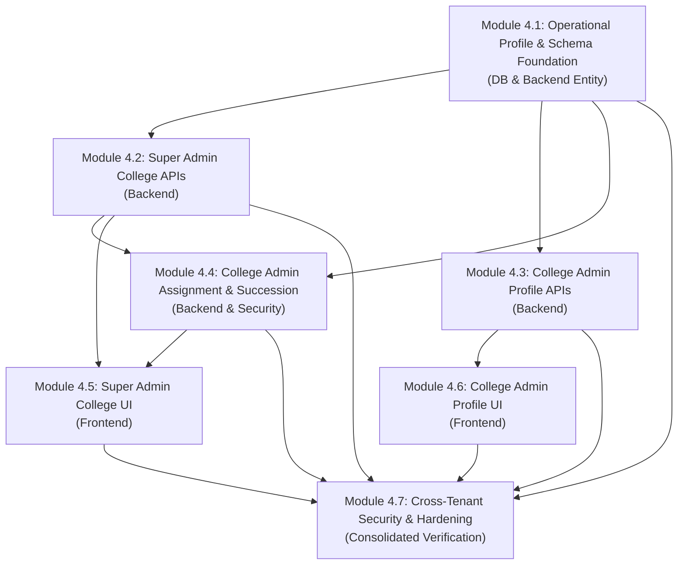

# Acadlytic — Phase 04 Final Module Breakdown & Dependency Plan v1.1

**Document Version:** 1.1  
**Status:** PROPOSED PLANNING ARTIFACT (PENDING USER APPROVAL)  
**Date:** 2026-11-27  
**Author:** Antigravity AI Assistant  
**Repository:** `c:\React\Acadlytic`  
**Target Module:** Phase 04 — College Management (Tenant Management & Profile)  
**Parent Epic:** Epic E2 (Tenant Management & Profile)  
**Preceding Phase:** Phase 03 (Registration Review & Approval Engine) — *Status: IN_PROGRESS (Manual E2E Verification Pending)*  
**Current Phase Status:** *Status: NOT_STARTED*  

---

## Document Revision History & Change Summary (v1.0 $\rightarrow$ v1.1)

| Version | Date | Key Changes & Corrections |
| :--- | :--- | :--- |
| **v1.0** | 2026-11-27 | Initial proposed plan: 7 canonical modules, Flyway V7 foundation, ADR-06/ADR-10 integration, removal of direct creation endpoint (`POST /api/v1/colleges`) from MVP. |
| **v1.1** | 2026-11-27 | **Consolidated Technical Corrections:**<br>1. **Session Architecture:** Removed erroneous JWT, Redis, and cache timestamp references. Aligned with approved stateful HTTP-only session cookie architecture using Spring Session JDBC (`SPRING_SESSION` table in MySQL) and dual-layer enforcement via `SessionRevocationService` and `SessionValidationFilter`.<br>2. **V7 Migration & Backfill:** Inspected exact schema relationships across `colleges`, `college_registrations`, and `users`. Reconciled nullable schema columns with historical data backfill. Defined preflight verification, fallback queries, and non-destructive rollback.<br>3. **Approval Lifecycle Synchronization:** Documented exact integration in `CollegeLifecycleService#onCollegeApproved` using caller-passed `submittedRevision` within the existing transaction boundary.<br>4. **College Admin Succession:** Comprehensive specification of six user replacement edge cases (new email, verified, unverified, inactive, cross-tenant, incompatible role) respecting email verification and ADR-06 database constraints.<br>5. **Profile Ownership & Permissions:** Added comprehensive field-level permission matrix distinguishing Super Admin vs. College Admin permissions, and separating operational contact email from admin login email.<br>6. **Branding & Logo Storage:** Replaced unsafe public URL assumption with Acadlytic's private `DocumentStorageService` abstraction; separated metadata from storage; flagged upload scope.<br>7. **Testing Boundaries:** Re-distributed unit/integration test ownership to individual modules; designated Module 4.7 strictly for consolidated cross-module, cross-tenant, and end-to-end security verification. |

---

## 1. Executive Summary

This document establishes the implementation-ready phase-level module breakdown, architectural boundaries, dependency sequence, and governance framework for **Phase 04 — College Management (Tenant Management & Profile)** of the Acadlytic platform.

### Core Objectives of Phase 04
Phase 04 operationalizes colleges following their initial onboarding in Phase 02 (Self-Registration) and Phase 03 (Super Admin Review & Approval). It elevates the prospective onboarding record into an active, manageable platform tenant. Specifically, Phase 04 delivers:
1. **Tenant Operational Schema & Profile Foundation:** Extension of the `colleges` relational schema from an onboarding placeholder into an operational tenant profile (address, contact details, operational email, website, accreditation, and administrative metadata).
2. **Super Admin College Directory & Tenant Governance:** Centralized management over all onboarded colleges, including directory search, multi-attribute filtering, operational status transitions (`ACTIVE`, `SUSPENDED`, `INACTIVE`), and immediate session revocation upon tenant suspension under **ADR-10**.
3. **College Admin Tenant Profile Self-Service:** Secure maintenance of operational profile data by authenticated College Admins strictly isolated to their own tenant context via `CollegeAccessGuard`, guarded by optimistic concurrency (`@Version`) under **ADR-07**.
4. **College Administrator Assignment & Succession:** Secure succession of the designated `COLLEGE_ADMIN` by Super Admin, deactivating the outgoing admin, immediately revoking all their active sessions under **ADR-05**, dispatching invitation/setup tokens, and strictly enforcing the single active admin invariant under **ADR-06**.
5. **Cross-Tenant Security & Consolidated Verification:** Comprehensive multi-tenant boundary verification ensuring zero IDOR vulnerabilities, strict query tenant-scoping, and full audit logging of administrative mutations.

### Key Architectural Baseline Principles
- **Canonical 7-Module Structure:** In accordance with project instructions, all confusing fractional sub-labels (e.g., `4.1A`, `4.1B`, `4.2A`) are eliminated. The phase is structured into **Module 4.1 through Module 4.7**.
- **Self-Registration as Sole Intake Path (No Direct Create in MVP):** Direct college creation via `POST /api/v1/colleges` is excluded from MVP scope. All colleges must ingest through the established Phase 02/03 workflow (`POST /api/v1/auth/register-college` followed by Super Admin review).
- **Stateful Spring Session JDBC Architecture:** Acadlytic operates on stateful HTTP-only session cookies persisted in MySQL via Spring Session JDBC. No JWTs or Redis caches are utilized.
- **Strict ADR Adherence:** Fully integrates **ADR-01/02/03** (Spring Session JDBC & Cookie rules), **ADR-05** (Session Revocation upon admin replacement), **ADR-06** (Single Active College Admin via database virtual generated column), **ADR-07** (Versioned Revisions & Concurrency), **ADR-08** (Approval Lifecycle), and **ADR-10** (Immediate Session Revocation upon College Suspension).

---

## 2. Inspected Documents and Codebase Baseline

The following authoritative specifications, architectural documents, and source files were inspected:

### 2.1 Project Master Context & Roadmaps
- `docs/00-project-overview/ACADLYTIC_MASTER_CONTEXT.md` (Sections 6, 13.1, 13.2, 13.5, 13.7, 14, 15)
- `docs/08-task-breakdown/roadmap.md` (Phase 04 lines 227–252; Phase 03 lines 200–225; Phase 05–07 lines 254–300)
- `docs/08-task-breakdown/epics.md` (Epic E2 lines 6–8, 43–100)
- `docs/08-task-breakdown/tasks.md` (EPIC-04, Tasks TASK-04.01 through TASK-04.04)

### 2.2 Specifications & Architecture Guides
- `docs/09-development/feature-specifications/college-management.md` (Super Admin & College Admin capabilities)
- `docs/09-development/implementation-notes/college-management-implementation.md` (Implementation guidance and DTO contracts)
- `docs/05-architecture/api-architecture.md` (Sections 22–27, lines 610–722; college endpoint specifications)
- `docs/05-architecture/database-architecture.md` (Sections 23–24, lines 565–614; college schema & profile extensions)
- `docs/05-architecture/data-ownership.md` (Multi-tenant boundary enforcement and data ownership)
- `docs/06-design/page-specifications.md` (Lines 164–166, 590–730; `/admin/colleges` and `/college/profile` specifications)

### 2.3 Existing Codebase Implementation Artifacts
- **Security & Session Management:**
  * `backend/src/main/java/com/acadlytic/config/SessionConfig.java` (Spring Session JDBC configuration; `ACADLYTIC_SID` dev cookie, `__Host-ACADLYTIC_SID` prod cookie)
  * `backend/src/main/java/com/acadlytic/security/SessionRevocationService.java` (Direct revocation against `JdbcIndexedSessionRepository`)
  * `backend/src/main/java/com/acadlytic/security/SessionValidationFilter.java` (Live per-request validation of user status and college operational status)
  * `backend/src/main/java/com/acadlytic/security/CollegeAccessGuard.java` (Tenant isolation and security checks)
- **Database Schema & Migrations:**
  * `backend/src/main/resources/db/migration/V2__spring_session_jdbc.sql` (`SPRING_SESSION`, `SPRING_SESSION_ATTRIBUTES`)
  * `backend/src/main/resources/db/migration/V3__auth_core_schema.sql` (`colleges`, `users` with ADR-06 virtual generated column `active_college_admin_college_id`, `auth_tokens`, `outbox_emails`)
  * `backend/src/main/resources/db/migration/V4__college_registration_schema.sql` (`college_registrations` revision table, `colleges.current_registration_id`, `college_registration_documents`)
  * `backend/src/main/resources/db/migration/V6__document_level_review.sql` (`college_document_reviews`, verification status)
- **Lifecycle & Storage Services:**
  * `backend/src/main/java/com/acadlytic/modules/colleges/service/CollegeLifecycleService.java` (`onCollegeApproved` hook)
  * `backend/src/main/java/com/acadlytic/modules/colleges/service/CollegeReviewService.java` (Super Admin approval orchestration)
  * `backend/src/main/java/com/acadlytic/modules/colleges/storage/DocumentStorageService.java` & `LocalFileSystemDocumentStorageService.java` (Private local file storage abstraction)
  * `backend/src/main/java/com/acadlytic/modules/auth/service/AuthTokenService.java` (Single-use hashed token issuance)

---

## 3. Session Architecture & Revocation Mechanics (ADR-05 & ADR-10)

### 3.1 Stateful Authentication Architecture
Acadlytic uses **stateful session cookie authentication** backed by Spring Session JDBC and MySQL 8:
- **Client-Side:** HTTP-only, SameSite=Lax cookie (`ACADLYTIC_SID` in development/testing, `__Host-ACADLYTIC_SID` in production with Secure=true and Path=/).
- **Server-Side Store:** `SPRING_SESSION` and `SPRING_SESSION_ATTRIBUTES` MySQL tables. The principal is indexed via `SPRING_SESSION.PRINCIPAL_NAME` using `acadlytic:user:{userId}`.
- **Zero JWT / Zero Redis:** There are no stateless JWT bearer tokens, no Redis caches, and no distributed token revocation timestamps.

### 3.2 Revocation Implementation & Observable Behavior
Session revocation is handled exclusively by `SessionRevocationService` via Spring Session's `FindByIndexNameSessionRepository`:

```
User Action / Administrative Mutation
   │
   ├─► SessionRevocationService.revokeAllSessionsForUser(userId)
   │     └─► Deletes rows in SPRING_SESSION where PRINCIPAL_NAME = 'acadlytic:user:{userId}'
   │
   └─► SessionRevocationService.revokeAllSessionsForCollege(collegeId)
         └─► Queries users WHERE college_id = :collegeId
         └─► Deletes all matching rows in SPRING_SESSION for each user
```

#### Dual-Layer Enforcement on Subsequent Requests

1. **Layer 1: Spring Session JDBC Deletion**
   - When a session is deleted from `SPRING_SESSION`, any subsequent HTTP request presenting that session cookie cannot resolve a session.
   - Spring Security finds no authenticated context in the request and invokes `ApiAuthenticationEntryPoint`, returning:
     ```http
     HTTP/1.1 401 Unauthorized
     Content-Type: application/json

     {
       "success": false,
       "errorCode": "SESSION_EXPIRED",
       "message": "Your session has expired. Please log in again."
     }
     ```

2. **Layer 2: Real-Time Database Validation (`SessionValidationFilter`)**
   - For every authenticated request that still has an active session row in `SPRING_SESSION`, `SessionValidationFilter` executes live database checks:
     * Queries `userRepository.findById(principal.getUserId())`.
       - If `user.getStatus() == SUSPENDED` $\rightarrow$ invalidates session, returns HTTP `403 Forbidden` (`AUTH_ACCOUNT_SUSPENDED`).
       - If `user.getStatus() != ACTIVE` $\rightarrow$ invalidates session, returns HTTP `403 Forbidden` (`AUTH_ACCOUNT_INACTIVE`).
     * If `user.getRole() == Role.COLLEGE_ADMIN`, queries `collegeRepository.findById(user.getCollegeId())`.
       - If `college.getStatus() == SUSPENDED` $\rightarrow$ invalidates session, returns HTTP `403 Forbidden` (`COLLEGE_SUSPENDED`).
       - If `college.getStatus() == INACTIVE` $\rightarrow$ invalidates session, returns HTTP `403 Forbidden` (`COLLEGE_INACTIVE`).
       - If `college.isPermanentlyRejected()` $\rightarrow$ invalidates session, returns HTTP `403 Forbidden` (`REGISTRATION_PERMANENTLY_REJECTED`).

---

## 4. Flyway V7 Migration & Operational Profile Backfill Design

### 4.1 Schema Extension Specification (`V7__add_college_profile_fields.sql`)
The `colleges` table created in `V3` contains institutional identity columns (`name`, `code`, `approval_status`, `status`, `version`), but lacks operational profile attributes. `V7` adds these columns as **nullable columns**:

```sql
ALTER TABLE colleges
    ADD COLUMN address_line1 VARCHAR(255) NULL,
    ADD COLUMN address_line2 VARCHAR(255) NULL,
    ADD COLUMN city VARCHAR(100) NULL,
    ADD COLUMN state VARCHAR(100) NULL,
    ADD COLUMN country VARCHAR(100) NULL,
    ADD COLUMN postal_code VARCHAR(30) NULL,
    ADD COLUMN contact_phone VARCHAR(50) NULL,
    ADD COLUMN contact_email VARCHAR(255) NULL,
    ADD COLUMN website_url VARCHAR(255) NULL,
    ADD COLUMN affiliated_university_name VARCHAR(255) NULL,
    ADD COLUMN established_year INT NULL,
    ADD COLUMN accreditation_details VARCHAR(255) NULL,
    ADD COLUMN logo_storage_key VARCHAR(100) NULL,
    ADD CONSTRAINT chk_colleges_established_year CHECK (established_year IS NULL OR (established_year >= 1800 AND established_year <= 2100));
```

### 4.2 Authoritative Source of Profile Data & Exact Mapping
Inspection of the codebase confirms that `college_registrations` is the revision table storing versioned applications. When an application is approved in Phase 03, `colleges.current_registration_id` points to the approved row in `college_registrations`.

#### Exact Field-to-Field Mapping
| Target Column in `colleges` | Authoritative Source in `college_registrations` / Context |
| :--- | :--- |
| `address_line1` | `college_registrations.address_line1` |
| `address_line2` | `college_registrations.address_line2` |
| `city` | `college_registrations.city` |
| `state` | `college_registrations.state` |
| `country` | `college_registrations.country` |
| `postal_code` | `college_registrations.postal_code` |
| `contact_phone` | `college_registrations.contact_phone` |
| `website_url` | `college_registrations.website_url` |
| `affiliated_university_name` | `college_registrations.affiliated_university_name` |
| `contact_email` | Active `COLLEGE_ADMIN` email from `users.email` where `college_id = c.id AND role = 'COLLEGE_ADMIN' AND status = 'ACTIVE'` (or `NULL` if none active) |
| `established_year` | Initialized as `NULL` (not captured in Phase 02/03 onboarding) |
| `accreditation_details` | Initialized as `NULL` (not captured in Phase 02/03 onboarding) |
| `logo_storage_key` | Initialized as `NULL` (no logo collected during onboarding) |

### 4.3 Idempotent Backfill Strategy & Treatment of Edge Cases
1. **Approved Colleges with Valid `current_registration_id`:**
   ```sql
   UPDATE colleges c
   JOIN college_registrations cr ON c.current_registration_id = cr.id
   SET c.address_line1 = cr.address_line1,
       c.address_line2 = cr.address_line2,
       c.city = cr.city,
       c.state = cr.state,
       c.country = cr.country,
       c.postal_code = cr.postal_code,
       c.contact_phone = cr.contact_phone,
       c.website_url = cr.website_url,
       c.affiliated_university_name = cr.affiliated_university_name
   WHERE c.approval_status = 'APPROVED';
   ```
2. **Approved Colleges where `current_registration_id` is NULL or Mismatched:**
   Fallback backfill subquery:
   ```sql
   UPDATE colleges c
   JOIN (
       SELECT college_id, address_line1, address_line2, city, state, country, postal_code, contact_phone, website_url, affiliated_university_name,
              ROW_NUMBER() OVER (PARTITION BY college_id ORDER BY version_number DESC) as rn
       FROM college_registrations
       WHERE status = 'APPROVED'
   ) latest_approved ON c.id = latest_approved.college_id AND latest_approved.rn = 1
   SET c.address_line1 = COALESCE(c.address_line1, latest_approved.address_line1),
       c.city = COALESCE(c.city, latest_approved.city),
       c.state = COALESCE(c.state, latest_approved.state),
       c.country = COALESCE(c.country, latest_approved.country),
       c.postal_code = COALESCE(c.postal_code, latest_approved.postal_code),
       c.contact_phone = COALESCE(c.contact_phone, latest_approved.contact_phone),
       c.website_url = COALESCE(c.website_url, latest_approved.website_url),
       c.affiliated_university_name = COALESCE(c.affiliated_university_name, latest_approved.affiliated_university_name)
   WHERE c.approval_status = 'APPROVED' AND c.address_line1 IS NULL;
   ```
3. **Pending, Action Required, and Rejected Colleges:**
   Operational profile fields remain `NULL`. Prospective colleges under review are not active tenants and do not require operational profiles until approved.
4. **Resolution of Contradiction (Nullability vs. Mandatory Data):**
   - *Database Level:* Columns in `colleges` MUST be nullable (`NULL`) to accommodate unapproved colleges, partial historical records, and optional fields (`established_year`, `address_line2`).
   - *Application Level:* DTO validators for `PUT /api/v1/colleges/my-college` enforce required operational fields (`address_line1`, `city`, `state`, `postal_code`, `contact_phone`, `contact_email`) on edit submissions. Existing approved colleges are never locked out; they can view their profile and will be required to provide missing values only when submitting updates.
5. **Pre-Migration Validation & Post-Migration Reconciliation:**
   - Pre-migration callback (`V7CollegeProfileMigrationPreflightCallback`) checks for approved colleges without corresponding `college_registrations` records.
   - Post-migration assertion: Reconciles that 100% of approved colleges with an approved registration revision have non-null `address_line1` and `city`.
6. **Rollback & Safe Recovery:**
   - Safe rollback drops the added columns via compensating down-migration without affecting base `colleges`, `users`, or `college_registrations` tables.

---

## 5. College Approval Lifecycle Integration

### 5.1 Integration Point in `CollegeLifecycleService`
The exact integration occurs in `com.acadlytic.modules.colleges.service.CollegeLifecycleService`:

```java
@Transactional(propagation = Propagation.REQUIRED)
public void onCollegeApproved(
        College college,
        CollegeRegistration submittedRevision,
        User adminUser,
        Long reviewerUserId,
        Role reviewerRole) {

    // 1. Existing Phase 03 Status Update
    college.setStatus(CollegeStatus.ACTIVE);

    // 2. Phase 04 Profile Synchronization (Module 4.1 addition)
    college.setAddressLine1(submittedRevision.getAddressLine1());
    college.setAddressLine2(submittedRevision.getAddressLine2());
    college.setCity(submittedRevision.getCity());
    college.setState(submittedRevision.getState());
    college.setCountry(submittedRevision.getCountry());
    college.setPostalCode(submittedRevision.getPostalCode());
    college.setContactPhone(submittedRevision.getContactPhone());
    college.setWebsiteUrl(submittedRevision.getWebsiteUrl());
    college.setAffiliatedUniversityName(submittedRevision.getAffiliatedUniversityName());
    if (adminUser != null && college.getContactEmail() == null) {
        college.setContactEmail(adminUser.getEmail());
    }

    collegeRepository.save(college);

    // 3. Existing Audit & Outbox Dispatch
    ...
}
```

### 5.2 Transaction Boundary & Safety Guarantees
- **Atomic Unit of Work:** `onCollegeApproved` executes inside the caller transaction from `CollegeReviewService#processDecision`.
- **Failure Behavior:** If profile synchronization fails (e.g., validation exception or database lock), the entire transaction rolls back:
  * `college.approval_status` is NOT set to `APPROVED`.
  * `submittedRevision.status` is NOT set to `APPROVED`.
  * No audit log is committed.
  * No approval email is enqueued in `outbox_emails`.
- **Phase 03 Invariant Preservation:** Zero changes to Phase 03 approval gates, document review verification logic, or resubmission counters.
- **Required Regression Tests:** `CollegeReviewServiceIntegrationTest`, `DocumentReviewIntegrationTest`, and `CollegeLifecycleServiceTest`.

---

## 6. Field-Level Ownership & Permission Matrix

The operational profile distinguishes institutional metadata, operational communication channels, and identity credentials:

| Field Name | System Controlled | Super Admin Permission | College Admin Permission | Mutability & Validation Rules |
| :--- | :---: | :---: | :---: | :--- |
| `id` | Yes | Read-Only | Read-Only | Immutable primary key |
| `code` | Yes | Read-Only | Read-Only | **Strictly Immutable Tenant Code.** Cannot be altered by any role post-approval. |
| `approval_status` | Yes | Managed via Review API | Read-Only | Controlled exclusively by Phase 03 review workflow |
| `status` | Yes | Editable (`PATCH /status`) | Read-Only | `ACTIVE`, `SUSPENDED`, `INACTIVE` (Triggers ADR-10 revocation) |
| `name` / `legal_name` | No | Editable (with Audit Log) | **Read-Only (Default)** | Institutional legal name. *Flagged Decision:* Self-service editing by College Admin requires Super Admin re-verification. |
| `affiliated_university_name` | No | Editable | Read-Only | Verified during onboarding. |
| `address_line1` | No | Editable | Editable | Mandatory on update; max 255 chars |
| `address_line2` | No | Editable | Editable | Optional; max 255 chars |
| `city`, `state`, `country` | No | Editable | Editable | Mandatory on update; max 100 chars |
| `postal_code` | No | Editable | Editable | Mandatory on update; max 30 chars |
| `contact_phone` | No | Editable | Editable | Mandatory on update; phone format validation |
| `contact_email` | No | Editable | Editable | **Operational Contact Email.** Distinct from admin login email. Does not affect user credentials or sessions. |
| `website_url` | No | Editable | Editable | Optional; valid URL format |
| `established_year` | No | Editable | Editable | Optional; numeric between 1800 and 2100 |
| `accreditation_details` | No | Editable | **Read-Only (Proposed)** | *Flagged Decision:* Accreditation details require institutional verification; College Admin editability requires review approval. |
| `logo_storage_key` | System | Managed via Logo API | Managed via Logo API | Private storage UUID key pointing to `DocumentStorageService` |
| `version` | Yes | System Managed | System Managed | Concurrency version incremented on each update (`@Version`) |
| `created_at`, `updated_at` | Yes | Read-Only | Read-Only | System audit timestamps |

---

## 7. College Administrator Assignment & Succession (Module 4.4)

### 7.1 Database Constraint & Invariant (ADR-06)
Under **ADR-06**, table `users` contains the virtual generated column:
```sql
active_college_admin_college_id BIGINT GENERATED ALWAYS AS (
    CASE WHEN role = 'COLLEGE_ADMIN' AND status = 'ACTIVE' THEN college_id ELSE NULL END
) VIRTUAL,
CONSTRAINT uk_users_single_active_college_admin UNIQUE (active_college_admin_college_id)
```
**Invariant:** At no point can a college have more than one user with `role = 'COLLEGE_ADMIN'` and `status = 'ACTIVE'`.

### 7.2 Succession Edge Cases & Business Rules
When Super Admin replaces or assigns a college administrator (`PUT /api/v1/super-admin/colleges/{id}/admin`):

| User Scenario | System Behavior & Validation | Security & State Transitions |
| :--- | :--- | :--- |
| **Case 1: New email address (no existing user record)** | Validates email format and availability.<br>Deactivates current admin (`status = INACTIVE`).<br>Creates new user record with `role = COLLEGE_ADMIN`, `status = ACTIVE`, `college_id = collegeId`, `emailVerifiedAt = null`, random un-usable password hash.<br>Issues invitation token via `AuthTokenService`.<br>Enqueues `COLLEGE_ADMIN_INVITATION` email. | Outgoing admin active sessions revoked via **ADR-05**.<br>ADR-06 satisfied (outgoing inactivated before new activated).<br>New user must complete password setup and email verification before first login. |
| **Case 2: Existing verified user in same college** | Validates user belongs to `collegeId` and has compatible role (`ACADEMIC_STAFF`).<br>Deactivates current admin (`status = INACTIVE`).<br>Promotes existing user to `role = COLLEGE_ADMIN`.<br>Enqueues promotion notification in outbox. | Outgoing admin sessions revoked via **ADR-05**.<br>Promoted user retains existing password and verified status.<br>New session required to reflect updated role permissions. |
| **Case 3: Existing unverified user in same college** | User has an incomplete onboarding/invitation.<br>Deactivates current admin.<br>Updates role to `COLLEGE_ADMIN`.<br>Revokes old tokens and issues fresh invitation/setup token. | Outgoing admin sessions revoked.<br>User must complete verification to activate account. |
| **Case 4: Existing inactive user in same college** | Reactivates account: sets `status = ACTIVE`, `role = COLLEGE_ADMIN`.<br>Issues password reset/activation token. | Outgoing admin sessions revoked.<br>ADR-06 invariant verified. |
| **Case 5: Existing user associated with ANOTHER college** | **STRICTLY FORBIDDEN.**<br>Throws `409 Conflict` (`USER_ALREADY_ASSOCIATED_WITH_TENANT`). | Zero state mutation. Outgoing admin remains untouched. |
| **Case 6: Existing user with incompatible role (`SUPER_ADMIN`)** | **STRICTLY FORBIDDEN.**<br>Throws `400 Bad Request` (`ROLE_INCOMPATIBLE`). | Zero state mutation. Super Admin accounts cannot be assigned as College Admins. |

### 7.3 Transactional Sequence & Failure Recovery
```
SuperAdminCollegeController
   │
   ▼
CollegeAdminService.assignAdmin(collegeId, request, superAdminPrincipal) [@Transactional]
   │
   ├─► 1. Validate college exists and status is ACTIVE
   ├─► 2. Find current active COLLEGE_ADMIN for collegeId
   ├─► 3. Deactivate outgoing admin:
   │       outgoingAdmin.setStatus(UserStatus.INACTIVE)
   │       userRepository.saveAndFlush(outgoingAdmin)  <-- Frees ADR-06 unique slot
   ├─► 4. Revoke outgoing admin sessions:
   │       sessionRevocationService.revokeAllSessionsForUser(outgoingAdmin.getId()) [ADR-05]
   ├─► 5. Provision or update new administrator:
   │       newAdmin.setRole(Role.COLLEGE_ADMIN)
   │       newAdmin.setStatus(UserStatus.ACTIVE)
   │       userRepository.save(newAdmin)                <-- Claims ADR-06 unique slot
   ├─► 6. Issue setup/invitation token:
   │       authTokenService.issueToken(newAdmin.getId(), AuthTokenType.PASSWORD_RESET, ...)
   ├─► 7. Enqueue invitation email in outbox:
   │       outboxEmailService.enqueue("COLLEGE_ADMIN_INVITATION", ...)
   └─► 8. Record audit event:
           auditEventService.record(COLLEGE_ADMIN_REPLACED, ...)
```
*Failure Recovery:* If any step fails, the entire transaction rolls back. The outgoing admin remains active, no sessions are deleted, and no invitation is dispatched.

---

## 8. Branding & Logo Storage Architecture

### 8.1 Private Document Storage Integration
Acadlytic does not expose an open public directory or external S3 bucket in MVP. All binary files are managed through the private storage port `DocumentStorageService` (`LocalFileSystemDocumentStorageService`):
- **Storage Location:** Files are stored outside the web root (`data/documents/` in dev/prod) with cryptographically random UUID storage keys.
- **Access Model:** Files are private and streamed exclusively through authenticated controller endpoints.
- **Branding Representation in Schema:** `colleges.logo_storage_key` holds the private UUID reference (`VARCHAR(100)`). Storing arbitrary public HTTP URLs is strictly forbidden.

### 8.2 Separation of Concerns & Scope Clarification
1. **Branding Metadata (Phase 04 In-Scope):** Schema foundation includes `logo_storage_key`. DTO responses include `hasLogo: boolean` and a secure download link.
2. **Logo Upload & Retrieval Endpoints:**
   - `POST /api/v1/colleges/my-college/logo` (College Admin) & `POST /api/v1/super-admin/colleges/{id}/logo` (Super Admin).
   - Validates MIME type (`image/png`, `image/jpeg`, `image/webp`), enforces 2MB size limit, computes SHA-256 checksum, and stores via `DocumentStorageService`.
   - `GET /api/v1/colleges/{id}/logo` streams the image resource with appropriate cache headers.
3. **Scope Recommendation:**
   - *Phase 04 Core Scope:* Schema column and DTO representation in Module 4.1 & Module 4.3.
   - *Logo Binary Upload/Streaming:* Implemented as a dedicated subtask within Module 4.3 (Backend) and Module 4.6 (Frontend) or explicitly flagged for Phase 04 hardening if file storage dependencies are prioritized for registration documents.

---

## 9. Final Recommended Module Count and Division

The 7-module structure is confirmed and organized across functional boundaries:

```
Phase 04: College Management (Tenant Management & Profile)
├── Module 4.1: College Operational Profile & Schema Foundation (Database + Backend Entity)
├── Module 4.2: Super Admin College Management APIs (Backend)
├── Module 4.3: College Admin Profile APIs (Backend)
├── Module 4.4: College Admin Assignment & Succession (Backend + Security)
├── Module 4.5: Super Admin College Management UI (Frontend)
├── Module 4.6: College Admin College Profile UI (Frontend)
└── Module 4.7: Cross-Tenant Security & Operational Hardening (Testing & Consolidated Verification)
```

### Detailed Module Definitions and Boundaries

#### Module 4.1: College Operational Profile & Schema Foundation
* **Domain:** Database & Backend Entity
* **Scope & Boundaries:** Flyway V7 migration, entity mapping, and approval lifecycle synchronization. Does not expose user-facing web endpoints.
* **Key Deliverables:**
  - `V7__add_college_profile_fields.sql`: Schema alteration, check constraints, and idempotent historical backfill.
  - Pre-migration callback `V7CollegeProfileMigrationPreflightCallback.java`.
  - Update `College.java` entity with operational fields, accessors, and builder methods.
  - Update `CollegeLifecycleService.java#onCollegeApproved` to synchronize profile fields on application approval.
  - Testcontainers migration test validating schema evolution and backfill integrity.

#### Module 4.2: Super Admin College Management APIs
* **Domain:** Backend API
* **Scope & Boundaries:** REST endpoints for platform-wide college directory and tenant status governance.
* **Key Deliverables:**
  - `SuperAdminCollegeController.java`:
    * `GET /api/v1/super-admin/colleges` (search, status filter, university filter, pagination, sorting)
    * `GET /api/v1/super-admin/colleges/{id}` (full college profile + admin user summary + tenant stats)
    * `PUT /api/v1/super-admin/colleges/{id}` (Super Admin profile update)
    * `PATCH /api/v1/super-admin/colleges/{id}/status` (status transition with ADR-10 session revocation)
  - `CollegeManagementService.java`: Business logic, status state-machine enforcement, audit logging.
  - Unit and MockMvc integration tests for all endpoints.

#### Module 4.3: College Admin Profile APIs
* **Domain:** Backend API
* **Scope & Boundaries:** Self-service endpoints for College Admins to view and update their own college profile.
* **Key Deliverables:**
  - `CollegeProfileController.java`:
    * `GET /api/v1/colleges/my-college` (returns tenant profile based on authenticated session context)
    * `PUT /api/v1/colleges/my-college` (updates permitted fields; enforces optimistic locking via `@Version`)
  - `CollegeProfileService.java`: Rejection of immutable fields (`code`, `name`, `status`), optimistic locking conflict translation (HTTP `409 Conflict`).
  - Security validation via `CollegeAccessGuard.requireApprovedAndActiveCurrentCollege()`.
  - Unit and MockMvc integration tests.

#### Module 4.4: College Admin Assignment & Succession
* **Domain:** Backend & Security
* **Scope & Boundaries:** Administrative succession and assignment for tenant leadership.
* **Key Deliverables:**
  - Endpoint `PUT /api/v1/super-admin/colleges/{id}/admin` in `SuperAdminCollegeController.java`.
  - `CollegeAdminService.java`: Handles 6 user replacement cases, enforces ADR-06 unique active admin constraint, invokes ADR-05 session revocation on outgoing admin, dispatches setup invitation via `outbox_emails`.
  - Unit and integration tests for succession workflows and error handling.

#### Module 4.5: Super Admin College Management UI
* **Domain:** Frontend UI
* **Scope & Boundaries:** Super Admin directory interface at `/admin/colleges`.
* **Key Deliverables:**
  - React Query API hooks (`useColleges`, `useCollegeDetail`, `useUpdateCollegeStatus`, `useAssignCollegeAdmin`).
  - `CollegeDirectoryPage.tsx`: Search, status filter pills, pagination table, quick actions.
  - `CollegeDetailModal.tsx` & `CollegeEditModal.tsx`.
  - `CollegeStatusDialog.tsx`: Confirmation dialog with explicit warnings regarding ADR-10 user lockout upon suspension.
  - `AssignAdminModal.tsx`: Admin succession dialog.
  - Update `routes/index.tsx` binding `/admin/colleges`.

#### Module 4.6: College Admin College Profile UI
* **Domain:** Frontend UI
* **Scope & Boundaries:** College Admin profile interface at `/college/profile`.
* **Key Deliverables:**
  - React Query hooks (`useCollegeProfile`, `useUpdateCollegeProfile`).
  - `CollegeProfilePage.tsx`: Layout with Profile Overview, Contact Details, Address, and Institutional Metadata cards.
  - React Hook Form + Zod schema validation for profile updates.
  - `ProfileConflictBanner.tsx`: HTTP 409 conflict detection with one-click reload to resolve concurrent update collisions.
  - Navigation links in `CollegeAdminSidebar.tsx` and route binding in `routes/index.tsx`.

#### Module 4.7: Cross-Tenant Security & Operational Hardening
* **Domain:** Consolidated Testing & Verification
* **Scope & Boundaries:** Phase-level verification and multi-tenant security penetration tests. (Does not replace individual module unit/integration testing).
* **Key Deliverables:**
  - **Cross-Tenant IDOR Attack Suite:** Verifies College Admin X cannot access, modify, or infer data for College Y via path manipulation, parameter forgery, or header injection.
  - **ADR-10 Suspension Lockout Verification:** Proves that suspending a college in Module 4.2 causes immediate HTTP 401/403 rejection across all active college user sessions.
  - **ADR-05 Succession Invalidation Verification:** Proves replacing an admin in Module 4.4 invalidates the old admin's active session immediately upon the next request.
  - **Optimistic Locking & Concurrency Tests:** Concurrent update simulation proving `@Version` increments and HTTP 409 responses are handled gracefully.
  - **Database Invariant Verification:** Verifies ADR-06 virtual column blocks duplicate active admins under race conditions.
  - **Full Platform Regression Suite:** Executes 100% of Phase 01–03 tests to guarantee zero regressions.

---

## 10. Dependency Matrix and Execution Sequence

### 10.1 Dependency Matrix



| Module | Hard Prerequisites | Unblocks / Enables | Testing Ownership |
| :--- | :--- | :--- | :--- |
| **Module 4.1** | None (Requires Phase 03 baseline) | Module 4.2, Module 4.3, Module 4.4 | Migration tests, backfill tests, entity unit tests |
| **Module 4.2** | Module 4.1 | Module 4.4, Module 4.5, Module 4.7 | Service unit tests, MockMvc status/filter tests |
| **Module 4.3** | Module 4.1 | Module 4.6, Module 4.7 | Tenant guard tests, optimistic locking tests |
| **Module 4.4** | Module 4.1, Module 4.2 | Module 4.5, Module 4.7 | Succession tests, ADR-05 revocation, ADR-06 constraints |
| **Module 4.5** | Module 4.2, Module 4.4 (Backend ready) | Module 4.7 | Component unit tests, form validation tests |
| **Module 4.6** | Module 4.3 (Backend ready) | Module 4.7 | Component unit tests, 409 conflict banner tests |
| **Module 4.7** | Modules 4.1 through 4.6 complete | Phase 04 Sign-off | Cross-tenant IDOR suite, platform regression |

### 10.2 Recommended Three-Stage Implementation Sequence

```
STAGE 1: Foundational Database & Backend Services
  [Step 1: Module 4.1] (Schema V7, Backfill, Lifecycle Hook)
          │
          ├──────────────────────────────┐
          ▼                              ▼
  [Step 2: Module 4.2]           [Step 3: Module 4.3]
  (Super Admin College APIs)     (College Admin Profile APIs)
          │
          ▼
  [Step 4: Module 4.4]
  (College Admin Succession)
          │
STAGE 2: User Interfaces (Parallel Frontend Development)
          ├──────────────────────────────┐
          ▼                              ▼
  [Step 5A: Module 4.5]          [Step 5B: Module 4.6]
  (Super Admin College UI)       (College Admin Profile UI)
          │                              │
          └──────────────┬───────────────┘
                         ▼
STAGE 3: Consolidated Verification & Hardening
  [Step 6: Module 4.7]
  (Multi-Tenant Security, Session Revocation, Concurrency, Regression)
```

---

## 11. Feature, API, Database, and UI Traceability

| Specification Requirement | Source Document & Section | Implementation Module |
| :--- | :--- | :--- |
| College Listing, Search, Filter | `feature-specifications/college-management.md` §13, 15 | **Module 4.2**, **Module 4.5** |
| College Detail View | `feature-specifications/college-management.md` §10, 14 | **Module 4.1**, **Module 4.2**, **Module 4.5** |
| College Status Transitions | `feature-specifications/college-management.md` §16, 17 | **Module 4.2**, **Module 4.5**, **Module 4.7** |
| Admin Assignment & Succession | `feature-specifications/college-management.md` §8, 9 | **Module 4.4**, **Module 4.5** |
| Self-Service Profile View & Update | `feature-specifications/college-management.md` §11, 12 | **Module 4.1**, **Module 4.3**, **Module 4.6** |
| Tenant Isolation & Context | `feature-specifications/college-management.md` §19, 20 | **Module 4.3**, **Module 4.7** |
| `GET /api/v1/super-admin/colleges` | `api-architecture.md` §22, 24 | **Module 4.2** |
| `GET /api/v1/super-admin/colleges/{id}` | `api-architecture.md` §25 | **Module 4.2** |
| `PUT /api/v1/super-admin/colleges/{id}` | `api-architecture.md` §26 | **Module 4.2** |
| `PATCH /api/v1/super-admin/colleges/{id}/status` | `api-architecture.md` §27 | **Module 4.2** |
| `GET /api/v1/colleges/my-college` | `api-architecture.md` §26; Implementation Notes | **Module 4.3** |
| `PUT /api/v1/colleges/my-college` | `api-architecture.md` §26; Implementation Notes | **Module 4.3** |
| `PUT /api/v1/super-admin/colleges/{id}/admin` | Implementation Notes (College Admin Replacement) | **Module 4.4** |
| Schema Alterations (`V7`) | `database-architecture.md` §23, 24 | **Module 4.1** |
| UI Super Admin Directory (`/admin/colleges`) | `page-specifications.md` lines 590–660 | **Module 4.5** |
| UI College Profile (`/college/profile`) | `page-specifications.md` lines 665–730 | **Module 4.6** |
| Immediate Session Revocation | **ADR-05**, **ADR-10** | **Module 4.2**, **Module 4.4**, **Module 4.7** |
| Single Active Admin Invariant | **ADR-06** | **Module 4.4**, **Module 4.7** |
| Optimistic Concurrency (`@Version`) | **ADR-07** | **Module 4.1**, **Module 4.3**, **Module 4.6** |

---

## 12. Unresolved Decisions and Architectural Flags

The following decisions are explicitly flagged for resolution during individual module planning:

1. **College Name Mutation Policy (Module 4.2 / 4.3):**
   * *Status:* Flagged Decision.
   * *Issue:* The legal name is verified by Super Admin during Phase 03 onboarding. If College Admin can edit `name`, it could bypass institutional verification.
   * *Recommendation:* Keep `name` read-only for College Admin; allow Super Admin to update with mandatory audit logging.
2. **Accreditation Editability (Module 4.3):**
   * *Status:* Flagged Decision.
   * *Issue:* Accreditation (NAAC, NBA, etc.) affects institutional standing. Allowing self-service editing without document proof introduces compliance risks.
   * *Recommendation:* In Phase 04 MVP, treat accreditation as read-only for College Admin (or text-only update flagged with "Self-reported").
3. **Invitation Token Strategy for Admin Succession (Module 4.4):**
   * *Status:* Flagged Decision.
   * *Issue:* `AuthTokenType` currently supports `PASSWORD_RESET`, `EMAIL_CHANGE`, and `EMAIL_VERIFICATION`.
   * *Recommendation:* In Module 4.4, either reuse `PASSWORD_RESET` token type with a dedicated invitation email template, or author a Flyway migration adding `INVITATION` to `AuthTokenType`.
4. **Logo Binary Upload Timing (Module 4.3 / 4.6):**
   * *Status:* Flagged Decision.
   * *Issue:* Logo upload requires multipart file validation and image streaming endpoints.
   * *Recommendation:* The schema foundation in Module 4.1 includes `logo_storage_key`. Decide in Module 4.3 planning whether binary upload endpoints are included in Module 4.3 or deferred to Phase 04 hardening.

---

## 13. Explicit Confirmation of Planning Proposal Boundary

> [!IMPORTANT]
> **Planning Proposal Only — Zero Implementation Undertaken**
> 
> This document is strictly an architectural inspection artifact and phase-level proposed plan.
> - **Zero production code changes** have been made.
> - **Zero database migrations** or SQL scripts have been executed.
> - **Zero database schema or data alterations** have occurred.
> - **Zero test files** have been created, modified, or executed.
> - **Zero ADRs or Master Context files** have been modified.
> - **Phase 03 status** remains independently tracked as `IN_PROGRESS` (pending manual E2E verification).
> - **Phase 04 status** remains strictly `NOT_STARTED`.
> - Detailed planning and implementation for Module 4.1 or any subsequent module will not begin until this plan receives formal user review and approval.

---

### End of Plan (v1.1)
*Artifact File Path:* `docs/04-phase/Acadlytic_Phase_04_Final_Module_Breakdown_and_Dependency_Plan_v1.1.md`
