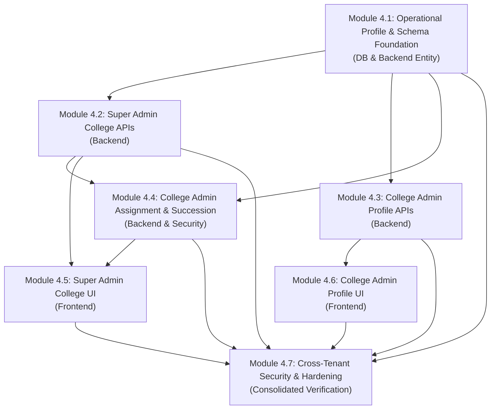

# Acadlytic — Phase 04 Final Module Breakdown & Dependency Plan v1.2

**Document Version:** 1.2  
**Status:** PROPOSED PLANNING ARTIFACT (PENDING USER APPROVAL)  
**Date:** 2026-11-27  
**Author:** Antigravity AI Assistant  
**Repository:** `c:\React\Acadlytic`  
**Target Module:** Phase 04 — College Management (Tenant Management & Profile)  
**Parent Epic:** Epic E2 (Tenant Management & Profile)  
**Preceding Phase:** Phase 03 (Registration Review & Approval Engine) — *Status: IN_PROGRESS (Manual E2E Verification Pending)*  
**Current Phase Status:** *Status: NOT_STARTED*  

---

## Document Revision History & Change Summary (v1.1 $\rightarrow$ v1.2)

| Version | Date | Key Changes & Corrections |
| :--- | :--- | :--- |
| **v1.0** | 2026-11-27 | Initial proposed plan: 7 canonical modules, Flyway V7 foundation, ADR-06/ADR-10 integration, exclusion of direct creation endpoint (`POST /api/v1/colleges`) from MVP. |
| **v1.1** | 2026-11-27 | Consolidated technical corrections: aligned session architecture with Spring Session JDBC (`SPRING_SESSION`), documented `SessionValidationFilter` live checks, detailed succession scenarios, added permission matrix. |
| **v1.2** | 2026-11-27 | **Final Targeted Architectural Corrections:**<br>1. **Single Authoritative Revision Backfill:** Replaced heuristic backfill fallback queries with strict single authoritative approved revision rule. Backfill uses `colleges.current_registration_id` ONLY after verifying integrity (`cr.id = c.current_registration_id AND cr.college_id = c.id AND cr.status = 'APPROVED'`). Multiple revisions are never combined. Ambiguous/inconsistent records are excluded and surfaced via preflight check. Existing valid profile data is never overwritten.<br>2. **College Admin Account Lifecycle:** Explicitly distinguished record creation, email verification, password setup, account status (`UserStatus`), role assignment, and login restriction semantics. Demonstrated that existing 15-minute `PASSWORD_RESET` token is semantically and technically unsuited for a 48h+ invitation/setup workflow. Left new invitation token mechanics explicitly unresolved for Module 4.4.<br>3. **Session Revocation Transaction Safety:** Documented that Spring Session JDBC SQL deletions participate in the surrounding database transaction, whereas in-memory container state does not. Formulated safe transactional succession sequence preventing race conditions, dual-admin states, and leaked access.<br>4. **Three-Tier Migration Rollback Strategy:** Explicitly separated deployment failure, pre-operational rollback, and post-operational rollback. Prohibited destructive column dropping when user-entered profile data exists.<br>5. **Institutional Contact Email Rule:** Recognized that existing registrations contain no operational institutional contact email (only the applicant's login email). Corrected backfill to set `contact_email = NULL` to prevent conflating personal login identity with institutional correspondence.<br>6. **Definitive Logo Scope Boundary:** Kept `logo_storage_key` solely as optional metadata in Module 4.1 schema. Explicitly **deferred** binary logo file upload, resizing, and streaming endpoints from Phase 04 MVP to Post-MVP.<br>7. **Phase 03 vs. Module 4.7 Testing Boundaries:** Reaffirmed that Module 4.7 owns consolidated Phase 04 integration and security hardening; Phase 01–03 regression runs verify non-regression, but Phase 03 manual E2E verification remains independently tracked as `IN_PROGRESS`. Completing Phase 04 does not approve Phase 03. |

---

## 1. Executive Summary

This document establishes the final, implementation-ready phase-level module breakdown, architectural boundaries, dependency sequence, and governance framework for **Phase 04 — College Management (Tenant Management & Profile)** of the Acadlytic platform.

### Core Objectives of Phase 04
Phase 04 operationalizes colleges following their onboarding in Phase 02 (Self-Registration) and Phase 03 (Super Admin Review & Approval). It elevates prospective onboarding records into fully active, manageable platform tenants. Specifically, Phase 04 delivers:
1. **Tenant Operational Schema & Profile Foundation:** Extension of the `colleges` relational schema from an onboarding placeholder into an operational tenant profile (address, operational contact channels, institutional website, accreditation, and administrative metadata).
2. **Super Admin College Directory & Tenant Governance:** Centralized management over all onboarded colleges, including directory search, multi-attribute filtering, operational status transitions (`ACTIVE`, `SUSPENDED`, `INACTIVE`), and immediate session revocation upon tenant suspension under **ADR-10**.
3. **College Admin Tenant Profile Self-Service:** Secure maintenance of operational profile data by authenticated College Admins strictly isolated to their own tenant context via `CollegeAccessGuard`, guarded by optimistic concurrency (`@Version`) under **ADR-07**.
4. **College Administrator Assignment & Succession:** Secure succession of the designated `COLLEGE_ADMIN` by Super Admin, deactivating the outgoing admin, immediately revoking all their active sessions under **ADR-05**, dispatching invitation/setup tokens, and strictly enforcing the single active admin invariant under **ADR-06**.
5. **Cross-Tenant Security & Consolidated Verification:** Comprehensive multi-tenant boundary verification ensuring zero IDOR vulnerabilities, strict query tenant-scoping, and full audit logging of administrative mutations.

### Key Architectural Baseline Principles
- **Canonical 7-Module Structure:** In accordance with project instructions, all confusing fractional sub-labels (e.g., `4.1A`, `4.1B`, `4.2A`) are eliminated. The phase is structured into **Module 4.1 through Module 4.7**.
- **Self-Registration as Sole Intake Path (No Direct Create in MVP):** Direct college creation via `POST /api/v1/colleges` is excluded from MVP scope. All colleges must ingest through the established Phase 02/03 workflow (`POST /api/v1/auth/register-college` followed by Super Admin review).
- **Stateful Spring Session JDBC Architecture:** Acadlytic operates on stateful HTTP-only session cookies persisted in MySQL via Spring Session JDBC. No JWTs or Redis caches are utilized.
- **Strict ADR Adherence:** Fully integrates **ADR-01/02/03** (Spring Session JDBC & Cookie rules), **ADR-05** (Session Revocation upon admin replacement), **ADR-06** (Single Active College Admin via database virtual generated column), **ADR-07** (Versioned Revisions & Concurrency), **ADR-08** (Approval Lifecycle), and **ADR-10** (Immediate Session Revocation upon College Suspension).

---

## 2. Inspected Documents and Codebase Baseline

The following authoritative specifications, architectural documents, and source files were inspected:

### 2.1 Project Master Context & Roadmaps
- `docs/00-project-overview/ACADLYTIC_MASTER_CONTEXT.md` (Sections 6, 13.1, 13.2, 13.5, 13.7, 14, 15)
- `docs/08-task-breakdown/roadmap.md` (Phase 04 lines 227–252; Phase 03 lines 200–225; Phase 05–07 lines 254–300)
- `docs/08-task-breakdown/epics.md` (Epic E2 lines 6–8, 43–100)
- `docs/08-task-breakdown/tasks.md` (EPIC-04, Tasks TASK-04.01 through TASK-04.04)

### 2.2 Specifications & Architecture Guides
- `docs/09-development/feature-specifications/college-management.md` (Super Admin & College Admin capabilities)
- `docs/09-development/implementation-notes/college-management-implementation.md` (Implementation guidance and DTO contracts)
- `docs/05-architecture/api-architecture.md` (Sections 22–27, lines 610–722; college endpoint specifications)
- `docs/05-architecture/database-architecture.md` (Sections 23–24, lines 565–614; college schema & profile extensions)
- `docs/05-architecture/data-ownership.md` (Multi-tenant boundary enforcement and data ownership)
- `docs/06-design/page-specifications.md` (Lines 164–166, 590–730; `/admin/colleges` and `/college/profile` specifications)

### 2.3 Existing Codebase Implementation Artifacts
- **Security & Session Management:**
  * `backend/src/main/java/com/acadlytic/config/SessionConfig.java` (Spring Session JDBC configuration; `ACADLYTIC_SID` dev cookie, `__Host-ACADLYTIC_SID` prod cookie)
  * `backend/src/main/java/com/acadlytic/security/SessionRevocationService.java` (Direct revocation against `JdbcIndexedSessionRepository`)
  * `backend/src/main/java/com/acadlytic/security/SessionValidationFilter.java` (Live per-request validation of user status and college operational status)
  * `backend/src/main/java/com/acadlytic/security/CollegeAccessGuard.java` (Tenant isolation and security checks)
- **Database Schema & Migrations:**
  * `backend/src/main/resources/db/migration/V2__spring_session_jdbc.sql` (`SPRING_SESSION`, `SPRING_SESSION_ATTRIBUTES`)
  * `backend/src/main/resources/db/migration/V3__auth_core_schema.sql` (`colleges`, `users` with ADR-06 virtual generated column `active_college_admin_college_id`, `auth_tokens`, `outbox_emails`)
  * `backend/src/main/resources/db/migration/V4__college_registration_schema.sql` (`college_registrations` revision table, `colleges.current_registration_id`, `college_registration_documents`)
  * `backend/src/main/resources/db/migration/V6__document_level_review.sql` (`college_document_reviews`, verification status)
- **Lifecycle & Storage Services:**
  * `backend/src/main/java/com/acadlytic/modules/colleges/service/CollegeLifecycleService.java` (`onCollegeApproved` hook)
  * `backend/src/main/java/com/acadlytic/modules/colleges/service/CollegeReviewService.java` (Super Admin approval orchestration)
  * `backend/src/main/java/com/acadlytic/modules/colleges/storage/DocumentStorageService.java` & `LocalFileSystemDocumentStorageService.java` (Private local file storage abstraction)
  * `backend/src/main/java/com/acadlytic/modules/auth/service/AuthTokenService.java` (Single-use hashed token issuance)

---

## 3. Session Architecture, Revocation Mechanics, and Transaction Safety (ADR-05 & ADR-10)

### 3.1 Stateful Authentication Architecture
Acadlytic uses **stateful session cookie authentication** backed by Spring Session JDBC and MySQL 8:
- **Client-Side:** HTTP-only, SameSite=Lax cookie (`ACADLYTIC_SID` in development/testing, `__Host-ACADLYTIC_SID` in production with Secure=true and Path=/).
- **Server-Side Store:** `SPRING_SESSION` and `SPRING_SESSION_ATTRIBUTES` MySQL tables. The principal is indexed via `SPRING_SESSION.PRINCIPAL_NAME` using `acadlytic:user:{userId}`.
- **Zero JWT / Zero Redis:** There are no stateless JWT bearer tokens, no Redis caches, and no distributed token revocation timestamps.

### 3.2 Revocation Implementation & Observable Behavior
Session revocation is handled exclusively by `SessionRevocationService` via Spring Session's `FindByIndexNameSessionRepository`:
- **College Suspension/Deactivation (ADR-10):** `sessionRevocationService.revokeAllSessionsForCollege(collegeId)` queries all users associated with `collegeId` and deletes all matching session rows in `SPRING_SESSION`.
- **Admin Replacement (ADR-05):** `sessionRevocationService.revokeAllSessionsForUser(outgoingAdminId)` queries sessions for the specific principal key and deletes matching session rows in `SPRING_SESSION`.

#### Dual-Layer Invalidation on Subsequent Requests
1. **Layer 1: Spring Session JDBC Deletion**
   - Once a session row is deleted from `SPRING_SESSION`, any subsequent HTTP request presenting that session cookie fails session resolution.
   - Spring Security finds an unauthenticated context and triggers `ApiAuthenticationEntryPoint`, returning:
     ```http
     HTTP/1.1 401 Unauthorized
     Content-Type: application/json

     {
       "success": false,
       "errorCode": "SESSION_EXPIRED",
       "message": "Your session has expired. Please log in again."
     }
     ```
2. **Layer 2: Real-Time Database Validation (`SessionValidationFilter`)**
   - For every request where a session exists, `SessionValidationFilter` executes live database checks:
     * Queries `userRepository.findById(principal.getUserId())`: If `status == SUSPENDED`, invalidates session and returns HTTP `403 Forbidden` (`AUTH_ACCOUNT_SUSPENDED`). If `status != ACTIVE`, returns HTTP `403 Forbidden` (`AUTH_ACCOUNT_INACTIVE`).
     * If `role == Role.COLLEGE_ADMIN`, queries `collegeRepository.findById(user.getCollegeId())`: If `college.getStatus() == SUSPENDED`, invalidates session and returns HTTP `403 Forbidden` (`COLLEGE_SUSPENDED`). If `college.getStatus() == INACTIVE`, returns HTTP `403 Forbidden` (`COLLEGE_INACTIVE`).

### 3.3 Transaction Boundary and Session Deletion Safety
Inspection of `JdbcIndexedSessionRepository` and Spring's `PlatformTransactionManager` reveals critical transactional semantics:
1. **Database Session Deletion Participates in the Transaction:** `JdbcIndexedSessionRepository.deleteById()` executes standard SQL `DELETE` queries using Spring's `JdbcTemplate`. When invoked within an active `@Transactional` boundary, these SQL statements participate in the surrounding database transaction.
2. **Rollback Behavior:** If the surrounding business transaction rolls back (e.g., due to an unexpected constraint failure or service exception), the SQL deletions in `SPRING_SESSION` **roll back atomically with the transaction**. The rows in `SPRING_SESSION` are restored.
3. **In-Memory Limitations:** Unlike SQL rows, in-memory servlet container state (if invalidated via `session.invalidate()`) cannot be rolled back. However, for administrative actions (`revokeAllSessionsForUser` / `revokeAllSessionsForCollege`), `SessionRevocationService` deletes database rows by session ID without touching servlet container `HttpSession` objects directly.
4. **Safe Replacement Sequence (Preventing Dual Admins and Leaked Access):**
   ```
   SuperAdminCollegeController.assignAdmin
      │
      ▼
   CollegeAdminService.assignAdmin [@Transactional]
      │
      ├─► 1. Validate target college exists and status is ACTIVE
      ├─► 2. Locate current active COLLEGE_ADMIN
      ├─► 3. Deactivate outgoing admin:
      │        outgoingAdmin.setStatus(UserStatus.INACTIVE)
      │        userRepository.saveAndFlush(outgoingAdmin)  <-- Vacates ADR-06 unique slot
      ├─► 4. Provision / reassign new administrator:
      │        newAdmin.setRole(Role.COLLEGE_ADMIN)
      │        newAdmin.setStatus(UserStatus.ACTIVE / INACTIVE based on verification)
      │        userRepository.save(newAdmin)                <-- Claims ADR-06 unique slot
      ├─► 5. Delete outgoing admin sessions:
      │        sessionRevocationService.revokeAllSessionsForUser(outgoingAdmin.getId())
      ├─► 6. Enqueue notification / setup token via transactional outbox:
      │        outboxEmailService.enqueue(...)              <-- Commits atomically with DB
      └─► 7. Record audit event:
               auditEventService.record(COLLEGE_ADMIN_REPLACED, ...)
   ```
   *Guarantees:*
   - **ADR-06 Invariant:** Outgoing admin status is updated to `INACTIVE` and flushed *before* new admin is saved, guaranteeing no unique constraint collision on `active_college_admin_college_id`.
   - **No Access Leak:** Outgoing admin status is `INACTIVE`. Even if session deletion experienced an anomaly, `SessionValidationFilter` rejects outgoing admin requests with HTTP `403 AUTH_ACCOUNT_INACTIVE`.
   - **Atomic Outbox Dispatch:** Invitation/notification emails are written to `outbox_emails` within the transaction; if the transaction rolls back, zero emails are dispatched.

---

## 4. Flyway V7 Migration, Single Authoritative Revision Backfill, and Recovery

### 4.1 Schema Extension Specification (`V7__add_college_profile_fields.sql`)
The `colleges` table created in `V3` contains institutional identity columns (`name`, `code`, `approval_status`, `status`, `version`), but lacks operational profile attributes. `V7` adds these columns as **nullable columns**:

```sql
ALTER TABLE colleges
    ADD COLUMN address_line1 VARCHAR(255) NULL,
    ADD COLUMN address_line2 VARCHAR(255) NULL,
    ADD COLUMN city VARCHAR(100) NULL,
    ADD COLUMN state VARCHAR(100) NULL,
    ADD COLUMN country VARCHAR(100) NULL,
    ADD COLUMN postal_code VARCHAR(30) NULL,
    ADD COLUMN contact_phone VARCHAR(50) NULL,
    ADD COLUMN contact_email VARCHAR(255) NULL,
    ADD COLUMN website_url VARCHAR(255) NULL,
    ADD COLUMN affiliated_university_name VARCHAR(255) NULL,
    ADD COLUMN established_year INT NULL,
    ADD COLUMN accreditation_details VARCHAR(255) NULL,
    ADD COLUMN logo_storage_key VARCHAR(100) NULL,
    ADD CONSTRAINT chk_colleges_established_year CHECK (established_year IS NULL OR (established_year >= 1800 AND established_year <= 2100));
```

### 4.2 Single Authoritative Approved Revision Backfill
Inspection of the codebase confirms that `college_registrations` is the revision table storing versioned applications. In Phase 03, when an application is approved, `CollegeReviewService` marks the submitted revision `status = APPROVED` and sets `colleges.approval_status = APPROVED`. At that time, `colleges.current_registration_id` points directly to that submitted revision.

#### Strict Single-Revision Rules
1. **Single Source of Truth:** Each college receives its backfill profile strictly from **one authoritative approved registration revision**. Fields from multiple historical revisions are **never combined or merged**.
2. **No Automatic Latest Guessing:** A historical revision is not treated as authoritative merely because it has the highest `version_number`. The pointer must be strictly validated.
3. **Integrity Validation of `current_registration_id`:** `colleges.current_registration_id` is used **only** when it satisfies all three integrity conditions:
   - `cr.id = c.current_registration_id`
   - `cr.college_id = c.id`
   - `cr.status = 'APPROVED'`
4. **Exclusion of Ambiguous / Inconsistent Records:**
   - Any approved college where `current_registration_id` is `NULL`, points to another college, or points to a revision where `status != 'APPROVED'` is classified as **inconsistent/ambiguous**.
   - Ambiguous records are **completely excluded** from automatic backfill. Their profile fields remain `NULL`.
   - The preflight callback (`V7CollegeProfileMigrationPreflightCallback`) logs all excluded colleges with full diagnostics for manual reconciliation.
5. **Preservation of Existing Profile Data:** The backfill query includes `AND c.address_line1 IS NULL`. It **never overwrites** valid existing operational profile values.

#### Authoritative Backfill SQL
```sql
UPDATE colleges c
JOIN college_registrations cr ON c.current_registration_id = cr.id
SET c.address_line1 = cr.address_line1,
    c.address_line2 = cr.address_line2,
    c.city = cr.city,
    c.state = cr.state,
    c.country = cr.country,
    c.postal_code = cr.postal_code,
    c.contact_phone = cr.contact_phone,
    c.website_url = cr.website_url,
    c.affiliated_university_name = cr.affiliated_university_name
WHERE c.approval_status = 'APPROVED'
  AND cr.college_id = c.id
  AND cr.status = 'APPROVED'
  AND c.address_line1 IS NULL;
```

#### Exact Field-to-Field Mapping
| Target Column in `colleges` | Authoritative Source in Approved `college_registrations` | Mapping & Invariant Rule |
| :--- | :--- | :--- |
| `address_line1` | `cr.address_line1` | Direct copy from single authoritative revision |
| `address_line2` | `cr.address_line2` | Direct copy from single authoritative revision (nullable) |
| `city` | `cr.city` | Direct copy from single authoritative revision |
| `state` | `cr.state` | Direct copy from single authoritative revision |
| `country` | `cr.country` | Direct copy from single authoritative revision |
| `postal_code` | `cr.postal_code` | Direct copy from single authoritative revision |
| `contact_phone` | `cr.contact_phone` | Direct copy from single authoritative revision |
| `website_url` | `cr.website_url` | Direct copy from single authoritative revision (nullable) |
| `affiliated_university_name` | `cr.affiliated_university_name` | Direct copy from single authoritative revision |
| `contact_email` | *None* | **Set to NULL.** (No institutional contact email exists in `college_registrations`; see §6) |
| `established_year` | *None* | **Set to NULL.** (Not collected during Phase 02/03 onboarding) |
| `accreditation_details` | *None* | **Set to NULL.** (Not collected during Phase 02/03 onboarding) |
| `logo_storage_key` | *None* | **Set to NULL.** (No logo collected during Phase 02/03 onboarding) |

### 4.3 Pre-Migration Validation and Post-Migration Reconciliation
- **Preflight Verification (`V7CollegeProfileMigrationPreflightCallback`):**
  - Scans **all approved colleges** (`approval_status = 'APPROVED'`).
  - Verifies whether `current_registration_id` exists, belongs to the college, and has `status = 'APPROVED'`.
  - Emits a structured diagnostic log: total approved colleges, valid authoritative revisions, and any ambiguous/orphaned records requiring manual reconciliation.
- **Post-Migration Reconciliation:**
  - Audits that every approved college with a valid authoritative revision now has non-null `address_line1` and `city`.
  - Asserts zero mutations occurred on unapproved colleges (`PENDING`, `ACTION_REQUIRED`, `REJECTED`).

### 4.4 Three-Tier Migration Rollback and Recovery Strategy
Recovery procedures depend strictly on the deployment stage:

1. **Scenario 1: Flyway Migration Fails During Deployment**
   - *Cause:* DDL syntax error, lock timeout, or preflight constraint check failure.
   - *State:* Flyway marks the migration as failed in `flyway_schema_history`. Application halts.
   - *Recovery:* Identify and fix root cause; execute `flyway repair` to clear failed entry; re-run migration.
2. **Scenario 2: Migration Succeeds, Release Rolled Back BEFORE Operational Profile Edits**
   - *State:* Schema alteration succeeded, backfill ran, but code release is rolled back prior to any user updates.
   - *Recovery:*
     * *Recommended:* Leave columns in place. All V7 columns are nullable and default to `NULL`. Phase 01–03 code ignores them completely.
     * *Alternative (Clean Schema Reset):* If strict V6 schema parity is mandated, execute a clean down-script (`ALTER TABLE colleges DROP COLUMN ...`) and delete the V7 record from `flyway_schema_history`.
3. **Scenario 3: Migration Succeeds, Application Runs, and Users Have Written Operational Data**
   - *State:* College Admins or Super Admins have modified or enriched operational profiles.
   - *Rule:* **STRICTLY PROHIBIT DROPPING COLUMNS.** Dropping columns in Scenario 3 causes permanent, irrecoverable loss of production tenant profiles.
   - *Recovery:* Apply application-level backward compatibility, deploy a **forward-fix Flyway migration (V8)**, or use point-in-time database restore with profile data preservation.

---

## 5. College Approval Lifecycle Integration

### 5.1 Exact Integration Point in `CollegeLifecycleService`
The exact integration occurs in `com.acadlytic.modules.colleges.service.CollegeLifecycleService`:

```java
@Transactional(propagation = Propagation.REQUIRED)
public void onCollegeApproved(
        College college,
        CollegeRegistration submittedRevision,
        User adminUser,
        Long reviewerUserId,
        Role reviewerRole) {

    // 1. Existing Phase 03 Status Update
    college.setStatus(CollegeStatus.ACTIVE);

    // 2. Phase 04 Profile Synchronization (Module 4.1 addition)
    college.setAddressLine1(submittedRevision.getAddressLine1());
    college.setAddressLine2(submittedRevision.getAddressLine2());
    college.setCity(submittedRevision.getCity());
    college.setState(submittedRevision.getState());
    college.setCountry(submittedRevision.getCountry());
    college.setPostalCode(submittedRevision.getPostalCode());
    college.setContactPhone(submittedRevision.getContactPhone());
    college.setWebsiteUrl(submittedRevision.getWebsiteUrl());
    college.setAffiliatedUniversityName(submittedRevision.getAffiliatedUniversityName());
    // Note: contactEmail remains untouched / null until set through profile workflow

    collegeRepository.save(college);

    // 3. Existing Audit & Outbox Dispatch
    ...
}
```

### 5.2 Transaction Boundary & Safety Guarantees
- **Atomic Unit of Work:** `onCollegeApproved` executes inside the caller transaction from `CollegeReviewService#processDecision`.
- **Failure Behavior:** If profile synchronization fails (e.g., validation exception or database lock), the entire transaction rolls back:
  * `college.approval_status` is NOT set to `APPROVED`.
  * `submittedRevision.status` is NOT set to `APPROVED`.
  * No audit log is committed.
  * No approval email is enqueued in `outbox_emails`.
- **Phase 03 Invariant Preservation:** Zero changes to Phase 03 approval gates, document review verification logic, or resubmission counters.
- **Required Regression Tests:** `CollegeReviewServiceIntegrationTest`, `DocumentReviewIntegrationTest`, and `CollegeLifecycleServiceTest`.

---

## 6. Profile Field Ownership, Permission Matrix, and Operational Contact Email

### 6.1 Operational Contact Email vs. Administrator Login Email
Inspection of the Phase 02/03 schema confirms:
- In `college_registrations`, there is no `contact_email` column.
- The email collected during registration was saved strictly on the `User` entity (`users.email`) as the personal login credential of the applicant.
- **Architectural Principle:** Institutional operational correspondence must be decoupled from individual personal credentials.
  * `users.email`: Administrator login credential. Subject to identity verification, session rotation, and password reset flows.
  * `colleges.contact_email`: Public/institutional correspondence address (e.g. `info@ahit.edu.in`).
- **Rule:** `colleges.contact_email` is **backfilled as NULL**. It is populated exclusively through operational profile workflows (`PUT /api/v1/colleges/my-college` or Super Admin update), subject to RFC 5322 email format validation. Updating `contact_email` never alters user login credentials or invalidates user sessions.

### 6.2 Field-Level Ownership & Permission Matrix

| Field Name | System Controlled | Super Admin Permission | College Admin Permission | Mutability & Governance Rules |
| :--- | :---: | :---: | :---: | :--- |
| `id` | Yes | Read-Only | Read-Only | Immutable primary key |
| `code` | Yes | Read-Only | Read-Only | **Strictly Immutable Tenant Code.** Cannot be altered by any role post-approval. |
| `approval_status` | Yes | Managed via Review API | Read-Only | Controlled exclusively by Phase 03 review workflow |
| `status` | Yes | Editable (`PATCH /status`) | Read-Only | `ACTIVE`, `SUSPENDED`, `INACTIVE` (Triggers ADR-10 revocation) |
| `name` / `legal_name` | No | Editable (with Audit Log) | **Read-Only (Default)** | Institutional legal name. *Flagged Decision:* Self-service editing by College Admin requires Super Admin re-verification. |
| `affiliated_university_name` | No | Editable | Read-Only | Verified during onboarding. |
| `address_line1` | No | Editable | Editable | Mandatory on update; max 255 chars |
| `address_line2` | No | Editable | Editable | Optional; max 255 chars |
| `city`, `state`, `country` | No | Editable | Editable | Mandatory on update; max 100 chars |
| `postal_code` | No | Editable | Editable | Mandatory on update; max 30 chars |
| `contact_phone` | No | Editable | Editable | Mandatory on update; phone format validation |
| `contact_email` | No | Editable | Editable | **Operational Contact Email.** Distinct from admin login email. Backfilled as NULL. |
| `website_url` | No | Editable | Editable | Optional; valid URL format |
| `established_year` | No | Editable | Editable | Optional; numeric between 1800 and 2100 |
| `accreditation_details` | No | Editable | **Read-Only (Proposed)** | *Flagged Decision:* Accreditation details require institutional verification; College Admin editability requires review approval. |
| `logo_storage_key` | System | Read-Only (Metadata) | Read-Only (Metadata) | Private storage UUID key pointing to `DocumentStorageService` (Deferred; see §7) |
| `version` | Yes | System Managed | System Managed | Concurrency version incremented on each update (`@Version`) |
| `created_at`, `updated_at` | Yes | Read-Only | Read-Only | System audit timestamps |

---

## 7. Logo Scope and Private Storage Architecture

### 7.1 Private Storage Integration
Acadlytic does not expose an open public directory or external S3 bucket in MVP. All binary files are managed through the private storage port `DocumentStorageService` (`LocalFileSystemDocumentStorageService`):
- Physical files reside outside the web root (`data/documents/`) using cryptographically random UUID storage keys.
- Direct public web URLs are strictly prohibited. Binary access requires authenticated streaming controller endpoints.

### 7.2 Definitive Scope Boundary Decision for Phase 04
To prevent scope creep and keep Phase 04 sharply focused on tenant management and security:
- **In-Scope for Phase 04 (Metadata Only):**
  * `colleges.logo_storage_key VARCHAR(100) NULL` schema column in Module 4.1.
  * DTO representation (`logoStorageKey: String` / `hasLogo: boolean`) in Module 4.2 and Module 4.3.
- **Deferred from Phase 04 (Binary Implementation):**
  * Binary multipart file upload endpoints (`POST /my-college/logo`).
  * Image thumbnailing, dimension validation, and MIME transcoding.
  * Binary image streaming endpoints (`GET /colleges/{id}/logo`).
  * Image upload acceptance criteria in Modules 4.3, 4.5, and 4.6.
- **Rationale:** Deferring binary image streaming to a dedicated Post-MVP branding enhancement eliminates unnecessary storage complexity and prevents diluting tenant administrative hardening.

---

## 8. Complete College Admin Account Lifecycle and Succession Design (Module 4.4)

### 8.1 Account Lifecycle Stages and Security Distinctions
The succession workflow explicitly distinguishes six distinct account dimensions:
1. **User Record Existence:** Whether a row exists in `users` for `email`.
2. **Email Verification (`email_verified_at`):** Whether email ownership has been cryptographically confirmed.
3. **Password Setup (`password_hash`):** Whether an account has an active BCrypt hash vs. an unusable placeholder.
4. **Account Operational Status (`UserStatus`):** `ACTIVE`, `INACTIVE`, or `SUSPENDED`.
5. **Role Assignment (`role`):** `COLLEGE_ADMIN`, `ACADEMIC_STAFF`, etc.
6. **Login Permissions:**
   - In `AuthService.java`, login requires: password match, `user.status == ACTIVE`, `college.status != SUSPENDED`, and `college.status != INACTIVE`.
   - Creating a user with `status = ACTIVE` but an unusable password hash **does not permit login**. The user cannot log in until password setup is completed.
   - However, activating an account without verified email violates security provenance. Accounts created for new administrators must remain restricted until email verification is proven.

### 8.2 Token Semantics and Limitation of `PASSWORD_RESET`
Inspection of `AuthTokenService` and `AuthService` reveals why `PASSWORD_RESET` tokens cannot be repurposed for user invitations:
- **TTL Discrepancy:** `PASSWORD_RESET` tokens have a 15-minute TTL (`securityProperties.token.passwordResetTtlSeconds = 900`). User invitations require 48 hours to 7 days.
- **Verification Incompleteness:** `AuthService#resetPassword` consumes the token and sets `password_hash`, but leaves `email_verified_at` as `NULL`.
- **Security Requirement:** A new administrator invitation must verify the email address AND establish the initial password.
- **Unresolved Decision for Module 4.4 Planning:**
  * *Option A:* Module 4.4 Flyway migration introduces `AuthTokenType.INVITATION` with a 72-hour TTL and a dedicated endpoint `POST /api/v1/auth/accept-invitation` that atomically sets password and marks `email_verified_at = now()`.
  * *Option B:* Two-stage workflow: issue 48-hour `EMAIL_VERIFICATION` token; upon verification, redirect user to password setup.
  * *Status:* Explicitly left for Module 4.4 detailed planning.

### 8.3 Succession Edge Cases and Permitted Behaviors

| Scenario | System Behavior & Validation | Security & State Transitions |
| :--- | :--- | :--- |
| **Case 1: New email address (no existing user record)** | Validates email syntax and uniqueness across `active_email`.<br>Deactivates current admin: `outgoingAdmin.setStatus(INACTIVE)`.<br>Creates new user: `role = COLLEGE_ADMIN`, `status = INACTIVE` (or unverified placeholder), `college_id = collegeId`, `emailVerifiedAt = null`, unusable password hash.<br>Enqueues invitation event via transactional outbox. | Outgoing admin sessions deleted via **ADR-05**.<br>**ADR-06** unique slot vacated by outgoing admin before new admin claims it.<br>New user cannot log in until invitation acceptance is completed. |
| **Case 2: Existing verified user in same college** | Validates user belongs to `collegeId` and has compatible role (`ACADEMIC_STAFF`).<br>Deactivates current admin (`status = INACTIVE`).<br>Promotes user: `role = COLLEGE_ADMIN`, `status = ACTIVE`.<br>Enqueues promotion notification in outbox. | Outgoing admin sessions deleted via **ADR-05**.<br>Promoted user retains existing password and verified status.<br>Existing sessions invalidated to force token refresh reflecting new role. |
| **Case 3: Existing unverified user in same college** | User has an incomplete onboarding/invitation.<br>Deactivates current admin.<br>Updates role to `COLLEGE_ADMIN`.<br>Revokes old tokens and re-issues fresh setup invitation. | Outgoing admin sessions deleted.<br>User remains restricted until verification is complete. |
| **Case 4: Existing inactive user in same college** | Reactivates account: sets `status = ACTIVE`, `role = COLLEGE_ADMIN`.<br>Enqueues password reset / reactivation notification. | Outgoing admin sessions deleted.<br>ADR-06 invariant verified. |
| **Case 5: Existing user associated with ANOTHER college** | **STRICTLY FORBIDDEN.**<br>Throws `409 Conflict` (`USER_ALREADY_ASSOCIATED_WITH_TENANT`). | Zero state mutation. Outgoing admin remains untouched. |
| **Case 6: Existing user with incompatible role (`SUPER_ADMIN`)** | **STRICTLY FORBIDDEN.**<br>Throws `400 Bad Request` (`ROLE_INCOMPATIBLE`). | Zero state mutation. Super Admin accounts cannot be assigned as College Admins. |

---

## 9. Final Recommended Module Count and Detailed Definitions

The 7-module structure is confirmed:

```
Phase 04: College Management (Tenant Management & Profile)
├── Module 4.1: College Operational Profile & Schema Foundation (Database + Backend Entity)
├── Module 4.2: Super Admin College Management APIs (Backend)
├── Module 4.3: College Admin Profile APIs (Backend)
├── Module 4.4: College Admin Assignment & Succession (Backend + Security)
├── Module 4.5: Super Admin College Management UI (Frontend)
├── Module 4.6: College Admin College Profile UI (Frontend)
└── Module 4.7: Cross-Tenant Security & Operational Hardening (Consolidated Verification)
```

### Detailed Module Definitions and Boundaries

#### Module 4.1: College Operational Profile & Schema Foundation
* **Domain:** Database & Backend Entity
* **Scope & Boundaries:** Flyway V7 migration, entity mapping, and approval lifecycle synchronization. Does not expose user-facing web endpoints.
* **Key Deliverables:**
  - `V7__add_college_profile_fields.sql`: Schema alteration, check constraints, and strict single authoritative revision backfill.
  - Pre-migration callback `V7CollegeProfileMigrationPreflightCallback.java`.
  - Update `College.java` entity with operational fields, accessors, and builder methods.
  - Update `CollegeLifecycleService.java#onCollegeApproved` to synchronize profile fields on application approval.
  - Testcontainers migration test validating schema evolution and backfill integrity.

#### Module 4.2: Super Admin College Management APIs
* **Domain:** Backend API
* **Scope & Boundaries:** REST endpoints for platform-wide college directory and tenant status governance.
* **Key Deliverables:**
  - `SuperAdminCollegeController.java`:
    * `GET /api/v1/super-admin/colleges` (search, status filter, university filter, pagination, sorting)
    * `GET /api/v1/super-admin/colleges/{id}` (full college profile + admin user summary + tenant stats)
    * `PUT /api/v1/super-admin/colleges/{id}` (Super Admin profile update)
    * `PATCH /api/v1/super-admin/colleges/{id}/status` (status transition with ADR-10 session revocation)
  - `CollegeManagementService.java`: Business logic, status state-machine enforcement, audit logging.
  - Unit and MockMvc integration tests for all endpoints.

#### Module 4.3: College Admin Profile APIs
* **Domain:** Backend API
* **Scope & Boundaries:** Self-service endpoints for College Admins to view and update their own college profile.
* **Key Deliverables:**
  - `CollegeProfileController.java`:
    * `GET /api/v1/colleges/my-college` (returns tenant profile based on authenticated session context)
    * `PUT /api/v1/colleges/my-college` (updates permitted fields; enforces optimistic locking via `@Version`)
  - `CollegeProfileService.java`: Rejection of immutable fields (`code`, `name`, `status`), optimistic locking conflict translation (HTTP `409 Conflict`).
  - Security validation via `CollegeAccessGuard.requireApprovedAndActiveCurrentCollege()`.
  - Unit and MockMvc integration tests.

#### Module 4.4: College Admin Assignment & Succession
* **Domain:** Backend & Security
* **Scope & Boundaries:** Administrative succession and assignment for tenant leadership.
* **Key Deliverables:**
  - Endpoint `PUT /api/v1/super-admin/colleges/{id}/admin` in `SuperAdminCollegeController.java`.
  - `CollegeAdminService.java`: Handles 6 user replacement cases, enforces ADR-06 unique active admin constraint, invokes ADR-05 session revocation on outgoing admin, dispatches setup invitation via `outbox_emails`.
  - Unit and integration tests for succession workflows and error handling.

#### Module 4.5: Super Admin College Management UI
* **Domain:** Frontend UI
* **Scope & Boundaries:** Super Admin directory interface at `/admin/colleges`.
* **Key Deliverables:**
  - React Query API hooks (`useColleges`, `useCollegeDetail`, `useUpdateCollegeStatus`, `useAssignCollegeAdmin`).
  - `CollegeDirectoryPage.tsx`: Search, status filter pills, pagination table, quick actions.
  - `CollegeDetailModal.tsx` & `CollegeEditModal.tsx`.
  - `CollegeStatusDialog.tsx`: Confirmation dialog with explicit warnings regarding ADR-10 user lockout upon suspension.
  - `AssignAdminModal.tsx`: Admin succession dialog.
  - Update `routes/index.tsx` binding `/admin/colleges`.

#### Module 4.6: College Admin College Profile UI
* **Domain:** Frontend UI
* **Scope & Boundaries:** College Admin profile interface at `/college/profile`.
* **Key Deliverables:**
  - React Query hooks (`useCollegeProfile`, `useUpdateCollegeProfile`).
  - `CollegeProfilePage.tsx`: Layout with Profile Overview, Contact Details, Address, and Institutional Metadata cards.
  - React Hook Form + Zod schema validation for profile updates.
  - `ProfileConflictBanner.tsx`: HTTP 409 conflict detection with one-click reload to resolve concurrent update collisions.
  - Navigation links in `CollegeAdminSidebar.tsx` and route binding in `routes/index.tsx`.

#### Module 4.7: Cross-Tenant Security & Operational Hardening
* **Domain:** Consolidated Testing & Verification
* **Scope & Boundaries:** Phase-level verification and multi-tenant security penetration tests. (Does not replace individual module unit/integration testing).
* **Key Deliverables:**
  - **Cross-Tenant IDOR Attack Suite:** Verifies College Admin X cannot access, modify, or infer data for College Y via path manipulation, parameter forgery, or header injection.
  - **ADR-10 Suspension Lockout Verification:** Proves that suspending a college in Module 4.2 causes immediate HTTP 401/403 rejection across all active college user sessions.
  - **ADR-05 Succession Invalidation Verification:** Proves replacing an admin in Module 4.4 invalidates the old admin's active session immediately upon the next request.
  - **Optimistic Locking & Concurrency Tests:** Concurrent update simulation proving `@Version` increments and HTTP 409 responses are handled gracefully.
  - **Database Invariant Verification:** Verifies ADR-06 virtual column blocks duplicate active admins under race conditions.
  - **Platform Non-Regression Suite:** Executes automated test suites across Phases 01–03 to guarantee zero breaking regressions.

---

## 10. Dependency Matrix and Execution Sequence

### 10.1 Dependency Matrix



| Module | Hard Prerequisites | Unblocks / Enables | Testing Ownership |
| :--- | :--- | :--- | :--- |
| **Module 4.1** | None (Requires Phase 03 baseline) | Module 4.2, Module 4.3, Module 4.4 | Migration tests, backfill tests, entity unit tests |
| **Module 4.2** | Module 4.1 | Module 4.4, Module 4.5, Module 4.7 | Service unit tests, MockMvc status/filter tests |
| **Module 4.3** | Module 4.1 | Module 4.6, Module 4.7 | Tenant guard tests, optimistic locking tests |
| **Module 4.4** | Module 4.1, Module 4.2 | Module 4.5, Module 4.7 | Succession tests, ADR-05 revocation, ADR-06 constraints |
| **Module 4.5** | Module 4.2, Module 4.4 (Backend ready) | Module 4.7 | Component unit tests, form validation tests |
| **Module 4.6** | Module 4.3 (Backend ready) | Module 4.7 | Component unit tests, 409 conflict banner tests |
| **Module 4.7** | Modules 4.1 through 4.6 complete | Phase 04 Sign-off | Cross-tenant IDOR suite, platform regression |

### 10.2 Recommended Implementation Sequence
1. **Stage 1: Foundational Database & Backend Services (Serial)**
   - Step 1: Module 4.1 (Schema V7, Backfill, Lifecycle Hook)
   - Step 2: Module 4.2 (Super Admin College APIs) & Step 3: Module 4.3 (College Admin Profile APIs) in parallel
   - Step 4: Module 4.4 (College Admin Succession & Security)
2. **Stage 2: User Interfaces (Parallel Frontend Development)**
   - Step 5A: Module 4.5 (Super Admin College Management UI at `/admin/colleges`)
   - Step 5B: Module 4.6 (College Admin College Profile UI at `/college/profile`)
3. **Stage 3: Consolidated Verification & Hardening**
   - Step 6: Module 4.7 (Multi-Tenant Security, Session Revocation, Concurrency, Platform Regression)

---

## 11. Feature, API, Database, and UI Traceability

| Specification Requirement | Source Document & Section | Implementation Module |
| :--- | :--- | :--- |
| College Listing, Search, Filter | `feature-specifications/college-management.md` §13, 15 | **Module 4.2**, **Module 4.5** |
| College Detail View | `feature-specifications/college-management.md` §10, 14 | **Module 4.1**, **Module 4.2**, **Module 4.5** |
| College Status Transitions | `feature-specifications/college-management.md` §16, 17 | **Module 4.2**, **Module 4.5**, **Module 4.7** |
| Admin Assignment & Succession | `feature-specifications/college-management.md` §8, 9 | **Module 4.4**, **Module 4.5** |
| Self-Service Profile View & Update | `feature-specifications/college-management.md` §11, 12 | **Module 4.1**, **Module 4.3**, **Module 4.6** |
| Tenant Isolation & Context | `feature-specifications/college-management.md` §19, 20 | **Module 4.3**, **Module 4.7** |
| `GET /api/v1/super-admin/colleges` | `api-architecture.md` §22, 24 | **Module 4.2** |
| `GET /api/v1/super-admin/colleges/{id}` | `api-architecture.md` §25 | **Module 4.2** |
| `PUT /api/v1/super-admin/colleges/{id}` | `api-architecture.md` §26 | **Module 4.2** |
| `PATCH /api/v1/super-admin/colleges/{id}/status` | `api-architecture.md` §27 | **Module 4.2** |
| `GET /api/v1/colleges/my-college` | `api-architecture.md` §26; Implementation Notes | **Module 4.3** |
| `PUT /api/v1/colleges/my-college` | `api-architecture.md` §26; Implementation Notes | **Module 4.3** |
| `PUT /api/v1/super-admin/colleges/{id}/admin` | Implementation Notes (College Admin Replacement) | **Module 4.4** |
| Schema Alterations (`V7`) | `database-architecture.md` §23, 24 | **Module 4.1** |
| UI Super Admin Directory (`/admin/colleges`) | `page-specifications.md` lines 590–660 | **Module 4.5** |
| UI College Profile (`/college/profile`) | `page-specifications.md` lines 665–730 | **Module 4.6** |
| Immediate Session Revocation | **ADR-05**, **ADR-10** | **Module 4.2**, **Module 4.4**, **Module 4.7** |
| Single Active Admin Invariant | **ADR-06** | **Module 4.4**, **Module 4.7** |
| Optimistic Concurrency (`@Version`) | **ADR-07** | **Module 4.1**, **Module 4.3**, **Module 4.6** |

---

## 12. Testing Boundaries and Phase 03 Decoupling

To prevent ambiguity regarding test ownership and phase completion:
1. **Module Test Ownership:** Every implementation module (4.1 through 4.6) must author and pass its own unit, integration, and component tests before declaring completion.
2. **Module 4.7 Ownership:** Module 4.7 owns consolidated phase-level verification: cross-module integration, cross-tenant negative testing (IDOR penetration), end-to-end session revocation, and database constraint race-condition testing.
3. **Decoupling from Phase 03 Completion:**
   - Automated regression runs of Phase 01–03 test suites are executed in Module 4.7 to verify non-regression.
   - However, **Phase 03 manual browser/API E2E verification remains independently tracked as `IN_PROGRESS`**.
   - Completing Phase 04 testing does **NOT** automatically complete, sign off, or approve Phase 03.

---

## 13. Unresolved Decisions Flagged for Individual Module Planning

The following decisions are explicitly flagged for detailed resolution during individual module planning:

1. **New Administrator Invitation Token Mechanics (Module 4.4):**
   * *Status:* Unresolved Decision.
   * *Issue:* Existing `PASSWORD_RESET` token has a 15-minute TTL and does not set `email_verified_at`.
   * *Options:* Author a Flyway migration introducing `AuthTokenType.INVITATION` with 72-hour TTL, or implement a paired token setup flow.
2. **College Name Mutation Governance (Module 4.2 / 4.3):**
   * *Status:* Unresolved Decision.
   * *Issue:* Legal name is formally verified in Phase 03.
   * *Recommendation:* Keep `name` read-only for College Admin; permit Super Admin update with mandatory audit logging.
3. **Accreditation Editability Governance (Module 4.3):**
   * *Status:* Unresolved Decision.
   * *Issue:* Accreditation claims impact compliance.
   * *Recommendation:* Keep read-only for College Admin in MVP, or treat as self-reported text.

---

## 14. Explicit Confirmation of Planning Proposal Boundary

> [!IMPORTANT]
> **Planning Proposal Only — Zero Implementation Undertaken**
> 
> This document is strictly an architectural inspection artifact and phase-level proposed plan.
> - **Zero production code changes** have been made.
> - **Zero database migrations** or SQL scripts have been executed.
> - **Zero database schema or data alterations** have occurred.
> - **Zero test files** have been created, modified, or executed.
> - **Zero ADRs or Master Context files** have been modified.
> - **Phase 03 status** remains independently tracked as `IN_PROGRESS` (pending manual E2E verification).
> - **Phase 04 status** remains strictly `NOT_STARTED`.
> - Detailed planning and implementation for Module 4.1 or any subsequent module will not begin until this plan receives formal user review and approval.

---

### End of Plan (v1.2)
*Artifact File Path:* `docs/04-phase/Acadlytic_Phase_04_Final_Module_Breakdown_and_Dependency_Plan_v1.2.md`
