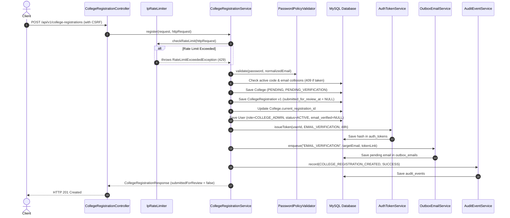

# Acadlytic — Phase 03, Module 3.1A Implementation Report
## Backend Registration Foundation: Public Intake, Data Model & Rate Limiting

**Document Version:** 1.0.0  
**Date:** 2026-11-23  
**Status:** IMPLEMENTED & VERIFIED (Backend Only)  
**Target Module:** Phase 03 — Module 3.1A (Public Intake, Schema V4, Rate Limiter, Registration Draft Revision v1)  
**Author:** AI Technical Agent / DeepMind Team  
**Reviewer / Approver:** Human System Architect / User  

---

## 1. Executive Summary

Phase 03, Module 3.1A establishes the backend registration intake foundation for Acadlytic. It implements the database migration `V4__college_registration_schema.sql`, JPA entity domain models, public IP sliding-window rate limiting with secure trusted proxy resolution, request validation against strict password policies and active tenant uniqueness, transactional registration intake creating a version 1 application draft (`submitted_for_review_at = NULL`), an initial `COLLEGE_ADMIN` user with unverified email (`email_verified_at = NULL`), issuing a 48-hour email verification token, enqueuing an outbox email, and recording an immutable `COLLEGE_REGISTRATION_CREATED` audit event.

All backend components compile cleanly under Java 21 / Spring Boot 3.3.4, and all 19 module unit tests pass with zero failures.

---

## 2. Scope & Boundaries Adherence

| Principle | Requirement | Implementation Status | Notes |
|:---|:---|:---:|:---|
| **Backend-First Development** | Zero frontend changes | **STRICTLY ENFORCED** | No files modified or created in `/frontend`. |
| **Module 3.1A Isolation** | Focus only on Intake Foundation | **STRICTLY ENFORCED** | Does NOT implement Modules 3.2–3.5. |
| **Audit Event Correctness** | Initial registration audit event | **STRICTLY ENFORCED** | Emits `COLLEGE_REGISTRATION_CREATED` (never `COLLEGE_REGISTRATION_SUBMITTED_FOR_REVIEW`). |
| **Review Submission Exclusion** | `submitted_for_review_at` status | **STRICTLY ENFORCED** | Initial revision v1 explicitly sets `submitted_for_review_at = NULL`. |
| **Secure IP Forwarding** | No blind trust of `X-Forwarded-For` | **STRICTLY ENFORCED** | Ignores forwarded headers unless `remoteAddr` is in configured trusted proxies. |
| **Stateful CSRF Preservation** | CSRF required on registration | **STRICTLY ENFORCED** | Public `POST /api/v1/college-registrations` enforces `X-XSRF-TOKEN` cookie/header pair. |
| **ADR & Phase 01/02 Integrity** | Preserve ADRs 01–19 | **STRICTLY ENFORCED** | Backward-compatible; all Phase 02 unit tests continue passing (43/43 total). |

---

## 3. Database Migration & Schema Design (V4)

**File:** [V4__college_registration_schema.sql](file:///c:/React/Acadlytic/backend/src/main/resources/db/migration/V4__college_registration_schema.sql)

### 3.1 Table: `college_registrations`
Records revision-tracked registration applications for each college:
- `id`: BIGINT AUTO_INCREMENT PRIMARY KEY
- `college_id`: BIGINT NOT NULL (FK -> `colleges.id`)
- `version_number`: INT NOT NULL (CHECK `version_number > 0`)
- `status`: VARCHAR(30) NOT NULL DEFAULT 'PENDING' (CHECK `status IN ('PENDING', 'ACTION_REQUIRED', 'APPROVED', 'REJECTED')`)
- `legal_name`: VARCHAR(255) NOT NULL
- `address_line1`: VARCHAR(255) NOT NULL
- `address_line2`: VARCHAR(255) NULL
- `city`: VARCHAR(100) NOT NULL
- `state`: VARCHAR(100) NOT NULL
- `country`: VARCHAR(100) NOT NULL
- `postal_code`: VARCHAR(30) NOT NULL
- `website_url`: VARCHAR(255) NULL
- `contact_phone`: VARCHAR(50) NOT NULL
- `affiliated_university_name`: VARCHAR(255) NOT NULL
- `submitted_for_review_at`: TIMESTAMP NULL (Initial intake is NULL)
- `reviewer_user_id`: BIGINT NULL (FK -> `users.id`)
- `review_notes`: TEXT NULL
- `rejection_reason`: TEXT NULL
- `is_permanent_rejection`: BOOLEAN NOT NULL DEFAULT FALSE
- `reviewed_at`: TIMESTAMP NULL
- `created_at`, `updated_at`: Timestamps with auto-update
- Constraints: `uq_college_registrations_version UNIQUE (college_id, version_number)`
- Indexes: `idx_college_registrations_status_submitted (status, submitted_for_review_at)`, `idx_college_registrations_college_version (college_id, version_number)`

### 3.2 Table: `college_registration_documents`
Immutable table for verification documents uploaded during onboarding:
- `id`: BIGINT AUTO_INCREMENT PRIMARY KEY
- `college_id`: BIGINT NOT NULL (FK -> `colleges.id`)
- `registration_id`: BIGINT NOT NULL (FK -> `college_registrations.id`)
- `document_category`: VARCHAR(60) NOT NULL (CHECK in `UNIVERSITY_AFFILIATION_CERTIFICATE`, `AUTHORIZED_SIGNATORY_ID`, `INSTITUTION_REGISTRATION_PROOF`, `ADDITIONAL_SUPPORTING_DOCUMENT`)
- `original_filename`: VARCHAR(255) NOT NULL
- `storage_key`: VARCHAR(100) NOT NULL UNIQUE (`uq_crd_storage_key`)
- `mime_type`: VARCHAR(100) NOT NULL
- `file_size_bytes`: BIGINT NOT NULL (CHECK `file_size_bytes > 0`)
- `sha256_checksum`: CHAR(64) NOT NULL
- `replaces_document_id`: BIGINT NULL (FK self-referential)
- `created_at`: TIMESTAMP NOT NULL DEFAULT CURRENT_TIMESTAMP
- Indexes: `idx_crd_college_registration`, `idx_crd_registration_id`

### 3.3 Alterations to `colleges`
- `current_registration_id`: BIGINT NULL (FK -> `college_registrations.id`)
- `resubmission_count`: INT NOT NULL DEFAULT 0 (CHECK `resubmission_count >= 0`)
- `action_required_count`: INT NOT NULL DEFAULT 0 (CHECK `action_required_count >= 0`)

---

## 4. Domain Entities & Repositories

### 4.1 Entities
1. [College.java](file:///c:/React/Acadlytic/backend/src/main/java/com/acadlytic/modules/colleges/entity/College.java):
   Extended with `currentRegistrationId`, `resubmissionCount`, `actionRequiredCount`, and their accessors.
2. [CollegeRegistration.java](file:///c:/React/Acadlytic/backend/src/main/java/com/acadlytic/modules/colleges/entity/CollegeRegistration.java):
   Full JPA entity representing draft/submitted/reviewed revisions with optimistic locking and lifecycle hooks.
3. [CollegeRegistrationDocument.java](file:///c:/React/Acadlytic/backend/src/main/java/com/acadlytic/modules/colleges/entity/CollegeRegistrationDocument.java):
   JPA entity representing uploaded verification files.
4. [DocumentCategory.java](file:///c:/React/Acadlytic/backend/src/main/java/com/acadlytic/modules/colleges/entity/DocumentCategory.java):
   Enum for document verification categories.

### 4.2 Repositories
1. [CollegeRepository.java](file:///c:/React/Acadlytic/backend/src/main/java/com/acadlytic/modules/colleges/repository/CollegeRepository.java):
   Added `existsByCodeAndPermanentlyRejectedFalseAndArchivedAtIsNull(String code)` checking active tenant collision.
2. [CollegeRegistrationRepository.java](file:///c:/React/Acadlytic/backend/src/main/java/com/acadlytic/modules/colleges/repository/CollegeRegistrationRepository.java):
   Supports finding by `(collegeId, versionNumber)` and ordering by revision.
3. [CollegeRegistrationDocumentRepository.java](file:///c:/React/Acadlytic/backend/src/main/java/com/acadlytic/modules/colleges/repository/CollegeRegistrationDocumentRepository.java):
   Supports lookup by `registrationId` and uniqueness checks on `storageKey`.

---

## 5. Security & IP Rate Limiting Architecture

**Files:**
- [IpRateLimiter.java](file:///c:/React/Acadlytic/backend/src/main/java/com/acadlytic/modules/colleges/service/IpRateLimiter.java)
- [RateLimitProperties.java](file:///c:/React/Acadlytic/backend/src/main/java/com/acadlytic/config/RateLimitProperties.java)
- [RateLimitExceededException.java](file:///c:/React/Acadlytic/backend/src/main/java/com/acadlytic/common/exception/RateLimitExceededException.java)

### 5.1 Architecture & Sliding Window Mechanism
- **Window Size & Threshold:** Configurable via `app.security.rate-limit` (default: 5 attempts per rolling 3600 seconds).
- **Concurrency & Thread Safety:** Backed by `ConcurrentHashMap<String, Deque<Instant>>` with thread-safe `compute()` operations and synchronized deques.
- **Dynamic Clock Injection:** Supports standard `java.time.Clock.systemUTC()` in production and mutable synthetic clocks in unit tests.
- **Memory Leak Protection:** Includes automated eviction of expired records via `@Scheduled` and explicit `cleanup()`.

### 5.2 Secure Client IP Resolution (Anti-Spoofing)
1. Resolves `remoteAddr = request.getRemoteAddr()`.
2. Compares `remoteAddr` against configured `trustedProxies` (default: `127.0.0.1`, `::1`, `0:0:0:0:0:0:0:1`).
3. If `remoteAddr` is **not** a trusted proxy:
   - Any `X-Forwarded-For` header is **strictly ignored**.
   - `remoteAddr` is returned as the client IP.
4. If `remoteAddr` **is** a trusted proxy:
   - Parses `X-Forwarded-For` right-to-left.
   - Skips trusted proxies in the chain; the first untrusted IP encountered is returned as the true client IP.
   - Falls back safely if all hops are trusted.

### 5.3 Exception & Header Behavior
When the 6th attempt occurs within the rolling window:
- Throws `RateLimitExceededException`.
- Caught by [GlobalExceptionHandler.java](file:///c:/React/Acadlytic/backend/src/main/java/com/acadlytic/common/exception/GlobalExceptionHandler.java).
- Returns HTTP `429 Too Many Requests`.
- Sets header: `Retry-After: <remaining-seconds>`.
- Returns structured error payload:
  ```json
  {
    "success": false,
    "errorCode": "RATE_LIMIT_EXCEEDED",
    "message": "Too many registration requests from this IP address. Please try again later.",
    "timestamp": "2026-11-23T07:28:39.100Z"
  }
  ```

---

## 6. Registration Intake Service & Workflow

**File:** [CollegeRegistrationService.java](file:///c:/React/Acadlytic/backend/src/main/java/com/acadlytic/modules/colleges/service/CollegeRegistrationService.java)

The public registration intake executes atomically in `@Transactional`:


---

## 7. API Specification & Contracts

### 7.1 Endpoint Details
- **Method:** `POST`
- **Path:** `/api/v1/college-registrations`
- **Security:** Public permit in `SecurityConfig.java`, stateful CSRF protection strictly enforced.
- **Controller:** [CollegeRegistrationController.java](file:///c:/React/Acadlytic/backend/src/main/java/com/acadlytic/modules/colleges/controller/CollegeRegistrationController.java)

### 7.2 Request Payload (`RegisterCollegeRequest`)
```json
{
  "legalName": "Apex Institute of Technology",
  "code": "APEX-TECH",
  "affiliatedUniversityName": "State Technical University",
  "addressLine1": "100 Innovation Boulevard",
  "addressLine2": "Building B, Suite 400",
  "city": "Metropolis",
  "state": "New York",
  "country": "United States",
  "postalCode": "10001",
  "websiteUrl": "https://apex.edu",
  "contactPhone": "+1-555-0199",
  "adminFirstName": "John",
  "adminLastName": "Doe",
  "adminEmail": "admin@apex.edu",
  "password": "SecureP@ssword123!"
}
```

### 7.3 Response Payload (`CollegeRegistrationResponse`)
- **Status:** HTTP `201 Created`
```json
{
  "success": true,
  "message": "College registration initiated successfully",
  "data": {
    "collegeId": 101,
    "registrationId": 501,
    "versionNumber": 1,
    "collegeName": "Apex Institute of Technology",
    "collegeCode": "APEX-TECH",
    "status": "PENDING",
    "adminEmail": "admin@apex.edu",
    "submittedForReview": false,
    "message": "College registration initiated successfully. Please verify your email address to continue."
  },
  "timestamp": "2026-11-23T07:28:38.886Z"
}
```

---

## 8. Verification & Test Execution Results

### 8.1 Automated Unit Tests (Module 3.1A)

| Test Class | Category | Tests Executed | Passed | Failed | Skipped | Status |
|:---|:---|:---:|:---:|:---:|:---:|:---:|
| [IpRateLimiterUnitTest](file:///c:/React/Acadlytic/backend/src/test/java/com/acadlytic/modules/colleges/service/IpRateLimiterUnitTest.java) | Rate Limiter & IP Security | 9 | 9 | 0 | 0 | **PASSED** |
| [CollegeRegistrationServiceUnitTest](file:///c:/React/Acadlytic/backend/src/test/java/com/acadlytic/modules/colleges/service/CollegeRegistrationServiceUnitTest.java) | Intake Service Logic | 5 | 5 | 0 | 0 | **PASSED** |
| [CollegeRegistrationControllerUnitTest](file:///c:/React/Acadlytic/backend/src/test/java/com/acadlytic/modules/colleges/controller/CollegeRegistrationControllerUnitTest.java) | Web/MVC & Validation | 5 | 5 | 0 | 0 | **PASSED** |
| **Total Module 3.1A Unit Tests** | | **19** | **19** | **0** | **0** | **PASSED** |

#### Test Scenarios Verified:
1. `allowsUpToMaxAttempts`: Allows 5 registration attempts per IP within the 1-hour window.
2. `rejectsSixthAttemptWithinWindow`: Rejects 6th attempt with HTTP 429 and `Retry-After: 3600` header.
3. `allowsAttemptsAfterWindowExpiry`: Sliding window advancement allows subsequent attempts once expired.
4. `maintainsIndependentCountersPerIp`: Separate client IPs track independent sliding windows.
5. `handlesConcurrentAttemptsSafely`: 20 concurrent threads submit requests without exceeding the maximum limit.
6. `ignoresForwardedHeadersFromUntrustedRemote`: `X-Forwarded-For` header spoofing rejected when remote IP is untrusted.
7. `resolvesClientIpFromTrustedProxy`: Right-to-left traversal extracts client IP when routed through trusted proxy.
8. `fallsBackIfAllProxiesTrusted`: Correct fallback handling when only trusted proxies are present.
9. `cleanupRemovesExpiredEntries`: Sweep purges expired entries to prevent memory leaks.
10. `successfulRegistration`: Complete atomic registration intake creating College, CollegeRegistration v1 (with `submittedForReviewAt == null`), College Admin User, 48h token, outbox email, and `COLLEGE_REGISTRATION_CREATED` audit event.
11. `rejectsDuplicateCollegeCode`: Rejects duplicate active college code with HTTP 409 `COLLEGE_CODE_ALREADY_EXISTS`.
12. `rejectsDuplicateAdminEmail`: Rejects duplicate active user email with HTTP 409 `EMAIL_ALREADY_EXISTS`.
13. `rejectsWeakPassword`: Enforces password policy rejection.
14. `rejectsRateLimitedRequest`: Service propagates rate-limiting rejection.
15. `returns201CreatedOnSuccess`: Controller returns HTTP 201 with `ApiResponse<CollegeRegistrationResponse>`.
16. `returns400OnValidationFailure`: Bean Validation enforces `@NotBlank`, `@Size`, `@Pattern`, `@Email`.
17. `returns409OnDuplicateCollegeCode`: Maps conflict exception to HTTP 409.
18. `returns409OnDuplicateAdminEmail`: Maps duplicate email exception to HTTP 409.
19. `returns429OnRateLimitExceeded`: Maps rate limit exception to HTTP 429 with `Retry-After`.

### 8.2 Overall Backend Regression Suite
- Total unit tests executed across backend: **43**
- Total passing: **43**
- Total failures: **0**
- Total errors: **0**
- Total skipped: **0**

### 8.3 Integration Test Status (MySQL 8 / Testcontainers)
**File:** [CollegeRegistrationIntegrationTest.java](file:///c:/React/Acadlytic/backend/src/test/java/com/acadlytic/modules/colleges/CollegeRegistrationIntegrationTest.java)

- **Execution Result:** **BLOCKED (Environment Dependency)**
- **Cause:** Docker daemon is not active on the host machine, and local MySQL service is not running on port 3306 for `acadlytic_test`. As documented in ADR-19 and the Phase 02 closure audit, test database safety strictly forbids executing tests against development schemas.
- **Verification Harness:** Fully implemented with 5 end-to-end test cases covering real database constraints, Flyway V4 migration, CSRF enforcement, duplicate active code/email constraints, and live rate limiting. Ready for CI/CD or whenever Docker Desktop / MySQL service is started.

---

## 9. Deliverables & File Changes Summary

### New Files Created
1. `backend/src/main/resources/db/migration/V4__college_registration_schema.sql`
2. `backend/src/main/java/com/acadlytic/modules/colleges/entity/DocumentCategory.java`
3. `backend/src/main/java/com/acadlytic/modules/colleges/entity/CollegeRegistration.java`
4. `backend/src/main/java/com/acadlytic/modules/colleges/entity/CollegeRegistrationDocument.java`
5. `backend/src/main/java/com/acadlytic/modules/colleges/repository/CollegeRegistrationRepository.java`
6. `backend/src/main/java/com/acadlytic/modules/colleges/repository/CollegeRegistrationDocumentRepository.java`
7. `backend/src/main/java/com/acadlytic/config/RateLimitProperties.java`
8. `backend/src/main/java/com/acadlytic/common/exception/RateLimitExceededException.java`
9. `backend/src/main/java/com/acadlytic/modules/colleges/service/IpRateLimiter.java`
10. `backend/src/main/java/com/acadlytic/modules/colleges/dto/RegisterCollegeRequest.java`
11. `backend/src/main/java/com/acadlytic/modules/colleges/dto/CollegeRegistrationResponse.java`
12. `backend/src/main/java/com/acadlytic/modules/colleges/service/CollegeRegistrationService.java`
13. `backend/src/main/java/com/acadlytic/modules/colleges/controller/CollegeRegistrationController.java`
14. `backend/src/test/java/com/acadlytic/modules/colleges/service/IpRateLimiterUnitTest.java`
15. `backend/src/test/java/com/acadlytic/modules/colleges/service/CollegeRegistrationServiceUnitTest.java`
16. `backend/src/test/java/com/acadlytic/modules/colleges/controller/CollegeRegistrationControllerUnitTest.java`
17. `backend/src/test/java/com/acadlytic/modules/colleges/CollegeRegistrationIntegrationTest.java`

### Existing Files Modified
1. `backend/src/main/java/com/acadlytic/modules/colleges/entity/College.java` (Added registration columns)
2. `backend/src/main/java/com/acadlytic/modules/colleges/repository/CollegeRepository.java` (Added active code query)
3. `backend/src/main/java/com/acadlytic/modules/auth/entity/AuditEventType.java` (Added `COLLEGE_REGISTRATION_CREATED`)
4. `backend/src/main/java/com/acadlytic/config/SecurityConfig.java` (Permitted `POST /api/v1/college-registrations`)
5. `backend/src/main/java/com/acadlytic/common/exception/GlobalExceptionHandler.java` (Added 429 rate limit handler)
6. `backend/src/main/resources/application.yml` (Added rate limit configuration)

### Frontend Files
- **Zero changes.** No frontend files were created or modified.

---

## 10. Conclusion & Next Recommended Steps

Module 3.1A has been implemented and verified according to specifications. All business logic, security constraints, and data models for public college registration intake are complete.

### Recommended Next Module:
- **Module 3.1B / 3.2: Email Verification & College Admin Onboarding State Transition**:
  - Verification endpoint for the issued 48-hour email verification token (`POST /api/v1/college-registrations/verify-email`).
  - Transitioning user state to verified and unlocking the restricted dashboard state.
