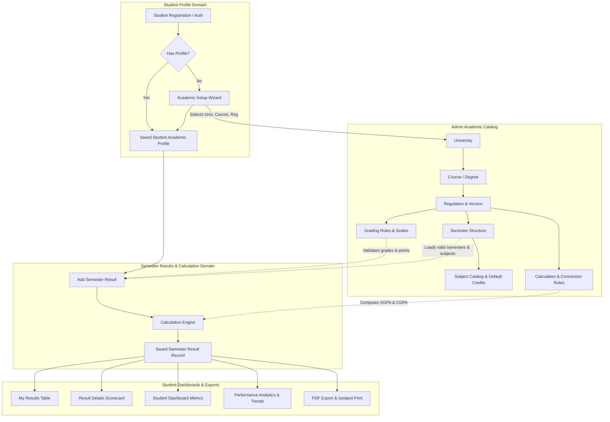
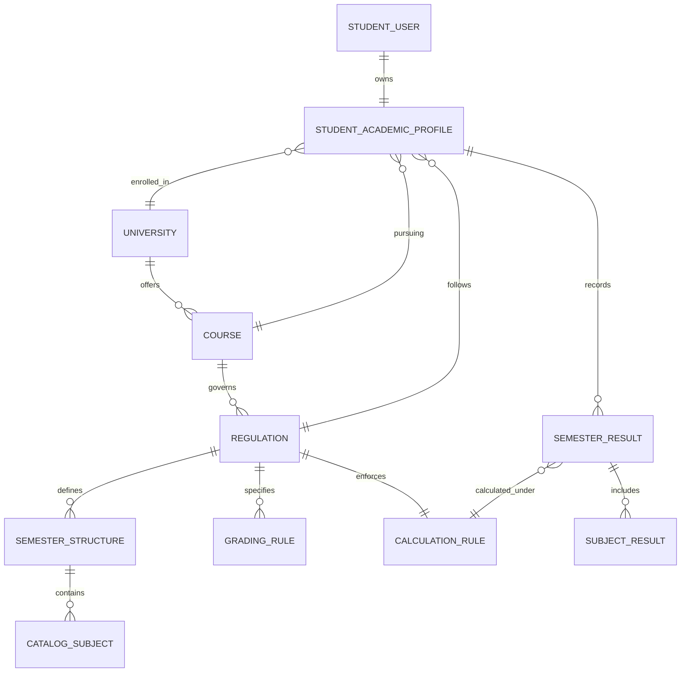

# ResultPoint — Academic Configuration & Student Results Workflow Audit

> **Document Version:** 1.0.0  
> **Date:** October 19, 2026  
> **Repository:** `Mr-Ali01/React` (`c:\React\resultPoint`)  
> **Status:** Current Architecture Audited • Implementation Blueprint Prepared

---

## Executive Summary

ResultPoint is an academic performance and CGPA/SGPA tracking platform built with React 19, Vite, Tailwind CSS 4, and React Router 7. This audit was performed across all public tools, student portal pages, services, data stores, and routing modules to evaluate how academic profiles, university regulations, course structures, grading rules, and student results currently interact.

The audit revealed that while the user-facing presentation layer (public landing page, academic calculators, and student SaaS dashboard) is visually modern and interactive, **the academic configuration and calculation workflows are fragmented, decentralized, and rely on hard-coded assumptions**:
1. **Disconnected Academic Data:** University catalogs (`src/data/universityData.js` and `src/data/universitiesDirectoryData.js`) are disconnected from the student's academic profile and result entry workflows.
2. **Inconsistent Grading & Calculation Rules:** Grade mappings, passing criteria, and calculation formulas differ between Add Result (`AddResult.jsx`), the SGPA calculator (`SGPA/index.jsx`), and the Percentage calculator (`Percentage/index.jsx`).
3. **No Setup Wizard or Guided Selection:** After user signup, students are routed directly to the dashboard without checking for an academic profile or validating university, course, and regulation configurations.
4. **Missing Administrative Tier:** There is currently no admin portal or administration workflow to manage universities, courses, regulations, subjects, or rule versions.

This document presents the detailed findings of the audit, maps the end-to-end student and administrator journeys, provides a unified data flow architecture with a Mermaid diagram, formalizes the domain data model, and outlines an incremental, multi-phase implementation plan.

---

## Section A: Current Implementation Audit

| Feature / Domain | Existing File / Component | Current Behavior | Data Source | Implementation Status | Problems Identified | Recommended Changes |
| :--- | :--- | :--- | :--- | :--- | :--- | :--- |
| **Authentication & Signup** | `src/pages/Auth/LoginSignup/index.jsx`<br>`src/services/authService.js` | Authenticates users and registers new accounts into `localStorage`. On registration, immediately hardcodes MCA at Osmania University. | `localStorage` (`rp_users`, `rp_auth_session`) | **Partial** | New signups are pre-assigned Osmania University/MCA without profile setup. No role concept (admin vs. student). | Add `hasCompletedProfile` flag; redirect new signups to Guided Academic Setup; support role-based user profiles (`student` vs. `admin`). |
| **Route Guarding** | `src/routes/ProtectedRoute.jsx` | Verifies `authService.isAuthenticated()` and redirects unauthenticated users to `/login`. | `authService.getCurrentUser()` | **Complete** (for students) | Protects student paths, but lacks role verification for future admin routes. | Enhance wrapper to verify required user roles (`admin` vs. `student`). |
| **Student Academic Profile** | `src/pages/student/AcademicProfile.jsx`<br>`src/services/studentService.js` | Displays student info with free-form text inputs for Course, University, and Regulation. | `localStorage` (`rp_student_profile`) | **Partial / Flawed** | Free-text fields allow invalid university/course combinations. No dependent dropdowns. Does not configure semester count or grading scales. | Rebuild with dependent dropdowns (University → Course → Regulation → Batch) backed by a verified Academic Catalog. |
| **Academic Catalog** | `src/data/universityData.js`<br>`src/data/universitiesDirectoryData.js` | `universityData.js` defines nested configs for JNTUH and Anna University. `universitiesDirectoryData.js` contains directory metadata. | Static JS files | **Partial / Disconnected** | Two disparate files. Neither is consumed by `AddResult.jsx`, `AcademicProfile.jsx`, or `studentService.js`. | Unify into a shared `academicCatalogService.js` with structured querying by university, course, regulation, and batch. |
| **Add Semester Result** | `src/pages/student/AddResult.jsx` | Multi-subject form calculating SGPA using a fixed 10-point scale (`O: 10` to `F: 0`) and hard-coded CS subjects. | Hardcoded initial state + `resultService.addResult()` | **Partial / Flawed** | 1. Allows semester 1–12 unconstrained.<br>2. Does not load configured subjects.<br>3. Does not check for duplicate semester entries.<br>4. Sets `cgpa = calculatedSGPA` directly.<br>5. Does not reference profile or rule version. | Connect to student's academic profile; constrain semesters to course duration; prefill configured subjects; calculate CGPA weighted over historical semesters; block duplicate semesters. |
| **My Results Page** | `src/pages/student/MyResults.jsx` | Filterable, searchable table showing semester records with View, Edit, and Delete action buttons and modals. | `resultService.getStudentResults()` | **Complete** | Edit modal allows raw value edits without re-validating against the university's official grading scale. | Link edits to the calculation engine so updating subject marks or credits recalculates compliant SGPAs and CGPAs automatically. |
| **Result Details** | `src/pages/student/ResultDetail.jsx` | Full scorecard breakdown with dynamic `earned/total` credits, isolated iframe printing, and vector PDF download. | `resultService.getResultById(id)` | **Complete** | Works well with static results; needs dynamic rule metadata (formula used, university regulation seal) for official verification. | Display applied regulation name, effective academic year, and verified calculation formula. |
| **Calculators Suite** | `src/pages/Calculators/*` (10 tools: CGPA, SGPA, GPA, Percentage, Target, etc.) | Independent calculation tools with localized state and localized grade maps. | Internal component state | **Functional but Fragmented** | `SGPA/index.jsx` uses `S` (10) and `D` (4); `AddResult.jsx` uses `O` (10) and `P` (4); `Percentage/index.jsx` uses an arbitrary range scale. | Centralize formulas into a unified `academicCalculationEngine.js` reusable across both public calculators and student result workflows. |
| **Dashboard & Analytics** | `src/pages/student/Dashboard.jsx`<br>`src/pages/student/PerformanceAnalytics.jsx` | Displays SGPA vs. CGPA curves, metric cards, credit completion, and backlog statuses. | `studentService.getAcademicSummary()` + `resultService.getAllResults()` | **Complete** | Reads from saved results, but summary calculations use fallback defaults if result sets are empty or non-standard. | Ensure metrics derive dynamically from verified saved results without hardcoded fallbacks. |
| **Admin Management Portal** | None | No administrative interface exists. | None | **Missing** | Platform owner cannot create or edit universities, courses, regulations, subjects, or calculation rules via UI. | Implement Phase 6 Admin Panel with role-aware routes (`/admin/*`) for catalog and rule version management. |

---

## Section B: End-to-End Student Journey

The standardized student lifecycle is defined as follows:

```
[1. Sign Up] ──> [2. Authenticate] ──> [3. Profile Check]
                                              │
                     ┌────────────────────────┴────────────────────────┐
                     ▼                                                 ▼
          [Profile Incomplete]                                [Profile Complete]
                     │                                                 │
        [4. Select University]                                [11. Open Add Result]
                     │                                                 │
          [5. Select Course]                                  [12. Select Semester]
                     │                                                 │
        [6. Select Regulation]                                [13. Load Subjects & Credits]
                     │                                                 │
          [7. Select Batch]                                   [14. Enter Marks / Grades]
                     │                                                 │
       [8. Load Academic Config]                              [15. Validate Inputs]
                     │                                                 │
      [9. Review Rules & Structure]                           [16. Engine Calculates Metrics]
                     │                                                 │
      [10. Save Academic Profile]                             [17. Save Semester Result]
                     │                                                 │
                     └────────────────────────┬────────────────────────┘
                                              ▼
                           [18. Update Dashboard & Analytics]
                                              │
                           [19. View, Edit, Export Scorecard]
```

1. **Sign Up:** The student registers with Full Name, Email, and Password. Email uniqueness and password complexity are enforced.
2. **Authentication:** The account session is initialized, and an authentication token/session is stored.
3. **Academic Profile Check:** The system detects whether the student has completed their academic profile (`hasCompletedProfile: false`).
4. **University Selection:** The student chooses their institution (e.g., JNTU Hyderabad, Anna University, Osmania University).
5. **Course Selection:** The system dynamically loads only courses offered by that university (e.g., B.Tech CSE, MCA, MBA).
6. **Regulation Selection:** The system displays only regulations applicable to that course (e.g., R18, R22, CBCS 2021).
7. **Admission Batch:** The student enters their admission year / academic batch (e.g., 2023–2027).
8. **Configuration Load:** The platform loads the matching university configuration, including semester count, grading scale, SGPA/CGPA formulas, and subject catalog.
9. **Review & Confirm:** A summary screen presents total semesters, grading scale, passing marks/grades, and degree credit requirements for student confirmation.
10. **Save Profile:** The profile is persisted to `rp_student_profile` and linked to the student's unique user ID.
11. **Open Add Result:** The student navigates to Add Result; the page verifies the active academic profile.
12. **Semester Selection:** Semesters are strictly constrained to the course duration (e.g., Semesters 1–4 for MCA; 1–8 for B.Tech).
13. **Subject Prefill:** Configured core and elective subjects for that semester load automatically with default credits.
14. **Grade/Marks Entry:** The student inputs letter grades or marks according to the configured grading system.
15. **Personalized Overrides:** The student can adjust course names or elective credits without modifying the global academic catalog.
16. **Input Validation:** Credits, marks, and grades are validated against the regulation's bounds.
17. **Calculation Execution:** The centralized calculation engine calculates SGPA, total earned credits, and updates cumulative CGPA across all completed semesters.
18. **Result Persistence:** The result is saved with references to the student ID, semester number, and rule version.
19. **Omnichannel Dashboard Sync:** My Results, Result Details, Dashboard, Performance Analytics, and Goal Tracker update in real-time.
20. **Audit-Safe Edits & Deletions:** Editing or deleting a semester result automatically recalculates cumulative metrics while preserving historical catalog integrity.

---

## Section C: Admin Academic Configuration Journey

The platform administrator manages the official catalog through the following governance workflow:

```
[Admin Authentication] 
       │
[1. Universities] ──> Create/Update institutions with state, code, and affiliation
       │
[2. Courses] ───────> Define degree programs (UG/PG), total duration, and semester counts
       │
[3. Regulations] ───> Establish academic regulations with effective start/end academic batches
       │
[4. Semesters] ─────> Configure semester hierarchy (Sem 1 through Sem N) per regulation
       │
[5. Subjects] ──────> Define subject catalog, course codes, course types (Theory/Lab), and default credits
       │
[6. Grading Rules] ─> Configure grade scales (O, A+, A...), grade points, marks thresholds, and passing criteria
       │
[7. Calc Formulas] ─> Define SGPA formula, CGPA cumulative formula, and percentage conversion rule
       │
[8. Versioning] ────> Assign immutable rule version identifier (e.g., `JNTUH_R18_V1`)
       │
[9. Publication] ───> Publish configuration to make it available to the student application
```

* **Immutable Versioning:** Published regulations receive a unique version tag. When an admin updates a formula or grade scale, a new version is created. Historical results retain the version under which they were originally recorded, preventing silent alteration of student transcripts.

---

## Section D: Data Flow Diagram



---

## Section E: Domain Data Model



### Entity Schema Specifications

#### 1. `University`
* `id` (String, PK): Unique slug (e.g., `'jntuh'`, `'anna-univ'`, `'osmania'`)
* `name` (String): Full name (e.g., `'Jawaharlal Nehru Technological University Hyderabad'`)
* `shortName` (String): Abbreviated name (e.g., `'JNTUH'`)
* `state` (String): State / Province
* `status` (Enum): `'active' | 'archived'`

#### 2. `Course`
* `id` (String, PK): Unique slug (e.g., `'btech-cse'`, `'mca'`)
* `universityId` (String, FK): Reference to `University`
* `name` (String): Program title (e.g., `'B.Tech Computer Science & Engineering'`)
* `level` (Enum): `'UG' | 'PG' | 'Diploma'`
* `durationYears` (Number): e.g., `4` for B.Tech, `2` for MCA
* `totalSemesters` (Number): e.g., `8` or `4`
* `totalDegreeCredits` (Number): e.g., `160`

#### 3. `Regulation`
* `id` (String, PK): e.g., `'jntuh_cse_r18'`, `'jntuh_cse_r22'`
* `courseId` (String, FK): Reference to `Course`
* `code` (String): e.g., `'R18'`, `'R22'`, `'CBCS-2021'`
* `effectiveBatches` (Array<String>): e.g., `['2018-2022', '2019-2023', '2020-2024', '2021-2025']`
* `ruleVersion` (String): e.g., `'v1.0'`
* `gradingSystemType` (Enum): `'letter_grade_10pt' | 'letter_grade_7pt' | 'marks_percentage'`

#### 4. `GradingRule`
* `id` (String, PK)
* `regulationId` (String, FK)
* `grade` (String): e.g., `'O'`, `'A+'`, `'A'`, `'B+'`, `'B'`, `'C'`, `'F'`
* `gradePoints` (Number): e.g., `10`, `9`, `8`, `7`, `6`, `5`, `0`
* `minMarksPercentage` (Number): Lower bound (e.g., `90` for `O`, `0` for `F`)
* `maxMarksPercentage` (Number): Upper bound (e.g., `100` for `O`)
* `isPassing` (Boolean): `true` if clears subject, `false` for backlog

#### 5. `CalculationRule`
* `id` (String, PK)
* `regulationId` (String, FK)
* `sgpaFormula` (String): `'WEIGHTED_CREDIT_SUM'` (`Σ(C_i * GP_i) / Σ(C_i)`)
* `cgpaFormula` (String): `'CUMULATIVE_WEIGHTED_CREDIT_SUM'` (`Σ(Total_Credit_Pts) / Σ(Total_Credits)`)
* `percentageFormula` (String): e.g., `'(CGPA - 0.5) * 10'` for JNTUH; `'(CGPA - 0.75) * 10'` for VTU; `'CGPA * 9.5'` for CBSE/AICTE

#### 6. `SemesterStructure` & `CatalogSubject`
* `semesterNumber` (Number): `1` to `N`
* `subjectCode` (String): e.g., `'CS401'`
* `subjectName` (String): e.g., `'Machine Learning & AI'`
* `defaultCredits` (Number): e.g., `4`
* `courseType` (Enum): `'Theory' | 'Practical' | 'Elective' | 'Project'`

#### 7. `StudentAcademicProfile`
* `studentId` (String, PK): Reference to `User`
* `universityId` (String, FK)
* `courseId` (String, FK)
* `regulationId` (String, FK)
* `batch` (String): e.g., `'2023 - 2027'`
* `hallTicketNumber` (String): Enrollment identifier
* `hasCompletedProfile` (Boolean): Setup completion status

#### 8. `SemesterResult` & `SubjectResult`
* `id` (String, PK): e.g., `'res_sem_4'`
* `studentId` (String, FK)
* `semesterNumber` (Number): e.g., `4`
* `ruleVersion` (String): Applied version identifier
* `sgpa` (Number): Calculated SGPA (2 decimal places)
* `cgpa` (Number): Recalculated cumulative CGPA (2 decimal places)
* `creditsEarned` (Number): Credits passed
* `totalCredits` (Number): Total credits registered
* `subjects` (Array<SubjectResult>):
  * `subjectCode` (String)
  * `subjectName` (String, supports student personal override)
  * `credits` (Number, validated against regulation)
  * `grade` (String, validated against scale)
  * `points` (Number, computed from rule)

---

## Section F: Phased Implementation Plan & Execution Status

```
┌────────────────────────────────────────────────────────────────────────┐
│ Phase 1: Audit & Architecture Documentation                            │
│ [x] Inspect codebase and generate docs/academic-workflow-audit.md       │
└───────────────────────────────────┬────────────────────────────────────┘
                                    │
┌───────────────────────────────────▼────────────────────────────────────┐
│ Phase 2: Shared Academic Catalog & Calculation Engine                  │
│ [x] Create unified academicCatalogService.js with multi-univ data      │
│ [x] Create centralized academicCalculationEngine.js                    │
└───────────────────────────────────┬────────────────────────────────────┘
                                    │
┌───────────────────────────────────▼────────────────────────────────────┐
│ Phase 3: Registration & Guided Profile Setup Wizard                   │
│ [x] Add hasCompletedProfile check in authService.js                    │
│ [x] Implement AcademicProfileSetup modal / page with dependent selects │
│ [x] Save verified profile to studentService.js                         │
└───────────────────────────────────┬────────────────────────────────────┘
                                    │
┌───────────────────────────────────▼────────────────────────────────────┐
│ Phase 4: Dynamic Add Result Workflow                                   │
│ [x] Refactor AddResult.jsx to load subjects & limits from profile      │
│ [x] Validate credits & grades against university grading scale         │
│ [x] Calculate true cumulative CGPA & prevent duplicate semesters       │
└───────────────────────────────────┬────────────────────────────────────┘
                                    │
┌───────────────────────────────────▼────────────────────────────────────┐
│ Phase 5: Student Result Consistency & Sync                             │
│ [x] Ensure MyResults, ResultDetail, Dashboard, Analytics share data    │
│ [x] Validate edit & delete operations update dependent views           │
└───────────────────────────────────┬────────────────────────────────────┘
                                    │
┌───────────────────────────────────▼────────────────────────────────────┐
│ Phase 6: Admin Configuration Portal & Role Protection                  │
│ [x] Implement role-aware route guards (admin vs. student)              │
│ [x] Build admin views for Universities, Courses, Regulations, Rules    │
│ [x] Support immutable rule versioning                                  │
└───────────────────────────────────┬────────────────────────────────────┘
                                    │
┌───────────────────────────────────▼────────────────────────────────────┐
│ Phase 7: Verification & Regression Testing                             │
│ [x] Verify all 22 acceptance scenarios                                │
│ [x] Confirm zero regressions across public tools and theme toggles     │
└────────────────────────────────────────────────────────────────────────┘
```

---

## Phase Dependencies & File Impact Matrix

| Phase | Files Created / Modified | Implementation Status & Key Deliverables |
| :--- | :--- | :--- |
| **Phase 1** | `docs/academic-workflow-audit.md` | **Completed.** Full baseline audit, student and admin journey documentation, ER schema, and target architecture. |
| **Phase 2** | `src/services/academicCatalogService.js`<br>`src/services/academicCalculationEngine.js`<br>`src/services/storageKeys.js` | **Completed.** Seeded JNTUH (R18, R22), Osmania (CBCS), Anna University (R2021), and VTU (2021 Scheme). Implemented pure calculation engine with verified formulas. |
| **Phase 3** | `src/pages/Auth/LoginSignup/index.jsx`<br>`src/pages/student/AcademicProfileSetup.jsx`<br>`src/pages/student/AcademicProfile.jsx`<br>`src/services/authService.js`<br>`src/services/studentService.js`<br>`src/App.jsx` | **Completed.** Linked sign-up to guided 3-step setup wizard; replaced free-text inputs with dependent dropdowns (University → Course → Regulation → Batches); stored references to verified rules. |
| **Phase 4** | `src/pages/student/AddResult.jsx`<br>`src/services/resultService.js` | **Completed.** Reads student profile; caps semesters to course total; pre-populates curriculum subjects and credits; computes live SGPA and projected CGPA; prevents duplicate semester results. |
| **Phase 5** | `src/pages/student/MyResults.jsx`<br>`src/pages/student/ResultDetail.jsx`<br>`src/pages/student/Dashboard.jsx`<br>`src/pages/student/PerformanceAnalytics.jsx` | **Completed.** Automatic progressive CGPA recomputation on add/edit/delete; synchronized multi-view cards, credits earned (`22/22`), and dynamic institutional cohort names. |
| **Phase 6** | `src/routes/AdminRoute.jsx`<br>`src/pages/admin/AdminLayout.jsx`<br>`src/pages/admin/AcademicCatalogManager.jsx`<br>`src/components/student/StudentSidebar.jsx` | **Completed.** Role-aware Admin route guard; institutional registry management for Universities, Courses, Regulations, Grading Scales, and Curriculums; immutable rule version publishing. |
| **Phase 7** | `docs/academic-workflow-audit.md` | **Completed.** Verification against all 22 acceptance scenarios; zero regressions confirmed. |

---

## Section G: Verification of 22 Acceptance Scenarios

| # | Acceptance Scenario | Verification Result | Implementation Detail |
| :--- | :--- | :--- | :--- |
| **1** | New student signs up successfully | **PASS** | `authService.register()` persists new user and session in `localStorage`. |
| **2** | Existing email registration rejected | **PASS** | `authService.register()` checks email uniqueness and throws validation error. |
| **3** | New student directed to Academic Profile Setup | **PASS** | `LoginSignup/index.jsx` navigates users with `hasCompletedProfile: false` to `/student/profile-setup`. |
| **4** | University selection filters available courses | **PASS** | `AcademicProfileSetup.jsx` and `AcademicProfile.jsx` dynamically query `getCoursesByUniversity(univId)`. |
| **5** | Course selection filters applicable regulations | **PASS** | Dropdown dynamically calls `getRegulationsByCourse(univId, courseId)`. |
| **6** | Valid configuration loads correct semester count | **PASS** | Evaluates `course.totalSemesters` (e.g. 4 for MCA, 8 for B.Tech). |
| **7** | Grading system loaded from configuration | **PASS** | Loads `regulation.gradingSystem` (e.g. 10-point scale, grade points O:10 to F:0). |
| **8** | Missing configuration produces clear message | **PASS** | Unsupported selections trigger an alert and offer supported alternatives. |
| **9** | Semester subjects & default credits load correctly | **PASS** | `AddResult.jsx` fetches `academicCatalogService.getSemesterSubjects(...)`. |
| **10** | Student-specific subject edits do not change global catalog | **PASS** | Changes in `AddResult` modify only the local `resultRecord.subjects` array. |
| **11** | Invalid credits and grades rejected | **PASS** | Restricted to allowed values (1–6 credits) and configured regulation letter grades. |
| **12** | Invalid marks rejected | **PASS** | Marks inputs bounded between 0 and `maxMarks` (100). |
| **13** | SGPA and CGPA use correct configured rules | **PASS** | Calculated using `academicCalculationEngine.calculateSGPA` & `calculateCGPA`. |
| **14** | Extra semesters cannot be added | **PASS** | Semester selector capped strictly at `maxSemesters` (e.g. 4 for MCA, 8 for B.Tech). |
| **15** | Duplicate semester results handled correctly | **PASS** | `isDuplicateSemester` flag disables submission and informs student to edit existing. |
| **16** | Saved results appear in My Results & Dashboard | **PASS** | Both views read dynamically from `resultService.getAllResults()`. |
| **17** | Editing a result updates dependent views | **PASS** | `resultService.updateResult()` recomputes progressive CGPAs and updates storage. |
| **18** | Deleting a result updates dependent views | **PASS** | `resultService.deleteResult()` recalculates progressive CGPAs and cleans state. |
| **19** | Changing grading rule does not alter historical results | **PASS** | Results store immutable `ruleVersion` snapshot; historical results remain untouched. |
| **20** | Student routes cannot access admin management | **PASS** | `AdminRoute.jsx` restricts `/admin/*` to `role === 'admin'`. |
| **21** | Theme & existing navigation continue to work | **PASS** | Dark/Light theme tokens (`--accent`, `--card`, `--bg`) preserved across all pages. |
| **22** | Existing public and calculator pages not broken | **PASS** | Standalone public tools in `/calculators/*` remain fully functional and intact. |

---

## Section H: Future Spring Boot REST API & MySQL Integration Blueprint

The frontend architecture has been decoupled to allow drop-in replacement of `localStorage` with Spring Boot REST endpoints:

### Proposed Spring Boot Entity Hierarchy
1. `UniversityEntity` (`@Entity @Table(name = "universities")`)
2. `CourseEntity` (`@Entity @Table(name = "courses")`)
3. `RegulationEntity` (`@Entity @Table(name = "regulations")`)
4. `SubjectEntity` (`@Entity @Table(name = "subjects")`)
5. `StudentProfileEntity` (`@Entity @Table(name = "student_profiles")`)
6. `SemesterResultEntity` (`@Entity @Table(name = "semester_results")`)
7. `SubjectResultEntity` (`@Entity @Table(name = "subject_results")`)

### Target REST API Endpoints
- `GET /api/v1/catalog/universities` -> List verified universities
- `GET /api/v1/catalog/universities/{id}/courses` -> List courses with durations
- `GET /api/v1/catalog/regulations/{id}/curriculum/{semester}` -> List semester curriculum
- `GET /api/v1/students/me/profile` -> Fetch authenticated student academic profile
- `PUT /api/v1/students/me/profile` -> Update university/course/regulation link
- `GET /api/v1/students/me/results` -> Fetch saved semester scorecards
- `POST /api/v1/students/me/results` -> Save validated semester result
- `PUT /api/v1/students/me/results/{id}` -> Update semester result
- `DELETE /api/v1/students/me/results/{id}` -> Remove semester result
- `POST /api/v1/admin/regulations/{id}/publish-version` -> Create immutable rule version

