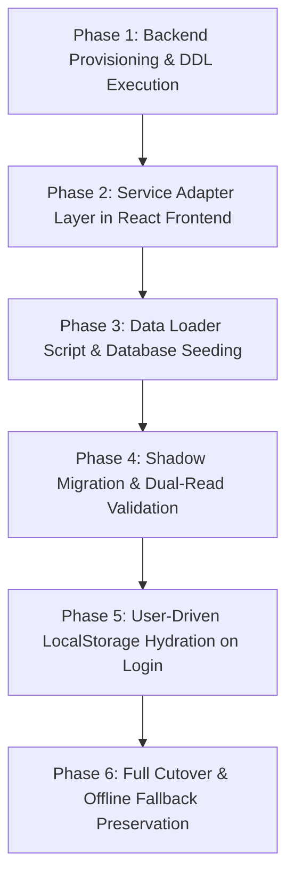
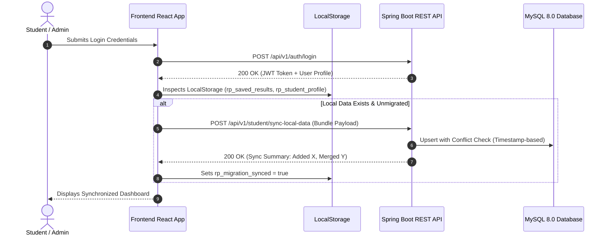

# ResultPoint Migration Strategy — LocalStorage to Spring Boot & MySQL

## 1. Migration Goals & High-Level Philosophy

The ResultPoint platform currently functions as a client-side Single Page Application (SPA) utilizing browser `localStorage` as its primary persistence engine across Phases 2A–2F and 3A–3E. 

Migrating to a production-grade Spring Boot 3.4.x backend and MySQL 8.0 database must achieve:
1. **Zero Data Loss:** All existing mock users, catalog entities, active/cleared backlogs, target goals, saved calculator runs, and audit logs must transfer without data truncation or numerical drift.
2. **Deterministic Backward Compatibility:** The client-side calculation engine remains operational as a zero-latency and offline fallback.
3. **Seamless Cutover with Safe Rollback:** If the backend or database experiences downtime during rollout, the frontend must degrade gracefully without stranding students during examination result verification.

---

## 2. Multi-Phase Migration Roadmap

### Phase 1: Database Provisioning & Schema Validation
- Execute MySQL 8.0 DDL scripts defined in [`database-design.md`](file:///c:/React/resultPoint/docs/backend-architecture/database-design.md).
- Verify foreign key constraints, indexes, and precision boundaries (`DECIMAL(4,2)`).
- Execute initial Flyway migration scripts (`V1__baseline_schema.sql`, `V2__seed_master_catalog.sql`).

### Phase 2: React Frontend Service Adapter Layer
- Introduce a unified `apiClient.js` Axios wrapper that detects backend availability.
- Implement an environment feature toggle `VITE_BACKEND_ENABLED` (`true` / `false`).
- Wrap existing services (`academicCatalogService`, `userService`, `studentProfileService`, `toolManagementService`, `auditHistoryService`) with a delegation pattern:
  - When `VITE_BACKEND_ENABLED=true` and token present: execute HTTP call.
  - When offline or backend returns network error: fallback to `localStorage` cache.

### Phase 3: Automated Data Loader & Seeding Script
- Create an automated Node.js ETL migration script: `scripts/migrate_localstorage_to_mysql.js`.
- Extract baseline data from `src/data/mockData.js`, `src/data/toolsData.js`, and browser export bundles.
- Transform and insert via Spring Boot REST ingestion endpoints (`POST /api/v1/migration/import-bundle`) secured with a migration bearer token.

---

## 3. Account Linking & Local Data Consolidation

When existing users log into the migrated platform for the first time, their browser will contain local calculation history (`rp_saved_results`), activity records (`resultpoint_activity_history`), and profile overrides (`rp_student_profile`).

### Consolidation Workflow on Login

### Conflict Resolution Strategy
1. **Academic Semester Results:** If a student has a local semester scorecard and the database also contains a scorecard for the same semester:
   - If `updatedAt` of database >= local: Database record prevails (authoritative transcript).
   - If `updatedAt` of local > database: Prompt user with an explicit comparison modal to review subject differences before merging.
2. **Saved Calculations & Activity History:** Merged using additive union. Duplicates are recognized by matching `(userId, toolId, createdAt)` and discarded safely.
3. **Tool Registry & Catalog:** Database is strictly authoritative. Local edits to catalog are ignored in favor of admin-approved database entries.

---

## 4. Rollback Plan & Killswitch Mechanics

To prevent student interruption during peak examination periods:
1. **Frontend Circuit Breaker:**
   - If 3 consecutive API requests return `503 Service Unavailable` or connection timeout, the React frontend automatically triggers `setBackendDegraded(true)`.
   - A non-intrusive warning banner appears: *"Offline calculation mode active. Changes will sync when reconnected."*
   - Interactive calculators continue executing instantaneously in-browser using `academicCalculationEngine.js`.
2. **Feature Toggle Killswitch:**
   - The production environment maintains `VITE_BACKEND_ENABLED`.
   - Setting `VITE_BACKEND_ENABLED=false` immediately reverts the application to pure client-side `localStorage` operation without requiring code changes or redeployments.

---

## 5. Data Integrity & Verification Invariants

Before deprecating `localStorage` writes, the following automated invariants must pass 100%:

| Invariant | Test Method | Acceptance Criteria |
| :--- | :--- | :--- |
| **Calculation Accuracy** | Run identical 20-subject dataset through frontend engine and backend `AcademicCalculationEngine.java`. | `Math.abs(frontendSGPA - backendSGPA) === 0.00` |
| **Catalog Completeness** | Compare entity count of universities, courses, and regulations. | Exactly 4 accredited universities, 13 courses, 14 regulations, and 20 tools. |
| **Audit Log Continuity** | Check log counts before and after migration. | All pre-migration audit logs present with matching timestamps. |
| **Historical Snapshot Parity** | Inspect `semester_results.grading_scale_snapshot_json`. | Snapshot contains exact grade boundaries used at the time of creation. |
