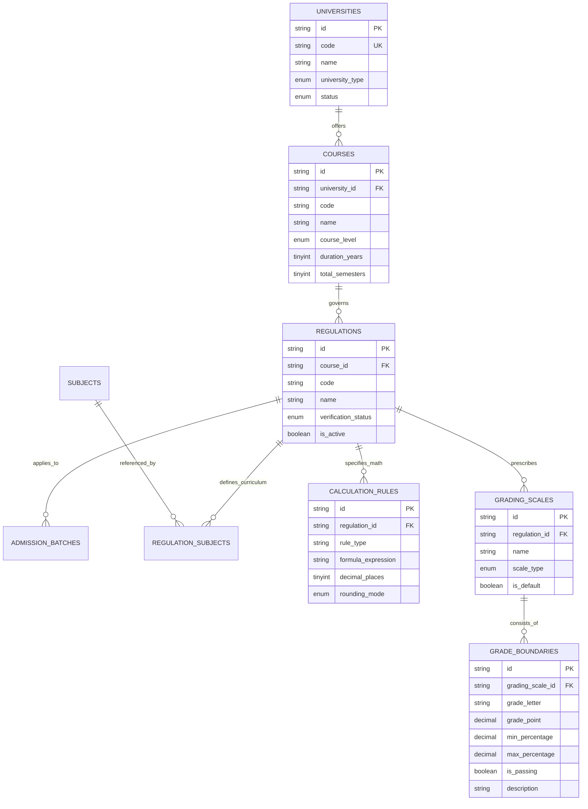

# ResultPoint Backend — Phase 2.3: Academic Catalog & Calculation Engine Specification

**Document Version:** 1.0.0  
**Implementation Date:** October 22, 2026  
**Status:** IMPLEMENTED & VERIFIED (94/94 Test Suite Passed)

---

## 1. Executive Summary

Phase 2.3 introduces the core **Academic Catalog APIs** and the deterministic, regulation-aware **Academic Calculation Engine** for ResultPoint backend on Spring Boot 3.4.2, Java 21, and MySQL 8.4.

This phase enables:
1. Public exploration of accredited universities, undergraduate/postgraduate degree courses, syllabus regulations, and regulation-specific grading scales.
2. Administrative catalog governance with role-based authorization (`ROLE_ADMIN`).
3. Pure, deterministic, credit-weighted calculation of **SGPA**, multi-semester **CGPA**, **Target CGPA forecasting**, and regulation-specific **Percentage Conversion**.
4. Full fidelity with institutional grading structures, specifically honoring **Osmania University (OU) BCA & MCA** with top grade **S — Super** ($GP = 10, \text{Marks} \ge 85$), while preserving university-specific grading schemes for other institutions (e.g., JNTUH, Anna University, VTU) with **O — Outstanding**.
5. Explicit flagging of non-verified institutional regulations (e.g., Osmania University B.Com CBCS) with `verificationStatus: "UNDER_REVIEW"`.

---

## 2. Domain Entities & Relational Mappings

All catalog entities map strictly to the Phase 1 Flyway baseline schema (`V1_0__identity_and_catalog_roots.sql`) with Hibernate 6 `@JdbcTypeCode` annotations for MySQL column compatibility.



### Hibernate 6 Mapping Details

- **MySQL `ENUM` columns:** Mapped with `@Enumerated(EnumType.STRING)` and `@JdbcTypeCode(java.sql.Types.CHAR)` to align with MySQL 8.4 JDBC driver character-type metadata.
- **MySQL `TINYINT UNSIGNED` columns:** (`duration_years`, `total_semesters`, `decimal_places`, `semester_number`): Mapped with `@JdbcTypeCode(java.sql.Types.TINYINT)` for strict Hibernate `ddl-auto: validate` compliance.
- **MySQL `SMALLINT UNSIGNED` columns:** (`display_order`): Mapped with `@JdbcTypeCode(java.sql.Types.SMALLINT)`.
- **Primary Keys:** Prefixed alphanumeric IDs generated via `IdGenerator` (`uni_`, `course_`, `reg_`, `sub_`, `scale_`, `gb_`, `rule_`).

---

## 3. Academic Catalog REST API Contracts

Base Path: `/api/v1/catalog`

### 3.1 Public Read Endpoints

| Method | Endpoint | Query Params | Description |
| :--- | :--- | :--- | :--- |
| `GET` | `/universities` | `search`, `type`, `page`, `size`, `sort` | Paginated listing of accredited universities. |
| `GET` | `/universities/{id}` | — | University detail with active courses and regulations. |
| `GET` | `/courses` | `universityId`, `level`, `page`, `size` | Filtered list of academic courses. |
| `GET` | `/courses/{id}` | — | Course detail including duration, semester count, regulations. |
| `GET` | `/regulations` | `courseId`, `activeOnly` | Regulations governing syllabus, grading, and batches. |
| `GET` | `/regulations/{id}` | — | Regulation detail with grading scale and calculation rules. |
| `GET` | `/regulations/{id}/curriculum` | `semester` | Semester-wise curriculum subject mappings. |

### 3.2 Administrative Mutation Endpoints (`ROLE_ADMIN`)

| Method | Endpoint | Role | Description |
| :--- | :--- | :--- | :--- |
| `POST` | `/universities` | `ADMIN` | Create a new accredited university. Validates unique code. |
| `PUT` | `/universities/{id}` | `ADMIN` | Update university metadata. |
| `POST` | `/courses` | `ADMIN` | Create degree course under a university. |
| `POST` | `/regulations` | `ADMIN` | Register academic regulation under a course. |
| `POST` | `/regulations/{id}/curriculum` | `ADMIN` | Associate subject with regulation semester and credit weight. |

Non-admin or unauthenticated access to mutation endpoints returns `401 Unauthorized` or `403 Forbidden`.

---

## 4. Regulation-Aware Calculation Engine

Base Path: `/api/v1/calculate` (All calculation endpoints are public).

### 4.1 Core Formulas & Precision Architecture

All arithmetic uses `java.math.BigDecimal` with `RoundingMode.HALF_UP` to prevent floating-point drift.

#### 1. Semester Grade Point Average (SGPA)
$$\text{SGPA} = \frac{\sum_{i=1}^{n} (C_i \times GP_i)}{\sum_{i=1}^{n} C_i}$$
Where:
- $C_i$: Credit assigned to subject $i$ ($C_i > 0$).
- $GP_i$: Grade point earned in subject $i$.
- $\sum C_i$: Total earned credits across evaluated subjects.
- If $\sum C_i = 0$, SGPA evaluates to `0.00`.

#### 2. Cumulative Grade Point Average (CGPA)
- **Credit-Weighted (Standard):**
  $$\text{CGPA} = \frac{\sum_{j=1}^{m} (C_j \times \text{SGPA}_j)}{\sum_{j=1}^{m} C_j}$$
- **Simple Unweighted Average (When credits omitted):**
  $$\text{CGPA} = \frac{\sum_{j=1}^{m} \text{SGPA}_j}{m}$$

#### 3. Percentage Conversion via Safe Formula Evaluator
Percentage conversion is resolved dynamically from `calculation_rules` for the applicable regulation:
$$\text{Percentage} = \text{FormulaEvaluator}(\text{formula\_expression}, \{\text{"CGPA"}: \text{cgpa}\})$$

Supported Institutional Formulas:
- **Direct Multiplier (OU Standard / VTU 2021+):** $\text{Percentage} = \text{CGPA} \times 10$
- **JNTUH (R18/R22):** $\text{Percentage} = (\text{CGPA} - 0.5) \times 10$
- **Anna University / VTU (Legacy):** $\text{Percentage} = (\text{CGPA} - 0.75) \times 10$
- **CBSE Standard:** $\text{Percentage} = \text{CGPA} \times 9.5$

*Security Guarantee:* Evaluated via `FormulaEvaluator.java` using the Shunting-Yard algorithm and an RPN stack. No JavaScript engine, SpEL, or reflection is used, eliminating Remote Code Execution (RCE) vectors.

#### 4. Target CGPA Forecaster
$$\text{Required SGPA} = \frac{(\text{Target CGPA} \times \text{Total Semesters}) - (\text{Current CGPA} \times \text{Completed Semesters})}{\text{Total Semesters} - \text{Completed Semesters}}$$

Feasibility Classification:
- $\le 8.50$: `ACHIEVABLE` (Normal academic effort required)
- $> 8.50 \text{ and } \le 9.50$: `CHALLENGING` (Distinction-level marks required)
- $> 9.50 \text{ and } \le 10.00$: `VERY_CHALLENGING` (Near-perfect grade required)
- $> 10.00$: `NOT_ACHIEVABLE` (Mathematically impossible within remaining semesters)

---

## 5. Osmania University (OU) Grading Scheme & Verified Rules

### 5.1 Osmania University BCA & MCA Specifics
- **Regulation:** OU CBCS (e.g., `reg_ou_bca_cbcs`, `reg_ou_mca_cbcs`)
- **Top Grade:** **S — Super** ($GP = 10, \text{Percentage} \ge 85\%$)
- **Grade Ladder:**
  - `S` (Super): $10.0$ ($85\% - 100\%$)
  - `A` (Excellent): $9.0$ ($70\% - 84.99\%$)
  - `B` (Very Good): $8.0$ ($60\% - 69.99\%$)
  - `C` (Good): $7.0$ ($55\% - 59.99\%$)
  - `D` (Fair): $6.0$ ($50\% - 54.99\%$)
  - `E` (Pass): $5.0$ ($40\% - 49.99\%$)
  - `F` (Fail): $0.0$ ($< 40\%$)

### 5.2 JNTUH & General CBCS Specifics
- **Regulation:** JNTUH R22 (`reg_jntuh_btech_r22`)
- **Top Grade:** **O — Outstanding** ($GP = 10, \text{Percentage} \ge 90\%$)
- **Grade Ladder:**
  - `O` (Outstanding): $10.0$ ($90\% - 100\%$)
  - `A+` (Excellent): $9.0$ ($80\% - 89.99\%$)
  - `A` (Very Good): $8.0$ ($70\% - 79.99\%$)
  - `B+` (Good): $7.0$ ($60\% - 69.99\%$)
  - `B` (Fair): $6.0$ ($50\% - 59.99\%$)
  - `C` (Satisfactory): $5.0$ ($40\% - 49.99\%$)
  - `F` (Fail): $0.0$ ($< 40\%$)

### 5.3 Non-Verified Regulations (`UNDER_REVIEW`)
Regulations flagged as `verificationStatus = 'UNDER_REVIEW'` (such as Osmania University B.Com CBCS) are permitted to calculate results, but the API response includes:
```json
{
  "verificationStatus": "UNDER_REVIEW"
}
```
This signals to clients that results are computed using catalog baseline rules but should not be certified for official academic records.

---

## 6. End-to-End Verification & Test Suite Evidence

The full backend test suite executed against MySQL 8.4 (`resultpoint_dev`) with 100% pass rate:

```
[INFO] ------------------------------------------------------------------------
[INFO] Results:
[INFO] 
[INFO] Tests run: 94, Failures: 0, Errors: 0, Skipped: 0
[INFO] 
[INFO] ------------------------------------------------------------------------
[INFO] BUILD SUCCESS
[INFO] ------------------------------------------------------------------------
```

### Breakdown of Test Suites
1. **FormulaEvaluatorTest (9 tests):** Direct multiplication, subtraction brackets, precedence, decimal evaluation, zero handling, invalid variables, mismatched parentheses, divide by zero defense.
2. **AcademicCalculationEngineTest (8 tests):** SGPA weighted average, fail grade handling, zero credit filtering, credit-weighted CGPA, unweighted CGPA, percentage conversion, target CGPA achievable, target CGPA impossible.
3. **CatalogIntegrationTest (10 tests):** University listing, university detail by ID, courses filter by university, course detail by ID, regulations list, curriculum subjects retrieval, 404 on nonexistent resource, admin create university success, non-admin create university forbidden, duplicate university code validation.
4. **CalculationIntegrationTest (9 tests):** Public SGPA calculation, public CGPA calculation, public percentage conversion, public target CGPA, regulation-bound SGPA (OU BCA S-Grade), regulation-bound SGPA (JNTUH R22 O-Grade), regulation-bound SGPA (OU B.Com UNDER_REVIEW status), invalid credit validation failure (400), empty subjects validation failure (400).
5. **Phase 1, 2.1 & 2.2 Suites (58 tests):** Token concurrency, refresh rotation grace period, FIFO session eviction, AES-256-GCM encryption, JWT authentication, migration schema constraints, and least-privilege grants.
