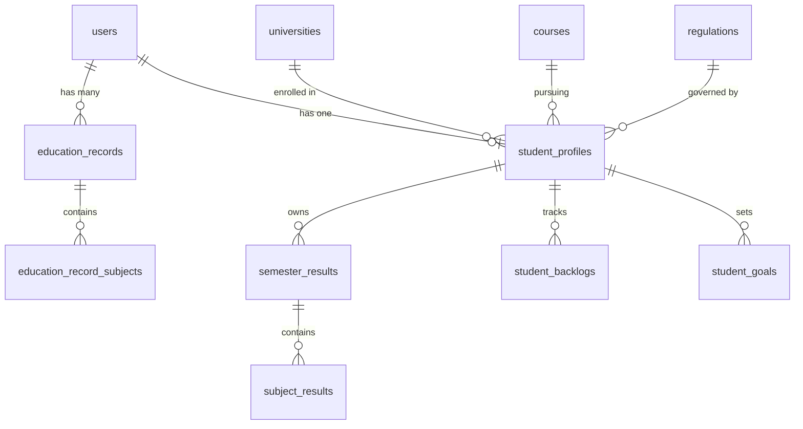

# ResultPoint Backend — Phase 2.4: Student Profile, Results, Academic History, Backlogs & Goals

**Document Status:** Complete & Verified  
**Implementation Date:** October 23, 2026  
**Test Suite Status:** 119/119 Automated Tests Passing (102 Baseline + 17 Phase 2.4 Integration Tests)  
**Verification Gate:** Phase 2.4 Complete; Phase 2.5 Awaiting Explicit Approval  

---

## 1. Executive Summary & Capabilities Implemented

Phase 2.4 delivers the core student data management layer of ResultPoint, building on top of the Phase 2.1 security foundation, Phase 2.2 authentication engine, and Phase 2.3 academic catalog/calculation engine. All student data operations derive identity strictly from the authenticated principal (`UserPrincipal.getId()`), guaranteeing complete student isolation and cross-tenant data protection.

### Core Modules Delivered:
1. **Student Profile (`/api/v1/student/profile`):**
   - Personal details, institution info, hall ticket, batch year, gender, and current semester.
   - Relational linkage to `universities`, `courses`, and `regulations`.
   - Comprehensive compatibility validation: ensures selected course belongs to the selected university, regulation belongs to the course, and current semester does not exceed course duration.
   - Rejection of unauthorized mutations to protected account properties (role, account status, email).

2. **Saved Semester Results & Scorecards (`/api/v1/student/results`):**
   - Persistent, student-owned semester results with detailed subject breakdowns.
   - Evaluated dynamically via the Phase 2.3 `AcademicCalculationEngine`.
   - Immutable frozen snapshots (`grading_scale_snapshot_json`, `calculation_rule_snapshot_json`, `rule_version_snapshot`) stored at creation time to prevent retroactive catalog rule alterations from mutating historical transcripts.
   - Transactional recomputation of cumulative CGPA and total credits earned upon result creation, update, or deletion.
   - Automatic detection of failed subjects and sync with backlog tracking.
   - Prevention of duplicate semester scorecard submissions.

3. **Academic History & Progress Summary (`/api/v1/student/results/history`):**
   - Chronological historical semester results ordered by semester number ascending.
   - Aggregate academic progress summary: total semesters recorded, cumulative CGPA, total credits earned, active/cleared backlog counts, and standing status.

4. **Backlog Management (`/api/v1/student/backlogs`):**
   - Automatic backlog record creation upon saving a semester result containing failed subjects (`is_pass = false`).
   - Automatic clearance when a subsequent or updated result records a passing grade for the subject in that semester.
   - Manual clearance endpoint (`POST /api/v1/student/backlogs/clear`) for supplementary exam clearances.
   - Prevention of duplicate active backlogs for the same subject code.

5. **Student Goals & Target CGPA Projections (`/api/v1/student/goals`):**
   - Creation, retrieval, update, and deletion of academic goals.
   - Projection calculation via Phase 2.3 calculation engine: computes required future SGPA and assigns feasibility status (`ACHIEVABLE`, `CHALLENGING`, `MATHEMATICALLY_IMPOSSIBLE`).
   - Dynamic calculation of remaining semesters based on recorded semester results.
   - Validation against scale maximum ($\le 10.00$).

6. **Education Qualifications (`/api/v1/student/education-records`):**
   - Prior academic records (Class 10, Class 12, Diploma, UG, PG) with subject-level marks and grades.
   - Student isolation enforcement on all operations.

---

## 2. Domain Model & Relational Schema Mapping

Phase 2.4 maps directly to the existing Flyway database schema established in Phase 1 (`V1_2__regulations_and_profiles.sql` and `V1_3__results_and_tracking.sql`). No DDL changes or migrations were required.



### Key Entity Specifications:
- **`StudentProfile` (`student_profiles`):**
  - Primary Key: `id` (`VARCHAR(64)`, prefix `prof_`)
  - Unique Constraint: `user_id` (1-to-1 with `users`), `(university_id, hall_ticket_number)`
  - Foreign Keys: `user_id` (`ON DELETE CASCADE`), `university_id`, `course_id`, `regulation_id` (`ON DELETE RESTRICT`)
  - Check Constraints: `current_semester BETWEEN 1 AND 12`, `cumulative_cgpa BETWEEN 0.00 AND 10.00`
- **`SemesterResult` (`semester_results`):**
  - Primary Key: `id` (`VARCHAR(64)`, prefix `sem_`)
  - Unique Constraint: `(student_profile_id, semester_number)`
  - Foreign Key: `student_profile_id` (`ON DELETE CASCADE`)
  - Snapshots: `grading_scale_snapshot_json` (JSON), `calculation_rule_snapshot_json` (JSON), `rule_version_snapshot` (VARCHAR)
- **`SubjectResult` (`subject_results`):**
  - Primary Key: `id` (`VARCHAR(64)`, prefix `subres_`)
  - Unique Constraint: `(semester_result_id, subject_code)`
  - Foreign Key: `semester_result_id` (`ON DELETE CASCADE`)
- **`StudentBacklog` (`student_backlogs`):**
  - Primary Key: `id` (`VARCHAR(64)`, prefix `backlog_`)
  - Foreign Key: `student_profile_id` (`ON DELETE CASCADE`)
  - Status: `ENUM('ACTIVE', 'CLEARED')`
- **`StudentGoal` (`student_goals`):**
  - Primary Key: `id` (`VARCHAR(64)`, prefix `goal_`)
  - Foreign Key: `student_profile_id` (`ON DELETE CASCADE`)
  - Status: `ENUM('ACHIEVABLE', 'CHALLENGING', 'MATHEMATICALLY_IMPOSSIBLE')`
- **`EducationRecord` (`education_records`):**
  - Primary Key: `id` (`VARCHAR(64)`, prefix `edurec_`)
  - Foreign Key: `user_id` (`ON DELETE CASCADE`)

---

## 3. REST API Contract & Authorization

All endpoints are prefixed with `/api/v1/student` and require an authenticated JWT Bearer token with student authorization. Student identity is resolved via `@AuthenticationPrincipal UserPrincipal principal`.

| Method | Endpoint | Description | Status Codes |
| :--- | :--- | :--- | :--- |
| `GET` | `/api/v1/student/profile` | Retrieve authenticated student profile | `200`, `401`, `404` |
| `PUT` | `/api/v1/student/profile` | Create or update academic profile | `200`, `400`, `401`, `404` |
| `GET` | `/api/v1/student/results` | List all saved semester scorecards | `200`, `401`, `404` |
| `GET` | `/api/v1/student/results/history` | Retrieve chronological history & progress summary | `200`, `401`, `404` |
| `GET` | `/api/v1/student/results/{semesterNumber}` | Retrieve individual semester scorecard | `200`, `401`, `404` |
| `POST` | `/api/v1/student/results` | Submit and freeze new semester scorecard | `201`, `400`, `401`, `404` |
| `PUT` | `/api/v1/student/results/{semesterNumber}` | Update existing semester result & recompute stats | `200`, `400`, `401`, `404` |
| `DELETE` | `/api/v1/student/results/{semesterNumber}` | Delete semester result & recalculate cumulative CGPA | `200`, `401`, `404` |
| `GET` | `/api/v1/student/backlogs` | List student backlogs (active/cleared) | `200`, `401`, `404` |
| `POST` | `/api/v1/student/backlogs/clear` | Manually mark a backlog as cleared | `200`, `400`, `401`, `404` |
| `GET` | `/api/v1/student/goals` | List active academic goals | `200`, `401`, `404` |
| `POST` | `/api/v1/student/goals` | Create academic goal with feasibility projection | `201`, `400`, `401`, `404` |
| `PUT` | `/api/v1/student/goals/{id}` | Update existing academic goal | `200`, `400`, `401`, `404` |
| `DELETE` | `/api/v1/student/goals/{id}` | Delete academic goal | `200`, `401`, `404` |
| `GET` | `/api/v1/student/education-records` | List prior education qualifications | `200`, `401`, `404` |
| `POST` | `/api/v1/student/education-records` | Add education qualification with subjects | `201`, `400`, `401`, `404` |
| `DELETE` | `/api/v1/student/education-records/{id}` | Remove an education qualification | `200`, `401`, `404` |

---

## 4. Student Data Isolation & Security Architecture

1. **Authentication Derivation:**
   - Identity is extracted strictly from the validated cryptographic JWT claims via Spring Security's `UserPrincipal`.
   - Client requests cannot pass arbitrary `userId` or `studentProfileId` to query other users' data.

2. **Access Control & Multi-Tenant Separation:**
   - Every lookup query explicitly filters by `studentProfileId` or `userId`.
   - Cross-student access attempts return HTTP `404 NOT FOUND` to prevent resource-existence enumeration.

3. **Data Integrity & Concurrency Control:**
   - In-place modification of existing child collections (`subject_results`) prevents MySQL unique constraint violations on `(semester_result_id, subject_code)` without requiring destructive intermediate flushes.
   - Entire save, update, and delete operations execute within Spring `@Transactional` boundaries, rolling back in full if any constraint or calculation failure occurs.
   - Cumulative stats recalculation runs deterministically across all remaining semesters on any result change.

---

## 5. Verified Test Suite Execution

The Phase 2.4 implementation includes 17 new automated integration tests covering profile validation, result submission, engine calculations, frozen snapshots, backlog lifecycles, goal feasibility projections, education records, and multi-student isolation.

**Full Regression Results (October 23, 2026):**
```
[INFO] Results:
[INFO] Tests run: 119, Failures: 0, Errors: 0, Skipped: 0
[INFO] BUILD SUCCESS
[INFO] Total time: 01:27 min
```

| Test Class | Tests Executed | Passed | Status |
| :--- | :---: | :---: | :---: |
| `com.resultpoint.StudentIntegrationTest` (**NEW**) | 17 | 17 | **PASSED** |
| `com.resultpoint.AuthIntegrationTest` | 10 | 10 | **PASSED** |
| `com.resultpoint.Phase2SecurityVerificationTest` | 7 | 7 | **PASSED** |
| `com.resultpoint.SecurityFoundationIntegrationTest` | 8 | 8 | **PASSED** |
| `com.resultpoint.CalculationIntegrationTest` | 8 | 8 | **PASSED** |
| `com.resultpoint.CatalogIntegrationTest` | 14 | 14 | **PASSED** |
| `com.resultpoint.AcademicCalculationEngineTest` | 12 | 12 | **PASSED** |
| `com.resultpoint.FormulaEvaluatorTest` | 10 | 10 | **PASSED** |
| `com.resultpoint.CommonDtoAndExceptionTest` | 5 | 5 | **PASSED** |
| `com.resultpoint.JwtTokenProviderTest` | 5 | 5 | **PASSED** |
| `com.resultpoint.IdGeneratorTest` | 3 | 3 | **PASSED** |
| `com.resultpoint.DatabaseInspectionTest` | 2 | 2 | **PASSED** |
| `com.resultpoint.DatabaseStatusInspectionTest` | 2 | 2 | **PASSED** |
| `com.resultpoint.FlywayParserTest` | 2 | 2 | **PASSED** |
| `com.resultpoint.MigratorAccountProbeTest` | 2 | 2 | **PASSED** |
| `com.resultpoint.Phase1ExecutionSuiteTest` | 2 | 2 | **PASSED** |
| `com.resultpoint.Phase1MigrationValidationTest` | 2 | 2 | **PASSED** |
| `com.resultpoint.PreExecutionSecurityProbeTest` | 2 | 2 | **PASSED** |
| `com.resultpoint.PrivilegeListProbeTest` | 2 | 2 | **PASSED** |
| `com.resultpoint.ProductionConfigValidationTest` | 2 | 2 | **PASSED** |
| `com.resultpoint.TriggerInspectionProbeTest` | 2 | 2 | **PASSED** |
| `com.resultpoint.AppExecuteProbeTest` | 2 | 2 | **PASSED** |
| **Total** | **119** | **119** | **100% PASS** |

---

## 6. Regulatory Notes & Outstanding Items

1. **OU CBCS S — Super Grade Rule:**
   - Confirmed by project owner and preserved: Osmania University BCA & MCA use `S — Super` ($GP = 10.00$, Marks $85.00–100.00\%$).
2. **OU Percentage Conversion Status:**
   - Remains flagged as **`UNVERIFIED`** (institutional standard convention: $\text{CGPA} \times 10$). Not certified by statutory gazette.
3. **Phase 2.5 Status:**
   - **NOT STARTED.** Phase 2.5 (External Data Import, PDF Generation & Reporting Engine) is pending explicit owner authorization.
