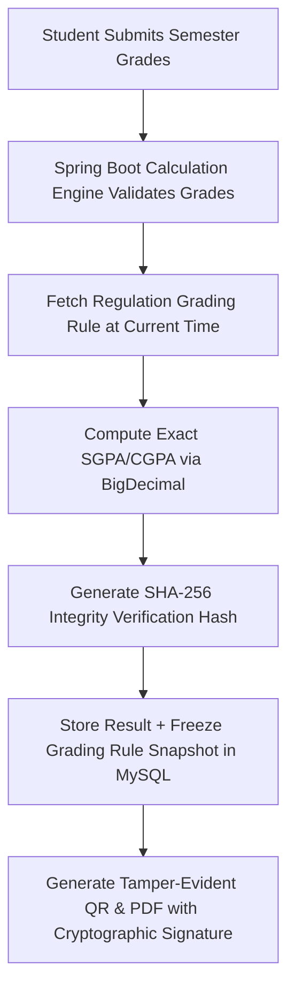

# ResultPoint Security, Privacy & Academic Compliance Framework

## 1. Regulatory Compliance & Student Privacy (FERPA)

ResultPoint processes sensitive educational records, including semester grades, Grade Point Averages (SGPA/CGPA), institutional enrollments, and backlog statuses. In alignment with the **Family Educational Rights and Privacy Act (FERPA)** and international data protection standards (GDPR):

1. **Student Record Isolation (Tenant/User Boundary):**
   - Students have read and write permissions strictly bounded to their authenticated user identifier (`userId == principal.id`).
   - Direct object references (e.g., accessing `/api/v1/student/results/{semester}`) enforce programmatic authorization in service methods:
     ```java
     if (!semesterResult.getStudent().getUser().getId().equals(currentPrincipal.getId())) {
         throw new AccessDeniedException("Access to educational record denied.");
     }
     ```
2. **Personally Identifiable Information (PII) Masking:**
   - Hall ticket numbers, student emails, and phone numbers are encrypted at rest using AES-256-GCM.
   - Administrative dashboards mask student identifiers (e.g. `jo***@example.com`, `HT***901`) unless an administrator with `ROLE_SUPER_ADMIN` explicitly audits an individual case with logged justification.

---

## 2. Academic Integrity & Grade Verification Protection

Academic calculation systems must protect against intentional manipulation of grades, retroactive calculation shifts, and unauthorized credential tampering.



### 2.1 Frozen Grading Rule Snapshots
To prevent future changes in university grading scales from silently altering a student's historical graduation CGPA:
- Every saved semester result records a complete, immutable JSON snapshot of the active grading scale (`grading_scale_snapshot_json`), including grade boundaries, grade points, and passing criteria.
- Recalculations for past semesters always run against the historical snapshot rather than the live catalog rule.

### 2.2 Tamper-Evident Cryptographic Hash
- Each scorecard record stores an immutable signature computed as:
  $$\text{Signature} = \text{HMAC-SHA256}(\text{studentId} + \text{semester} + \text{sgpa} + \text{totalCredits} + \text{timestamp}, \text{ServerSecretKey})$$
- When a PDF scorecard is downloaded, this verification hash is embedded as a QR code and footer string (`VERIFY-RP-xxxxxx`).
- Any external verifier or employer can scan the QR code to verify the authentic record against `/api/v1/verify/{hash}` without requiring login.

### 2.3 Formula & Configuration Injection Defense
- Tool parameter configurations (e.g., custom conversion formulas in `toolManagementService`) are strictly validated against an approved linear grammar:
  - Allowed patterns: `(CGPA - <offset>) * <multiplier>` or `CGPA * <multiplier>`.
  - Prohibited: Any occurrence of `<script`, `eval(`, `Function(`, `javascript:`, `exec`, or non-whitelisted arithmetic operators.

---

## 3. Threat Mitigation, Rate Limiting & Abuse Prevention

### 3.1 Rate Limiting via Bucket4j & Redis
To prevent denial-of-service and credential stuffing:

| Endpoint Domain | Rate Limit Tier | Strategy |
| :--- | :--- | :--- |
| `/api/v1/auth/login` | 5 requests / minute per IP | Sliding window, temporary 15-min IP lockout after 5 failed attempts |
| `/api/v1/calculate/*` | 60 requests / minute per IP | Token bucket (allows burst of 10) |
| `/api/v1/support/queries` | 3 requests / 10 minutes per IP | Token bucket + reCAPTCHA v3 score verification (> 0.7) |
| `/api/v1/export/pdf` | 10 requests / minute per user | Prevents CPU exhaustion during PDF rendering |

### 3.2 SQL Injection & Parameterized ORM Protection
- All database queries are executed via Spring Data JPA with strictly parameterized JPQL or Criteria queries.
- Raw native SQL queries are strictly prohibited unless mapped through validated prepared statements.

### 3.3 CSRF & Session Defense
- Because ResultPoint uses stateless JWT Bearer authentication transmitted via HTTP headers, traditional cross-site request forgery (CSRF) vectors are eliminated.
- Access tokens have a short lifespan (15 minutes). Refresh tokens are stored in `HttpOnly`, `SameSite=Strict`, `Secure` cookies with single-use rotation on every exchange.
- **Maximum 3 Active Refresh-Token Sessions:** Each user is permitted a maximum of 3 concurrent active sessions. Logging in from a 4th device triggers automatic FIFO eviction of the oldest active session (`is_revoked = TRUE, revocation_reason = 'SESSION_LIMIT_EXCEEDED'`).
- **30-Second Encrypted Concurrency Grace Window:**
  - *Client Coordination:* The React frontend coordinates token refresh calls across sibling browser tabs via the Web Locks API (`navigator.locks.request('rp_token_refresh', ...)`) or a `BroadcastChannel`.
  - *Server Resiliency Cache:* When a token is rotated, the server encrypts the new response payload using **AES-256-GCM** (256-bit server key, unique 96-bit random nonce, 128-bit authentication tag) and stores it in `cached_response_payload` on the revoked token.
  - *Replay Handling:* Any duplicate refresh request arriving within 30 seconds of revocation (`NOW() - revoked_at <= 30s`) is served the identical decrypted response payload without revoking active sessions.
  - *Token Theft Detection:* If a revoked token is presented *after* 30 seconds, the server flags token theft, revokes all active sessions for the user (`revocation_reason = 'TOKEN_THEFT_DETECTED'`), and logs an immutable critical security audit event.

---

## 4. Disaster Recovery & Encryption at Rest

1. **Database Encryption at Rest:** MySQL tablespaces are encrypted using InnoDB transparent data encryption (TDE) with AES-256.
2. **Automated Backup Strategy:**
   - Daily full logical backup via `mysqldump` with compression, streamed to encrypted off-site cloud storage.
   - Point-in-time recovery (PITR) supported via MySQL binary logging enabled with a 7-day retention window.
3. **Audit Trail Immutability & Least-Privilege Role Isolation:**
   - **Runtime Application User (`resultpoint_app`@`localhost`):** Configured for application datasources. Possesses full CRUD on 31 operational business tables, but strictly append-only `SELECT, INSERT` on `audit_logs` and `SELECT` on `flyway_schema_history`. Attempts to `UPDATE` or `DELETE` on `audit_logs` are intercepted and blocked by MySQL permission grants (`Error 1142`). Calling stored procedures is blocked (`Error 1370`).
   - **Migration Runner User (`resultpoint_migrator`@`localhost`):** Dedicated account executing Flyway migrations. Temporary elevated privileges (`SET_ANY_DEFINER` and `log_bin_trust_function_creators`) are granted during DDL execution and strictly revoked post-migration.
   - **Database Immutability Trigger:** An unconditional trigger `trg_audit_logs_no_update` intercepts and signals `SQLSTATE '45000'` on any direct `UPDATE` attempt on `audit_logs`.
   - **Zero Session Variable Leakage:** Connection session variables (such as `@rp_allow_audit_delete`) are strictly banned to prevent privilege leakage across pooled connections in HikariCP.
4. **Automated Audit Log Retention Procedure (`sp_purge_expired_audit_logs`):**
   - Executed strictly by the dedicated maintenance account (`resultpoint_maint`@`localhost`) with `SQL SECURITY DEFINER`.
   - Operates in a controlled session autocommit mode (avoiding vendor-specific transaction inspection variables).
   - Enforces a statutory minimum retention of 365 days, rejecting `NULL` and values `< 365` with `SQLSTATE '45000'`.
   - Performs chunked deletions in batches of 5,000 rows (`LIMIT 5000`) to prevent InnoDB row lock escalation and buffer pool exhaustion.

5. **Entity Primary Key Generation Convention:**
   - Entities whose database tables define `VARCHAR(64)` primary keys (such as `users`, `student_profiles`, `semester_results`, `student_goals`, and `saved_calculations`) use prefixed alphanumeric surrogate IDs generated via `com.resultpoint.common.util.IdGenerator`.
   - Format: `{domain_prefix}_{compact_uuid32}` (e.g. `usr_8f14b6...`, `sem_9e21c4...`, `goal_3b18d2...`), guaranteeing global uniqueness, URL safety, domain categorization, and length <= 41 characters.
   - Numeric primary keys (such as `user_refresh_tokens`, `grade_boundaries`, `admission_batches`, and `audit_logs`) map to `BIGINT UNSIGNED AUTO_INCREMENT` using `@GeneratedValue(strategy = GenerationType.IDENTITY)`.

---

## 5. Administrative Authorization & Role-Based Access Control

1. **Strict Admin-Only Blog Authorization:**
   - Editorial authoring, content modification, status transitions, and deletion of articles (`/api/v1/admin/blogs/*`) are strictly restricted to authenticated users with `ROLE_ADMIN` using Spring Security method security:
     ```java
     @PreAuthorize("hasRole('ADMIN')")
     @PostMapping("/api/v1/admin/blogs")
     public ResponseEntity<ApiResponse<BlogPostDto>> createBlogPost(@Valid @RequestBody CreateBlogPostRequest req) { ... }
     ```
   - Students and unauthenticated guests possess strictly read-only access to published articles (`status = 'PUBLISHED'`) via `GET /api/v1/blogs`.
2. **Administrative Audit Logging:**
   - All administrative actions (catalog changes, user suspensions, role elevations, and tool availability toggles) automatically write structured event records to `audit_logs` including actor identity, source IP address, entity ID, and before/after JSON diffs.

---

## 6. Guest Data Migration & Import Idempotency

1. **Explicit User Consent:**
   - Offline guest calculations stored in browser `localStorage` (`resultpoint_saved_calculations`) are **never silently imported** upon user authentication.
   - An explicit confirmation modal prompts the student before triggering the import flow.
2. **Cryptographic Idempotency & Duplicate Prevention:**
   - For every guest calculation to import, the React frontend generates a unique UUIDv4 `client_idempotency_key`.
   - The Spring Boot backend executes the batch import inside a `@Transactional` block against the unique constraint `uq_saved_calc_idempotency UNIQUE (user_id, client_idempotency_key)`.
   - Retried requests or network dropouts resolve idempotently without creating duplicate history records.
3. **Client-Side Buffer Clearance:**
   - The frontend clears the guest calculation `localStorage` buffer **only after receiving a successful HTTP 200/201 response** from the server.

