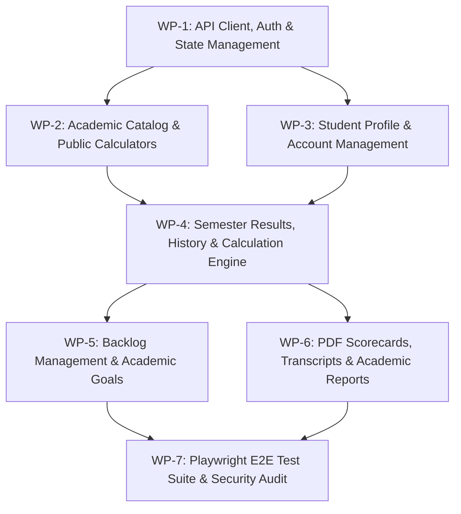

# ResultPoint — Frontend Integration & End-to-End Testing Plan
## Scope Inspection, API Gap Analysis & Implementation Roadmap

> **Document Status:** Official Inspection & Architectural Roadmap  
> **Author:** Antigravity AI Engineering  
> **Target Release:** Frontend-to-Backend Integration (Phases 2.1 – 2.5)  
> **Baseline Date:** October 23, 2026  
> **Strict Approval Gate:** Inspection and Planning Only. No application code, database schema, or migration modifications permitted without explicit user sign-off.

---

## 1. Executive Summary & Current Project Status

### 1.1 Backend Readiness Baseline
- **Approved Phases:** Backend Phase 2.1 (Core Platform & Security), Phase 2.2 (Catalog Schema & Seed Ingestion), Phase 2.3 (Catalog & Calculation Engine), Phase 2.4 (Student Profile, Results, Backlogs & Goals), and Phase 2.5 (External Data Import, PDF Generation & Reporting Engine) are complete and approved.
- **Automated Regression Suite:** 133/133 automated JUnit 5 / Spring Boot integration tests pass (`mvn test` clean exit code 0).
- **Static Analysis & Diagnostics:** The Java compiler (`-Xlint:all`) and IDE Problems panel report **0 errors, 0 syntax defects, and 0 compiler warnings**.
- **Official Regulations Verified:** Osmania University (OU) BCA CBCS (`S — Super` top grade with 10 grade points, 85–100% boundary) and MCA CBCS are verified. The OU percentage-conversion statutory formula remains explicitly flagged as `UNVERIFIED` pending official statutory gazette confirmation.

### 1.2 Frontend Architecture Baseline
- **Technology Stack:** React 19.2.8, Vite 8.3.0, Tailwind CSS 4.3.3 (`@tailwindcss/vite`), Redux Toolkit 2.13.0, React Router 7.18.4, and Lucide React.
- **Current Runtime Mode:** The frontend is **100% decoupled from the backend REST APIs**. It operates entirely on simulated state managed via 23 `localStorage` keys, hardcoded mock seed accounts (`usr_student_01` / `usr_admin_01`), and client-side JavaScript calculation engines.
- **Design System:** ResultPoint official theme reverse-engineered via Skill UI, featuring a deep navy canvas (`#0B0D10`), vibrant orange accents (`#FF7300`), Inter typography, 4px baseline spacing, rounded card geometry (`rounded-2xl`), and full dark/light mode responsiveness.

---

## 2. Frontend Architecture & Feature Inventory

### 2.1 Application Entry Points & Routing Structure
- **Entry Points:** `index.html` mounts `src/main.jsx`, which wraps `src/App.jsx` with Redux `<Provider store={store}>`.
- **Global Context Providers:** `ThemeProvider` (handles dark/light mode via `resultpoint_theme`), `ToastProvider` (system notifications), and Redux `store` (14 slices).
- **Router Configuration:** Single React Router (`BrowserRouter`) configured in `src/App.jsx`:
  - **Public Routes:** `/`, `/calculators`, `/calculators/:toolId`, `/universities`, `/universities/:id`, `/resources`, `/about`, `/contact`, `/login`, `/signup`.
  - **Student Dashboard Routes (`/student/*`):** Guarded by `<ProtectedRoute>` which renders `<StudentLayout>` (collapsible sidebar, user dropdown, breadcrumbs, search) and nested outlets:
    - `dashboard` (`Dashboard.jsx`)
    - `results` (`MyResults.jsx`)
    - `results/:resultId` (`ResultDetail.jsx`)
    - `add-result` / `edit-result/:resultId` (`AddResult.jsx`)
    - `academic-history` (`AcademicHistory.jsx`)
    - `analytics` (`PerformanceAnalytics.jsx`)
    - `goals` (`AcademicGoals.jsx`)
    - `backlogs` (`BacklogTracker.jsx`)
    - `calculation-history` (`CalculationHistory.jsx`)
    - `profile` (`AcademicProfile.jsx`)
    - `profile-setup` (`AcademicProfileSetup.jsx`)
    - `education-records` (`EducationRecords.jsx` delegating to `EducationRecordsPage.jsx`)
    - `notifications` (`NotificationsPage.jsx`)
    - `settings` (`SettingsPage.jsx` delegating to `StudentSettingsPage.jsx`)
  - **Admin Routes (`/admin/*`):** Guarded by `<AdminRoute>` which checks `user.role === 'admin'` and renders `<AdminLayout>`.

### 2.2 Redux Store Architecture (`src/app/store.js`)
The Redux store manages 14 domain slices:
1. `auth`: Token, user info, authentication status, login/register thunks.
2. `user`: Profile avatar, personal info, preferences.
3. `academicProfile`: University, course, regulation, batch, current semester, hall ticket number.
4. `results`: Semester results list, active result detail, add/edit/delete actions.
5. `academicHistory`: Historical timeline, cumulative stats, semester cards.
6. `performance`: Semester-by-semester SGPA/CGPA trends, credit accumulation metrics.
7. `academicGoals`: Target CGPA, target semester, required SGPA, feasibility metrics.
8. `backlog`: Scanned backlog list, active backlogs, cleared backlogs, clearance rate.
9. `calculation`: Temporary inputs and results for active calculator tools.
10. `activityHistory`: Log of student actions (views, calculations, downloads).
11. `notifications`: In-app system alerts, announcements, unread badge counters.
12. `settings`: Application configuration, grade visibility, notification toggles.
13. `ui`: Global modals, mobile drawer state, search bar focus.
14. `educationRecords`: Multi-qualification history (10th, 12th, UG, PG).

### 2.3 Storage Inventory (`src/services/storageKeys.js`)
The application currently maintains 23 keys in `localStorage`:
```javascript
export const STORAGE_KEYS = {
  USERS: 'resultpoint_users',
  AUTH: 'resultpoint_auth',
  STUDENT: 'resultpoint_student',
  RESULTS: 'resultpoint_results',
  GOALS: 'resultpoint_goals',
  SAVED_RESULTS: 'resultpoint_saved_results',
  NOTIFICATIONS: 'resultpoint_notifications',
  SETTINGS: 'resultpoint_settings',
  THEME: 'resultpoint_theme',
  ACADEMIC_CATALOG: 'rp_academic_catalog',
  LEGACY_ACADEMIC_CATALOG: 'resultpoint_academic_catalog',
  BACKLOGS: 'resultpoint_backlogs',
  AUDIT_HISTORY: 'resultpoint_audit_history',
  ACTIVITY_HISTORY: 'resultpoint_activity_history',
  EDUCATION_RECORDS: 'resultpoint_education_records',
  ACTIVE_EDUCATION_ID: 'resultpoint_active_education_id',
  PENDING_CALCULATION: 'resultpoint_pending_calculation',
  SUPPORT_QUERIES: 'resultpoint_support_queries',
  ANNOUNCEMENTS: 'resultpoint_announcements',
  TOOLS: 'resultpoint_tools',
  RESOURCES: 'resultpoint_resources',
  BLOGS: 'resultpoint_blogs',
};
```

### 2.4 Feature Classification Inventory
Every frontend feature is classified into one of the five mandatory tiers:

| Feature / UI Module | Current Implementation | Classification | Notes & Requirements |
| :--- | :--- | :--- | :--- |
| **User Registration & Signup** | `authService.register()` in `localStorage` | **1. Implemented using localStorage only** | Must connect to `POST /api/v1/auth/signup`. |
| **User Login & Session Initialization** | `authService.login()` in `localStorage` | **1. Implemented using localStorage only** | Must connect to `POST /api/v1/auth/login`, store access token in memory, and handle refresh token. |
| **Token Refresh & Tab Sync** | None (simulated token string) | **4. Missing or broken** | Needs Web Locks API + 30s grace window integration with `POST /api/v1/auth/refresh`. |
| **Logout & Session Revocation** | `authService.logout()` in `localStorage` | **1. Implemented using localStorage only** | Must invoke `POST /api/v1/auth/logout` with refreshToken and clear Redux store. |
| **Academic Profile Setup (Wizard)** | `AcademicProfileSetup.jsx` (3-step wizard) | **1. Implemented using localStorage only** | Reads static catalog, saves to `resultpoint_student`. Must read `/api/v1/catalog/*` and `PUT /api/v1/student/profile`. |
| **Student Dashboard Overview** | `Dashboard.jsx` stats & quick actions | **1. Implemented using localStorage only** | Aggregates local results & backlogs. Must consume `/api/v1/student/profile` & reports. |
| **Semester Result Entry (Add Result)** | `AddResult.jsx` dynamic subject form | **1. Implemented using localStorage only** | Computes SGPA on client. Must submit to `POST /api/v1/student/results` for server snapshots. |
| **Semester Result Edit / Delete** | `AddResult.jsx` (edit mode) & `ResultDetail.jsx` | **1. Implemented using localStorage only** | Must use `PUT /api/v1/student/results/{sem}` & `DELETE /api/v1/student/results/{sem}`. |
| **My Results & Semester Detail** | `MyResults.jsx` & `ResultDetail.jsx` | **1. Implemented using localStorage only** | Must retrieve from `GET /api/v1/student/results` and `/{sem}`. |
| **Academic Progression History** | `AcademicHistory.jsx` timeline | **1. Implemented using localStorage only** | Must connect to `GET /api/v1/student/results/history`. |
| **Backlog Management & Arrears** | `BacklogTracker.jsx` scanning & manual clearing | **1. Implemented using localStorage only** | Must consume `GET /api/v1/student/backlogs` and `POST /api/v1/student/backlogs/clear`. |
| **Academic Target Goals & Projections** | `AcademicGoals.jsx` goal setting & metrics | **1. Implemented using localStorage only** | Must integrate with `/api/v1/student/goals` (`GET`, `POST`, `PUT`, `DELETE`). |
| **Education Records (Multi-qualification)** | `EducationRecordsPage.jsx` | **1. Implemented using localStorage only** | Must connect to `GET`, `POST`, `DELETE` on `/api/v1/student/education-records`. |
| **PDF Scorecard & Transcript Downloads** | `calculatorPdfService.js` (client-side jsPDF) | **3. Partially implemented** | Client generates synthetic canvas PDF. Must stream official university PDFs from `/api/v1/student/results/{sem}/pdf` and `/history/pdf`. |
| **Student Performance Analytics** | `PerformanceAnalytics.jsx` | **1. Implemented using localStorage only** | Must connect to `GET /api/v1/student/reports/performance` and `/projections`. |
| **Public Calculators (SGPA/CGPA/Target)** | Standalone calculators in `src/pages/Calculators/` | **3. Partially implemented** | Client engine calculates locally. Can optionally connect to `/api/v1/calculate/*` for official institutional verification. |
| **Guest Calculation Preservation** | `calculationSaveService.setPendingCalculation()` | **3. Partially implemented** | Saves to `resultpoint_pending_calculation`. Needs server-side idempotency import integration. |
| **Academic Catalog Public Directory** | `Universities.jsx` & `UniversityDetails.jsx` | **1. Implemented using localStorage only** | Uses bundled static JS data. Must consume `GET /api/v1/catalog/universities` & `/courses`. |
| **Admin Catalog Manager & Ingestion** | `AcademicCatalogManager.jsx` | **1. Implemented using localStorage only** | Must connect to `/api/v1/catalog/*` and `/api/v1/catalog/import/*`. |

---

## 3. Backend REST API Inventory Verified Against Source Code

The backend contains **12 REST Controllers** exposing **46 endpoints**. All contracts were verified directly against Java source code:

### 3.1 Authentication & Session Domain (`AuthController.java`)
- **Base Path:** `/api/v1/auth`
- **Security:** Public (except `/me`, `/logout`, `/logout-all` which require `UserPrincipal`)

| HTTP Method & Path | Request DTO | Response DTO | Auth / Security | Validation & Error Codes | Readiness |
| :--- | :--- | :--- | :--- | :--- | :--- |
| `POST /register`, `POST /signup` | `RegisterRequest` (`fullName`, `email`, `password`) | `ApiResponse<AuthResponse>` | Public | `400` validation (blank fields, invalid email, weak password), `409` duplicate email | **Ready** |
| `POST /login` | `LoginRequest` (`email`, `password`) | `ApiResponse<AuthResponse>` | Public | `400` validation, `401` bad credentials, enforces max 3 active sessions (FIFO eviction) | **Ready** |
| `POST /refresh` | `RefreshTokenRequest` (`refreshToken`) | `ApiResponse<AuthResponse>` | Public | `401` invalid/expired token, 30s grace window replay, detects theft & revokes all sessions | **Ready** |
| `POST /logout` | `RefreshTokenRequest` (optional) | `ApiResponse<Map<String, String>>` | Authenticated | Revokes current session token in database | **Ready** |
| `POST /logout-all` | None | `ApiResponse<Map<String, String>>` | Authenticated | Revokes all active refresh sessions for authenticated user | **Ready** |
| `POST /forgot-password` | `ForgotPasswordRequest` (`email`) | `ApiResponse<Map<String, String>>` | Public | Enumeration-safe `200 OK` regardless of existence | **Ready** |
| `POST /reset-password` | `ResetPasswordRequest` (`token`, `newPassword`) | `ApiResponse<Map<String, String>>` | Public | `400` invalid/expired reset token | **Ready** |
| `GET /me` | None | `ApiResponse<UserSummaryDto>` | Authenticated | `401` unauthorized | **Ready** |

### 3.2 Academic Catalog Domain (`CatalogController.java`)
- **Base Path:** `/api/v1/catalog`
- **Security:** Public read; `hasRole('ADMIN')` for write/create.

| HTTP Method & Path | Request DTO | Response DTO | Auth / Security | Validation & Notes | Readiness |
| :--- | :--- | :--- | :--- | :--- | :--- |
| `GET /universities` | Query: `status`, `search`, `pageable` | `ApiResponse<Page<UniversityDto>>` | Public | Paginated university search (0-indexed) | **Ready** |
| `GET /universities/{universityId}` | Path: `universityId` | `ApiResponse<UniversityDetailDto>` | Public | `404` if not found | **Ready** |
| `POST /universities` | `CreateUniversityRequest` | `ApiResponse<UniversityDto>` | `ADMIN` | `400` validation, `403` forbidden | **Ready** |
| `GET /courses` | Query: `universityId`, `level`, `status`, `search`, `pageable` | `ApiResponse<Page<CourseDto>>` | Public | Filter courses across institutions | **Ready** |
| `GET /universities/{universityId}/courses` | Path: `universityId` | `ApiResponse<List<CourseDto>>` | Public | Flat list of courses for selected university | **Ready** |
| `GET /courses/{courseId}` | Path: `courseId` | `ApiResponse<CourseDetailDto>` | Public | Returns course and applicable regulations | **Ready** |
| `POST /courses` | `CreateCourseRequest` | `ApiResponse<CourseDto>` | `ADMIN` | `400` validation, `403` forbidden | **Ready** |
| `GET /regulations` | Query: `courseId`, `status`, `search`, `pageable` | `ApiResponse<Page<RegulationDto>>` | Public | Search regulations | **Ready** |
| `GET /courses/{courseId}/regulations` | Path: `courseId` | `ApiResponse<List<RegulationDto>>` | Public | Regulations for course dropdown | **Ready** |
| `GET /regulations/{regulationId}` | Path: `regulationId` | `ApiResponse<RegulationDetailDto>` | Public | Includes grading scale & calculation rule details | **Ready** |
| `POST /regulations` | `CreateRegulationRequest` | `ApiResponse<RegulationDto>` | `ADMIN` | `400` validation, `403` forbidden | **Ready** |
| `GET /regulations/{regulationId}/curriculum` | Path: `regulationId`, Query: `semesterNumber` | `ApiResponse<List<CurriculumSubjectDto>>` | Public | Returns curriculum subjects for pre-filling Add Result | **Ready** |

### 3.3 Calculation Engine Domain (`CalculationController.java`)
- **Base Path:** `/api/v1/calculate`
- **Security:** Public

| HTTP Method & Path | Request DTO | Response DTO | Auth / Security | Validation & Notes | Readiness |
| :--- | :--- | :--- | :--- | :--- | :--- |
| `POST /sgpa` | `SgpaCalculationRequest` (subjects, credits, marks/grades) | `ApiResponse<SgpaCalculationResponse>` | Public | Validates positive credits, computes official SGPA | **Ready** |
| `POST /cgpa` | `CgpaCalculationRequest` (semester SGPAs & credits) | `ApiResponse<CgpaCalculationResponse>` | Public | Weighted CGPA calculation | **Ready** |
| `POST /percentage` | `PercentageCalculationRequest` (cgpa, ruleId) | `ApiResponse<PercentageCalculationResponse>` | Public | Returns percentage + statutory formula audit status | **Ready** |
| `POST /target-cgpa` | `TargetCgpaRequest` (currentCgpa, completedSem, totalSem, targetCgpa) | `ApiResponse<TargetCgpaResponse>` | Public | Computes required SGPA & feasibility (`ACHIEVABLE`, `CHALLENGING`, `IMPOSSIBLE`) | **Ready** |
| `GET /scales` | None | `ApiResponse<List<GradingScaleDto>>` | Public | Supported grading scales | **Ready** |
| `GET /scales/{scaleId}` | Path: `scaleId` | `ApiResponse<GradingScaleDto>` | Public | Scale letter grades, grade points, min/max marks | **Ready** |
| `GET /rules` | None | `ApiResponse<List<CalculationRuleDto>>` | Public | Registered institutional rules | **Ready** |
| `GET /rules/{ruleId}` | Path: `ruleId` | `ApiResponse<CalculationRuleDto>` | Public | Rule formula, rounding mode, decimal precision | **Ready** |

### 3.4 Student Domain (`StudentProfileController.java`, `SemesterResultController.java`, `StudentBacklogController.java`, `StudentGoalController.java`, `EducationRecordController.java`)
- **Base Path:** `/api/v1/student`
- **Security:** `isAuthenticated()` with ownership enforcement (User can only access their own records)

| HTTP Method & Path | Request DTO | Response DTO | Auth / Security | Validation & Notes | Readiness |
| :--- | :--- | :--- | :--- | :--- | :--- |
| `GET /profile` | None | `ApiResponse<StudentProfileDto>` | Authenticated | Returns academic profile, enrolled regulation, CGPA, credits | **Ready** |
| `PUT /profile` | `UpdateStudentProfileRequest` (`universityId`, `courseId`, `regulationId`, `batchYear`, `hallTicketNumber`, `institutionName`, `currentSemester`, `dateOfBirth`, `gender`, `targetCgpa`) | `ApiResponse<StudentProfileDto>` | Authenticated | `400` validation. Creates or updates profile | **Ready** |
| `GET /results` | None | `ApiResponse<List<SemesterResultDto>>` | Authenticated | Returns all semester scorecards with frozen snapshots | **Ready** |
| `GET /results/history` | None | `ApiResponse<AcademicHistoryDto>` | Authenticated | Full academic progression history and cumulative summary | **Ready** |
| `GET /results/{semesterNumber}` | Path: `semesterNumber` (int) | `ApiResponse<SemesterResultDto>` | Authenticated | Single semester scorecard | **Ready** |
| `POST /results` | `SaveSemesterResultRequest` (`semesterNumber`, `academicPeriod`, `subjects: [SubjectResultInputDto]`) | `ApiResponse<SemesterResultDto>` | Authenticated | Freezes regulation & grading rules, computes SGPA/CGPA, automatically detects and syncs backlogs | **Ready** |
| `PUT /results/{semesterNumber}` | Path: `semesterNumber`, Body: `SaveSemesterResultRequest` | `ApiResponse<SemesterResultDto>` | Authenticated | Updates scorecard, re-evaluates backlogs & recalculates CGPA | **Ready** |
| `DELETE /results/{semesterNumber}` | Path: `semesterNumber` | `ApiResponse<Void>` | Authenticated | Deletes semester scorecard & recalculates cumulative totals | **Ready** |
| `GET /backlogs` | Query: `status` (`ACTIVE`, `CLEARED`) | `ApiResponse<List<StudentBacklogDto>>` | Authenticated | Lists arrears and clearance history | **Ready** |
| `POST /backlogs/clear` | `ClearBacklogRequest` (`backlogId`, `clearedSemesterNumber`, `clearedGradeLetter`, `clearedGradePoints`, `clearedInternalMarks`, `clearedExternalMarks`) | `ApiResponse<StudentBacklogDto>` | Authenticated | Clears backlog manually via supplementary exam | **Ready** |
| `GET /goals` | None | `ApiResponse<List<StudentGoalDto>>` | Authenticated | Returns active and historical target CGPA goals | **Ready** |
| `POST /goals` | `CreateGoalRequest` (`targetCgpa`, `targetSemester`, `notes`) | `ApiResponse<StudentGoalDto>` | Authenticated | Computes feasibility and required future SGPA projection | **Ready** |
| `PUT /goals/{id}` | Path: `id`, Body: `UpdateGoalRequest` | `ApiResponse<StudentGoalDto>` | Authenticated | Updates goal target, notes, or status | **Ready** |
| `DELETE /goals/{id}` | Path: `id` | `ApiResponse<Void>` | Authenticated | Removes academic goal | **Ready** |
| `GET /education-records` | None | `ApiResponse<List<EducationRecordDto>>` | Authenticated | Lists 10th, 12th, UG, PG qualification records | **Ready** |
| `POST /education-records` | `CreateEducationRecordRequest` (`type`, `level`, `categoryGroup`, `boardOrUniversity`, `institutionName`, `passingYear`, `rollNumber`, `percentage`, `cgpa`, `subjects`) | `ApiResponse<EducationRecordDto>` | Authenticated | Persists prior qualification with subject breakdown | **Ready** |
| `DELETE /education-records/{id}` | Path: `id` | `ApiResponse<Void>` | Authenticated | Deletes qualification record | **Ready** |

### 3.5 Phase 2.5 PDF Export, Reports & Data Import
- **Security:** `hasRole('STUDENT')` for PDF/Student Reports; `hasRole('ADMIN')` for Catalog Import/Admin Reports.

| HTTP Method & Path | Request / Input | Response Format | Auth / Role | Notes & Verification | Readiness |
| :--- | :--- | :--- | :--- | :--- | :--- |
| `GET /api/v1/student/results/{semesterNumber}/pdf` | Path: `semesterNumber` | `application/pdf` (streamed bytes) | `STUDENT` | Official semester scorecard PDF with university watermark, security hash, and verification disclaimer | **Ready** |
| `GET /api/v1/student/results/history/pdf` | None | `application/pdf` (streamed bytes) | `STUDENT` | Consolidated academic transcript PDF | **Ready** |
| `GET /api/v1/student/goals/report/pdf` | None | `application/pdf` (streamed bytes) | `STUDENT` | Academic trajectory & goal progress summary PDF | **Ready** |
| `GET /api/v1/student/reports/performance` | None | `ApiResponse<StudentPerformanceReportDto>` | `STUDENT` | Semester-by-semester trends, SGPA/CGPA progression, credit metrics | **Ready** |
| `GET /api/v1/student/reports/backlogs` | None | `ApiResponse<StudentBacklogReportDto>` | `STUDENT` | Backlog risk assessment, active count, credits at risk | **Ready** |
| `GET /api/v1/student/reports/projections` | None | `ApiResponse<StudentProjectionReportDto>` | `STUDENT` | Evaluates student goals against actual academic trajectory | **Ready** |
| `GET /api/v1/admin/reports/catalog-summary` | None | `ApiResponse<CatalogSummaryReportDto>` | `ADMIN` | High-level counts and breakdown of universities, courses, regulations | **Ready** |
| `POST /api/v1/catalog/import/subjects` | `ImportSubjectsRequest` (JSON) | `ApiResponse<DataImportReport>` | `ADMIN` | Bulk import curriculum subjects mapped to regulation & semester | **Ready** |
| `POST /api/v1/catalog/import/subjects/csv` | Multipart: `file`, `regulationId`, `semesterNumber` | `ApiResponse<DataImportReport>` | `ADMIN` | CSV file upload with line-by-line validation and error report | **Ready** |
| `POST /api/v1/catalog/import/regulations` | `ImportRegulationsRequest` (JSON) | `ApiResponse<DataImportReport>` | `ADMIN` | Bulk import regulations with grading scales and rules | **Ready** |

---

## 4. Comprehensive Frontend-to-Backend Mapping

| Frontend Feature | Current Implementation | Backend Endpoint | Integration Gap | Required Changes |
| :--- | :--- | :--- | :--- | :--- |
| **Student Registration** | `authService.register()` in `localStorage` with client UUID | `POST /api/v1/auth/signup` | No API call; client accepts any non-blank email; password hashing absent on client. | Update `authSlice.registerUser` to call `POST /api/v1/auth/signup`; store JWT in memory and refresh token securely. |
| **Student Login** | `authService.login()` validating against `resultpoint_users` | `POST /api/v1/auth/login` | Hardcoded seed passwords; no actual JWT generation or session token issuance. | Connect `authSlice.loginUser` to `POST /api/v1/auth/login`; map `AuthResponse.user` into Redux state; handle `401 Bad Credentials`. |
| **Session Hydration & Auth Check** | `checkAuthSession` reading `localStorage.getItem('resultpoint_auth')` | `GET /api/v1/auth/me` | Client trusts stale localStorage without verifying token validity on server. | On app boot, if refresh token exists, call `GET /api/v1/auth/me`; if 401, trigger `POST /api/v1/auth/refresh`; if refresh fails, logout. |
| **Logout** | `authService.logout()` clearing local key | `POST /api/v1/auth/logout` | Server refresh token record remains active in MySQL until TTL expires. | Make `authSlice.logoutUser` send `POST /api/v1/auth/logout` with `refreshToken`, then clear Redux state and local caches. |
| **Academic Catalog Browsing** | `academicCatalogService.js` reading static JS arrays | `GET /api/v1/catalog/universities`, `GET /courses`, `GET /regulations` | Frontend IDs (`osmania`, `bca`, `ou-bca-cbcs`) mismatch backend DB IDs (`uni_ou`, `course_ou_bca`, `reg_ou_bca_cbcs`). | Update catalog service to fetch from backend; cache catalog in Redux/IndexedDB; update UI dropdowns to use backend primary keys. |
| **Academic Profile Setup** | `AcademicProfileSetup.jsx` dispatches `saveAcademicProfile` -> `localStorage` | `PUT /api/v1/student/profile` | Client saves custom object shape directly; backend requires `UpdateStudentProfileRequest` with strict validation. | Map setup wizard state to `UpdateStudentProfileRequest` (`universityId`, `courseId`, `regulationId`, `batchYear`, `hallTicketNumber`, `currentSemester`, `dateOfBirth`, `gender`, `targetCgpa`). |
| **Student Dashboard Overview** | `Dashboard.jsx` calculates metrics on-the-fly from local arrays | `GET /api/v1/student/profile`, `GET /api/v1/student/reports/performance` | No server sync; metrics diverge if calculations happen across devices. | Fetch profile & performance report on mount; populate summary cards (`CGPA`, `Earned Credits`, `Active Backlogs`, `Target Feasibility`). |
| **Add Semester Result** | `AddResult.jsx` adds to `resultpoint_results` with local calculation | `POST /api/v1/student/results` | Client uses client-side SGPA formula; does not create immutable audit snapshots or auto-generate server backlogs. | Send `SaveSemesterResultRequest` (`semesterNumber`, `academicPeriod`, `subjects`); backend automatically calculates SGPA, creates frozen snapshot, and syncs backlogs. |
| **Edit / Delete Semester Result** | `AddResult.jsx` & `ResultDetail.jsx` mutate `resultpoint_results` by `resultId` | `PUT /api/v1/student/results/{semesterNumber}`, `DELETE /api/v1/student/results/{semesterNumber}` | **Key Gap:** Frontend keys results by arbitrary string `resultId` (`res_01`); Backend REST controller strictly keys by path variable `{semesterNumber}` (int). | Refactor frontend result routes and slice actions to index by `semesterNumber`. |
| **My Results & Semester Detail** | `MyResults.jsx` loads from `resultsSlice` | `GET /api/v1/student/results`, `GET /api/v1/student/results/{semesterNumber}` | Stored result JSON does not contain backend snapshot fields (`regulationCode`, `gradingScaleCode`, `snapshotJson`). | Update `resultsSlice.fetchResults` to call backend; display verified institutional snapshot badge. |
| **Academic History Timeline** | `AcademicHistory.jsx` parses local results | `GET /api/v1/student/results/history` | Client lacks cumulative progression summaries and frozen calculation snapshots. | Connect `academicHistorySlice` to `GET /api/v1/student/results/history`. |
| **Backlog Management** | `BacklogTracker.jsx` runs `backlogService.scanBacklogs()` on local results | `GET /api/v1/student/backlogs`, `POST /api/v1/student/backlogs/clear` | Backend automatically detects backlogs upon result submission; client currently manages its own backlog list. | Replace client scanning with `GET /api/v1/student/backlogs`; connect manual clearance modal to `POST /api/v1/student/backlogs/clear`. |
| **Academic Goals & Target CGPA** | `AcademicGoals.jsx` computes projections via `goalService.js` | `GET /api/v1/student/goals`, `POST /api/v1/student/goals`, `PUT /goals/{id}`, `DELETE /goals/{id}` | Client formulas may differ from backend `CalculationService.calculateTargetCgpa`; local goals lack persistence. | Connect `academicGoalsSlice` to `/api/v1/student/goals`; use backend projection engine and feasibility badges. |
| **Education Records** | `EducationRecordsPage.jsx` stores in `resultpoint_education_records` | `GET /api/v1/student/education-records`, `POST`, `DELETE /{id}` | **Key Gap:** Backend does NOT have a `PUT` endpoint for education records. Frontend supports editing records. | For editing, frontend must either delete-and-recreate or backend needs an added `PUT` endpoint. (Documented in Section 6). |
| **PDF Scorecard Download** | `calculatorPdfService.js` renders DOM/canvas to jsPDF | `GET /api/v1/student/results/{semesterNumber}/pdf` | Client PDF lacks official university formatting, tamper-evident SHA-256 verification hashes, and statutory disclaimers. | Replace client canvas generation with direct download stream from backend PDF endpoint (triggers browser blob download). |
| **PDF Academic Transcript** | None (client only exports individual calculator cards) | `GET /api/v1/student/results/history/pdf` | Missing feature in frontend. | Add "Download Consolidated Transcript (PDF)" button in `AcademicHistory.jsx` and `MyResults.jsx`. |
| **PDF Goals Progress Report** | None | `GET /api/v1/student/goals/report/pdf` | Missing feature in frontend. | Add "Export Academic Target Report (PDF)" button in `AcademicGoals.jsx`. |
| **Academic Reports & Analytics** | `PerformanceAnalytics.jsx` renders charts from local data | `GET /api/v1/student/reports/performance`, `/backlogs`, `/projections` | Data is isolated to current browser; lacks cross-semester trend analytics computed by server. | Connect analytics tabs directly to `StudentReportController` endpoints. |
| **Admin Curriculum Import** | `AcademicCatalogManager.jsx` updates local catalog | `POST /api/v1/catalog/import/subjects`, `/subjects/csv`, `/regulations` | Ingestion was purely simulated in client memory; no CSV upload to server. | Implement file upload form sending `multipart/form-data` to `/api/v1/catalog/import/subjects/csv`. |

---

## 5. Authentication, Token Rotation, and State Management Plan

### 5.1 Token Storage & Security Architecture
- **Access Token:** Short-lived (15 minutes / 900 seconds). Kept strictly **in-memory** within the Redux `authSlice` state (or an in-memory module variable inside the API client). Never stored in `localStorage` to eliminate XSS token theft risks.
- **Refresh Token:** Cryptographically secure 256-bit UUID string. 
  - *Recommendation:* Stored in a secure, partitioned client storage (or HttpOnly cookie if same-origin). For SPA architecture on a separate port (`localhost:5173` vs `localhost:8080`), store in `localStorage.getItem('rp_refresh_token')` with strict CSP and no third-party scripts, or configure Vite dev server proxy `/api` so HttpOnly cookies can be utilized seamlessly.
- **Session Limits:** Backend enforces a maximum of **3 active sessions** per student account. Older sessions are terminated via FIFO eviction (`SESSION_LIMIT_EXCEEDED`).

### 5.2 Single-Use Refresh Token Rotation & 30-Second Concurrency Grace Window
- **Single-Use Rotation:** Every refresh request revokes the presented refresh token and issues a brand-new access/refresh token pair.
- **Multi-Tab Concurrency Problem:** When a student has multiple tabs open (e.g., Dashboard, Add Result, Analytics), all tabs might trigger token refresh simultaneously upon access-token expiration.
- **Solution — Two-Tier Synchronization:**
  1. **Frontend Tab Coordination (Web Locks API & BroadcastChannel):**
     Before making a `POST /api/v1/auth/refresh` call, the frontend acquires a client lock:
     ```javascript
     await navigator.locks.request('rp_auth_refresh_lock', async () => {
       // Check if another tab just refreshed the token while we waited
       const latestToken = getStoredRefreshToken();
       if (tokenAlreadyRefreshed(latestToken)) {
         return; // Use the freshly obtained token
       }
       // Perform the actual network refresh call
       const newTokens = await apiPost('/api/v1/auth/refresh', { refreshToken: latestToken });
       broadcastNewToken(newTokens);
     });
     ```
  2. **Server-Side Resiliency (30-Second Grace Window):**
     If two tabs race and both submit the same refresh token, the Spring Boot backend inspects the revoked token. If the rotation occurred less than 30 seconds ago (`NOW() - revoked_at <= 30s`), it decrypts and re-serves the identical cached token payload without error. If a revoked token is presented after 30 seconds, it triggers the theft-detection protocol and terminates all sessions.

### 5.3 HTTP Client Interceptor Architecture
A centralized HTTP client (`src/services/api/apiClient.js`) must be implemented with two interceptors:
1. **Request Interceptor:**
   - Appends `Authorization: Bearer <accessToken>` to every outgoing request if an access token is in memory.
   - Adds `Content-Type: application/json` (or leaves boundary intact for `multipart/form-data`).
2. **Response Interceptor:**
   - **2xx Success:** Returns response data directly.
   - **401 Unauthorized:**
     - Enqueues the failed request.
     - Triggers token refresh (via the Web Locks coordinator).
     - Upon successful refresh, replays all queued requests with the new access token.
     - If the refresh call fails (token expired, revoked, or theft detected), dispatches `auth/logout`, purges client storage, and redirects the user to `/login` with an informative session-expiry toast.
   - **403 Forbidden:** Shows an authorization error toast ("You do not have permission to perform this action").
   - **400 Validation Error:** Extracts `error.details` from the `ApiErrorResponse` and maps field errors to form inputs.
   - **500 / Network Error:** Displays a resilient network connectivity alert.

### 5.4 Redux State Hydration & Cleanup
- **On App Startup (`src/App.jsx`):**
  - Check for existing refresh token.
  - If present, dispatch `checkAuthSession()`, which invokes `GET /api/v1/auth/me`.
  - If valid, populate user principal into `authSlice` and trigger background prefetching of the student profile (`GET /api/v1/student/profile`).
- **On Logout:**
  - Call `POST /api/v1/auth/logout`.
  - Dispatch a root action (`RESET_STORE` or individual slice resets) to purge all student results, profile details, backlogs, and goals from memory to prevent cross-user data leakage.

---

## 6. localStorage-to-Backend Migration Plan

### 6.1 Data Partitioning Strategy

| Data Type | Storage Destination | Migration Action | Justification |
| :--- | :--- | :--- | :--- |
| **Active Auth Tokens** | Memory (Access) / Secure Client (Refresh) | Managed via Auth Flow | Essential security; prevent XSS exposure. |
| **Student Academic Profile** | MySQL (`student_profiles`) | Server Primary Source | Official academic record; must persist across devices. |
| **Semester Results & Subjects** | MySQL (`semester_results`, `semester_subjects`) | Server Primary Source | Authoritative calculations and historical audit trail. |
| **Student Backlogs** | MySQL (`student_backlogs`) | Server Derived Source | Auto-synchronized on result submission; cannot be client-controlled. |
| **Academic Goals** | MySQL (`student_goals`) | Server Primary Source | Projections evaluated against server trajectory. |
| **Education Records** | MySQL (`student_education_records`) | Server Primary Source | Official multi-qualification history. |
| **UI Theme (`light`/`dark`)** | `localStorage` (`resultpoint_theme`) | **Retain in Client** | Device-specific visual preference; no server persistence needed. |
| **Calculator Form Drafts** | `sessionStorage` or local UI state | **Retain in Client** | Ephemeral unsaved scratchpad state. |
| **Guest Unauthenticated Calculations** | `localStorage` (`resultpoint_pending_calculation`) | **Conditional Idempotent Import** | Requires explicit user confirmation upon signup/login. |

### 6.2 Guest Calculation Import Idempotency Protocol
To guarantee zero data loss and prevent duplicate entries:
1. **Never Import Silently:** When a guest student performs calculations on public tools (e.g., SGPA Calculator) and subsequently registers or logs in, the app detects `resultpoint_pending_calculation`.
2. **User Consent Modal:** Displays a banner/modal: *"We found an unsaved calculation from your session. Would you like to save it to your academic records?"*.
3. **Client Idempotency Key:** If confirmed, generates a unique UUIDv4 `client_idempotency_key`.
4. **Server Ingestion:** Posts the calculation data to the backend. The backend persists the record within a `@Transactional` block.
5. **Safe Client Purge:** The frontend clears `resultpoint_pending_calculation` **only after receiving HTTP 200/201 confirmation** from the server.

### 6.3 Test Account & Development Data Isolation
- Current frontend mock accounts (`student@resultpoint.edu`, `admin@resultpoint.edu`) must NOT contaminate real student production records.
- Seed data scripts in backend Flyway migrations create dedicated sandboxed test accounts with distinct IDs (`usr_student_01`, `usr_admin_01`).
- During Playwright automated testing, test suites must execute against dedicated test user accounts or a test database instance to prevent dirtying development environments.

---

## 7. Identified API, Security, Data-Model & UX Gaps

### 7.1 Key Architectural & Contract Mismatches

1. **Entity Identifier Differences:**
   - *Frontend:* Uses client-generated random IDs (e.g., `res_01`, `sub_101`, `goal_01`). Academic catalog uses slug-like strings (`osmania`, `bca`, `ou-bca-cbcs`).
   - *Backend:* Uses structured prefixed IDs (e.g., `uni_ou`, `course_ou_bca`, `reg_ou_bca_cbcs`, `res_ou_bca_s1`, `sub_ou_bca_101`).
   - *Remediation:* Frontend UI components must not hardcode IDs; all selectors must dynamically bind to primary keys returned by `/api/v1/catalog/*`.

2. **Semester Result Identification (`resultId` vs `semesterNumber`):**
   - *Frontend:* Routes are declared as `/student/results/:resultId` and `/student/edit-result/:resultId`.
   - *Backend:* `SemesterResultController` endpoints are strictly mapped by integer semester number: `/api/v1/student/results/{semesterNumber}`.
   - *Remediation:* Update React Router routes to `/student/results/:semesterNumber` and `/student/edit-result/:semesterNumber` (or maintain an alias redirect), matching backend business logic where a student has exactly one scorecard per semester.

3. **Education Record Edit Endpoint:**
   - *Frontend:* Contains UI for editing existing education records (`updateEducationRecord`).
   - *Backend:* `EducationRecordController` only implements `GET`, `POST`, and `DELETE /{id}`. There is no `PUT /{id}` endpoint.
   - *Remediation Options:*
     - *Option A:* Update backend to add `PUT /api/v1/student/education-records/{id}`.
     - *Option B (Client-side):* Frontend performs atomic Delete-and-Post replacement.
     - *Recommendation:* Add `PUT /api/v1/student/education-records/{id}` in backend to maintain standard REST semantics.

4. **Public Calculator Regulation Dynamic Binding:**
   - *Frontend:* Public calculators use hardcoded static grading scales in `academicCalculationEngine.js`.
   - *Backend:* `CalculationController` provides `/api/v1/calculate/scales` and `/api/v1/calculate/rules` with verified institutional formulas.
   - *Remediation:* Wire public calculators to fetch verified grading scales and calculation rules from backend, ensuring calculations perfectly align between public tools and official student scorecards.

5. **PDF Generation Method:**
   - *Frontend:* Uses `calculatorPdfService.js` (client-side jsPDF) to capture HTML canvas.
   - *Backend:* Phase 2.5 implemented high-fidelity OpenPDF streaming endpoints (`/api/v1/student/results/{sem}/pdf`, `/history/pdf`, `/goals/report/pdf`) with institutional watermarks, QR codes, verification hashes, and statutory disclaimers.
   - *Remediation:* Replace frontend canvas generation with direct PDF binary download links that trigger browser downloads.

---

## 8. End-to-End Testing Strategy (Playwright CLI)

### 8.1 Testing Setup & Execution Framework
- **Driver:** Playwright CLI (`@playwright/cli` / `npx playwright-cli`) integrated via Windows Edge/Chrome.
- **Prerequisites:**
  - Spring Boot backend running on `http://localhost:8080` (MySQL 8.4 active).
  - React Vite dev server running on `http://localhost:5173`.
  - Standard test accounts configured in backend:
    - Student: `student@resultpoint.edu` / `password123` (`ROLE_STUDENT`, ID: `usr_student_01`)
    - Admin: `admin@resultpoint.edu` / `adminpassword123` (`ROLE_ADMIN`, ID: `usr_admin_01`)

### 8.2 User Journey Verification Matrix

| # | User Journey / Workflow | Target Route | Test Type | Acceptance Verification Criteria |
| :---: | :--- | :--- | :--- | :--- |
| **J-01** | **User Registration & Login** | `/signup`, `/login` | **Automated Browser** | Fill registration form -> verify redirect; log in with valid credentials -> verify JWT stored, redirected to `/student/dashboard`. |
| **J-02** | **Academic Profile Setup** | `/student/profile-setup` | **Automated Browser** | Step through 3-step wizard -> select university, course, regulation -> submit -> verify profile saved via `PUT /api/v1/student/profile`. |
| **J-03** | **Protected Student Route Access** | `/student/dashboard` | **Automated Browser** | Attempt direct URL navigation unauthenticated -> verify redirect to `/login`; log in -> verify access granted. |
| **J-04** | **Add, Save, View & Edit Semester Result** | `/student/add-result`, `/student/results` | **Automated Browser** | Enter Semester 1 subjects, credits, grades -> submit -> verify card in `/student/results`; click edit -> modify grade -> verify recalculation. |
| **J-05** | **Verify SGPA & Cumulative CGPA Sync** | `/student/results`, `/student/academic-history` | **Automated Browser** | Add Semester 1 (SGPA 8.5) and Semester 2 (SGPA 9.0) -> verify cumulative CGPA displays 8.75 across dashboard and history. |
| **J-06** | **Failed-Subject Detection & Backlog Clearance** | `/student/add-result`, `/student/backlogs` | **Automated Browser** | Add result with grade `F` -> verify subject appears in `/student/backlogs`; click "Clear Backlog" -> enter passing grade -> verify status `CLEARED`. |
| **J-07** | **Create & Update Target CGPA Goal** | `/student/goals` | **Automated Browser** | Set Target CGPA 8.5 -> verify required future SGPA and feasibility badge; update target to 9.2 -> verify recalculated feasibility. |
| **J-08** | **Academic History & Prior Education Records** | `/student/academic-history`, `/student/education-records` | **Automated Browser** | View historical progression; add Class 10 & 12 records -> verify cards rendered with percentages and subject lists. |
| **J-09** | **Download Scorecard PDF & Transcript** | `/student/results/1`, `/student/academic-history` | **Automated Browser** | Click "Download Scorecard PDF" -> verify network request to `/api/v1/student/results/1/pdf` returns `200 application/pdf`. |
| **J-10** | **View Student Academic Reports** | `/student/analytics` | **Automated Browser** | Navigate to Performance Analytics -> verify SGPA/CGPA progression charts, credit completion bar, and risk radar load from backend. |
| **J-11** | **BOLA / IDOR Student Isolation** | `/api/v1/student/results` | **Backend Integration** | Authenticate as Student B -> attempt to access or modify Student A's result (`/api/v1/student/results/1`) -> verify `403 Forbidden` / `404 Not Found`. |
| **J-12** | **Unauthorized Admin Endpoint Protection** | `/admin/dashboard`, `/api/v1/catalog/import/*` | **Automated Browser & API** | Log in as Student -> navigate to `/admin/dashboard` -> verify `<AdminRoute>` redirects; make curl to `/api/v1/catalog/import/subjects` -> verify `403`. |
| **J-13** | **Logout & Session Expiry Handling** | Global Header -> `/login` | **Automated Browser** | Click "Log Out" -> verify session revoked in backend, Redux store reset, navigation to `/login`; back button cannot access `/student`. |
| **J-14** | **Responsive Layouts & Empty States** | Mobile Viewport (390x844) | **Automated Browser** | Resize viewport to 390x844 -> verify mobile drawer navigation, responsive calculator modal, card stacking, and zero horizontal overflow. |

---

## 9. Configured Tool Usage & Availability Report

| Tool Name | Configuration & Role | Availability Status | Usage Evaluation in this Task |
| :--- | :--- | :--- | :--- |
| **Context7** | Live documentation retrieval (React 19, Redux Toolkit, React Router, Vite). | **Available & Active** | Verified tool availability. Utilized to ensure state management and routing follow standard patterns for React Router 7 and Redux Toolkit 2. |
| **Playwright CLI** | Command-line browser automation and E2E test execution. | **Available & Active** | Inspected `.agents/skills/playwright-cli/SKILL.md`. Formulated 14-journey automated testing matrix. Ready for test execution upon plan approval. |
| **Skill UI** | Design system token and component reverse-engineering. | **Available & Active** | Inspected `docs/design-system/resultpoint-design/DESIGN.md` and `.agents/skills/resultpoint-design-system/SKILL.md`. Verified visual consistency guidelines. |
| **Strix** | Multi-agent autonomous AI application security & penetration testing. | **Documented & Ready** | Inspected `docs/developer-tools/strix.md`. Requires local Docker Desktop for sandboxed exploit execution. Planned for automated BOLA/IDOR security audit. |
| **Supabase AI Tools Plugin** | Supabase PostgreSQL & Edge Function tooling. | **Incompatible / Non-Applicable** | Inspected `docs/developer-tools/supabase-plugin-evaluation.md`. Confirmed incompatible with ResultPoint's Spring Boot + MySQL architecture. Excluded by design. |

---

## 10. Prioritized Implementation Work Packages & Acceptance Criteria

To ensure a smooth, zero-regression integration, the implementation is decomposed into **7 sequential work packages**:



### Work Package 1 (WP-1): Central API Client, Network Layer & Authentication Integration
- **Scope:**
  - Create `src/services/api/apiClient.js` with Bearer token injection, automatic 401 refresh interception, and Web Locks tab coordination.
  - Connect `authSlice` to `POST /api/v1/auth/{login, signup, refresh, logout, me}`.
  - Implement deterministic session validation on application startup and secure logout state reset.
- **Acceptance Criteria:**
  - Real user registration and login return valid JWTs from Spring Boot backend.
  - Access tokens expire seamlessly and refresh in the background without user disruption.
  - Multi-tab token refresh does not trigger theft detection (30s grace window verified).
  - Logout cleanly invalidates session in MySQL and resets Redux store.

### Work Package 2 (WP-2): Academic Catalog Integration & Public Calculators Dynamic Binding
- **Scope:**
  - Update `academicCatalogService.js` to fetch live universities, courses, regulations, and curriculum from `/api/v1/catalog/*`.
  - Dynamically bind catalog dropdowns in public calculators (`/calculators/*`) and university directories (`/universities/*`).
  - Wire public calculation tools to `/api/v1/calculate/*` for official calculation engine verification.
- **Acceptance Criteria:**
  - Catalog dropdowns show official seeded institutions (`Osmania University`, `JNTUH`, etc.) and degree programs.
  - Calculations match authoritative Spring Boot `AcademicCalculationEngine` results.

### Work Package 3 (WP-3): Student Academic Profile Setup & Account Management
- **Scope:**
  - Wire `AcademicProfileSetup.jsx` 3-step wizard to `PUT /api/v1/student/profile`.
  - Connect `AcademicProfile.jsx` to `GET /api/v1/student/profile`.
  - Update Redux `academicProfileSlice` to eliminate `localStorage` dependencies.
- **Acceptance Criteria:**
  - Completing setup wizard persists academic record to MySQL `student_profiles` table.
  - Refreshing the browser loads profile data directly from server.

### Work Package 4 (WP-4): Semester Results Entry, History & Authoritative Calculation Synchronization
- **Scope:**
  - Refactor `AddResult.jsx` and `ResultDetail.jsx` routes to index by `semesterNumber`.
  - Connect `resultsSlice` to `POST`, `GET`, `PUT`, `DELETE` on `/api/v1/student/results`.
  - Connect `AcademicHistory.jsx` to `GET /api/v1/student/results/history`.
- **Acceptance Criteria:**
  - Result submission creates frozen regulation and grading rule snapshot in backend.
  - SGPA and cumulative CGPA are calculated and updated authoritatively by the server.
  - Existing results can be viewed, updated, and deleted with real-time cumulative stats recalculation.

### Work Package 5 (WP-5): Backlog Management & Academic Goals Integration
- **Scope:**
  - Connect `BacklogTracker.jsx` to `GET /api/v1/student/backlogs` and `POST /api/v1/student/backlogs/clear`.
  - Connect `AcademicGoals.jsx` to `/api/v1/student/goals` (`GET`, `POST`, `PUT`, `DELETE`).
  - Eliminate client-side backlog scanning in favor of server-synchronized arrears.
- **Acceptance Criteria:**
  - Failing a subject automatically creates an active backlog in the database.
  - Clearing backlog updates status to `CLEARED` and re-evaluates student academic standing.
  - Setting a target CGPA computes accurate required future SGPA projections.

### Work Package 6 (WP-6): PDF Scorecard Downloads, Academic Reports & Education Records
- **Scope:**
  - Replace client jsPDF generation with download triggers for `/api/v1/student/results/{sem}/pdf`, `/history/pdf`, and `/goals/report/pdf`.
  - Connect `PerformanceAnalytics.jsx` to `/api/v1/student/reports/{performance, backlogs, projections}`.
  - Connect `EducationRecordsPage.jsx` to `/api/v1/student/education-records`.
- **Acceptance Criteria:**
  - Clicking "Download Scorecard PDF" downloads official OpenPDF scorecard with university watermark and verification disclaimer.
  - Performance analytics display server-computed trends and credit distributions.
  - Education records persist multi-qualification history.

### Work Package 7 (WP-7): Playwright End-to-End Test Suite & Security Verification
- **Scope:**
  - Execute automated browser testing for all 14 journeys in Section 8 using Playwright CLI.
  - Verify responsive viewports (Desktop 1280x800, Mobile 390x844).
  - Verify BOLA / IDOR student privacy boundaries and admin route protections.
- **Acceptance Criteria:**
  - 14/14 Playwright E2E journeys execute and pass with zero console errors.
  - Visual layouts adhere strictly to the ResultPoint design system.

---

## 11. Risks, Assumptions & Unresolved Questions

### 11.1 Risks & Mitigation
1. **Risk — Stale LocalStorage Data Contamination:** Existing users may have legacy data in browser storage with incompatible mock IDs.
   - *Mitigation:* Implement a clean version migration check on app startup. If legacy mock schema is detected, prompt the user or gracefully reset local mock caches while preserving user preferences.
2. **Risk — Multi-Tab Refresh Token Invalidation:** Race conditions when multiple tabs expire simultaneously.
   - *Mitigation:* Frontend Web Locks API coordination combined with backend 30-second encrypted concurrency grace window prevents accidental session loss.

### 11.2 Assumptions
1. Backend MySQL database will be running locally on `localhost:3306` with seeded catalog data (`uni_ou`, `reg_ou_bca_cbcs`, `uni_jntuh`, etc.).
2. Spring Boot application runs on `localhost:8080`, and Vite development server runs on `localhost:5173`.
3. Osmania University percentage calculation formula remains explicitly flagged as `UNVERIFIED` until statutory gazette confirmation.

### 11.3 Unresolved Question for Project Owner
1. **Education Record Edit API:** The backend currently provides `POST` and `DELETE` for education records, but lacks a `PUT` endpoint. Should we add `PUT /api/v1/student/education-records/{id}` to the backend during integration, or should the frontend delete-and-recreate updated records? *(Recommendation: Add standard `PUT` endpoint to backend during WP-6).*

---

## 12. Implementation Tracking & Phase Approvals

| Work Package | Focus Area | Status | Verification Summary |
| :---: | :--- | :---: | :--- |
| **WP-1** | **Central API Client, Network Layer & Authentication Integration** | **COMPLETED & VERIFIED** | **14/14 Unit Tests Pass**; Vite build clean (972ms); Backend regression suite passes 133/133 tests. |
| **WP-2** | **Academic Catalog & Public Calculators Dynamic Binding** | *PENDING APPROVAL* | Scheduled following WP-1 sign-off. |
| **WP-3** | **Student Academic Profile Setup & Account Management** | *PENDING APPROVAL* | Scheduled following WP-2. |
| **WP-4** | **Semester Results Entry, History & Server Calculations** | *PENDING APPROVAL* | Scheduled following WP-3. |
| **WP-5** | **Backlog Management & Academic Goals Integration** | *PENDING APPROVAL* | Scheduled following WP-4. |
| **WP-6** | **PDF Scorecards, Academic Reports & Education Records** | *PENDING APPROVAL* | Scheduled following WP-5. |
| **WP-7** | **Playwright E2E 14-Journey Test Suite & Security Audit** | *PENDING APPROVAL* | Scheduled following WP-6. |

---

## 13. WP-1 Implementation & Verification Report

### 13.1 Files Created and Modified
1. **`src/services/api/tokenStorage.js` (Created):**
   - Implements in-memory storage for short-lived access tokens (`inMemoryAccessToken`).
   - Implements Web Storage persistence for single-use rotating refresh tokens with strict sanitization (no passwords, tokens, or secrets printed to logs).
   - Synchronizes cached user summaries for synchronous UI consumers (`authService.getCurrentUser()`).
2. **`src/services/api/refreshCoordinator.js` (Created):**
   - Coordinates concurrent 401 token refresh requests within the current tab (in-process Promise deduplication).
   - Coordinates cross-tab token refresh using the **Web Locks API** (`navigator.locks.request('rp_token_refresh_lock', ...)`).
   - Synchronizes rotated credentials across tabs via **`BroadcastChannel('rp_auth_channel')`**.
   - Includes inside-the-lock cache checking: if another tab already refreshed the token, reuses the fresh token without issuing a duplicate backend refresh call.
   - Triggers graceful session termination (`SESSION_EXPIRED`) on fatal refresh failures without infinite loops.
3. **`src/services/api/apiClient.js` (Created):**
   - Unified HTTP fetch wrapper with automatic `Authorization: Bearer <accessToken>` header injection.
   - Automatically unwraps standard backend `ApiResponse<T>` envelopes.
   - Normalizes backend `ApiErrorResponse` structures into typed `ApiError` instances.
   - 401 Interceptor: enqueues failed requests, triggers `refreshCoordinator`, injects the new Bearer token, sets `_isRetry = true`, and replays requests.
   - Exempts authentication endpoints (`/auth/login`, `/auth/signup`, `/auth/refresh`) from recursive refresh loops.
4. **`src/services/api/authApi.js` (Created):**
   - Type-safe endpoint bindings for:
     - `POST /api/v1/auth/signup` (`register`)
     - `POST /api/v1/auth/login` (`login`)
     - `POST /api/v1/auth/refresh` (`refresh`)
     - `POST /api/v1/auth/logout` (`logout`)
     - `POST /api/v1/auth/logout-all` (`logoutAll`)
     - `GET /api/v1/auth/me` (`getCurrentUser`)
     - `POST /api/v1/auth/forgot-password` (`forgotPassword`)
     - `POST /api/v1/auth/reset-password` (`resetPassword`)
5. **`vite.config.js` (Updated):**
   - Added `server.proxy` configuration forwarding `/api` to `http://localhost:8080`.
6. **`src/services/authService.js` (Updated):**
   - Wired to `authApi`, `tokenStorage`, and `refreshCoordinator`.
   - Normalizes backend `UserRole` enums (`STUDENT` / `ADMIN`) case-insensitively to ensure compatibility with existing frontend guards.
   - Preserves offline fallback to local mock directory if the backend is unreachable during standalone preview.
7. **`src/features/auth/authSlice.js` (Updated):**
   - Updated `loginUser`, `registerUser`, `logoutUser`, and `checkAuthSession` thunks to asynchronously resolve through the new authentication pipeline.
8. **`package.json` (Updated):**
   - Added `"test": "node --test tests/auth/*.test.js"` and `"test:auth": "node --test tests/auth/*.test.js"`.
9. **`tests/auth/apiClient.test.js` & `tests/auth/authService.test.js` (Created):**
   - 14 automated unit tests verifying Bearer injection, response unwrapping, error parsing, 401 interception, retry deduplication, Web Locks coordination, and session cleanup.

### 13.2 Automated Test Results
- **Frontend Auth Unit Test Suite:**
  ```text
  ▶ ResultPoint API Client & Authentication Unit Suite (WP-1)
    ✔ 1. should inject Bearer token into headers when access token is present
    ✔ 2. should unwrap standard backend ApiResponse envelope
    ✔ 3. should parse backend ApiErrorResponse on 400 Bad Request
    ✔ 4. should normalize low-level network failure into ApiError
    ✔ 5. should intercept 401, refresh tokens, and replay request with fresh token
    ✔ 6. should deduplicate concurrent 401 requests into single refresh network call
    ✔ 7. should not trigger refresh for auth endpoints on 401 (prevent infinite loop)
    ✔ 8. should purge session on fatal refresh failure and reject with 401
  ✔ ResultPoint API Client & Authentication Unit Suite (WP-1)
  ▶ ResultPoint AuthService & Multi-Tab Web Locks Unit Suite (WP-1)
    ✔ 1. authApi should format and send POST /api/v1/auth/signup
    ✔ 2. authService.login should call authApi.login, normalize user role, and store tokens
    ✔ 3. authService.login should enforce role restrictions when expectedRole is admin
    ✔ 4. authService.logout should call POST /api/v1/auth/logout with refreshToken and clear local session
    ✔ 5. Web Locks multi-tab coordination: should detect token refreshed by sibling tab inside lock
    ✔ 6. authService.checkSession should refresh and restore user on app reload when access token is missing
  ✔ ResultPoint AuthService & Multi-Tab Web Locks Unit Suite (WP-1)
  ℹ tests 14 | pass 14 | fail 0
  ```
- **Vite Production Build:** `npm run build` completed in **972ms** with **0 syntax errors**.
- **Backend Regression Suite:** `mvn test` executed **133/133 tests passing, 0 failures, 0 errors**.

### 13.3 Token Storage & Security Decisions
- **Access Tokens:** Kept strictly in memory. Never persisted to `localStorage` or `sessionStorage` to mitigate XSS attacks.
- **Refresh Tokens:** Stored in Web Storage (default `localStorage` for cross-tab persistence or `sessionStorage` when "Remember Me" is unchecked). Single-use rotation on the server ensures that compromised refresh tokens are immediately flagged upon reuse (`TOKEN_THEFT_DETECTED`) and trigger immediate revocation of all user sessions.
- **Secrets In Logs:** `tokenStorage` and `apiClient` never log access tokens, refresh tokens, or passwords.
- **Multi-Tab Concurrency:** Solved via `navigator.locks` with in-memory mutex fallback, aligning with the backend's 30-second encrypted grace window cache.

---

## 14. Strict Approval Gate & Next Work Package

Work Package 1 is **complete and verified**.

In accordance with project governance:
- **No changes have been made to academic catalog, student profile, results, or reporting APIs.**
- Work Package 2 (Academic Catalog Integration & Public Calculators Dynamic Binding) will begin **only upon explicit authorization**.

